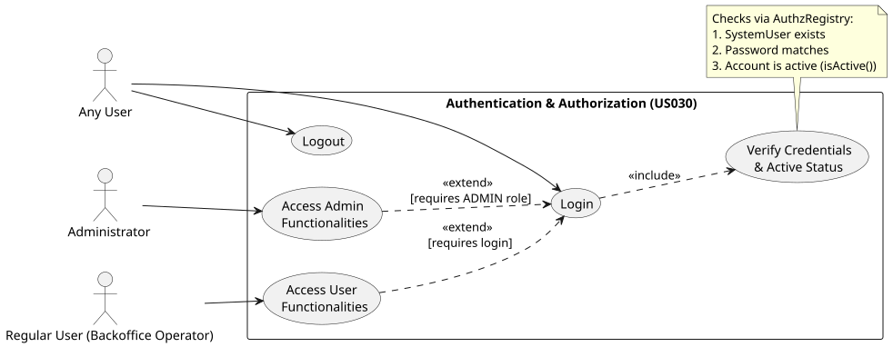
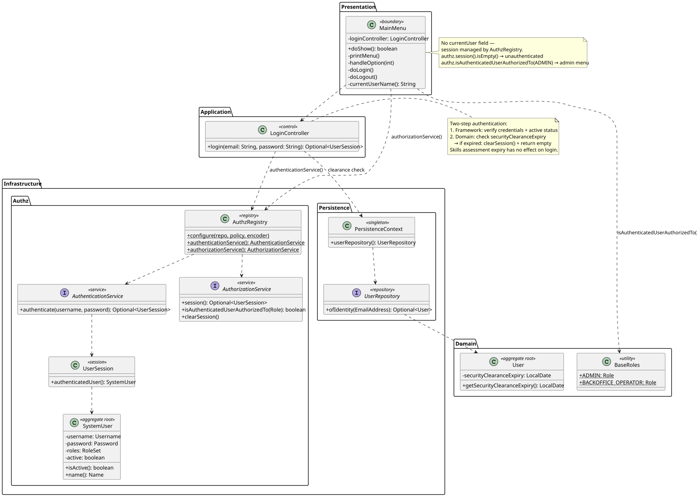
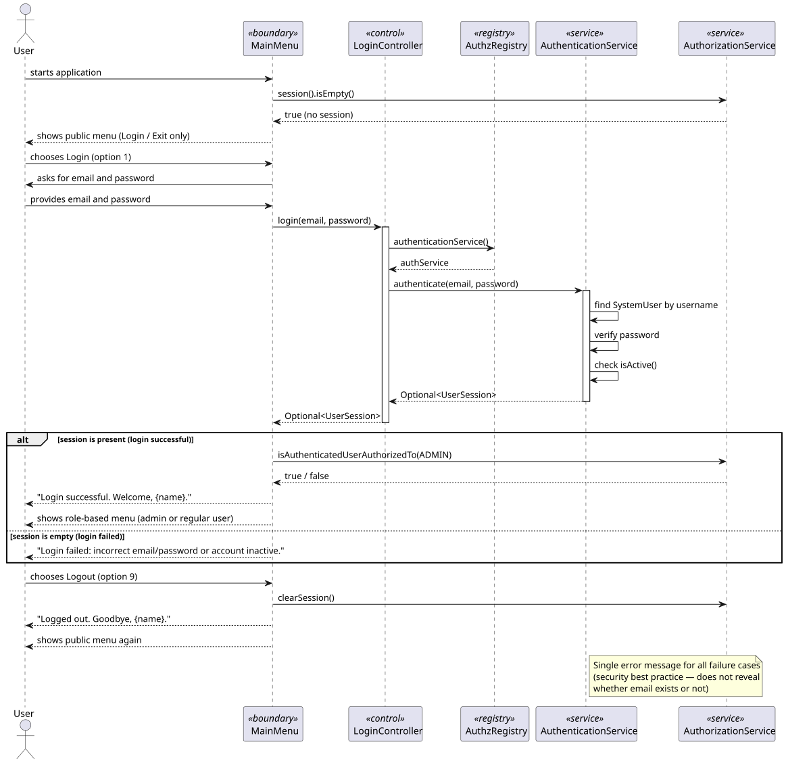

# US030 - Authentication and Authorization

## 1. Context

This User Story is being developed for the first time in Sprint 2. It is a foundational requirement for the entire system, as all other functionalities depend on it. Without authentication and authorization, no user can securely access the system.

This US is mandatory for all team sizes and must be implemented before (or in parallel with) any other US that requires a logged-in user (US031, US032, US033, US050, US052, etc.).

### 1.1 List of Issues

Analysis: Study the EAPLI Framework's built-in authentication/authorization mechanisms; identify roles needed for Sprint 2 (Admin, BackofficeOperator, WeatherPerson, Pilot, FlightControlOperator, AirTransportCompanyCollaborator).

Design: Define the role hierarchy and access control rules; design the login flow using the EAPLI Framework.

Implement: Configure the EAPLI Framework's authentication module; define system roles as an enum or equivalent; protect all use cases with role-based authorization checks.

Test: Verify that unauthenticated users cannot access protected features; verify that each role can only access its permitted functionalities.

---

## 2. Requirements

**US030** As a Project Manager, I want the system to support and apply authentication and authorization for all its users and functionalities.

**Acceptance Criteria:**

- US030.1 — The system must require users to authenticate (login with valid credentials) before accessing any functionality.
- US030.2 — Each user must be associated with a role that defines what actions they are permitted to perform.
- US030.3 — The system must reject unauthorized access attempts, returning an appropriate error/message.
- US030.4 — Roles defined in the system must at minimum cover: Admin, BackofficeOperator, WeatherPerson, Pilot, FlightControlOperator, and AirTransportCompanyCollaborator.
- US030.5 — Sessions must be properly managed (login/logout).

**Dependencies/References:**

- This US is a prerequisite for all other USs that involve user interaction (US031, US032, US033, US041, US050, US052, US055, US056, US060, US061, US070, US075, US080, US085, US100, etc.).
- The EAPLI Framework already provides base classes and interfaces for authentication (`AuthenticationService`, `AuthorizationService`) that must be used and configured.
- NFR09 explicitly mandates authentication and authorization throughout the system.
- NFR10 mandates Java as the implementation language.

---

## 3. Analysis

### 3.1 Domain Understanding

The system has multiple actors with distinct responsibilities:

| Role | Responsibilities |
|---|---|
| Admin | Manage users (register, enable, disable) |
| BackofficeOperator | Register airports, aircraft models, air control areas, companies, collaborators |
| WeatherPerson | Register and import weather data |
| Pilot | Create and test flight plans |
| FlightControlOperator | Simulate flights and air control |
| AirTransportCompanyCollaborator | Manage company fleet, routes, and pilots |

### 3.2 EAPLI Framework Analysis

The EAPLI Framework provides:

- `SystemUser` — the base entity for any user of the system. Contains username (email), password, and roles.
- `Role` — represents a system role. Should be implemented as a type-safe enum-like structure using `ValueObject`.
- `AuthenticationService` — handles login and session management.
- `AuthorizationService` — checks whether the current user has a given role/permission.
- `UserSession` — holds the currently authenticated user's information.

The framework follows the **Infrastructure Layer** pattern, meaning authentication/authorization is cross-cutting and must be configured at application startup.

### 3.3 Role Design

Roles should be defined as constants (e.g., in a `Roles` class using the EAPLI framework's `Role` type), so they can be referenced throughout the application layer:

```
Roles.ADMIN
Roles.BACKOFFICE_OPERATOR
Roles.WEATHER_PERSON
Roles.PILOT
Roles.FLIGHT_CONTROL_OPERATOR
Roles.AIR_TRANSPORT_COMPANY_COLLABORATOR
```

### 3.4 Use Case Diagram



---

## 4. Design

The design for this functionality follows the EAPLI Framework's standard for Authentication and Authorization, leveraging the built-in security modules.

### 4.1. Design Decisions
- **Framework Integration**: The system uses `AuthzRegistry` to obtain an instance of `AuthenticationService`, ensuring a centralized point for security management.
- **Layered Architecture**: Follows the standard UI -> Controller -> Service pattern. The `LoginController` is a thin wrapper that delegates the credential verification to the framework's core.
- **Session Management**: Upon successful authentication, a `UserSession` is created and managed by the framework, containing the authenticated `SystemUser` and their roles.

### 4.2. Class Diagram (CD)


### 4.3. Sequence Diagram (SD)


### 4.4 Acceptance Tests

**Test 1:** Verifies that an unauthenticated user cannot access a protected use case.

**Refers to Acceptance Criteria:** US030.1, US030.3

```java
@Test(expected = UnauthorizedException.class)
public void ensureUnauthenticatedUserCannotAccessProtectedFeature() {
    // Arrange: no user is logged in
    authorizationService.clearSession();

    // Act: attempt to access a feature requiring ADMIN role
    SomeController controller = new SomeController(authorizationService);
    controller.doProtectedAction();

    // Assert: exception expected
}
```

**Test 2:** Verifies that a user with the wrong role is denied access.

**Refers to Acceptance Criteria:** US030.2, US030.3

```java
@Test(expected = UnauthorizedException.class)
public void ensureUserWithWrongRoleCannotAccessAdminFeature() {
    // Arrange: login as PILOT
    authorizationService.authenticateForTesting(pilotUser);

    // Act: attempt to access ADMIN-only feature
    AdminController controller = new AdminController(authorizationService);
    controller.registerUser(...);

    // Assert: exception expected
}
```

**Test 3:** Verifies that a user with the correct role can access a feature.

**Refers to Acceptance Criteria:** US030.2

```java
@Test
public void ensureAdminUserCanAccessAdminFeature() {
    // Arrange: login as ADMIN
    authorizationService.authenticateForTesting(adminUser);

    // Act
    AdminController controller = new AdminController(authorizationService);
    controller.registerUser(...);

    // Assert: no exception thrown
}
```

---

## 5. Implementation

> To be filled after implementation.

Key implementation notes:
- The `Roles` class should be placed in the `domain` module so it can be referenced from any layer.
- Each controller must call `authorizationService.ensureAuthenticatedUserHasAnyOf(...)` as the first statement.
- The bootstrap process (US031) must create at least one Admin user on first startup.
- Passwords must be stored hashed — use the `PasswordPolicy` and `PasswordEncoder` provided by the EAPLI Framework.

---

## 6. Integration/Demonstration

> To be filled after implementation.

- The authentication module integrates with every other use case controller.
- To demonstrate: attempt to access any menu option without logging in — the system should redirect to the login screen or display an error.
- To demonstrate role-based access: log in as a BackofficeOperator and verify that Admin-only options are not accessible.

---

## 7. Observations

- At the moment, the project specification states that a user has a single role. The design should, however, allow for multiple roles in the future (the EAPLI Framework already supports `Set<Role>`), as the specification hints this may change.
- The EAPLI Framework's `AuthenticationService` uses a credentials-based login; the UI layer must never store raw passwords.
- Security clearance and skills assessment (mentioned in section 3.1.1 of the specification) are additional domain attributes of `SystemUser` but are not part of this US's scope — they will be addressed in a later sprint or US.
