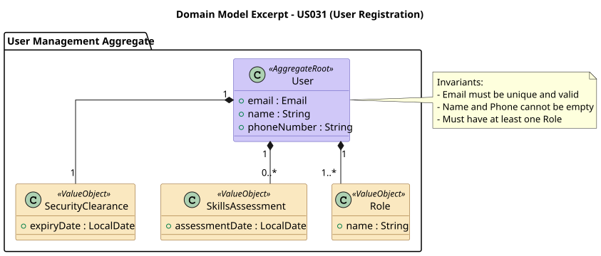
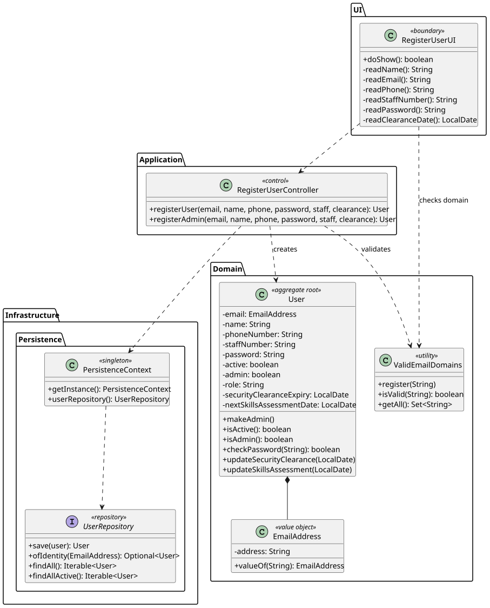
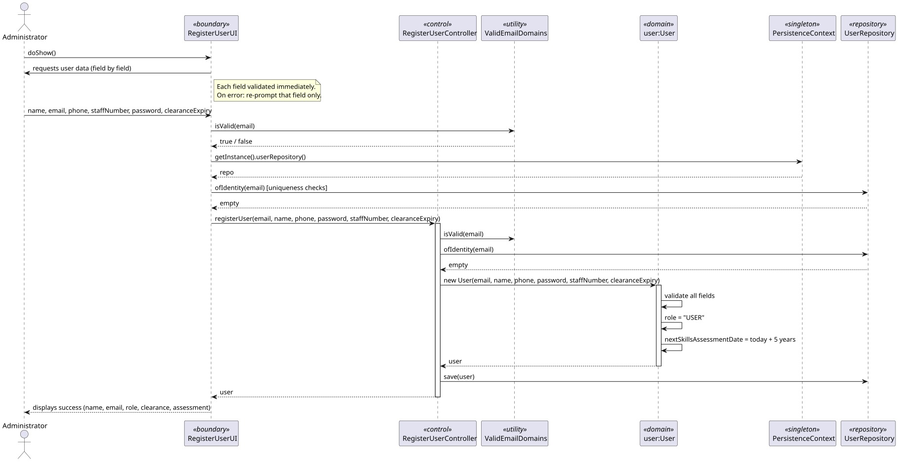

# US031 - Register Users

## 1. Context

This User Story is being developed for the first time in Sprint 2. It covers the ability for an Administrator to register new backoffice users in the system. It is also required to be achievable via a **bootstrap process**, meaning the system must be able to pre-populate at least one Admin user on first startup (without any manual interaction).

This US is closely tied to US030 (Authentication and Authorization) since the registered users must be assigned roles and must be able to log in to the system.

### 1.1 List of Issues

Analysis: Understand what constitutes a valid user in the system; identify mandatory fields (email, name, phone, role, password); understand the bootstrap requirement.

Design: Design the `RegisterUserController`, `SystemUser` aggregate, and `SystemUserRepository`; design the bootstrap process.

Implement: Implement the controller, UI, domain entity and repository; implement the bootstrap data loader.

Test: Test valid user registration; test duplicate email rejection; test invalid field formats; test bootstrap process creates the admin user.

---

## 2. Requirements

**US031** As Administrator, I want to be able to register users of the backoffice. This must also be achieved by a bootstrap process.

**Acceptance Criteria:**

- US031.1 — The administrator must be able to register a new user by providing: full name, email address (unique), phone number, role, and password.
- US031.2 — The email must be unique in the system — it is not possible to register two users with the same email.
- US031.3 — The email must follow a valid email format.
- US031.4 — The phone number must be in a valid format.
- US031.5 — A role must be assigned to the user at registration time.
- US031.6 — The user is created in an **active** state by default.
- US031.7 — The system must support a bootstrap process that creates at least one Admin user on first startup, without manual interaction.

**Dependencies/References:**

- Depends on **US030** (Authentication and Authorization) — the Admin must be logged in to perform this action; the registered users will use the auth system to log in.
- Required by **US032** (Disable/Enable Users) and **US033** (List Users) — users must exist before they can be managed.
- Required by **US061** (Add Customer Collaborator) — collaborators are also users.
- Referenced in the specification, section 3.1.1: "A user is identified by a unique valid email... A user also has a name and phone number."

---

## 3. Analysis

### 3.1 Domain Understanding

A **SystemUser** in the AISafe system is the base entity for any person who interacts with the system. Based on the specification (section 3.1.1), a user must have:

- A unique valid **email** (acts as the username/identifier)
- A **name**
- A **phone number**
- A **role** (e.g., Admin, BackofficeOperator, Pilot, etc.)
- An **active/inactive status**
- A **password** (stored securely/hashed)

Additionally, the specification mentions that users need an **active security clearance** (with expiry date) and periodic **skills assessment**, but these are not in scope for this US.

### 3.2 Email Domain Validation

The specification states that users are "identified by a unique valid email from the list of valid email domains." For Sprint 2, we will accept any valid email format. The domain restriction can be added later when the list of valid domains is defined.

### 3.3 Bootstrap Process

The bootstrap process must run on system startup and check if an Admin user already exists. If not, it creates a default Admin account. This is critical so the system can be used on first deployment. The EAPLI Framework provides a `DataBootstrapper` or similar interface for this purpose.

### 3.4 Domain Model (relevant excerpt)



---

## 4. Design

This US follows Domain-Driven Design (DDD) principles, using the Builder pattern to create the SystemUser aggregate.

### 4.1. Design Decisions
- **Builder Pattern**: We use `SystemUserBuilder` to encapsulate the complex creation of a `SystemUser`. This ensures that mandatory fields (email, name, roles) are present and that the `PasswordPolicy` is enforced before the object is instantiated.
- **Value Objects**: Attributes like `EmailAddress` and `PhoneNumber` are implemented as Value Objects to encapsulate specific validation logic (e.g., regex for email format).
- **Persistence**: The `UserManagementService` uses the `PersistenceContext` to access the `SystemUserRepository`, following the Repository pattern to decouple domain logic from database implementation.

### 4.2. Class Diagram (CD)


### 4.3. Sequence Diagram (SD)


### 4.4 Acceptance Tests

**Test 1:** Verifies that registering a user with valid data succeeds.

**Refers to Acceptance Criteria:** US031.1, US031.6

```java
@Test
public void ensureUserIsRegisteredWithValidData() {
    // Arrange
    RegisterUserController controller = new RegisterUserController(authService, userRepo);
    authService.authenticateForTesting(adminUser);

    // Act
    SystemUser user = controller.registerUser(
        "João Silva", "joao@aisafe.com", "+351912345678", Roles.BACKOFFICE_OPERATOR, "Secure@1234"
    );

    // Assert
    assertNotNull(user);
    assertTrue(user.isActive());
    assertEquals("joao@aisafe.com", user.email().toString());
}
```

**Test 2:** Verifies that registering a user with a duplicate email is rejected.

**Refers to Acceptance Criteria:** US031.2

```java
@Test(expected = IllegalStateException.class)
public void ensureDuplicateEmailIsRejected() {
    // Arrange
    authService.authenticateForTesting(adminUser);
    controller.registerUser("User One", "same@aisafe.com", "+351911111111", Roles.PILOT, "Pass@123");

    // Act: try to register another user with the same email
    controller.registerUser("User Two", "same@aisafe.com", "+351922222222", Roles.PILOT, "Pass@456");

    // Assert: exception expected
}
```

**Test 3:** Verifies that an invalid email format is rejected.

**Refers to Acceptance Criteria:** US031.3

```java
@Test(expected = IllegalArgumentException.class)
public void ensureInvalidEmailFormatIsRejected() {
    authService.authenticateForTesting(adminUser);
    controller.registerUser("Test User", "not-an-email", "+351912345678", Roles.PILOT, "Pass@123");
}
```

**Test 4:** Verifies that the bootstrap process creates an Admin user.

**Refers to Acceptance Criteria:** US031.7

```java
@Test
public void ensureBootstrapCreatesAdminUser() {
    // Arrange: clean repository
    userRepository.clear();

    // Act
    new AddUsersBootstrapper(userRepository, passwordEncoder).execute();

    // Assert
    Optional<SystemUser> admin = userRepository.findByEmail("admin@aisafe.com");
    assertTrue(admin.isPresent());
    assertTrue(admin.get().hasRole(Roles.ADMIN));
}
```

---

## 5. Implementation

> To be filled after implementation.

Key notes:
- The `SystemUser` aggregate should enforce its own invariants in the constructor (e.g., email cannot be null, name cannot be blank).
- `EmailAddress` and `PhoneNumber` should be Value Objects that validate format in their constructors.
- The repository must enforce the uniqueness of `email` at the database level (unique constraint) and at the domain level (check before save).
- The bootstrap class must be registered in the application's startup sequence.

---

## 6. Integration/Demonstration

> To be filled after implementation.

- To demonstrate: log in as Admin → navigate to "Manage Users" → "Register User" → fill in the form → confirm the user appears in the user list (US033).
- Bootstrap: on a clean database startup, verify the default Admin user is created and can be used to log in.

---

## 7. Observations

- The specification states that in the future a user may have multiple roles. The `Set<Role>` design already supports this without code changes.
- Password policy (minimum length, complexity) should be defined and enforced through the EAPLI Framework's `PasswordPolicy`.
- The security clearance and skills assessment fields mentioned in the specification (section 3.1.1) will be implemented in a future sprint — the domain model should leave room for these fields.
