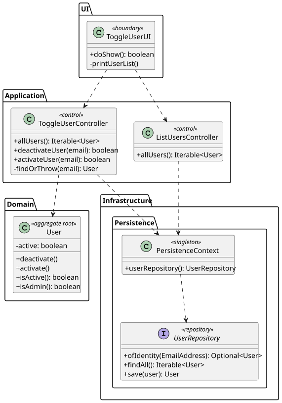

# US032 - Disable/Enable Users

## 1. Context

This User Story is being developed for the first time in Sprint 2. It allows an Administrator to disable or re-enable a backoffice user account. A disabled user cannot authenticate or use the system, but their data is preserved in the database (no deletion).

This US is marked as **mandatory** for teams of 5 EAPLI students (our case) and as extra for smaller teams.

### 1.1 List of Issues

Analysis: Understand what "disabled" means in the domain context; clarify whether disabling a user affects any ongoing operations (e.g., flight plans assigned to that user).

Design: Design the `EnableDisableUserController`, the `SystemUser` state change logic, and the UI flow.

Implement: Implement the enable/disable toggle in the controller and domain entity; ensure disabled users are rejected at login.

Test: Test disabling an active user; test enabling an inactive user; test that a disabled user cannot log in; test that the Admin cannot disable themselves.

---

## 2. Requirements

**US032** As Administrator, I want to be able to disable/enable users of the backoffice.

**Acceptance Criteria:**

- US032.1 — The administrator must be able to disable an active user account.
- US032.2 — The administrator must be able to re-enable a previously disabled user account.
- US032.3 — A disabled user must not be able to authenticate (log in) to the system.
- US032.4 — Disabling a user must **not** delete the user or their data.
- US032.5 — The administrator must not be able to disable their own account.
- US032.6 — If a user is already disabled, attempting to disable them again should be rejected (and vice versa for enabling).

**Dependencies/References:**

- Depends on **US030** (Authentication and Authorization) — only an authenticated Admin can perform this action.
- Depends on **US031** (Register Users) — a user must exist before they can be disabled/enabled.
- Related to **US033** (List Users) — the user list shows each user's status, and this action changes that status.
- Related to **US064** (Disable Customer Collaborator) — similar pattern applied to collaborators.

---

## 3. Analysis

### 3.1 Domain Understanding

The `active` flag on a `SystemUser` entity represents whether the account is enabled. The business rules are:

- An active user (`active = true`) can log in.
- An inactive/disabled user (`active = false`) cannot log in — the `AuthenticationService` must check this flag.
- The state change is reversible (disable → enable → disable, etc.).
- An admin should not be able to self-disable, as it would lock out the only (or all) admin accounts.

### 3.2 State Machine

```
[active] ---(Admin disables)---> [inactive]
[inactive] ---(Admin enables)---> [active]
```

This is a simple two-state toggle. The transition should be guarded:
- From `active` to `inactive`: only if the user is not the currently logged-in Admin.
- From `inactive` to `active`: always allowed.

### 3.3 Impact on Authentication

The EAPLI Framework's `AuthenticationService.authenticate()` must verify that the user is active before granting access. If the user is disabled, authentication fails with a clear error message ("Account is disabled").

---

## 4. Design

The design focuses on state management within the `SystemUser` aggregate, adhering to the principle of Information Expert.

### 4.1. Design Decisions
- **Dual update**: Toggling a user's status requires updating both the EAPLI Framework's `SystemUser` (via `UserManagementService`) and the domain `User` (via `UserRepository`). The framework update is what prevents/allows login; the domain update keeps the display status in sync.
- **Soft Delete**: No data is deleted — only the `active` flag is changed. This preserves referential integrity.
- **Guards at controller level**: Business rules (cannot disable admin, cannot disable already-inactive) are enforced in `ToggleUserController`, keeping the domain `User.deactivate()` and `User.activate()` methods simple and guard-free.
- **Admin check via role**: The domain `User` does not have an `isAdmin()` method — admin status is checked via `user.getRole().equals("ADMIN")`.

### 4.2. Class Diagram (CD)


### 4.3. Sequence Diagram (SD)


### 4.4 Acceptance Tests

**Test 1:** Verifies that a deactivated domain user is inactive.

**Refers to Acceptance Criteria:** US032.1, US032.4

```java
@Test
void ensureDeactivatedDomainUserIsInactive() {
    // Arrange
    final User u = new User(EmailAddress.valueOf("d@alsafe.com"),
            "D User", "910000001", "S-300", LocalDate.now().plusYears(2));
    // Act
    u.deactivate();
    // Assert
    assertFalse(u.isActive());
}
```

**Test 2:** Verifies that a reactivated user is active.

**Refers to Acceptance Criteria:** US032.2

```java
@Test
void ensureReactivatedDomainUserIsActive() {
    // Arrange
    final User u = new User(EmailAddress.valueOf("r@alsafe.com"),
            "R User", "910000001", "S-301", LocalDate.now().plusYears(2));
    u.deactivate();
    // Act
    u.activate();
    // Assert
    assertTrue(u.isActive());
}
```

**Test 3:** Verifies that admin account cannot be deactivated.

**Refers to Acceptance Criteria:** US032.5

```java
@Test
void ensureToggleRejectsDeactivatingAdminRole() {
    // Arrange
    final User admin = new User(EmailAddress.valueOf("admin2@alsafe.com"),
            "Admin2", "910000000", "S-ADM2", LocalDate.now().plusYears(10));
    admin.markAsAdmin();
    repo.save(admin);
    // Act / Assert
    assertThrows(IllegalArgumentException.class, () ->
            new ToggleUserController().deactivateUser("admin2@alsafe.com"));
}
```

**Test 4:** Verifies that deactivating an already inactive user is rejected.

**Refers to Acceptance Criteria:** US032.6

```java
@Test
void ensureToggleRejectsDeactivatingAlreadyInactiveUser() {
    // Arrange
    final User u = new User(EmailAddress.valueOf("ai@alsafe.com"),
            "AI User", "910000001", "S-302", LocalDate.now().plusYears(2));
    u.deactivate();
    repo.save(u);
    // Act / Assert
    assertThrows(IllegalArgumentException.class, () ->
            new ToggleUserController().deactivateUser("ai@alsafe.com"));
}
```

**Test 5:** Verifies that activating an already active user is rejected.

**Refers to Acceptance Criteria:** US032.6

```java
@Test
void ensureToggleRejectsActivatingAlreadyActiveUser() {
    // Arrange
    repo.save(new User(EmailAddress.valueOf("aa@alsafe.com"),
            "AA User", "910000001", "S-303", LocalDate.now().plusYears(2)));
    // Act / Assert
    assertThrows(IllegalArgumentException.class, () ->
            new ToggleUserController().activateUser("aa@alsafe.com"));
}
```

---

## 5. Implementation

**`domain/User.java`**
- `deactivate()` sets `active = false`; `activate()` sets `active = true`. Simple state mirrors.
- No `isAdmin()` method — admin check is `user.getRole().equals("ADMIN")`.
- Guards are enforced at the controller level, not in the domain methods.

**`controller/ToggleUserController.java`**
- `deactivateUser(email)`: finds domain `User`, checks guards (not found / role==ADMIN / already inactive), then:
    1. Calls `AuthzRegistry.userService().deactivateUser(systemUser)` — the framework sets `SystemUser.active=false`, refusing future logins.
    2. Calls `domainUser.deactivate()` + `repo.save()` — keeps domain state in sync.
- `activateUser(email)`: same pattern with `activateUser()` and guard for already-active.
- `findSystemUser(email)`: iterates `AuthzRegistry.userService().allUsers()` matching by username.

**`ui/ToggleUserUI.java`**
- Shows full user list (via `ListUsersController`) then prompts for email and choice (1=Enable / 2=Disable).

**Authentication integration (US030)**
- After `UserManagementService.deactivateUser()`, the framework's `AuthenticationService.authenticate()` will return `Optional.empty()` for that user.
- This is the primary guard — our domain `User.active` is a display mirror.

## 6. Integration/Demonstration

1. Login as Admin → choose `2. Enable/Disable User`.
2. The full user list is displayed with current status (ACTIVE / INACTIVE).
3. Enter the email of an active user and choose `2. Disable` → confirmed.
4. Navigate to `3. List Users` → the user now shows `INACTIVE`.
5. Attempt to login as the disabled user → login is refused with "incorrect email/password or account inactive".
6. Return to `2. Enable/Disable User`, enter the same email, choose `1. Enable` → confirmed.
7. Login as that user → login succeeds.
8. Try to disable the admin account (`admin@alsafe.com`) → rejected: "The administrator account cannot be deactivated".
9. Try to disable an already inactive user → rejected: "User is already inactive".

## 7. Observations

- Soft-delete (disable) is preferable to hard-delete in enterprise systems, as it preserves audit trails and referential integrity (e.g., flight plans assigned to a disabled pilot remain intact).
- Future consideration: when disabling a collaborator (US064), a similar pattern applies. Code reuse should be considered — a shared `UserStatusService` could encapsulate the enable/disable logic.