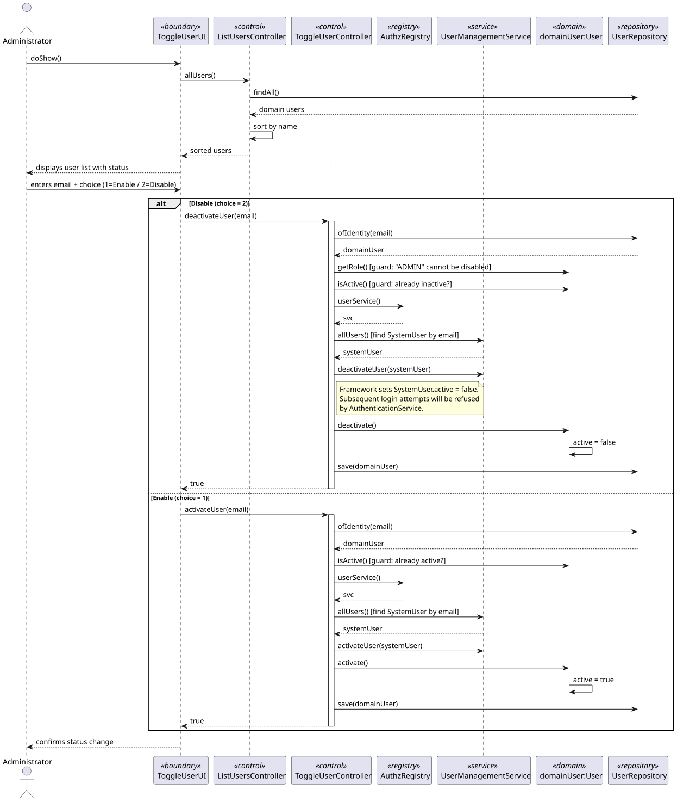

# US032 - Disable/Enable Users

## 1. Context

This User Story is being developed for the first time in Sprint 2. It allows an Administrator to disable or re-enable a backoffice user account. A disabled user cannot authenticate or use the system, but their data is preserved in the database (no deletion).

This US is marked as **mandatory** for teams of 5 EAPLI students (our case) and as extra for smaller teams.

### 1.1 List of Issues

Analysis: Understand what "disabled" means in the domain context; clarify whether disabling a user affects any ongoing operations (e.g., flight plans assigned to that user).

Design: Design the `EnableDisableUserController`, the `SystemUser` state change logic, and the UI flow.

Implement: Implement the enable/disable toggle in the controller and domain entity; ensure disabled users are rejected at login.

Test: Test disabling an active user; test enabling an inactive user; test that a disabled user cannot log in; test that the Admin cannot disable themselves.

---

## 2. Requirements

**US032** As Administrator, I want to be able to disable/enable users of the backoffice.

**Acceptance Criteria:**

- US032.1 — The administrator must be able to disable an active user account.
- US032.2 — The administrator must be able to re-enable a previously disabled user account.
- US032.3 — A disabled user must not be able to authenticate (log in) to the system.
- US032.4 — Disabling a user must **not** delete the user or their data.
- US032.5 — The administrator must not be able to disable their own account.
- US032.6 — If a user is already disabled, attempting to disable them again should be rejected (and vice versa for enabling).

**Dependencies/References:**

- Depends on **US030** (Authentication and Authorization) — only an authenticated Admin can perform this action.
- Depends on **US031** (Register Users) — a user must exist before they can be disabled/enabled.
- Related to **US033** (List Users) — the user list shows each user's status, and this action changes that status.
- Related to **US064** (Disable Customer Collaborator) — similar pattern applied to collaborators.

---

## 3. Analysis

### 3.1 Domain Understanding

The `active` flag on a `SystemUser` entity represents whether the account is enabled. The business rules are:

- An active user (`active = true`) can log in.
- An inactive/disabled user (`active = false`) cannot log in — the `AuthenticationService` must check this flag.
- The state change is reversible (disable → enable → disable, etc.).
- An admin should not be able to self-disable, as it would lock out the only (or all) admin accounts.

### 3.2 State Machine

```
[active] ---(Admin disables)---> [inactive]
[inactive] ---(Admin enables)---> [active]
```

This is a simple two-state toggle. The transition should be guarded:
- From `active` to `inactive`: only if the user is not the currently logged-in Admin.
- From `inactive` to `active`: always allowed.

### 3.3 Impact on Authentication

The EAPLI Framework's `AuthenticationService.authenticate()` must verify that the user is active before granting access. If the user is disabled, authentication fails with a clear error message ("Account is disabled").

---

## 4. Design

The design focuses on state management within the `SystemUser` aggregate, adhering to the principle of Information Expert.

### 4.1. Design Decisions
- **Information Expert**: The `SystemUser` entity is responsible for changing its own status (`active` flag) and recording the timestamp of the deactivation.
- **Soft Delete**: Instead of removing users from the database, the system implements a "soft delete" by deactivating them. This preserves referential integrity for historical data (e.g., logs, past operations).
- **Authorization Service**: The controller checks if the current user has the "ADMIN" role before allowing the status toggle.

### 4.2. Class Diagram (CD)


### 4.3. Sequence Diagram (SD)


### 4.4 Acceptance Tests

**Test 1:** Verifies that an active user can be disabled.

**Refers to Acceptance Criteria:** US032.1, US032.4

```java
@Test
public void ensureActiveUserCanBeDisabled() {
    // Arrange
    authService.authenticateForTesting(adminUser);
    SystemUser target = userRepository.findByEmail("user@aisafe.com").get();
    assertTrue(target.isActive());

    // Act
    controller.disableUser(target.email());

    // Assert
    SystemUser updated = userRepository.findByEmail("user@aisafe.com").get();
    assertFalse(updated.isActive());
}
```

**Test 2:** Verifies that a disabled user can be re-enabled.

**Refers to Acceptance Criteria:** US032.2

```java
@Test
public void ensureDisabledUserCanBeEnabled() {
    // Arrange
    authService.authenticateForTesting(adminUser);
    controller.disableUser(targetUser.email());

    // Act
    controller.enableUser(targetUser.email());

    // Assert
    SystemUser updated = userRepository.findByEmail(targetUser.email().toString()).get();
    assertTrue(updated.isActive());
}
```

**Test 3:** Verifies that a disabled user cannot log in.

**Refers to Acceptance Criteria:** US032.3

```java
@Test(expected = AuthenticationFailedException.class)
public void ensureDisabledUserCannotLogin() {
    // Arrange
    authService.authenticateForTesting(adminUser);
    controller.disableUser(targetUser.email());

    // Act: attempt login as disabled user
    authenticationService.authenticate(
        targetUser.email().toString(), "password", new Role[]{Roles.BACKOFFICE_OPERATOR}
    );

    // Assert: exception expected
}
```

**Test 4:** Verifies that the administrator cannot disable themselves.

**Refers to Acceptance Criteria:** US032.5

```java
@Test(expected = IllegalArgumentException.class)
public void ensureAdminCannotDisableThemselves() {
    // Arrange
    authService.authenticateForTesting(adminUser);

    // Act: try to disable own account
    controller.disableUser(adminUser.email());

    // Assert: exception expected
}
```

**Test 5:** Verifies that disabling an already inactive user is rejected.

**Refers to Acceptance Criteria:** US032.6

```java
@Test(expected = IllegalStateException.class)
public void ensureAlreadyDisabledUserCannotBeDisabledAgain() {
    // Arrange
    authService.authenticateForTesting(adminUser);
    controller.disableUser(targetUser.email());

    // Act: disable again
    controller.disableUser(targetUser.email());

    // Assert: exception expected
}
```

---

## 5. Implementation

> To be filled after implementation.

Key notes:
- The `disable()` and `enable()` methods on `SystemUser` must guard their own state transitions, throwing `IllegalStateException` if called in an invalid state.
- The controller must check that the target user is not the currently authenticated user before allowing disable.
- The `AuthenticationService` must check `user.isActive()` during login.

---

## 6. Integration/Demonstration

> To be filled after implementation.

- To demonstrate: log in as Admin → navigate to user list (US033) → select a user → choose "Disable" → confirm the user's status changes → attempt to log in as that user → confirm login is rejected.
- Re-enable: same flow but choose "Enable" and confirm login is restored.

---

## 7. Observations

- Soft-delete (disable) is preferable to hard-delete in enterprise systems, as it preserves audit trails and referential integrity (e.g., flight plans assigned to a disabled pilot remain intact).
- Future consideration: when disabling a collaborator (US064), a similar pattern applies. Code reuse should be considered — a shared `UserStatusService` could encapsulate the enable/disable logic.
