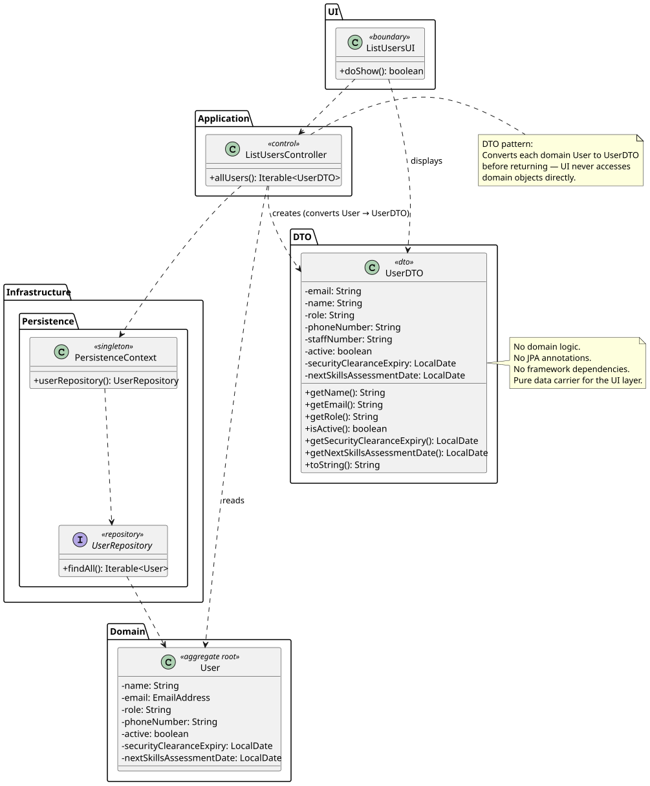
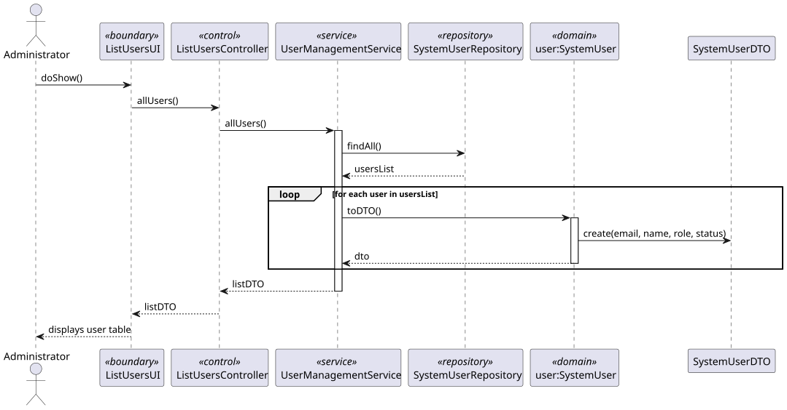

# US033 - List Users

## 1. Context

This User Story is being developed for the first time in Sprint 2. It allows an Administrator to view a list of all backoffice users registered in the system, along with their current status (active/inactive). This is a read-only query operation and does not modify any data.

This US is marked as **mandatory** for teams of 5 EAPLI students (our case) and as extra for smaller teams.

### 1.1 List of Issues

Analysis: Define what information should be displayed per user (email, name, role(s), status); understand whether disabled users should be visible in the list.

Design: Design the `ListUsersController` as a simple query; define the DTO or projection for displaying user data.

Implement: Implement the controller and UI; ensure the repository supports fetching all users.

Test: Test that the list returns all users; test that status is correctly reflected; test that filtering by status works (if applicable).

---

## 2. Requirements

**US033** As Administrator, I want to be able to list the users of the backoffice, including their status.

**Acceptance Criteria:**

- US033.1 — The administrator must be able to view a list of all backoffice users registered in the system.
- US033.2 — Each entry in the list must display at minimum: full name, email, role(s), and current status (active/inactive).
- US033.3 — Both active and inactive users must appear in the list (the status must be shown).
- US033.4 — The list must be sorted in a consistent and useful manner (e.g., alphabetically by name, or by email).
- US033.5 — Only an authenticated Administrator can access this list.

**Dependencies/References:**

- Depends on **US030** (Authentication and Authorization) — only an authenticated Admin can view the user list.
- Depends on **US031** (Register Users) — users must exist to be listed.
- Related to **US032** (Disable/Enable Users) — this list is the natural starting point for disabling/enabling a user.
- Related to **US062** (List Customer Collaborators) — similar pattern for collaborators.

---

## 3. Analysis

### 3.1 Domain Understanding

This is a simple **query use case** (read-only). The goal is to display a summary of all `SystemUser` entities so the Admin can see who has access to the system and their current state.

The specification (section 3.1.1) confirms that users have: email, name, phone number, and role(s). The status (active/inactive) is an operational flag derived from US032.

### 3.2 Data to Display

For each user in the list, the following should be shown:

| Field | Source |
|---|---|
| Full Name | `SystemUser.name` |
| Email | `SystemUser.email` |
| Role(s) | `SystemUser.roles` |
| Status | `SystemUser.isActive()` → "Active" / "Inactive" |

### 3.3 Design Pattern: Query vs Command

This US is a **Query** (no side effects), which follows the CQS (Command-Query Separation) principle. The controller only reads data and returns it to the UI — no writes are performed.

In the EAPLI Framework, this is typically handled by a lightweight controller that calls the repository directly (since no domain logic needs to be enforced for a read).

---

## 4. Design

This US implements a read-only query pattern using Data Transfer Objects (DTO) to decouple the UI from the Domain Layer.

### 4.1. Design Decisions
- **DTO Pattern**: We use `SystemUserDTO` to transfer data from the `UserManagementService` to the `ListUsersUI`. This prevents the UI from having direct access to domain methods and protects the internal state of the `SystemUser` aggregate.
- **Clean Architecture**: The `ListUsersController` does not contain business logic; it merely coordinates the data flow between the service and the presentation layer.
- **Single Responsibility**: The `SystemUser` aggregate provides a `toDTO()` method to handle its own transformation into a displayable format.

### 4.2. Class Diagram (CD)


### 4.3. Sequence Diagram (SD)


### 4.4 Acceptance Tests

**Test 1:** Verifies that the list returns all registered users.

**Refers to Acceptance Criteria:** US033.1, US033.3

```java
@Test
public void ensureAllUsersAreListedIncludingInactive() {
    // Arrange
    authService.authenticateForTesting(adminUser);
    // Pre-populate: 2 active, 1 inactive
    userRepository.save(activeUser1);
    userRepository.save(activeUser2);
    userRepository.save(inactiveUser);

    // Act
    Iterable<SystemUser> result = controller.allUsers();

    // Assert
    long count = StreamSupport.stream(result.spliterator(), false).count();
    assertEquals(3, count);
}
```

**Test 2:** Verifies that user status is correctly reflected in the list.

**Refers to Acceptance Criteria:** US033.2, US033.3

```java
@Test
public void ensureUserStatusIsCorrectlyReported() {
    // Arrange
    authService.authenticateForTesting(adminUser);
    userRepository.save(activeUser);
    userRepository.save(inactiveUser);

    // Act
    Iterable<SystemUser> result = controller.allUsers();

    // Assert
    List<SystemUser> users = StreamSupport.stream(result.spliterator(), false)
            .collect(Collectors.toList());

    assertTrue(users.stream().anyMatch(u -> u.email().equals(activeUser.email()) && u.isActive()));
    assertTrue(users.stream().anyMatch(u -> u.email().equals(inactiveUser.email()) && !u.isActive()));
}
```

**Test 3:** Verifies that a non-Admin user cannot list users.

**Refers to Acceptance Criteria:** US033.5

```java
@Test(expected = UnauthorizedException.class)
public void ensureNonAdminCannotListUsers() {
    // Arrange: log in as BackofficeOperator
    authService.authenticateForTesting(backofficeOperatorUser);

    // Act
    controller.allUsers();

    // Assert: exception expected
}
```

**Test 4:** Verifies that the list is empty when no users are registered (edge case).

**Refers to Acceptance Criteria:** US033.1

```java
@Test
public void ensureEmptyListIsReturnedWhenNoUsersExist() {
    // Arrange
    authService.authenticateForTesting(adminUser);
    userRepository.clear();

    // Act
    Iterable<SystemUser> result = controller.allUsers();

    // Assert
    assertFalse(result.iterator().hasNext());
}
```

---

## 5. Implementation

This is a read-only query use case. The implementation is intentionally minimal — no domain logic is executed, only a repository fetch followed by a sort.

**`controller/ListUsersController.java`**
- Calls `repo.findAll()` to retrieve all users (active and inactive).
- Sorts the result alphabetically by name using `Comparator.comparing(User::getName, String.CASE_INSENSITIVE_ORDER)` (US033.4).
- Returns a standard `Iterable<User>` — no DTO transformation, keeping the implementation simple.

**`ui/ListUsersUI.java`**
- Renders a formatted table with columns: Name, Email, Role, Phone, Status, Clearance Expiry, Next Assessment.
- Both active (`ACTIVE`) and inactive (`INACTIVE`) users are shown in the same list (US033.3).
- A summary line at the bottom shows: total users, active count, inactive count.

**Access control (US033.5)**
- The list option is only available in the admin menu (after login as Administrator).
- A regular user session does not expose this option.

## 6. Integration/Demonstration

1. Login as Admin → choose `3. List Users`.
2. The table displays all registered users sorted alphabetically by name.
3. Columns shown: Name | Email | Role | Phone | Status | Clearance Expiry | Next Assessment.
4. Register a new user (US031) → return to the list → the new user appears in the correct alphabetical position.
5. Disable a user (US032) → return to the list → the user status changes from `ACTIVE` to `INACTIVE`.
6. Re-enable the user → the status returns to `ACTIVE`.
7. Logout and login as a regular user → option `3. List Users` is not available.

## 7. Observations

- This US, while simple, is architecturally important as it sets the pattern for all future list/query use cases in the system (US062, US072, US076, etc.). A consistent approach (controller → repository → UI display) will make future list views faster to implement.
- If the system grows to have many users, pagination should be considered in a future sprint. For now, a simple full list is acceptable.
- The relationship between this US and US032 suggests that the UI could combine both: the list screen shows users and allows the Admin to select one and toggle their status inline or via a sub-menu.