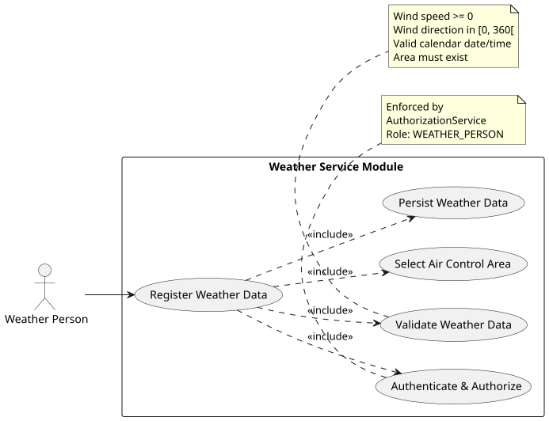
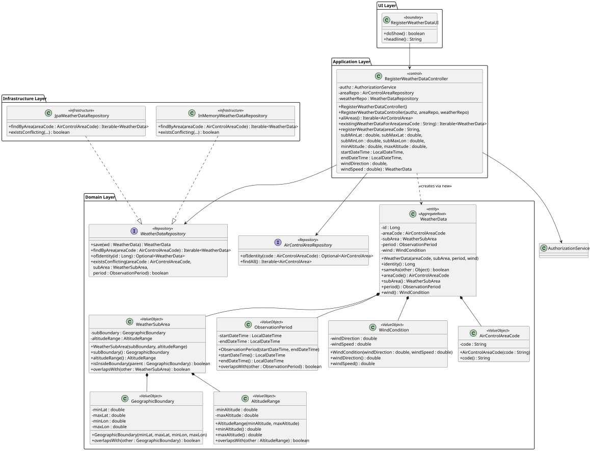
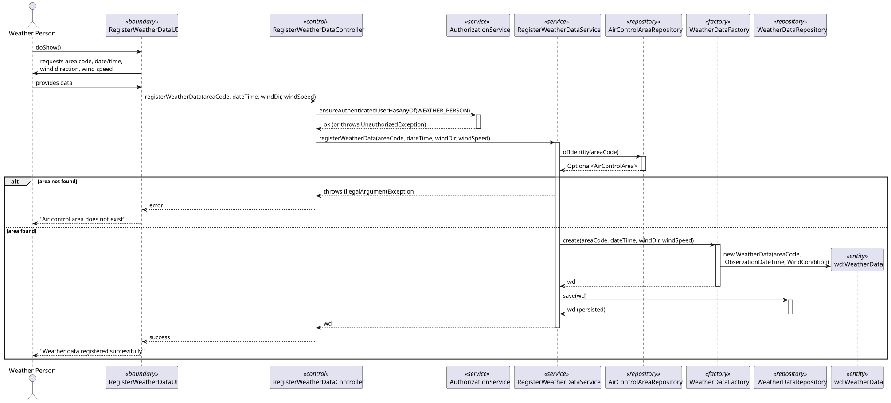

# US041 - Register Weather Data

## 1. Context

This User Story is being developed for the first time in Sprint 2. It represents a core domain feature of the Weather Service module, enabling Weather Persons to introduce weather data into the system for a specific air control area.

This US depends on US030 (Authentication and Authorization) being in place, as only authenticated users with the `WeatherPerson` role may register weather data. It also depends on US050 (Register an Air Control Area), since weather data must be associated with an existing air control area.

### 1.1 List of Issues

Analysis: Understand the domain concept of weather data and its relationship with air control areas; identify the attributes required for a weather data entry (area, date/time, conditions, etc.); clarify what constitutes a valid registration.

Design: Define the `WeatherData` aggregate root and its value objects; design the `WeatherDataRepository` interface; design the `RegisterWeatherDataController` and `RegisterWeatherDataService` following the layered architecture pattern.

Implement: Create the `WeatherData` aggregate in the domain layer; implement the repository using JPA/ORM; implement the application service and controller; protect the use case with role-based authorization (`WeatherPerson`).

Test: Verify that valid weather data is correctly persisted; verify that invalid or incomplete data is rejected; verify that only users with the `WeatherPerson` role can register weather data.

---

## 2. Requirements

**US041** As a Weather Person, I want to register weather data in the system for a specific air control area.

**Acceptance Criteria:**

- US041.1 — The system must allow a Weather Person to register weather data associated with a specific, existing air control area.
- US041.2 — The weather data must include at least: the target air control area, the date/time of observation, wind direction (angle relative to North, in degrees), and wind speed (in m/s).
- US041.3 — Wind speed must be a non-negative numeric value.
- US041.4 — Wind direction must be a valid angle between 0 and 360 degrees (exclusive of 360).
- US041.5 — The observation date/time must represent a valid calendar value.
- US041.6 — The system must reject registrations that reference a non-existent air control area.
- US041.7 — Only authenticated users with the `WeatherPerson` role may perform this operation.

**Dependencies/References:**

- Depends on US030 (Authentication and Authorization) — the use case must be protected by role-based access control.
- Depends on US050 (Register an Air Control Area) — weather data must be linked to an existing area.
- Weather data registered here may later be consumed by US043 (Consult Weather Data), US082 (Insert Weather Data in a Flight), and US110 (Integrate Environmental Influences into Simulation).
- NFR09 mandates authentication and authorization throughout the system.
- NFR10 mandates Java as the implementation language.
- NFR08 mandates that persistence must work both in-memory and with a relational database.

---

## 3. Analysis

### 3.1 Domain Understanding

Weather data in the AISafe system is used to enrich flight simulations and support flight plan validation. Each piece of weather data is scoped to a specific air control area and a specific point in time, allowing the system to retrieve contextually relevant conditions for a given area on a given day.

The main attributes of a weather data record, as derived from section 3.2 of the specification (Segment definition), are:

| Attribute | Description |
|---|---|
| Air Control Area | The area to which this weather observation applies |
| Observation Date/Time | The moment to which this data refers |
| Wind Direction | Angle relative to North, in degrees (0–359) |
| Wind Speed | Speed in m/s (non-negative) |

The `WeatherPerson` is the sole actor responsible for registering weather data. Their identity and permissions are managed via US030.

### 3.2 Domain-Driven Design Analysis

Following DDD principles:

- **`WeatherData`** is the **Aggregate Root** of this aggregate. It encapsulates the observation and enforces its own invariants (valid area reference, valid date/time, valid wind values).
- **`AirControlAreaCode`** is a **Value Object** used as a reference to the `AirControlArea` aggregate — weather data holds a reference by identity (code), not by object composition, respecting aggregate boundary rules.
- **`WindCondition`** is a **Value Object** encapsulating wind direction and speed, ensuring that both are validated together and that the concept is reusable.
- **`ObservationDateTime`** is a **Value Object** wrapping the date/time of the observation, enforcing format and calendar validity.
- **`WeatherDataRepository`** is the **Repository** interface defined in the domain layer; its JPA implementation resides in the infrastructure layer.

### 3.3 Use Case Diagram



---

## 4. Design

The design for this functionality follows the standard EAPLI layered architecture: UI → Controller → Service → Domain/Repository.

### 4.1. Design Decisions

- **Aggregate Boundary**: `WeatherData` is its own aggregate root. It references `AirControlArea` by its code (a Value Object identifier) rather than holding a direct object reference, preserving aggregate independence and avoiding cross-aggregate object graph loading.
- **Value Object for Wind**: Wind direction and speed are grouped into a `WindCondition` value object. This ensures that both values are always validated together and makes the concept explicit in the domain model.
- **Factory**: A `WeatherDataFactory` is responsible for instantiating `WeatherData`, validating preconditions and building value objects before delegating to the aggregate constructor. This follows the Factory pattern and keeps the constructor clean.
- **Service Layer**: The `RegisterWeatherDataService` (application service) orchestrates the operation: it verifies the existence of the referenced air control area via `AirControlAreaRepository`, calls the factory, and persists the result via `WeatherDataRepository`. This keeps the controller thin.
- **Authorization**: The `RegisterWeatherDataController` calls `authorizationService.ensureAuthenticatedUserHasAnyOf(Roles.WEATHER_PERSON)` as its first statement, before any domain logic is executed.

### 4.2. Class Diagram (CD)



### 4.3. Sequence Diagram (SD)



### 4.4 Acceptance Tests

**Test 1:** Verifies that a Weather Person can successfully register valid weather data.

**Refers to Acceptance Criteria:** US041.1, US041.2

```java
@Test
public void ensureWeatherPersonCanRegisterValidWeatherData() {
    // Arrange
    authorizationService.authenticateForTesting(weatherPersonUser);
    AirControlAreaCode areaCode = new AirControlAreaCode("AREA01");
    when(airControlAreaRepository.ofIdentity(areaCode)).thenReturn(Optional.of(mockArea));

    RegisterWeatherDataController controller =
        new RegisterWeatherDataController(authorizationService, registerWeatherDataService);

    // Act
    WeatherData result = controller.registerWeatherData(
        "AREA01",
        LocalDateTime.of(2026, 5, 1, 12, 0),
        45.0,
        10.5
    );

    // Assert
    assertNotNull(result);
}
```

**Test 2:** Verifies that weather data with an invalid wind speed (negative) is rejected.

**Refers to Acceptance Criteria:** US041.3

```java
@Test(expected = IllegalArgumentException.class)
public void ensureNegativeWindSpeedIsRejected() {
    // Arrange
    authorizationService.authenticateForTesting(weatherPersonUser);

    // Act: negative wind speed
    new WindCondition(90.0, -5.0);

    // Assert: exception expected
}
```

**Test 3:** Verifies that weather data with an invalid wind direction is rejected.

**Refers to Acceptance Criteria:** US041.4

```java
@Test(expected = IllegalArgumentException.class)
public void ensureWindDirectionOutOfRangeIsRejected() {
    // Arrange
    authorizationService.authenticateForTesting(weatherPersonUser);

    // Act: wind direction >= 360 is invalid
    new WindCondition(360.0, 10.0);

    // Assert: exception expected
}
```

**Test 4:** Verifies that registering weather data for a non-existent air control area is rejected.

**Refers to Acceptance Criteria:** US041.6

```java
@Test(expected = IllegalArgumentException.class)
public void ensureRegistrationFailsForNonExistentArea() {
    // Arrange
    authorizationService.authenticateForTesting(weatherPersonUser);
    when(airControlAreaRepository.ofIdentity(any())).thenReturn(Optional.empty());

    RegisterWeatherDataController controller =
        new RegisterWeatherDataController(authorizationService, registerWeatherDataService);

    // Act
    controller.registerWeatherData(
        "NONEXISTENT",
        LocalDateTime.of(2026, 5, 1, 12, 0),
        90.0,
        8.0
    );

    // Assert: exception expected
}
```

**Test 5:** Verifies that a user without the WeatherPerson role cannot register weather data.

**Refers to Acceptance Criteria:** US041.7

```java
@Test(expected = UnauthorizedException.class)
public void ensureNonWeatherPersonCannotRegisterWeatherData() {
    // Arrange: logged in as a Pilot
    authorizationService.authenticateForTesting(pilotUser);

    RegisterWeatherDataController controller =
        new RegisterWeatherDataController(authorizationService, registerWeatherDataService);

    // Act
    controller.registerWeatherData(
        "AREA01",
        LocalDateTime.of(2026, 5, 1, 12, 0),
        180.0,
        15.0
    );

    // Assert: exception expected
}
```

---

## 5. Implementation

> To be filled after implementation.

Key implementation notes:
- `WeatherData` must extend `AggregateRoot<WeatherDataId>`, where `WeatherDataId` is a generated identity (e.g., auto-incremented long or UUID).
- `WindCondition` and `ObservationDateTime` must implement `ValueObject` and be annotated with `@Embeddable` for JPA mapping.
- `WeatherDataRepository` must extend the EAPLI `Repository` interface and have a JPA implementation in the infrastructure layer.
- `RegisterWeatherDataService` must verify that the referenced `AirControlAreaCode` corresponds to an existing area before delegating to the factory.
- The `RegisterWeatherDataController` must call `authorizationService.ensureAuthenticatedUserHasAnyOf(Roles.WEATHER_PERSON)` as its very first statement.
- The UI layer (console menu action) must use `RegisterWeatherDataController` exclusively and must never interact with repositories directly.

---

## 6. Integration/Demonstration

> To be filled after implementation.

- This US integrates with US050 (the air control area must exist before weather data can be registered for it).
- This US feeds data into US043 (Consult Weather Data) and US082 (Insert Weather Data in a Flight).
- To demonstrate: log in as a Weather Person, navigate to the Weather Service menu, select "Register Weather Data", provide a valid area code, date/time, wind direction, and speed — the system should confirm the registration.
- To demonstrate rejection: provide a non-existent area code or an invalid wind value — the system should display a clear error message without persisting any data.

---

## 7. Observations

- The specification (section 3.2) defines wind direction and wind speed as attributes of a `Segment`. Weather data registered via this US will be the source for populating those values during flight plan import and simulation — this coupling should be kept in mind for future integration.
- The `WeatherData` aggregate may need to be extended in a future sprint to support additional meteorological attributes (e.g., temperature, pressure, visibility) as the AI-enhanced weather service (section 3 of the specification) is developed.
- US042 (Import Bulk Weather Data) will share the same domain model and repository introduced here — the design should anticipate batch creation of `WeatherData` instances without requiring changes to the aggregate itself.
- The `ObservationDateTime` value object should be designed to support querying by date range, as US043 requires retrieval by a given day, not just an exact timestamp.
