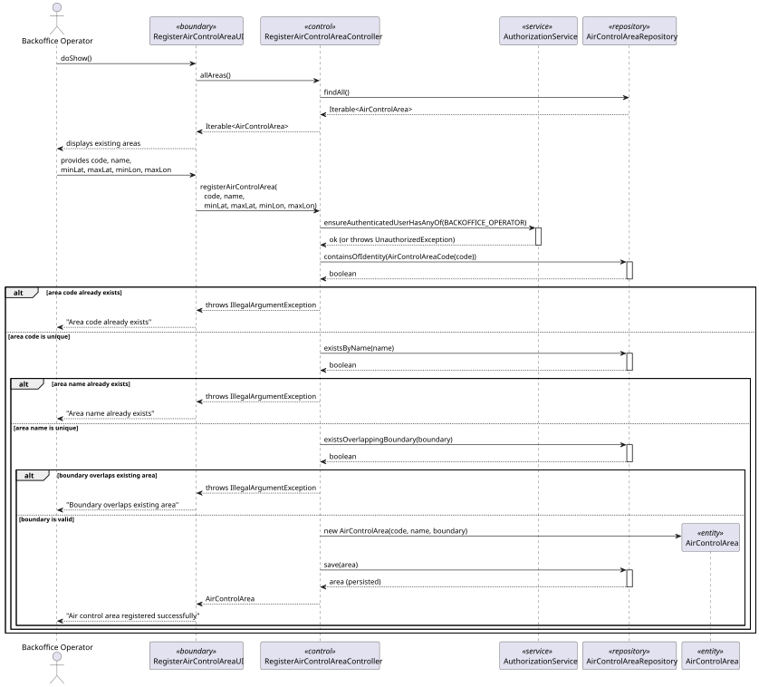

# US050 - Register an Air Control Area

## 1. Context

This User Story is being developed for the first time in Sprint 2. It is a foundational backoffice configuration requirement: air control areas are a core domain concept that other entities — airports, weather data, and flight simulations — depend upon. Without at least one registered air control area, several other use cases cannot function correctly.

This US depends on US030 (Authentication and Authorization) being in place, as only authenticated users with the `BackofficeOperator` role may perform this operation. It must also be achievable via a bootstrap process, meaning the system can pre-populate air control areas on first startup without manual UI interaction.

### 1.1 List of Issues

Analysis: Understand the domain concept of an air control area and its attributes; identify what constitutes a valid area code and valid geographic boundaries; clarify bootstrap requirements.

Design: Define the `AirControlArea` aggregate root and its value objects (`AirControlAreaCode`, `GeographicBoundary`); design the `AirControlAreaRepository` interface; design the `RegisterAirControlAreaController` following the layered architecture.

Implement: Create the `AirControlArea` aggregate in the domain layer; implement the repository using JPA/ORM and in-memory; implement the controller; implement bootstrap support.

Test: Verify that a valid air control area is correctly persisted; verify that duplicate area codes are rejected; verify that duplicate area names are rejected; verify that overlapping geographic boundaries are rejected; verify that invalid coordinates are rejected.

---

## 2. Requirements

**US050** As a Backoffice Operator, I want to register an air control area. The area code must be unique in the system. Geographic boundaries must be valid. This must also be achievable by a bootstrap process.

**Acceptance Criteria:**

- US050.1 — The system must allow a Backoffice Operator to register a new air control area.
- US050.2 — The area code must be unique across the entire system; duplicate codes must be rejected.
- US050.3 — The geographic boundaries provided must be valid (well-formed bounding box with lat ∈ [−90, 90], lon ∈ [−180, 180], minLat < maxLat, minLon < maxLon, and non-zero area).
- US050.4 — The area must have a human-readable name in addition to its code.
- US050.5 — The area name must be unique across the entire system; duplicate names must be rejected.
- US050.6 — The geographic boundary must not overlap any existing air control area.
- US050.7 — The system must reject registrations with missing or malformed mandatory fields.
- US050.8 — The registration must also be achievable via a bootstrap process (programmatic creation at system startup).

**Dependencies/References:**

- Depends on US030 (Authentication and Authorization).
- This US is a prerequisite for US041 (Register Weather Data), US052 (Create an Airport), US061 (Add a Customer's Collaborator), and US100 (Simulate Flights in a Given Area), all of which reference air control areas.
- NFR08 mandates that persistence must work both in-memory and with a relational database.
- NFR10 mandates Java as the implementation language.

---

## 3. Analysis

### 3.1 Domain Understanding

An air control area is a defined region of airspace managed by a flight control entity. In the AISafe system, it serves as a geographic and organisational unit to which airports, weather data, and flight simulations are scoped.

Based on the specification (sections 3.1, 3.1.4, and 3.2), the relevant attributes for an air control area are:

| Attribute | Description |
|---|---|
| Area Code | Unique identifier for the area (e.g. ICAO region code such as "LPPC") |
| Name | Human-readable name of the area (e.g. "Lisbon ACC") |
| Geographic Boundary | A bounding box (minLat, maxLat, minLon, maxLon) defining the airspace limits, with optional altitude range |

The `BackofficeOperator` is the actor responsible for registering air control areas. The bootstrap process creates areas directly via the controller, using the same validation logic as the UI.

### 3.2 Domain-Driven Design Analysis

Following DDD principles:

- **`AirControlArea`** is the **Aggregate Root** of this aggregate. It encapsulates all area attributes and enforces its own invariants (non-empty code, non-empty name, non-null boundary) via `Preconditions`.
- **`AirControlAreaCode`** is a **Value Object** that acts as the aggregate's identity (`@EmbeddedId`). It normalises input to uppercase and trims whitespace. Used by other aggregates to reference this area without crossing aggregate boundaries.
- **`GeographicBoundary`** is a **Value Object** (`@Embeddable`) encapsulating the bounding box. It validates coordinate ranges and min < max constraints internally in its constructor, and provides an `overlapsWith` method for cross-area checks.
- **`AirControlAreaRepository`** is the **Repository** interface defined in the domain layer; its JPA and in-memory implementations reside in the infrastructure layer.
- Business rules that require repository access (uniqueness of code and name, boundary overlap) are enforced in the **Controller**, which is the application-layer entry point for this use case.

---

## 4. Design

The design follows the EAPLI layered architecture: UI → Controller → Domain/Repository.

### 4.1. Design Decisions

- **Aggregate Identity**: `AirControlAreaCode` is both the Value Object representing the code and the aggregate's identity type (`@EmbeddedId`). This avoids a surrogate key at the domain level and makes cross-aggregate references by code explicit.
- **Geographic Boundary as Value Object**: Coordinates are encapsulated in `GeographicBoundary` as a bounding box (minLat, maxLat, minLon, maxLon, minAltitude, maxAltitude). Validation is performed internally by the constructor, keeping rules close to the concept they describe. A convenience two-argument constructor sets altitude to system-wide defaults (0 m to 14 000 m).
- **Overlap Detection**: `GeographicBoundary.overlapsWith` performs a 2D rectangle intersection check on lat/lon axes. Boundaries that share only an edge (touching) are not considered overlapping.
- **Uniqueness Enforcement**: The `RegisterAirControlAreaController` checks for duplicate code and duplicate name via `AirControlAreaRepository` before constructing the domain object. Boundary overlap is also verified before persisting. This guards the uniqueness invariant at the application layer.
- **`name` as plain String**: The `AirControlArea` aggregate stores the name as a `String` field annotated `@Column(nullable = false)`. Validation (non-blank) is enforced via `Preconditions.nonEmpty` in the constructor. A dedicated `AreaName` Value Object is not used in this implementation.
- **Bootstrap Support**: The bootstrap class (`AirControlAreaBootstrapper`) calls `RegisterAirControlAreaController` directly, reusing the same validation and persistence logic regardless of the entry point.
- **ORM/JPA**: `AirControlArea` is annotated as a JPA `@Entity`. `GeographicBoundary` is mapped as `@Embeddable`. `AirControlAreaCode` is mapped as `@EmbeddedId`.
- **Dual persistence**: `InMemoryAirControlAreaRepository` is used during development and testing; `JpaAirControlAreaRepository` (backed by H2) is used for deployment, in accordance with NFR08.

### 4.2. Class Diagram (CD)


### 4.3. Sequence Diagram (SD)



### 4.4 Acceptance Tests

**Test 1:** Verifies that a valid air control area is registered and returned.

**Refers to Acceptance Criteria:** US050.1, US050.4

```java
@Test
public void ensureValidAreaIsRegisteredAndReturned() {
    // Arrange — empty repo
    // Act
    final AirControlArea area = controller.registerAirControlArea(
            "LPPC", "Lisbon ACC", 36.0, 42.0, -10.0, -6.0);

    // Assert
    assertNotNull(area);
    assertEquals("LPPC", area.identity().code());
    assertEquals("Lisbon ACC", area.name());
}
```

**Test 2:** Verifies that a duplicate area code is rejected.

**Refers to Acceptance Criteria:** US050.2

```java
@Test
public void ensureDuplicateCodeIsRejected() {
    assertThrows(IllegalArgumentException.class, () -> {
        controller.registerAirControlArea(
                "LPPC", "Lisbon ACC", 36.0, 42.0, -10.0, -6.0);
        // same code, non-overlapping boundary
        controller.registerAirControlArea(
                "LPPC", "Other Area", 50.0, 55.0, 10.0, 20.0);
    });
}
```

**Test 3:** Verifies that a duplicate area name is rejected.

**Refers to Acceptance Criteria:** US050.5

```java
@Test
public void ensureDuplicateNameIsRejected() {
    assertThrows(IllegalArgumentException.class, () -> {
        controller.registerAirControlArea(
                "LPPC", "Lisbon ACC", 36.0, 42.0, -10.0, -6.0);
        // different code, same name, non-overlapping boundary
        controller.registerAirControlArea(
                "LECM", "Lisbon ACC", 50.0, 55.0, 10.0, 20.0);
    });
}
```

**Test 4:** Verifies that an overlapping boundary is rejected.

**Refers to Acceptance Criteria:** US050.6

```java
@Test
public void ensureOverlappingBoundaryIsRejected() {
    assertThrows(IllegalArgumentException.class, () -> {
        controller.registerAirControlArea(
                "LPPC", "Lisbon ACC", 36.0, 42.0, -10.0, -6.0);
        // boundary overlaps top-right corner of LPPC
        controller.registerAirControlArea(
                "LECM", "Madrid ACC", 40.0, 46.0, -8.0, -2.0);
    });
}
```

**Test 5:** Verifies that an out-of-range latitude is rejected.

**Refers to Acceptance Criteria:** US050.3

```java
@Test
public void ensureInvalidMinLatIsRejected() {
    assertThrows(IllegalArgumentException.class, () -> {
        controller.registerAirControlArea(
                "LPPC", "Lisbon ACC", -95.0, 42.0, -10.0, -6.0);
    });
}
```

**Test 6:** Verifies that the bootstrap process can create an air control area without UI interaction.

**Refers to Acceptance Criteria:** US050.8

```java
@Test
public void ensureBootstrapCanCreateAirControlArea() {
    // Act: controller called directly, bypassing UI
    final AirControlArea result = controller.registerAirControlArea(
            "LPPC", "Lisbon ACC", 36.0, 42.0, -10.0, -6.0);

    // Assert
    assertNotNull(result);
    assertTrue(repo.containsOfIdentity(new AirControlAreaCode("LPPC")));
}
```

---

## 5. Implementation

Key implementation notes:

- `AirControlArea` extends `AggregateRoot<AirControlAreaCode>`, using `AirControlAreaCode` as its identity. The constructor accepts a `String` code and wraps it in `AirControlAreaCode` internally. The `name` attribute is a plain `String` validated via `Preconditions.nonEmpty`.
- `AirControlAreaCode` is annotated with `@EmbeddedId`. It normalises input to uppercase and trims whitespace. Used as the aggregate identity and as a reference key by other aggregates.
- `GeographicBoundary` is annotated with `@Embeddable` and stores six `double` fields. The constructor validates all ranges and min < max constraints. A convenience constructor sets altitude to defaults (0 m – 14 000 m). `overlapsWith` performs a 2D rectangle intersection check.
- `AirControlAreaRepository` extends `DomainRepository` and adds three custom methods: `findAll`, `existsByName` (case-insensitive), and `existsOverlappingBoundary`.
- `RegisterAirControlAreaController` obtains the repository from `PersistenceContext` and enforces three business rules before persisting: unique code, unique name, and non-overlapping boundary.
- `InMemoryAirControlAreaRepository` is used for tests; `JpaAirControlAreaRepository` (extends `JpaAutoTxRepository`) is used for deployment.
- The bootstrap class calls `RegisterAirControlAreaController` directly, reusing all validation logic.

---

## 6. Integration/Demonstration

- This US is a prerequisite for US041 (Register Weather Data) and US052 (Create an Airport), which both require an existing air control area.
- To demonstrate via UI: log in as a Backoffice Operator, navigate to the Backoffice Configuration menu, select "Register Air Control Area", provide a unique code, a name, and a valid bounding box — the system confirms registration and displays the new area.
- To demonstrate code uniqueness enforcement: attempt to register a second area with the same code — the system displays a clear error message without persisting any data.
- To demonstrate name uniqueness enforcement: attempt to register a second area with the same name — the system displays a clear error message.
- To demonstrate boundary overlap enforcement: attempt to register an area whose bounding box intersects an existing one — the system displays a clear error message.
- To demonstrate bootstrap: start the system for the first time and verify that pre-configured air control areas are present without manual input.

---

## 7. Observations

- The `name` attribute is stored as a plain `String` rather than a dedicated `AreaName` Value Object. This is a pragmatic implementation decision; a future refactor could introduce `AreaName` as a VO to bring this attribute in line with DDD conventions.
- The `GeographicBoundary` uses a bounding box representation (minLat, maxLat, minLon, maxLon). This is simpler than a full polygon and sufficient for the current scope. A future sprint may require a `contains(lat, lon)` check for flight simulation scoping, which this representation supports directly.
- The `AirControlAreaCode` format is not restricted beyond non-blank. ICAO region codes (e.g. "LPPC", "LECM") are the expected convention but not enforced programmatically. This decision should be validated with the Product Owner if a stricter format is required.
- The uniqueness check for `name` is case-insensitive (`equalsIgnoreCase` in the in-memory implementation; `LOWER()` comparison in the JPA implementation).
- The `AirControlAreaCode` used as `@EmbeddedId` is also used as a reference key by `Airport` (US052) and `WeatherData` (US041). Coordination between bootstrap entries is important to ensure referenced codes exist before dependent records are created.
- All control areas range from zero to 14,000 m for simplification purposes.