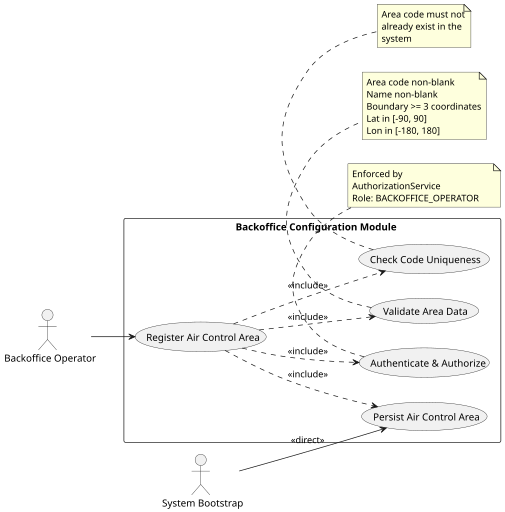
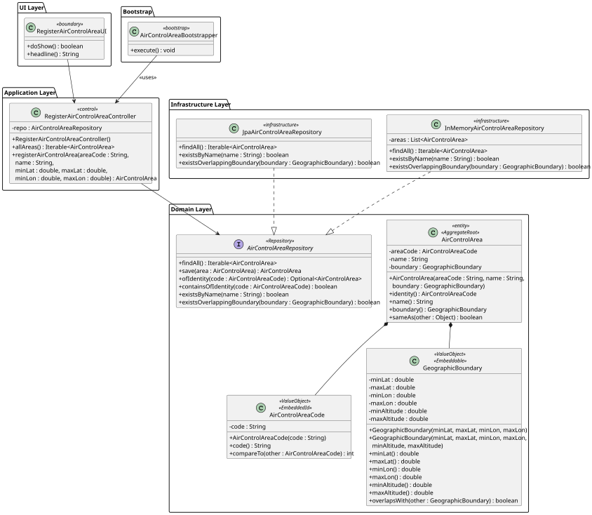

# US050 - Register an Air Control Area

## 1. Context

This User Story is being developed for the first time in Sprint 2. It is a foundational backoffice configuration requirement: air control areas are a core domain concept that other entities — airports, weather data, and flight simulations — depend upon. Without at least one registered air control area, several other use cases cannot function correctly.

This US depends on US030 (Authentication and Authorization) being in place, as only authenticated users with the `BackofficeOperator` role may perform this operation. It must also be achievable via a bootstrap process, meaning the system can pre-populate air control areas on first startup without manual UI interaction.

### 1.1 List of Issues

Analysis: Understand the domain concept of an air control area and its attributes; identify what constitutes a valid area code and valid geographic boundaries; clarify bootstrap requirements.

Design: Define the `AirControlArea` aggregate root and its value objects (`AirControlAreaCode`, `GeographicBoundary`); design the `AirControlAreaRepository` interface; design the `RegisterAirControlAreaController` and `RegisterAirControlAreaService` following the layered architecture.

Implement: Create the `AirControlArea` aggregate in the domain layer; implement the repository using JPA/ORM; implement the application service and controller; protect the use case with role-based authorization (`BackofficeOperator`); implement bootstrap support.

Test: Verify that a valid air control area is correctly persisted; verify that duplicate area codes are rejected; verify that invalid geographic boundaries are rejected; verify that only `BackofficeOperator` users can register areas.

---

## 2. Requirements

**US050** As a Backoffice Operator, I want to register an air control area. The area code must be unique in the system. Geographic boundaries must be valid. This must also be achievable by a bootstrap process.

**Acceptance Criteria:**

- US050.1 — The system must allow a Backoffice Operator to register a new air control area.
- US050.2 — The area code must be unique across the entire system; duplicate codes must be rejected.
- US050.3 — The geographic boundaries provided must be valid (well-formed coordinates defining a closed region and isn't 0).
- US050.4 — The area must have a human-readable name in addition to its code.
- US050.5 — The system must reject registrations with missing or malformed mandatory fields.
- US050.6 — Only authenticated users with the `BackofficeOperator` role may perform this operation.
- US050.7 — The registration must also be achievable via a bootstrap process (programmatic creation at system startup).

**Dependencies/References:**

- Depends on US030 (Authentication and Authorization) — the use case must be protected by role-based access control.
- This US is a prerequisite for US041 (Register Weather Data), US052 (Create an Airport), US061 (Add a Customer's Collaborator), and US100 (Simulate Flights in a Given Area), all of which reference air control areas.
- NFR09 mandates authentication and authorization throughout the system.
- NFR10 mandates Java as the implementation language.
- NFR08 mandates that persistence must work both in-memory and with a relational database.

---

## 3. Analysis

### 3.1 Domain Understanding

An air control area is a defined region of airspace managed by a flight control entity. In the AISafe system, it serves as a geographic and organisational unit to which airports, weather data, and flight simulations are scoped.

Based on the specification (sections 3.1, 3.1.4, and 3.2), the relevant attributes for an air control area are:

| Attribute | Description |
|---|---|
| Area Code | Unique identifier for the area (e.g. ICAO region code) |
| Name | Human-readable name of the area |
| Geographic Boundary | A set of coordinates (e.g. bounding polygon) that define the airspace limits |

The `BackofficeOperator` is the actor responsible for registering air control areas. Their identity and permissions are managed via US030. The bootstrap process must be able to create areas without going through the UI, using the same service layer.

### 3.2 Domain-Driven Design Analysis

Following DDD principles:

- **`AirControlArea`** is the **Aggregate Root** of this aggregate. It encapsulates all area attributes and enforces its own invariants (unique code, valid boundaries, non-empty name).
- **`AreaCode`** is a **Value Object** that acts as the aggregate's identity. It must be unique in the system and is used by other aggregates (e.g. `WeatherData`) to reference this area without crossing aggregate boundaries.
- **`GeographicBoundary`** is a **Value Object** encapsulating the coordinate set that defines the area's spatial extent. It validates that the coordinates are well-formed and define a closed, non-degenerate region.
- **`AirControlAreaRepository`** is the **Repository** interface defined in the domain layer; its JPA implementation resides in the infrastructure layer.
- **`AirControlAreaFactory`** encapsulates the instantiation logic, keeping the aggregate constructor clean and supporting both UI-driven and bootstrap-driven creation.

### 3.4 Use Case Diagram



---

## 4. Design

The design follows the standard EAPLI layered architecture: UI → Controller → Service → Domain/Repository.

### 4.1. Design Decisions

- **Aggregate Identity**: `AirControlAreaCode` is both the Value Object representing the code and the aggregate's identity type. This avoids a separate surrogate key at the domain level and makes cross-aggregate references by code natural and explicit.
- **Geographic Boundary as Value Object**: Coordinates are encapsulated in `GeographicBoundary`, which validates that at least three distinct points are provided (minimum for a polygon) and that all coordinate values are within valid geographic ranges (latitude −90 to +90, longitude −180 to +180). This keeps validation close to the concept it describes.
- **Uniqueness Enforcement**: The `RegisterAirControlAreaService` checks for an existing area with the same code via `AirControlAreaRepository` before delegating to the factory. This guards the uniqueness invariant at the application layer, complemented by a unique constraint at the database level.
- **Bootstrap Support**: The same `RegisterAirControlAreaService` is used by both the UI controller and the bootstrap class, ensuring consistent validation and persistence regardless of the entry point.
- **Authorization**: The `RegisterAirControlAreaController` calls `authorizationService.ensureAuthenticatedUserHasAnyOf(Roles.BACKOFFICE_OPERATOR)` as its first statement. The bootstrap process bypasses the controller (and thus the authorization check) by calling the service directly with a privileged system context, as is standard in EAPLI bootstrap classes.
- **ORM/JPA**: `AirControlArea` is annotated as a JPA `@Entity`. Value objects (`GeographicBoundary`, `AreaName`) are mapped as `@Embeddable`. `AirControlAreaCode` is mapped as an `@EmbeddedId`.

### 4.2. Class Diagram (CD)



### 4.3. Sequence Diagram (SD)


### 4.4 Acceptance Tests

**Test 1:** Verifies that a Backoffice Operator can successfully register a valid air control area.

**Refers to Acceptance Criteria:** US050.1, US050.4

```java
@Test
public void ensureBackofficeOperatorCanRegisterValidArea() {
    // Arrange
    authorizationService.authenticateForTesting(backofficeOperatorUser);
    when(airControlAreaRepository.ofIdentity(any())).thenReturn(Optional.empty());

    RegisterAirControlAreaController controller =
        new RegisterAirControlAreaController(authorizationService, registerAirControlAreaService);

    // Act
    AirControlArea result = controller.registerAirControlArea(
        "LPPC",
        "Lisbon ACC",
        List.of(new Coordinate(38.7, -9.1), new Coordinate(41.1, -9.1),
                new Coordinate(41.1, -6.2), new Coordinate(38.7, -6.2))
    );

    // Assert
    assertNotNull(result);
    assertEquals("LPPC", result.identity().code());
}
```

**Test 2:** Verifies that registering an area with a duplicate code is rejected.

**Refers to Acceptance Criteria:** US050.2

```java
@Test(expected = IllegalStateException.class)
public void ensureDuplicateAreaCodeIsRejected() {
    // Arrange
    authorizationService.authenticateForTesting(backofficeOperatorUser);
    when(airControlAreaRepository.ofIdentity(any())).thenReturn(Optional.of(existingArea));

    RegisterAirControlAreaController controller =
        new RegisterAirControlAreaController(authorizationService, registerAirControlAreaService);

    // Act: area code already exists
    controller.registerAirControlArea(
        "LPPC",
        "Duplicate Area",
        List.of(new Coordinate(38.7, -9.1), new Coordinate(41.1, -9.1),
                new Coordinate(41.1, -6.2), new Coordinate(38.7, -6.2))
    );

    // Assert: exception expected
}
```

**Test 3:** Verifies that a geographic boundary with fewer than three coordinates is rejected.

**Refers to Acceptance Criteria:** US050.3

```java
@Test(expected = IllegalArgumentException.class)
public void ensureInvalidGeographicBoundaryIsRejected() {
    // Arrange & Act: only two points — not a valid polygon
    new GeographicBoundary(
        List.of(new Coordinate(38.7, -9.1), new Coordinate(41.1, -9.1))
    );

    // Assert: exception expected
}
```

**Test 4:** Verifies that a coordinate with an out-of-range latitude is rejected.

**Refers to Acceptance Criteria:** US050.3

```java
@Test(expected = IllegalArgumentException.class)
public void ensureOutOfRangeLatitudeIsRejected() {
    // Arrange & Act: latitude > 90 is invalid
    new Coordinate(95.0, -9.1);

    // Assert: exception expected
}
```

**Test 5:** Verifies that a user without the BackofficeOperator role cannot register an air control area.

**Refers to Acceptance Criteria:** US050.6

```java
@Test(expected = UnauthorizedException.class)
public void ensureNonBackofficeOperatorCannotRegisterArea() {
    // Arrange: logged in as a Weather Person
    authorizationService.authenticateForTesting(weatherPersonUser);

    RegisterAirControlAreaController controller =
        new RegisterAirControlAreaController(authorizationService, registerAirControlAreaService);

    // Act
    controller.registerAirControlArea(
        "LPPC",
        "Lisbon ACC",
        List.of(new Coordinate(38.7, -9.1), new Coordinate(41.1, -9.1),
                new Coordinate(41.1, -6.2), new Coordinate(38.7, -6.2))
    );

    // Assert: exception expected
}
```

**Test 6:** Verifies that the bootstrap process can create an air control area without UI interaction.

**Refers to Acceptance Criteria:** US050.7

```java
@Test
public void ensureBootstrapCanCreateAirControlArea() {
    // Arrange
    when(airControlAreaRepository.ofIdentity(any())).thenReturn(Optional.empty());

    // Act: service called directly, bypassing controller and authorization
    AirControlArea result = registerAirControlAreaService.registerAirControlArea(
        new AirControlAreaCode("LPPC"),
        new AreaName("Lisbon ACC"),
        new GeographicBoundary(
            List.of(new Coordinate(38.7, -9.1), new Coordinate(41.1, -9.1),
                    new Coordinate(41.1, -6.2), new Coordinate(38.7, -6.2))
        )
    );

    // Assert
    assertNotNull(result);
}
```

---

## 5. Implementation

> To be filled after implementation.

Key implementation notes:
- `AirControlArea` must extend `AggregateRoot<AirControlAreaCode>`, using `AirControlAreaCode` as its identity.
- `AirControlAreaCode` must be annotated with `@EmbeddedId` for JPA, as it is the aggregate's identity and a Value Object simultaneously.
- `GeographicBoundary` should store its coordinates as a serialised collection (e.g. `@ElementCollection`) or as a JSON-encoded string column, depending on the chosen persistence strategy.
- `AirControlAreaRepository` must extend the EAPLI `Repository` interface and include a method to check existence by code (e.g. `containsOfIdentity(AirControlAreaCode)`).
- The `RegisterAirControlAreaService` must check for code uniqueness before calling the factory; if a duplicate is found, it must throw a meaningful exception.
- The bootstrap class (e.g. `MasterDataBootstrap`) must call `RegisterAirControlAreaService` directly with pre-defined data, ensuring at least one area exists on system startup.
- The UI layer must never interact with repositories directly; all interaction goes through the controller.

---

## 6. Integration/Demonstration

> To be filled after implementation.

- This US is a prerequisite for US041 (Register Weather Data) and US052 (Create an Airport), which both require an existing air control area.
- To demonstrate via UI: log in as a Backoffice Operator, navigate to the Backoffice Configuration menu, select "Register Air Control Area", provide a unique code, a name, and a set of valid boundary coordinates — the system should confirm the registration.
- To demonstrate uniqueness enforcement: attempt to register a second area with the same code — the system should display a clear error message without persisting any data.
- To demonstrate bootstrap: start the system for the first time and verify that pre-configured air control areas are present in the system without any manual input.

---

## 7. Observations

- The specification does not prescribe a specific format for geographic boundaries (e.g. bounding box vs. polygon). The design adopts a polygon (ordered list of coordinates) as it is the most expressive and extensible representation. This decision should be validated with the Product Owner if needed.
- The `AirControlAreaCode` is used as a reference key by `WeatherData` (US041), `Airport` (US052), and future flight simulation entities. Its format (e.g. ICAO region code, free string) should be agreed upon early to avoid cascading refactors.
- Future sprints may require querying areas by geographic overlap (e.g. for flight simulation). The `GeographicBoundary` value object should be designed with this in mind, potentially supporting a `contains(Coordinate)` method.
- The bootstrap process creates a dependency between startup data and the `AirControlAreaCode` values assumed by other bootstrap entries (e.g. airports bootstrapped in US052 must reference codes created here). Coordination between bootstrap classes is therefore important.
