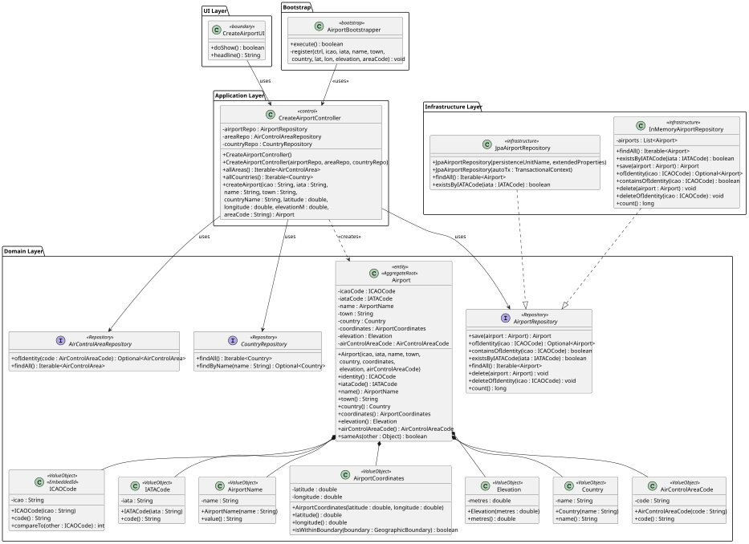

# US052 - Create an Airport

## 1. Context

This User Story is being developed for the first time in Sprint 2. Airports are a fundamental domain concept in the AISafe system: they represent the origin and destination points of all flights, and are referenced by flight plans, routes, and simulations. Without registered airports, flight-related use cases cannot be exercised.

This US depends on US030 (Authentication and Authorization), as only authenticated users with the `BackofficeOperator` role may register airports. It also depends on US050 (Register an Air Control Area), since every airport must be associated with exactly one existing air control area. It must also be achievable via a bootstrap process, allowing the system to be pre-populated with airports on first startup.

### 1.1 List of Issues

Analysis: Understand the domain concept of an airport and its mandatory attributes as defined in section 3.2 of the specification; clarify the uniqueness constraints on IATA and ICAO codes; clarify the relationship with air control areas; clarify the representation of country (bootstrap-loaded list vs. free text).

Design: Define the `Airport` aggregate root and its value objects (`ICAOCode`, `IATACode`, `AirportName`, `AirportCoordinates`, `Elevation`, `Country`, `AirControlAreaCode`); design the `AirportRepository` interface and its two implementations (in-memory and JPA); design the `CreateAirportController` following the layered architecture; confirm with professor that country is entered as free text or selected from a list.

Implement: Create the `Airport` aggregate in the domain layer; implement both repository implementations; implement the controller with inline business-rule enforcement; implement bootstrap support via `AirportBootstrapper`.

Test: Verify that a valid airport is correctly persisted; verify that duplicate IATA or ICAO codes are rejected; verify that an airport cannot be registered for a non-existent air control area; verify that invalid coordinates or elevation values are rejected; verify that airport coordinates outside the area boundary are rejected.

---

## 2. Requirements

**US052** As a Backoffice Operator, I want to register an airport in a given air control area. An airport must be associated with exactly one air control area. The airport has an ICAO and IATA code that must be unique worldwide. An airport has location coordinates that must be valid and an elevation in meters above sea level. This must also be achieved by a bootstrap process.

**Acceptance Criteria:**

- US052.1 — The system must allow a Backoffice Operator to register a new airport.
- US052.2 — Each airport must be associated with exactly one existing air control area.
- US052.3 — The IATA code (3 letters) must be unique across the entire system.
- US052.4 — The ICAO code (4 letters) must be unique across the entire system.
- US052.5 — The airport's location coordinates must be valid (latitude in [−90, 90], longitude in [−180, 180]).
- US052.6 — The airport coordinates must lie within the bounding box of the selected air control area.
- US052.7 — The elevation must be a numeric value in metres above sea level (negative values are valid for airports below sea level).
- US052.8 — The airport must have a name and a town/city.
- US052.9 — The system must reject registrations referencing a non-existent air control area.
- US052.10 — The registration must also be achievable via a bootstrap process (programmatic creation at system startup).

**Dependencies/References:**

- Depends on US030 (Authentication and Authorization) — the use case must be protected by role-based access control.
- Depends on US050 (Register an Air Control Area) — every airport must be linked to an existing area.
- This US is a prerequisite for US073 (Create a Flight Route), US080 (Create a Flight Plan), and US100 (Simulate Flights in a Given Area), all of which reference airports.
- The airport attributes are formally specified in section 3.2 of the project specification.
- NFR09 mandates authentication and authorization throughout the system.
- NFR10 mandates Java as the implementation language.
- NFR08 mandates that persistence must work both in-memory and with a relational database.

---

## 3. Analysis

### 3.1 Domain Understanding

An airport is a physical location where aircraft take off and land. In the AISafe system, it is a named, geographically situated entity identified by internationally standardised codes (IATA and ICAO). It belongs to exactly one air control area, which determines the regulatory context for flights departing from or arriving at that airport.

Based on section 3.2 of the specification, the mandatory attributes of an airport are:

| Attribute | Description |
|---|---|
| Name | Full name of the airport |
| Town | City or town where the airport is located (free text) |
| Country | Country where the airport is located (selected from bootstrap-loaded list) |
| IATA Code | 3-letter internationally recognised code (e.g. LIS) |
| ICAO Code | 4-letter internationally recognised code (e.g. LPPT) |
| Coordinates | Geographic location (latitude and longitude) |
| Elevation | Height in metres above sea level (may be negative) |
| Air Control Area | The area this airport belongs to (reference by code) |

The `BackofficeOperator` is the actor responsible for registering airports. The bootstrap process creates airports directly via the controller, reusing the same business-rule enforcement.

### 3.2 Domain-Driven Design Analysis

Following DDD principles:

- **`Airport`** is the **Aggregate Root** of this aggregate. It encapsulates all airport attributes and enforces its own invariants (valid codes, valid coordinates, valid elevation, non-empty name and town, non-null country and area reference).
- **`ICAOCode`** is a **Value Object** that acts as the aggregate's identity (`@EmbeddedId`). ICAO codes are globally unique 4-letter identifiers, making them a natural and meaningful aggregate identity.
- **`IATACode`** is a **Value Object** representing the 3-letter IATA identifier. Its uniqueness is enforced at the controller layer and at the database level (`@Column(unique = true)`).
- **`AirportCoordinates`** is a **Value Object** encapsulating latitude and longitude, enforcing range validity. It additionally exposes `isWithinBoundary(GeographicBoundary)` to support the area-boundary check in the controller.
- **`Elevation`** is a **Value Object** wrapping the elevation in metres as a `double`. Negative values are explicitly allowed (some airports exist below sea level, e.g. Amsterdam Schiphol at −3.35 m).
- **`AirportName`** is a **Value Object** wrapping the airport's full name. Its getter is `value()`. Enforces non-null and non-blank constraints.
- **`Country`** is a **Value Object** wrapping a country name selected from the bootstrap-loaded list. It is embedded directly in `Airport` as a column.
- **`AirControlAreaCode`** is used as a reference-by-identity Value Object, avoiding direct object references across aggregate boundaries.
- **`AirportRepository`** is the **Repository** interface defined in the domain layer. Two implementations exist: `InMemoryAirportRepository` (development/testing) and `JpaAirportRepository` (production).

---

## 4. Design

The design follows the standard EAPLI layered architecture: UI → Controller → Repository / Domain.

### 4.1. Design Decisions

- **Aggregate Identity**: `ICAOCode` is chosen as the aggregate identity over `IATACode` because ICAO codes are 4-letter, globally unique, and are the standard used in aviation systems for machine-readable identification.
- **Uniqueness of Both Codes**: The `CreateAirportController` checks both `ICAOCode` (via `containsOfIdentity`) and `IATACode` (via `existsByIATACode`) for uniqueness before creating the aggregate. Both are also enforced by database constraints.
- **Country as Value Object**: `Country` is a simple `@Embeddable` Value Object stored as a column on `Airport`. The country is resolved from the bootstrap-loaded `CountryRepository` before the airport is created, ensuring only known country names are accepted.
- **Boundary Validation**: `AirportCoordinates.isWithinBoundary(GeographicBoundary)` is called in the controller after confirming the area exists. If coordinates fall outside the area's bounding box the registration is rejected with a descriptive message.
- **Elevation**: Stored as `double metres` and allows negative values. The previous (incorrect) constraint of `> 0` has been removed. The bootstrap comment for Schiphol Airport is no longer needed.
- **Reference to Air Control Area by Code**: The `Airport` aggregate holds an `AirControlAreaCode` value object, not a direct reference to `AirControlArea`.
- **Bootstrap Support**: `AirportBootstrapper.execute()` calls `CreateAirportController.createAirport(...)` directly, reusing all validation logic. Any airport that already exists or fails validation is silently skipped.
- **Repository Selection**: `PersistenceContext` provides `JpaAirportRepository` in production and `InMemoryAirportRepository` can be swapped in for tests. Country data is always served from `InMemoryCountryRepository` (bootstrap-only data).

### 4.2. Class Diagram (CD)



### 4.3. Sequence Diagram (SD)


### 4.4 Acceptance Tests

**Test 1:** Verifies that a Backoffice Operator can successfully register a valid airport.

**Refers to Acceptance Criteria:** US052.1, US052.2, US052.8

```java
@Test
public void ensureValidAirportIsRegistered() {
    // Arrange
    when(areaRepo.ofIdentity(any())).thenReturn(Optional.of(mockArea));
    when(mockArea.boundary()).thenReturn(mockBoundary);
    when(mockBoundary.minLat()).thenReturn(30.0); when(mockBoundary.maxLat()).thenReturn(50.0);
    when(mockBoundary.minLon()).thenReturn(-20.0); when(mockBoundary.maxLon()).thenReturn(10.0);
    when(airportRepo.containsOfIdentity(any())).thenReturn(false);
    when(airportRepo.existsByIATACode(any())).thenReturn(false);
    when(countryRepo.findByName("Portugal")).thenReturn(Optional.of(new Country("Portugal")));
    when(airportRepo.save(any())).thenAnswer(inv -> inv.getArgument(0));

    CreateAirportController ctrl =
        new CreateAirportController(airportRepo, areaRepo, countryRepo);

    // Act
    Airport result = ctrl.createAirport(
        "LPPT", "LIS", "Humberto Delgado Airport",
        "Lisbon", "Portugal",
        38.7756, -9.1354, 114.0,
        "LPPC"
    );

    // Assert
    assertNotNull(result);
    assertEquals("LPPT", result.identity().code());
    assertEquals("LIS",  result.iataCode().code());
}
```

**Test 2:** Verifies that registering an airport with a duplicate ICAO code is rejected.

**Refers to Acceptance Criteria:** US052.4

```java
@Test(expected = IllegalArgumentException.class)
public void ensureDuplicateICAOCodeIsRejected() {
    // Arrange
    when(countryRepo.findByName("Portugal")).thenReturn(Optional.of(new Country("Portugal")));
    when(airportRepo.containsOfIdentity(new ICAOCode("LPPT"))).thenReturn(true);

    CreateAirportController ctrl =
        new CreateAirportController(airportRepo, areaRepo, countryRepo);

    // Act — ICAO code already exists
    ctrl.createAirport("LPPT", "OPO", "Another Airport",
        "Porto", "Portugal", 41.2481, -8.6814, 69.0, "LPPC");
}
```

**Test 3:** Verifies that registering an airport with a duplicate IATA code is rejected.

**Refers to Acceptance Criteria:** US052.3

```java
@Test(expected = IllegalArgumentException.class)
public void ensureDuplicateIATACodeIsRejected() {
    // Arrange
    when(countryRepo.findByName("Portugal")).thenReturn(Optional.of(new Country("Portugal")));
    when(airportRepo.containsOfIdentity(any())).thenReturn(false);
    when(airportRepo.existsByIATACode(new IATACode("LIS"))).thenReturn(true);

    CreateAirportController ctrl =
        new CreateAirportController(airportRepo, areaRepo, countryRepo);

    // Act — IATA code already exists
    ctrl.createAirport("LPPO", "LIS", "Another Airport",
        "Ponta Delgada", "Portugal", 37.7412, -25.6979, 55.0, "LPPO");
}
```

**Test 4:** Verifies that an airport cannot be registered for a non-existent air control area.

**Refers to Acceptance Criteria:** US052.2, US052.9

```java
@Test(expected = IllegalArgumentException.class)
public void ensureRegistrationFailsForNonExistentAirControlArea() {
    // Arrange
    when(countryRepo.findByName("Portugal")).thenReturn(Optional.of(new Country("Portugal")));
    when(airportRepo.containsOfIdentity(any())).thenReturn(false);
    when(airportRepo.existsByIATACode(any())).thenReturn(false);
    when(areaRepo.ofIdentity(any())).thenReturn(Optional.empty());

    CreateAirportController ctrl =
        new CreateAirportController(airportRepo, areaRepo, countryRepo);

    // Act
    ctrl.createAirport("LPPT", "LIS", "Humberto Delgado Airport",
        "Lisbon", "Portugal", 38.7756, -9.1354, 114.0, "NONEXISTENT");
}
```

**Test 5:** Verifies that airport coordinates with an out-of-range latitude are rejected.

**Refers to Acceptance Criteria:** US052.5

```java
@Test(expected = IllegalArgumentException.class)
public void ensureInvalidLatitudeIsRejected() {
    // latitude > 90 must be rejected by AirportCoordinates constructor
    new AirportCoordinates(95.0, -9.1354);
}
```

**Test 6:** Verifies that airport coordinates outside the selected area boundary are rejected.

**Refers to Acceptance Criteria:** US052.6

```java
@Test(expected = IllegalArgumentException.class)
public void ensureCoordinatesOutsideAreaBoundaryAreRejected() {
    // Arrange — area covers only lat [40,45] lon [-10,-5]
    when(countryRepo.findByName("Portugal")).thenReturn(Optional.of(new Country("Portugal")));
    when(airportRepo.containsOfIdentity(any())).thenReturn(false);
    when(airportRepo.existsByIATACode(any())).thenReturn(false);
    when(areaRepo.ofIdentity(any())).thenReturn(Optional.of(mockArea));
    when(mockArea.boundary()).thenReturn(mockBoundary);
    when(mockBoundary.minLat()).thenReturn(40.0); when(mockBoundary.maxLat()).thenReturn(45.0);
    when(mockBoundary.minLon()).thenReturn(-10.0); when(mockBoundary.maxLon()).thenReturn(-5.0);

    CreateAirportController ctrl =
        new CreateAirportController(airportRepo, areaRepo, countryRepo);

    // Act — coordinates (32.7, -16.8) are outside the boundary
    ctrl.createAirport("LPMA", "FNC", "Madeira Airport",
        "Funchal", "Portugal", 32.7, -16.8, 59.0, "LPPC");
}
```

**Test 7:** Verifies that a negative elevation is accepted (airport below sea level).

**Refers to Acceptance Criteria:** US052.7

```java
@Test
public void ensureNegativeElevationIsAccepted() {
    // Schiphol is at -3.35 m — must not throw
    Elevation e = new Elevation(-3.35);
    assertEquals(-3.35, e.metres(), 0.001);
}
```

**Test 8:** Verifies that the bootstrap process can create airports without UI interaction.

**Refers to Acceptance Criteria:** US052.10

```java
@Test
public void ensureBootstrapRegistersAirports() {
    // Arrange
    when(areaRepo.ofIdentity(any())).thenReturn(Optional.of(mockArea));
    when(mockArea.boundary()).thenReturn(mockBoundary);
    // ... boundary stubs covering all bootstrap coordinates ...
    when(airportRepo.containsOfIdentity(any())).thenReturn(false);
    when(airportRepo.existsByIATACode(any())).thenReturn(false);
    when(countryRepo.findByName(any())).thenAnswer(inv ->
        Optional.of(new Country(inv.getArgument(0))));
    when(airportRepo.save(any())).thenAnswer(inv -> inv.getArgument(0));

    // Act
    AirportBootstrapper bootstrapper = new AirportBootstrapper();
    boolean result = bootstrapper.execute();

    // Assert
    assertTrue(result);
    verify(airportRepo, atLeastOnce()).save(any());
}
```

---

## 5. Implementation

Key implementation notes:

- `Airport` extends `AggregateRoot<ICAOCode>` from the EAPLI framework, using `ICAOCode` as its identity.
- `ICAOCode` is annotated with `@EmbeddedId` and `@Embeddable`. Its format is validated in the constructor with `[A-Z]{4}`. The field name is `icao` (used in the JPA query `e.iataCode.iata`).
- `IATACode` is annotated with `@Embeddable`. Its field is `iata`, validated as `[A-Z]{3}`. It is mapped with `@Column(name = "iata_code", nullable = false, unique = true)`.
- `AirportName` is annotated with `@Embeddable`. Its getter is `value()` (not `name()`).
- `AirportCoordinates` is annotated with `@Embeddable`. It additionally provides `isWithinBoundary(GeographicBoundary)` used by the controller.
- `Elevation` is annotated with `@Embeddable`. The field is `metres` of type `double`. **Negative values are valid** — no lower-bound constraint is enforced.
- `Country` is annotated with `@Embeddable` with `@Column(name = "country_name", nullable = false)`. It is resolved from `CountryRepository.findByName(...)` before the airport is created.
- `AirportRepository` extends `DomainRepository<ICAOCode, Airport>` and adds `findAll()` and `existsByIATACode(IATACode)`.
- `JpaAirportRepository` extends `JpaAutoTxRepository<Airport, ICAOCode, ICAOCode>` with identity field `"icaoCode"`. The `existsByIATACode` query filters on `e.iataCode.iata`.
- `CreateAirportController` obtains its repositories from `PersistenceContext` (production constructor) or via constructor injection (testing constructor). It enforces all business rules inline, in this order: VO construction → country resolution → ICAO uniqueness → IATA uniqueness → area existence → boundary check → save.
- `AirportBootstrapper` calls `CreateAirportController.createAirport(...)` for each pre-configured airport. Failures are caught and silently skipped so re-runs are idempotent.

---

## 6. Integration/Demonstration

- This US depends on US050 (Register an Air Control Area) — at least one area must exist before an airport can be registered. `AirportBootstrapper` must run after `AirControlAreaBootstrapper`.
- This US is a prerequisite for US073 (Create a Flight Route) and US080 (Create a Flight Plan).
- To demonstrate via UI: log in as a Backoffice Operator, navigate to the Backoffice Configuration menu, select "Create Airport", choose an area from the list, enter a unique ICAO code, a unique IATA code, a name, a town, select a country, provide coordinates within the area's bounding box, and an elevation — the system confirms the registration.
- To demonstrate ICAO/IATA uniqueness: attempt to register a second airport with a code already in use — the system displays a clear error message without persisting.
- To demonstrate boundary validation: provide coordinates outside the selected area's bounding box — the system displays the exact boundary and rejects the registration.
- To demonstrate negative elevation: register an airport with a negative elevation value — the system accepts it.
- To demonstrate bootstrap: start the system for the first time and verify that pre-configured airports (Porto, Lisbon, Paris CDG, London Heathrow, etc.) are present without any manual input.

---

## 7. Observations

- The specification defines the IATA code as 3 letters and the ICAO code as 4 letters (section 3.2). Both formats are strictly enforced in their respective Value Object constructors. Input is normalised to uppercase before validation, so lowercase input is accepted gracefully.
- `AirportName.value()` returns the airport name string. The getter is named `value()` (not `name()`) to avoid collision with `Object.getClass()` and to follow the convention used for other string-wrapping VOs in the project.
- Elevation allows negative values. The comment in `AirportBootstrapper` for Schiphol (`// Using 1 m...`) is a legacy note from an earlier, incorrect version of `Elevation` and should be removed; Schiphol's real elevation of −3.35 m is now valid and should be updated in the bootstrap data.
- `Country` is treated as a Value Object rather than an Aggregate Root because countries have no lifecycle of their own in this system — they are simply a selection constraint. The `CountryRepository` is always backed by the in-memory implementation, as country data does not change at runtime.
- The choice to enforce business rules in the controller rather than a separate service was deliberate for this use case. If a future use case (e.g. bulk import) needs to create airports programmatically without a controller, extracting a `CreateAirportService` at that point is straightforward.
- Future use cases that reference airports (US073, US080, US100) must use `ICAOCode` as the airport identifier consistently.
