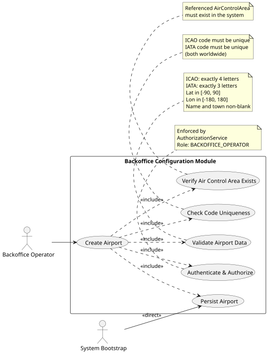
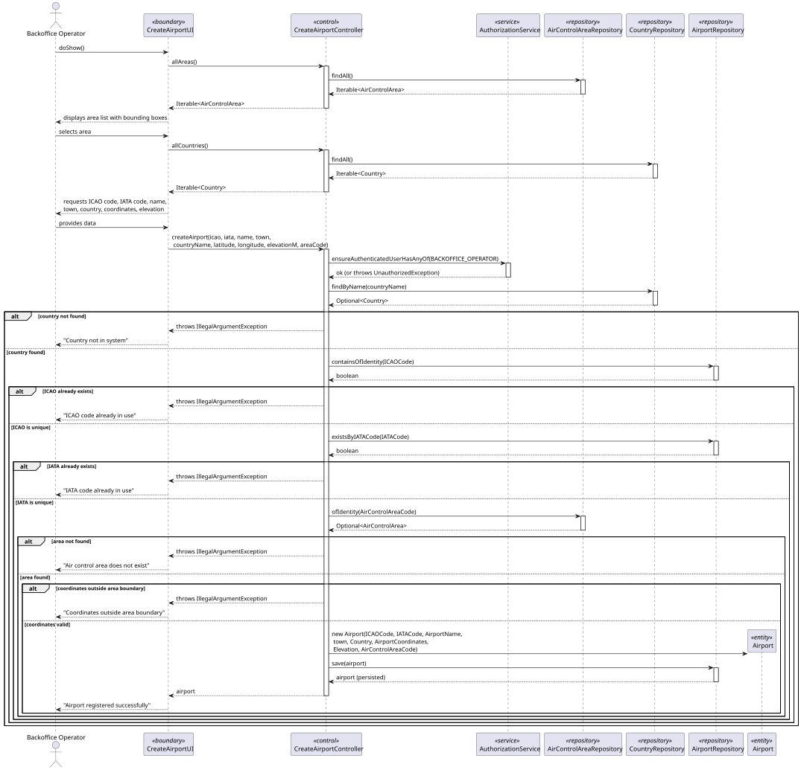

# US052 - Create an Airport

## 1. Context

This User Story is being developed for the first time in Sprint 2. Airports are a fundamental domain concept in the AISafe system: they represent the origin and destination points of all flights, and are referenced by flight plans, routes, and simulations. Without registered airports, flight-related use cases cannot be exercised.

This US depends on US030 (Authentication and Authorization), as only authenticated users with the `BackofficeOperator` role may register airports. It also depends on US050 (Register an Air Control Area), since every airport must be associated with exactly one existing air control area. It must also be achievable via a bootstrap process, allowing the system to be pre-populated with airports on first startup.

### 1.1 List of Issues

Analysis: Understand the domain concept of an airport and its mandatory attributes as defined in section 3.2 of the specification; clarify the uniqueness constraints on IATA and ICAO codes; clarify the relationship with air control areas.

Design: Define the `Airport` aggregate root and its value objects (`AirportCode`, `AirportCoordinates`); design the `AirportRepository` interface; design the `CreateAirportController` and `CreateAirportService` following the layered architecture.

Implement: Create the `Airport` aggregate in the domain layer; implement the repository using JPA/ORM; implement the application service and controller; protect the use case with role-based authorization (`BackofficeOperator`); implement bootstrap support.

Test: Verify that a valid airport is correctly persisted; verify that duplicate IATA or ICAO codes are rejected; verify that an airport cannot be registered for a non-existent air control area; verify that invalid coordinates or elevation values are rejected; verify that only `BackofficeOperator` users can register airports.

---

## 2. Requirements

**US052** As a Backoffice Operator, I want to register an airport in a given air control area. An airport must be associated with exactly one air control area. The airport has an ICAO and IATA code that must be unique worldwide. An airport has location coordinates that must be valid and an elevation in meters above sea level. This must also be achieved by a bootstrap process.

**Acceptance Criteria:**

- US052.1 — The system must allow a Backoffice Operator to register a new airport.
- US052.2 — Each airport must be associated with exactly one existing air control area.
- US052.3 — The IATA code (3 letters) must be unique across the entire system.
- US052.4 — The ICAO code (4 letters) must be unique across the entire system.
- US052.5 — The airport's location coordinates must be valid (latitude in [−90, 90], longitude in [−180, 180]).
- US052.6 — The elevation must be a numeric value in meters above sea level (may be negative for airports below sea level).
- US052.7 — The airport must have a name and a town/city.
- US052.8 — The system must reject registrations referencing a non-existent air control area.
- US052.9 — Only authenticated users with the `BackofficeOperator` role may perform this operation.
- US052.10 — The registration must also be achievable via a bootstrap process (programmatic creation at system startup).

**Dependencies/References:**

- Depends on US030 (Authentication and Authorization) — the use case must be protected by role-based access control.
- Depends on US050 (Register an Air Control Area) — every airport must be linked to an existing area.
- This US is a prerequisite for US073 (Create a Flight Route), US080 (Create a Flight Plan), and US100 (Simulate Flights in a Given Area), all of which reference airports.
- The airport attributes are formally specified in section 3.2 of the project specification.
- NFR09 mandates authentication and authorization throughout the system.
- NFR10 mandates Java as the implementation language.
- NFR08 mandates that persistence must work both in-memory and with a relational database.

---

## 3. Analysis

### 3.1 Domain Understanding

An airport is a physical location where aircraft take off and land. In the AISafe system, it is a named, geographically situated entity identified by internationally standardised codes (IATA and ICAO). It belongs to exactly one air control area, which determines the regulatory context for flights departing from or arriving at that airport.

Based on section 3.2 of the specification, the mandatory attributes of an airport are:

| Attribute | Description |
|---|---|
| Name | Full name of the airport |
| Town | City or town where the airport is located |
| Country | Country where the airport is located |
| IATA Code | 3-letter internationally recognised code (e.g. LIS) |
| ICAO Code | 4-letter internationally recognised code (e.g. LPPT) |
| Coordinates | Geographic location (latitude and longitude) |
| Elevation | Height in meters above sea level |
| Air Control Area | The area this airport belongs to (reference by code) |

The `BackofficeOperator` is the actor responsible for registering airports. The bootstrap process must be able to create airports without going through the UI, using the same service layer.

### 3.2 Domain-Driven Design Analysis

Following DDD principles:

- **`Airport`** is the **Aggregate Root** of this aggregate. It encapsulates all airport attributes and enforces its own invariants (valid codes, valid coordinates, valid elevation, non-empty name and town, existing area reference).
- **`ICAOCode`** is a **Value Object** that acts as the aggregate's identity. ICAO codes are globally unique 4-letter identifiers, making them a natural and meaningful aggregate identity.
- **`IATACode`** is a **Value Object** representing the 3-letter IATA identifier. Its uniqueness is enforced at the application service layer and at the database level.
- **`AirportCoordinates`** is a **Value Object** encapsulating latitude and longitude, enforcing range validity. It is distinct from `Coordinate` used in `GeographicBoundary` to preserve the semantic distinction between a point location and a boundary vertex.
- **`Elevation`** is a **Value Object** wrapping the elevation in meters, allowing for future extension (e.g. unit conversion) without altering the aggregate.
- **`AirportName`** is a **Value Object** wrapping the airport's full name, enforcing non-null and non-blank constraints.
- **`AirControlAreaCode`** is used as a reference-by-identity Value Object, avoiding direct object references across aggregate boundaries — consistent with the design established in US050 and US041.
- **`AirportRepository`** is the **Repository** interface defined in the domain layer; its JPA implementation resides in the infrastructure layer.
- **`AirportFactory`** encapsulates the instantiation logic, supporting both UI-driven and bootstrap-driven creation uniformly.

### 3.3 Use Case Diagram



---

## 4. Design

The design follows the standard EAPLI layered architecture: UI → Controller → Service → Domain/Repository.

### 4.1. Design Decisions

- **Aggregate Identity**: `ICAOCode` is chosen as the aggregate identity over `IATACode` because ICAO codes are 4-letter, globally unique, and are the standard used in aviation systems for machine-readable identification. `IATACode` remains a mandatory, unique attribute but is not the identity.
- **Uniqueness of Both Codes**: The `CreateAirportService` checks both `ICAOCode` and `IATACode` for uniqueness before delegating to the factory. The repository exposes `containsOfIdentity` (for ICAO) and `existsByIATACode` (for IATA) to support these checks. Both are also enforced by unique database constraints.
- **Reference to Air Control Area by Code**: The `Airport` aggregate holds an `AirControlAreaCode` value object rather than a direct reference to `AirControlArea`, preserving aggregate boundary independence. The service verifies the area exists before persisting.
- **Bootstrap Support**: The same `CreateAirportService` is used by both the UI controller and the bootstrap class, ensuring consistent validation and persistence regardless of the entry point. The bootstrap bypasses the controller and authorization check.
- **Authorization**: The `CreateAirportController` calls `authorizationService.ensureAuthenticatedUserHasAnyOf(Roles.BACKOFFICE_OPERATOR)` as its first statement, before any domain logic is executed.
- **ORM/JPA**: `Airport` is annotated as a JPA `@Entity`. Value objects (`AirportCoordinates`, `Elevation`, `AirportName`) are mapped as `@Embeddable`. `ICAOCode` is mapped as `@EmbeddedId`. `IATACode` is mapped as a unique column.

### 4.2. Class Diagram (CD)


### 4.3. Sequence Diagram (SD)



### 4.4 Acceptance Tests

**Test 1:** Verifies that a Backoffice Operator can successfully register a valid airport.

**Refers to Acceptance Criteria:** US052.1, US052.2, US052.7

```java
@Test
public void ensureBackofficeOperatorCanRegisterValidAirport() {
    // Arrange
    authorizationService.authenticateForTesting(backofficeOperatorUser);
    when(airControlAreaRepository.ofIdentity(any())).thenReturn(Optional.of(mockArea));
    when(airportRepository.ofIdentity(any())).thenReturn(Optional.empty());
    when(airportRepository.existsByIATACode(any())).thenReturn(false);

    CreateAirportController controller =
        new CreateAirportController(authorizationService, createAirportService);

    // Act
    Airport result = controller.createAirport(
        "LPPT", "LIS", "Humberto Delgado Airport",
        "Lisbon", "Portugal",
        38.7756, -9.1354, 113,
        "LPPC"
    );

    // Assert
    assertNotNull(result);
    assertEquals("LPPT", result.identity().code());
}
```

**Test 2:** Verifies that registering an airport with a duplicate ICAO code is rejected.

**Refers to Acceptance Criteria:** US052.4

```java
@Test(expected = IllegalStateException.class)
public void ensureDuplicateICAOCodeIsRejected() {
    // Arrange
    authorizationService.authenticateForTesting(backofficeOperatorUser);
    when(airportRepository.ofIdentity(any())).thenReturn(Optional.of(existingAirport));

    CreateAirportController controller =
        new CreateAirportController(authorizationService, createAirportService);

    // Act: ICAO code already exists
    controller.createAirport(
        "LPPT", "OPO", "Another Airport",
        "Porto", "Portugal",
        41.2481, -8.6814, 69,
        "LPPC"
    );

    // Assert: exception expected
}
```

**Test 3:** Verifies that registering an airport with a duplicate IATA code is rejected.

**Refers to Acceptance Criteria:** US052.3

```java
@Test(expected = IllegalStateException.class)
public void ensureDuplicateIATACodeIsRejected() {
    // Arrange
    authorizationService.authenticateForTesting(backofficeOperatorUser);
    when(airportRepository.ofIdentity(any())).thenReturn(Optional.empty());
    when(airportRepository.existsByIATACode(new IATACode("LIS"))).thenReturn(true);

    CreateAirportController controller =
        new CreateAirportController(authorizationService, createAirportService);

    // Act: IATA code already exists
    controller.createAirport(
        "LPPO", "LIS", "Another Airport",
        "Ponta Delgada", "Portugal",
        37.7412, -25.6979, 55,
        "LPPC"
    );

    // Assert: exception expected
}
```

**Test 4:** Verifies that an airport cannot be registered for a non-existent air control area.

**Refers to Acceptance Criteria:** US052.2, US052.8

```java
@Test(expected = IllegalArgumentException.class)
public void ensureRegistrationFailsForNonExistentAirControlArea() {
    // Arrange
    authorizationService.authenticateForTesting(backofficeOperatorUser);
    when(airControlAreaRepository.ofIdentity(any())).thenReturn(Optional.empty());

    CreateAirportController controller =
        new CreateAirportController(authorizationService, createAirportService);

    // Act
    controller.createAirport(
        "LPPT", "LIS", "Humberto Delgado Airport",
        "Lisbon", "Portugal",
        38.7756, -9.1354, 113,
        "NONEXISTENT"
    );

    // Assert: exception expected
}
```

**Test 5:** Verifies that airport coordinates with an out-of-range latitude are rejected.

**Refers to Acceptance Criteria:** US052.5

```java
@Test(expected = IllegalArgumentException.class)
public void ensureInvalidLatitudeIsRejected() {
    // Arrange & Act: latitude > 90 is invalid
    new AirportCoordinates(95.0, -9.1354);

    // Assert: exception expected
}
```

**Test 6:** Verifies that a user without the BackofficeOperator role cannot register an airport.

**Refers to Acceptance Criteria:** US052.9

```java
@Test(expected = UnauthorizedException.class)
public void ensureNonBackofficeOperatorCannotCreateAirport() {
    // Arrange: logged in as a Pilot
    authorizationService.authenticateForTesting(pilotUser);

    CreateAirportController controller =
        new CreateAirportController(authorizationService, createAirportService);

    // Act
    controller.createAirport(
        "LPPT", "LIS", "Humberto Delgado Airport",
        "Lisbon", "Portugal",
        38.7756, -9.1354, 113,
        "LPPC"
    );

    // Assert: exception expected
}
```

**Test 7:** Verifies that the bootstrap process can create an airport without UI interaction.

**Refers to Acceptance Criteria:** US052.10

```java
@Test
public void ensureBootstrapCanCreateAirport() {
    // Arrange
    when(airControlAreaRepository.ofIdentity(any())).thenReturn(Optional.of(mockArea));
    when(airportRepository.ofIdentity(any())).thenReturn(Optional.empty());
    when(airportRepository.existsByIATACode(any())).thenReturn(false);

    // Act: service called directly, bypassing controller and authorization
    Airport result = createAirportService.createAirport(
        new ICAOCode("LPPT"),
        new IATACode("LIS"),
        new AirportName("Humberto Delgado Airport"),
        "Lisbon", "Portugal",
        new AirportCoordinates(38.7756, -9.1354),
        new Elevation(113),
        new AirControlAreaCode("LPPC")
    );

    // Assert
    assertNotNull(result);
}
```

---

## 5. Implementation

> To be filled after implementation.

Key implementation notes:
- `Airport` must extend `AggregateRoot<ICAOCode>`, using `ICAOCode` as its identity.
- `ICAOCode` must be annotated with `@EmbeddedId` for JPA, as it is the aggregate's identity and a Value Object simultaneously. Its format must be validated (exactly 4 uppercase letters).
- `IATACode` must be validated as exactly 3 uppercase letters. It must be persisted as a unique column (`@Column(unique = true)`).
- `AirportCoordinates` should be annotated with `@Embeddable` and store latitude and longitude as separate columns.
- `Elevation` should be annotated with `@Embeddable` and store the value in meters as an integer or double column.
- `AirportRepository` must extend the EAPLI `Repository` interface and additionally expose `existsByIATACode(IATACode)` to support the uniqueness check in the service.
- The `CreateAirportService` must check ICAO uniqueness (via `containsOfIdentity`) and IATA uniqueness (via `existsByIATACode`) before calling the factory; if either check fails, a meaningful exception must be thrown.
- The `CreateAirportService` must also verify that the referenced `AirControlAreaCode` corresponds to an existing area.
- The bootstrap class (e.g. `MasterDataBootstrap`) must call `CreateAirportService` directly with pre-defined data, and must run after the air control area bootstrap to ensure referenced areas exist.
- The UI layer must never interact with repositories directly; all interaction goes through the controller.

---

## 6. Integration/Demonstration

> To be filled after implementation.

- This US depends on US050 (Register an Air Control Area) — at least one area must exist before an airport can be registered.
- This US is a prerequisite for US073 (Create a Flight Route) and US080 (Create a Flight Plan), which both require origin and destination airports.
- To demonstrate via UI: log in as a Backoffice Operator, navigate to the Backoffice Configuration menu, select "Create Airport", provide a unique ICAO code, a unique IATA code, a name, town, country, valid coordinates, elevation, and an existing area code — the system should confirm the registration.
- To demonstrate ICAO/IATA uniqueness enforcement: attempt to register a second airport with a code already in use — the system should display a clear error message without persisting any data.
- To demonstrate area validation: provide a non-existent area code — the system should display a clear error message.
- To demonstrate bootstrap: start the system for the first time and verify that pre-configured airports are present without any manual input.

---

## 7. Observations

- The specification defines the IATA code as 3 letters and the ICAO code as 4 letters (section 3.2). Both formats must be strictly enforced in their respective Value Object constructors, not only at the UI layer.
- The choice of `ICAOCode` as the aggregate identity (over `IATACode`) is deliberate: ICAO codes are used in aviation systems for unambiguous, machine-readable identification and align with the segment/node model described in section 3.2. If the Product Owner has a different preference, this decision should be revisited early.
- Future use cases (e.g. US073 Create a Flight Route, US080 Create a Flight Plan) will reference airports by their `ICAOCode`. This must be consistent across all aggregates that hold airport references.
- The bootstrap execution order is critical: `AirControlArea` bootstrap (US050) must complete before `Airport` bootstrap (US052), as airports depend on existing areas. This ordering must be explicitly enforced in the bootstrap orchestration class.
- Some airports exist below sea level (e.g. Schiphol at −3.35 m). The `Elevation` value object must allow negative values and must not impose a non-negative constraint.
