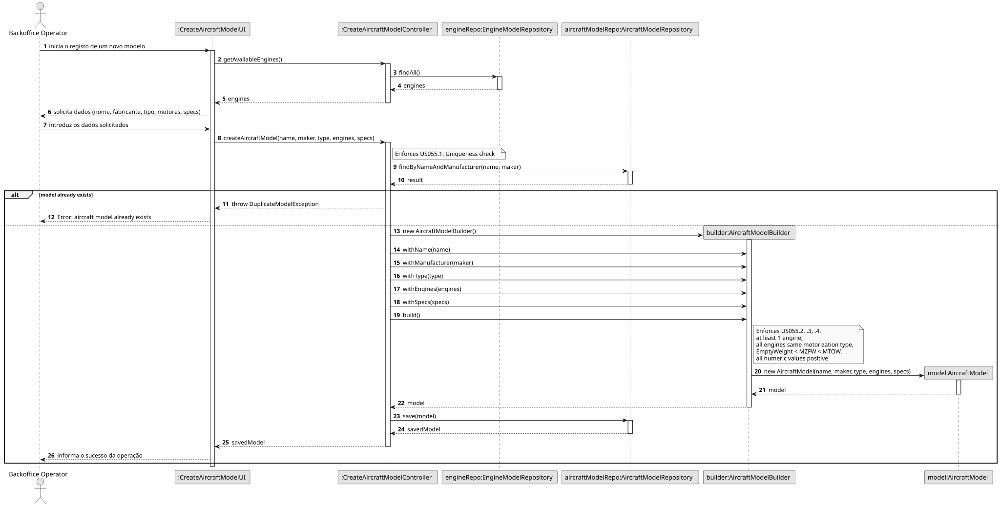
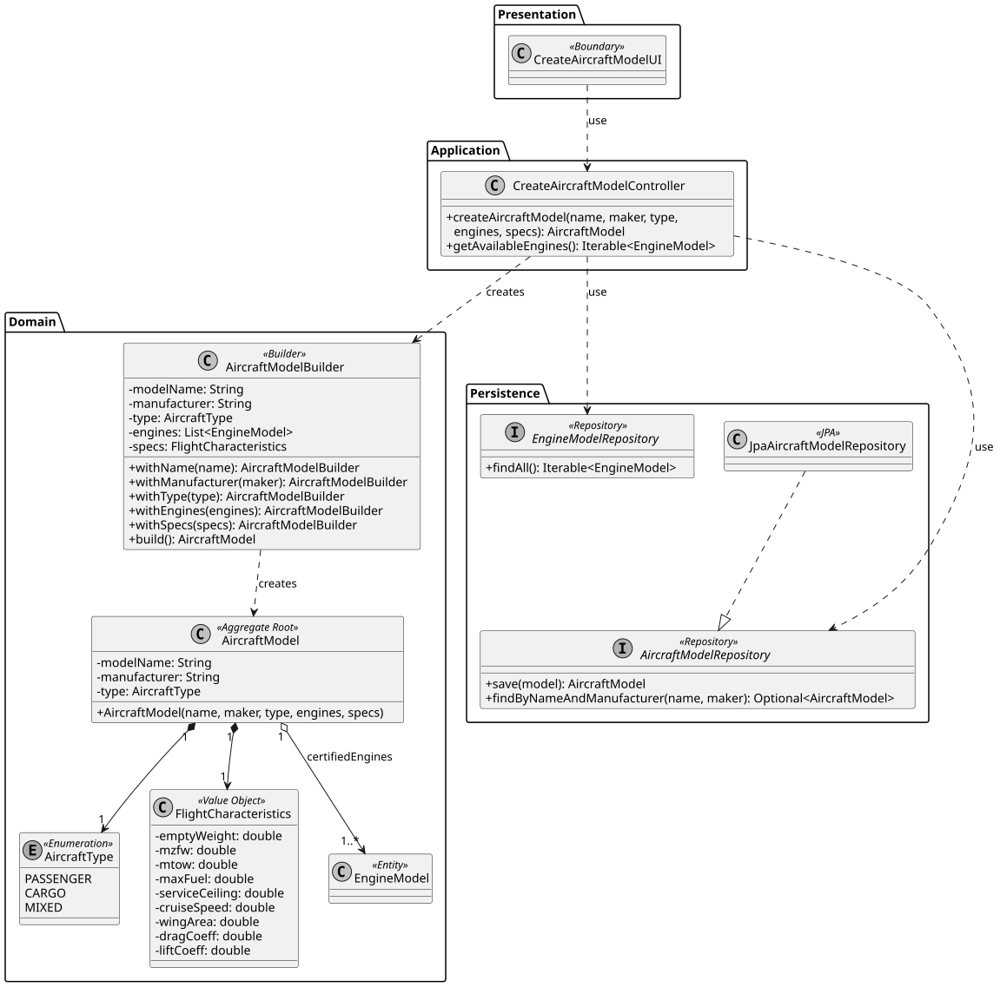

# US055 — Create an Aircraft Model

## 1. Context

This task is developed for the first time in Sprint 2, as part of the Backoffice Configuration requirements. The goal is to allow the system to register aircraft models that will later be used to instantiate specific aircraft in the fleets of air transport companies.

---

## 2. Requirements

**US055** — As a Backoffice Operator, I want to register a new aircraft model.

### 2.1 Acceptance Criteria

- **US055.1** The combination of model name and manufacturer must be unique in the system.
- **US055.2** At least one certified engine model must be associated at creation time.
- **US055.3** An aircraft model must have a type: passenger, cargo, or mixed.
- **US055.4** The aircraft model must include maximum range and other flight characteristics. All numeric values must be positive. EmptyWeight < MZFW < MTOW.
- **US055.5** Registration must also be achievable via a bootstrap process.

### 2.2 Flight Characteristics (Mandatory)

| Attribute                       | Unit          |
|---------------------------------|---------------|
| Empty Weight                    | kg            |
| Maximum Zero Fuel Weight (MZFW) | kg            |
| Maximum Take-Off Weight (MTOW)  | kg            |
| Maximum Fuel Capacity           | litres        |
| Service Ceiling                 | m             |
| Cruise Speed                    | m/s           |
| Maximum Range                   | km            |
| Wing Area                       | m²            |
| Drag Coefficient (Cd)           | dimensionless |
| Lift Coefficient (Cl)           | dimensionless |

### 2.3 Dependencies

**US056 – Create Aircraft Engine Model**
Engine models must exist in the system before being associated with an aircraft model.

---

## 3. Analysis

### 3.1 Domain Model Excerpt

The `AircraftModel` is implemented as an **Aggregate Root** following Domain-Driven Design principles.

The aggregate contains:

- **Identity:** `ModelID`
- **Business identity:** `modelName` + `manufacturer` (combination must be unique)
- **List of certified engine references:** `List<EngineModel>` (at least one required)
- **Classification:** `AircraftType`
- **Physical parameters:** `FlightCharacteristics` value object

Key relationships:

- `AircraftModel` — composition → `FlightCharacteristics` (1 to 1)
- `AircraftModel` — composition → `AircraftType`
- `AircraftModel` — association → `EngineModel` (1 to many, minimum 1)

### 3.2 Domain Invariants

The `AircraftModel` aggregate enforces:

1. `modelName` + `manufacturer` combination must be unique in the system.
2. At least one `EngineModel` must be associated.
3. All engine models associated must share the same motorization type.
4. All numeric values in `FlightCharacteristics` must be positive.
5. `EmptyWeight` < `MZFW` < `MTOW`.
6. `MaximumRange` must be positive.

---

## 4. Design

### 4.1 Architecture

The solution follows the layered architecture of the EAPLI framework:

```
CreateAircraftModelUI
    → CreateAircraftModelController
        → AircraftModelBuilder
            → AircraftModel (Aggregate Root)
        → AircraftModelRepository
        → EngineModelRepository
```

### 4.2 Main Components

| Class                           | Layer                    | Responsibility                                                         |
|---------------------------------|--------------------------|------------------------------------------------------------------------|
| `CreateAircraftModelUI`         | UI (Boundary)            | Collects input from the operator; presents available engine models     |
| `CreateAircraftModelController` | Application              | Orchestrates use case; calls builder and repository                    |
| `AircraftModelBuilder`          | Domain (Builder)         | Constructs `AircraftModel`; validates inputs and engine compatibility   |
| `AircraftModel`                 | Domain (Aggregate Root)  | Enforces all domain invariants                                         |
| `AircraftModelRepository`       | Persistence (interface)  | Persistence abstraction                                                |
| `EngineModelRepository`         | Persistence (interface)  | Provides engine models for selection (defined in US056)                |

### 4.3 Value Objects

As defined in the class diagram:

| Value Object            | Description                                                                                     |
|-------------------------|-------------------------------------------------------------------------------------------------|
| `AircraftType`          | Enum: `PASSENGER`, `CARGO`, `MIXED`                                                             |
| `FlightCharacteristics` | Groups `emptyWeight`, `mtow`, `mzfw`, `maxFuel`, `cruiseSpeed`, `wingArea`, `dragCoeff`, `liftCoeff` |

### 4.4 Sequence Diagram

**

The main success scenario proceeds as follows:

1. The Backoffice Operator selects *Create Aircraft Model*.
2. The UI requests the list of available engine models from the controller.
3. The controller retrieves all engine models from `EngineModelRepository` and returns them to the UI.
4. The UI presents the options and collects all required input from the operator.
5. The UI invokes `createAircraftModel(data...)` on the controller.
6. The controller creates an `AircraftModelBuilder` and sets all fields via chained calls (`withName`, `withManufacturer`, `withEngine`, `withSpecs`).
7. The builder constructs the `AircraftModel` domain object, validating all invariants.
8. The controller persists the model via `AircraftModelRepository`.
9. The system confirms success to the operator.

### 4.5 Class Diagram

**

---

## 5. Tests

All tests follow the **AAA (Arrange / Act / Assert)** convention as required by NFR03. Coverage of domain and controller packages must not fall below 90%.

### 5.1 Unit Test — Must Have Engine (US055.2)

```java
@Test
public void ensureAircraftModelMustHaveAtLeastOneEngine() {
    // Arrange
    AircraftModelBuilder builder = new AircraftModelBuilder()
        .withName("737 MAX")
        .withManufacturer("Boeing")
        .withSpecs(validSpecs());
    // Act + Assert
    assertThrows(IllegalArgumentException.class, builder::build);
}
```

### 5.2 Unit Tests — Negative Values Not Allowed (US055.4)

```java
@Test
public void ensureFlightCharacteristicsCannotBeNegative() {
    // Arrange
    AircraftModelBuilder builder = new AircraftModelBuilder()
        .withName("A320")
        .withManufacturer("Airbus")
        .withEmptyWeight(-100)
        .withEngine(validEngine());
    // Act + Assert
    assertThrows(IllegalArgumentException.class, builder::build);
}

@Test
public void ensureEmptyWeightCannotExceedMTOW() {
    // Arrange
    AircraftModelBuilder builder = new AircraftModelBuilder()
        .withName("A320")
        .withManufacturer("Airbus")
        .withEngine(validEngine())
        .withEmptyWeight(90000)
        .withMtow(80000);
    // Act + Assert
    assertThrows(IllegalArgumentException.class, builder::build);
}
```

### 5.3 Integration Test — Unique Model + Manufacturer (US055.1)

```java
@Test
public void ensureModelNameAndManufacturerCombinationIsUnique() {
    // Arrange
    AircraftModel model1 = new AircraftModelBuilder()
        .withName("737 MAX")
        .withManufacturer("Boeing")
        .withEngine(validEngine())
        .withSpecs(validSpecs())
        .build();
    repository.save(model1);
    // Act + Assert
    // Uniqueness is checked by the controller before invoking the builder;
    // the second attempt must fail at controller/repository level.
    assertThrows(DuplicateModelException.class,
        () -> controller.createAircraftModel(validDto("737 MAX", "Boeing")));
}
```

> **Note:** This is an integration test. The builder itself does not access the repository — uniqueness is enforced by the controller calling `findByNameAndManufacturer()` before invoking the builder. The original test placed this check inside the builder, which is incorrect since the builder has no repository access.

### 5.4 Bootstrap Test (US055.5)

```java
@Test
public void ensureBootstrapCreatesAircraftModels() {
    // Arrange + Act
    bootstrapper.execute();
    // Assert
    assertTrue(repository.findByNameAndManufacturer("737 MAX", "Boeing").isPresent());
}
```

---

## 6. Implementation

### 6.1 Package Structure

```
eapli.aisafe/
  backoffice/
    application/
      CreateAircraftModelController.java
    domain/
      aircraftmodel/
        AircraftModel.java              ← Aggregate Root
        AircraftModelBuilder.java
        AircraftModelRepository.java    ← interface
        AircraftType.java               ← enum
        MotorizationType.java           ← enum
        FlightCharacteristics.java      ← Value Object
    infrastructure/
      persistence/
        jpa/
          JpaAircraftModelRepository.java
    ui/
      backoffice/
        CreateAircraftModelUI.java
  bootstrapping/
    AircraftModelBootstrapper.java
```

### 6.2 Key Implementation Notes

- `AircraftModel` is the aggregate root. All mutations go through it.
- Uniqueness (`modelName` + `manufacturer`) is enforced at two levels: controller (pre-check via repository before invoking the builder) and database (unique constraint on the JPA entity).
- Engine type compatibility is validated inside `AircraftModelBuilder` before `build()` is called.
- Bootstrap is implemented via `AircraftModelBootstrapper implements Bootstrapper`, loaded by the EAPLI framework on startup. The bootstrap execution order must be: `EngineModelBootstrapper` → `AircraftModelBootstrapper`.
- All value objects are immutable and implement `equals`/`hashCode` based on their value.

### 6.3 Bootstrap Example

```java
@Component
public class AircraftModelBootstrapper implements Bootstrapper {

    @Autowired
    private CreateAircraftModelController controller;

    @Override
    public void execute() {
        controller.createAircraftModel(new AircraftModelDTO(
            "737 MAX", "Boeing", AircraftType.PASSENGER,
            List.of(cfmLeap1bId),
            new FlightCharacteristicsDTO(
                41413.0, 79016.0, 65317.0, 26020.0,
                12500.0, 230.0, 5500.0, 125.08, 0.0265, 1.45
            )
        ));
    }
}
```

---

## 7. Observations and Design Decisions

1. **Uniqueness check location** — the check is done in the controller, not in the builder or aggregate, because it requires repository access. The aggregate root enforces structural invariants; inter-aggregate uniqueness is an application-layer concern.

2. **`FlightCharacteristics` as Value Object** — groups all physics-related parameters, keeping `AircraftModel` focused on identity and classification. This also makes weight-ordering validation (`EmptyWeight < MZFW < MTOW`) cohesive and easy to test in isolation.

3. **Engine association cardinality** — minimum 1 engine is enforced by the builder. No explicit maximum is defined in the requirements; this should be clarified with the Product Owner.

4. **Bootstrap execution order** — `EngineModelBootstrapper` must run before `AircraftModelBootstrapper` since aircraft models depend on existing engine models (US055.2).

### 7.1 Relation to Other User Stories

| US    | Relationship                                                                    |
|-------|---------------------------------------------------------------------------------|
| US056 | Must be implemented first — engine models must exist to be associated           |
| US057 | Extends US055 by adding further engine models to an existing aircraft model     |
| US058 | Removes engines from the list; US055 guarantees at least one always remains     |
| US070 | Requires an existing `AircraftModel` to instantiate aircraft in a company fleet |

### 7.2 Open Questions

- Can an `AircraftModel` be edited after aircraft instances (US070) already reference it?
- What is the maximum number of engine models certifiable per aircraft model?