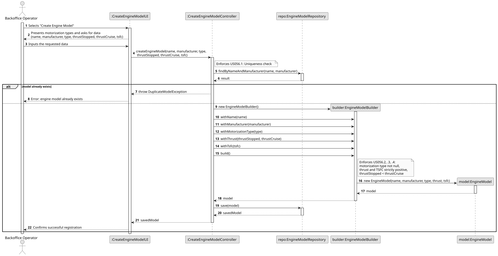
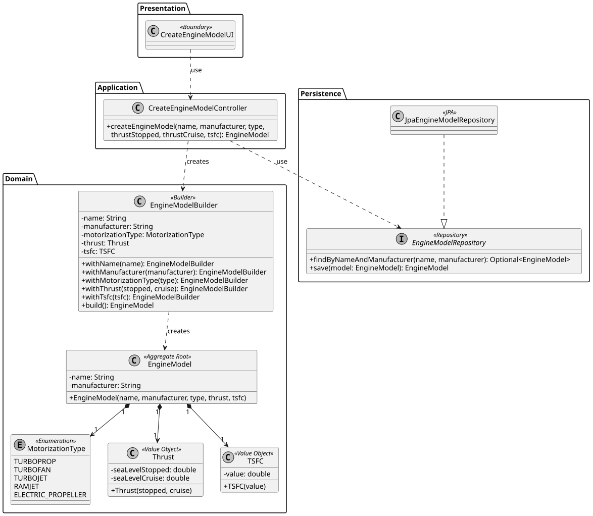

# US056 — Create an Aircraft Engine Model

## 1. Context

This task is developed for the first time in Sprint 2, as part of the Backoffice Configuration requirements. The goal is to allow the system to register engine models that will later be associated with aircraft models (US055), forming the basis for flight simulation and performance calculations.

---

## 2. Requirements

**US056** — As a Backoffice Operator, I want to register a new engine model to be used by aircraft.

### 2.1 Acceptance Criteria

- **US056.1** The engine model has a name and manufacturer, and their combination must be unique.
- **US056.2** The engine model must specify a motorization type (turboprop, turbofan, turbojet, ramjet, electric propeller).
- **US056.3** The engine model must include thrust information at sea level at two reference speeds: stopped and cruise/maximum speed.
- **US056.4** The engine model must include fuel efficiency information, specifically the Thrust Specific Fuel Consumption (TSFC), stored in SI units (N/N/s).
- **US056.5** Registration must also be achievable via a bootstrap process.

### 2.2 Dependencies

There are no functional dependencies for this user story. However, US056 is a strong dependency for:

- **US055** — Create an Aircraft Model (aircraft models must reference existing engine models)
- **US057** — Add an Engine Model to an Aircraft Model
- **US058** — Remove an Engine Model from an Aircraft Model

---

## 3. Analysis

### 3.1 Domain Model Excerpt

The `EngineModel` is implemented as an **Aggregate Root** following Domain-Driven Design principles.

The aggregate contains:

- **Identity:** `EngineModelID` (surrogate key)
- **Business identity:** `name` + `manufacturer` (combination must be unique)
- **Classification:** `MotorizationType`
- **Physical parameters:** `Thrust` (sea level stopped and sea level cruise) and `TSFC`

Key relationships:

- `EngineModel` — composition → `MotorizationType` (1 to 1)
- `EngineModel` — composition → `Thrust` (1 to 1, contains two reference values)
- `EngineModel` — composition → `TSFC` (1 to 1)
- `AircraftModel` (US055) — association → `EngineModel` (many to many; an engine model can be certified for multiple aircraft models)

### 3.2 Domain Invariants

The `EngineModel` aggregate enforces:

1. `name` + `manufacturer` combination must be unique in the system.
2. `MotorizationType` must be one of the allowed values and cannot be null.
3. Thrust at sea level stopped must be strictly positive.
4. Thrust at sea level cruise must be strictly positive and greater than thrust at stopped.
5. TSFC must be strictly positive.

---

## 4. Design

### 4.1 Architecture

The solution follows the layered architecture of the EAPLI framework:

```
CreateEngineModelUI
    → CreateEngineModelController
        → EngineModelBuilder
            → EngineModel (Aggregate Root)
        → EngineModelRepository
```

### 4.2 Main Components

| Class                        | Layer                    | Responsibility                                                       |
|------------------------------|--------------------------|----------------------------------------------------------------------|
| `CreateEngineModelUI`        | UI (Boundary)            | Collects input from the operator; displays motorization type options |
| `CreateEngineModelController`| Application              | Orchestrates use case; checks uniqueness; calls builder and repository |
| `EngineModelBuilder`         | Domain (Builder)         | Constructs `EngineModel`; validates inputs                           |
| `EngineModel`                | Domain (Aggregate Root)  | Enforces all domain invariants                                       |
| `EngineModelRepository`      | Persistence (interface)  | Persistence abstraction                                              |
| `JpaEngineModelRepository`   | Persistence (JPA impl)   | JPA implementation                                                   |

### 4.3 Value Objects

| Value Object       | Description                                                                 |
|--------------------|-----------------------------------------------------------------------------|
| `MotorizationType` | Enum: `TURBOFAN`, `TURBOPROP`, `TURBOJET`, `RAMJET`, `ELECTRIC_PROPELLER`  |
| `Thrust`           | Groups `seaLevelStopped` (kN) and `seaLevelCruise` (kN); both must be positive and `stopped` < `cruise` |
| `TSFC`             | Thrust Specific Fuel Consumption in SI units (N/N/s); must be positive      |

### 4.4 Sequence Diagram

**

The main success scenario proceeds as follows:

1. The Backoffice Operator selects *Create Engine Model*.
2. The UI presents the available motorization types and collects all required input.
3. The UI invokes `createEngineModel(data...)` on the controller.
4. The controller checks uniqueness by calling `findByNameAndManufacturer()` on the repository.
5. If no duplicate exists, the controller creates an `EngineModelBuilder` and sets all fields.
6. The builder constructs the `EngineModel` domain object, validating all invariants.
7. The controller persists the model via `EngineModelRepository`.
8. The system confirms success to the operator.

### 4.5 Class Diagram

**

### 4.6 Design Decision — Unit Normalisation

Although the domain physics specification states that TSFC can be expressed in different units (g/s/kN or US units), the system stores all values internally in SI units (N/N/s) to prevent conversion errors during flight simulation (Sprint 3). The UI must inform the operator of the expected units during data entry.

---

## 5. Tests

All tests follow the **AAA (Arrange / Act / Assert)** convention as required by NFR03. Coverage of domain and controller packages must not fall below 90%.

### 5.1 Unit Test — Must Have Motorization Type (US056.2)

```java
@Test
public void ensureEngineModelMustHaveMotorizationType() {
    // Arrange
    EngineModelBuilder builder = new EngineModelBuilder()
        .withName("LEAP-1B")
        .withManufacturer("CFM International")
        .withThrust(new Thrust(101.8, 121.4))
        .withTsfc(new TSFC(0.0157));
    // Act + Assert
    assertThrows(IllegalArgumentException.class, builder::build);
}
```

### 5.2 Unit Tests — Positive Values Enforced (US056.3, US056.4)

```java
@Test
public void ensureEngineThrustCannotBeNegative() {
    // Arrange
    EngineModelBuilder builder = new EngineModelBuilder()
        .withName("LEAP-1B")
        .withManufacturer("CFM International")
        .withMotorizationType(MotorizationType.TURBOFAN)
        .withThrust(new Thrust(-500.0, 121.4))
        .withTsfc(new TSFC(0.0157));
    // Act + Assert
    assertThrows(IllegalArgumentException.class, builder::build);
}

@Test
public void ensureTsfcCannotBeNegative() {
    // Arrange
    EngineModelBuilder builder = new EngineModelBuilder()
        .withName("LEAP-1B")
        .withManufacturer("CFM International")
        .withMotorizationType(MotorizationType.TURBOFAN)
        .withThrust(new Thrust(101.8, 121.4))
        .withTsfc(new TSFC(-0.01));
    // Act + Assert
    assertThrows(IllegalArgumentException.class, builder::build);
}
```

### 5.3 Unit Test — Valid Engine Model Created Successfully

```java
@Test
public void ensureValidEngineModelIsCreatedSuccessfully() {
    // Arrange + Act
    EngineModel engine = new EngineModelBuilder()
        .withName("LEAP-1B")
        .withManufacturer("CFM International")
        .withMotorizationType(MotorizationType.TURBOFAN)
        .withThrust(new Thrust(101.8, 121.4))
        .withTsfc(new TSFC(0.0157))
        .build();
    // Assert
    assertNotNull(engine);
    assertEquals("LEAP-1B", engine.name());
}
```

### 5.4 Integration Test — Unique Name + Manufacturer (US056.1)

```java
@Test
public void ensureEngineNameAndManufacturerCombinationIsUnique() {
    // Arrange
    EngineModel engine = new EngineModelBuilder()
        .withName("LEAP-1B")
        .withManufacturer("CFM International")
        .withMotorizationType(MotorizationType.TURBOFAN)
        .withThrust(new Thrust(101.8, 121.4))
        .withTsfc(new TSFC(0.0157))
        .build();
    repository.save(engine);
    // Act + Assert
    // Uniqueness is checked by the controller before invoking the builder.
    assertThrows(DuplicateModelException.class,
        () -> controller.createEngineModel(validDto("LEAP-1B", "CFM International")));
}
```

> **Note:** Uniqueness is enforced by the controller, which calls `findByNameAndManufacturer()` before invoking the builder. The builder itself has no repository access.

### 5.5 Bootstrap Test (US056.5)

```java
@Test
public void ensureBootstrapCreatesEngineModels() {
    // Arrange + Act
    bootstrapper.execute();
    // Assert
    assertTrue(repository.findByNameAndManufacturer("LEAP-1B", "CFM International").isPresent());
}
```

---

## 6. Implementation

### 6.1 Package Structure

```
eapli.aisafe/
  backoffice/
    application/
      CreateEngineModelController.java
    domain/
      enginemodel/
        EngineModel.java              ← Aggregate Root
        EngineModelBuilder.java
        EngineModelRepository.java    ← interface
        MotorizationType.java         ← enum
        Thrust.java                   ← Value Object
        TSFC.java                     ← Value Object
    infrastructure/
      persistence/
        jpa/
          JpaEngineModelRepository.java
    ui/
      backoffice/
        CreateEngineModelUI.java
  bootstrapping/
    EngineModelBootstrapper.java
```

### 6.2 Key Implementation Notes

- `EngineModel` is the aggregate root. All mutations go through it.
- Uniqueness (`name` + `manufacturer`) is enforced at two levels: controller (pre-check via repository) and database (unique constraint on the JPA entity).
- All value objects (`Thrust`, `TSFC`) are immutable and validate their inputs in the constructor.
- `EngineModelBootstrapper` must run **before** `AircraftModelBootstrapper`, since US055 depends on existing engine models.

### 6.3 Bootstrap Example

```java
@Component
public class EngineModelBootstrapper implements Bootstrapper {

    @Autowired
    private CreateEngineModelController controller;

    @Override
    public void execute() {
        controller.createEngineModel(new EngineModelDTO(
            "LEAP-1B", "CFM International",
            MotorizationType.TURBOFAN,
            new ThrustDTO(101.8, 121.4),
            new TSFCDTO(0.0157)
        ));
        controller.createEngineModel(new EngineModelDTO(
            "Trent 900", "Rolls-Royce",
            MotorizationType.TURBOFAN,
            new ThrustDTO(311.0, 340.0),
            new TSFCDTO(0.0152)
        ));
    }
}
```

---

## 7. Observations and Design Decisions

1. **Uniqueness check location** — the check is done in the controller, not in the builder or aggregate, because it requires repository access. The aggregate root enforces structural invariants; inter-aggregate uniqueness is an application-layer concern.

2. **`Thrust` as a single Value Object** — both thrust reference values (sea level stopped and sea level cruise) are grouped in a single `Thrust` value object. This allows the invariant `stopped < cruise` to be enforced cohesively in one place.

3. **TSFC unit normalisation** — all TSFC values are stored in SI units (N/N/s) regardless of how the operator enters them. This is a deliberate design decision to prevent conversion errors in Sprint 3 simulation components.

4. **Bootstrap execution order** — `EngineModelBootstrapper` must run before `AircraftModelBootstrapper`.

### 7.1 Relation to Other User Stories

| US    | Relationship                                                                          |
|-------|---------------------------------------------------------------------------------------|
| US055 | US056 must be implemented first — aircraft models must reference existing engine models |
| US057 | Adds further engine model associations to an aircraft model created in US055          |
| US058 | Removes engine models; requires at least one to remain (enforced by US055/US057)      |

### 7.2 Open Questions

- Should TSFC values be stored with a specific number of decimal places, or with full double precision?
- Is there a maximum number of thrust reference points per engine model, or only the two defined in the requirements?