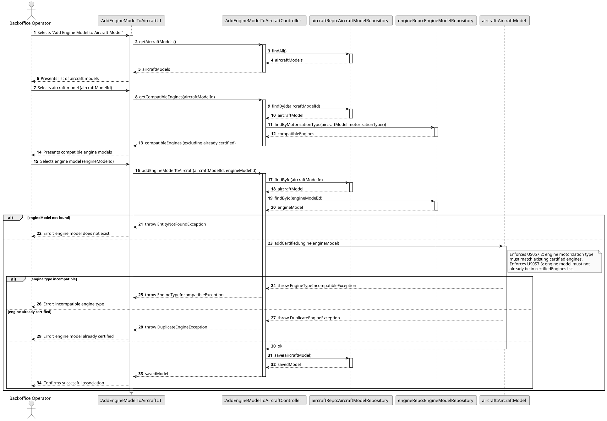
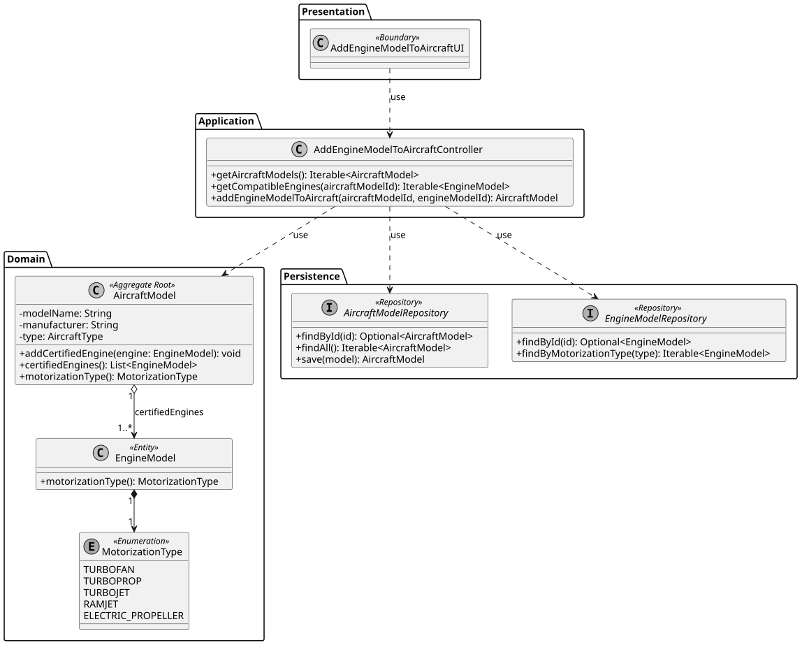

# US057 — Add an Engine Model to an Aircraft Model

## 1. Context

This task is developed for the first time in Sprint 2, as part of the Backoffice Configuration requirements. The goal is to allow the system to associate additional certified engine models to an existing aircraft model, expanding the set of valid engine configurations (variants) for that model.

---

## 2. Requirements

**US057** — As a Backoffice Operator, I want to add an engine model to an aircraft model's list of certified engines.

### 2.1 Acceptance Criteria

- **US057.1** The engine model to be added must already exist in the system.
- **US057.2** The motorization type of the engine model must be compatible with the motorization type already certified for the aircraft model (all engines of the same aircraft model must share the same motorization type).
- **US057.3** The same engine model cannot be added twice to the same aircraft model.
- **US057.4** An aircraft model may have several variants, each corresponding to a different combination of aircraft model and engine configuration.

### 2.2 Dependencies

- **US055** — Create an Aircraft Model: the aircraft model must already exist.
- **US056** — Create an Aircraft Engine Model: the engine model must already exist.

---

## 3. Analysis

### 3.1 Domain Model Excerpt

This user story operates on the existing `AircraftModel` aggregate (defined in US055). No new aggregates are introduced.

The operation adds a reference to an existing `EngineModel` entity to the `certifiedEngines` list of an `AircraftModel`. The `AircraftModel` aggregate root is responsible for enforcing all invariants related to this association.

Key relationships involved:

- `AircraftModel` — association → `EngineModel` (1 to many; this US increases the cardinality by 1)
- `EngineModel` — already exists in the system (created by US056)

### 3.2 Domain Invariants

The `AircraftModel` aggregate enforces, when adding a new engine:

1. The `EngineModel` must exist in the system (checked via repository before calling the domain method).
2. The `EngineModel`'s `MotorizationType` must match the `MotorizationType` of all engines already certified for the aircraft model.
3. The `EngineModel` must not already be present in the `certifiedEngines` list of the aircraft model.

---

## 4. Design

### 4.1 Architecture

```
AddEngineModelToAircraftUI
    → AddEngineModelToAircraftController
        → AircraftModelRepository (fetch aircraft model)
        → EngineModelRepository (fetch engine model)
        → AircraftModel.addCertifiedEngine(engineModel)
        → AircraftModelRepository (save updated aircraft model)
```

### 4.2 Main Components

| Class                               | Layer                    | Responsibility                                                                 |
|-------------------------------------|--------------------------|--------------------------------------------------------------------------------|
| `AddEngineModelToAircraftUI`        | UI (Boundary)            | Collects input; presents list of aircraft models and compatible engine models  |
| `AddEngineModelToAircraftController`| Application              | Orchestrates use case; fetches both aggregates; calls domain method            |
| `AircraftModel`                     | Domain (Aggregate Root)  | Enforces all invariants via `addCertifiedEngine()`                             |
| `AircraftModelRepository`           | Persistence (interface)  | Fetches and persists the updated aircraft model                                |
| `EngineModelRepository`             | Persistence (interface)  | Fetches the engine model to be added                                           |

### 4.3 Sequence Diagram

**

The main success scenario proceeds as follows:

1. The Backoffice Operator selects *Add Engine Model to Aircraft Model*.
2. The UI requests the list of available aircraft models from the controller.
3. The controller retrieves all aircraft models and returns them to the UI.
4. The operator selects an aircraft model.
5. The UI requests the list of engine models compatible with the selected aircraft model's motorization type.
6. The controller retrieves compatible engine models (not yet certified for that aircraft) and returns them.
7. The operator selects an engine model.
8. The UI invokes `addEngineModelToAircraft(aircraftModelId, engineModelId)` on the controller.
9. The controller fetches both the `AircraftModel` and the `EngineModel` from their repositories.
10. The controller calls `aircraftModel.addCertifiedEngine(engineModel)`, which enforces all invariants.
11. The controller persists the updated `AircraftModel` via the repository.
12. The system confirms success to the operator.

### 4.4 Class Diagram

**

---

## 5. Tests

All tests follow the **AAA (Arrange / Act / Assert)** convention as required by NFR03. Coverage of domain and controller packages must not fall below 90%.

### 5.1 Unit Test — Engine Type Must Be Compatible (US057.2)

```java
@Test
public void ensureIncompatibleEngineTypeIsRejected() {
    // Arrange
    EngineModel turbofanEngine = engineWithType(MotorizationType.TURBOFAN);
    AircraftModel aircraft = validAircraftModelWith(turbofanEngine);
    EngineModel turbopropEngine = engineWithType(MotorizationType.TURBOPROP);
    // Act + Assert
    assertThrows(EngineTypeIncompatibleException.class,
        () -> aircraft.addCertifiedEngine(turbopropEngine));
}
```

### 5.2 Unit Test — Duplicate Engine Not Allowed (US057.3)

```java
@Test
public void ensureSameEngineCannotBeAddedTwice() {
    // Arrange
    EngineModel engine = validEngine();
    AircraftModel aircraft = validAircraftModelWith(engine);
    // Act + Assert
    assertThrows(DuplicateEngineException.class,
        () -> aircraft.addCertifiedEngine(engine));
}
```

### 5.3 Unit Test — Valid Engine Added Successfully (US057.1, US057.2, US057.3)

```java
@Test
public void ensureCompatibleEngineIsAddedSuccessfully() {
    // Arrange
    EngineModel engine1 = engineWithType(MotorizationType.TURBOFAN);
    EngineModel engine2 = engineWithType(MotorizationType.TURBOFAN);
    AircraftModel aircraft = validAircraftModelWith(engine1);
    // Act
    aircraft.addCertifiedEngine(engine2);
    // Assert
    assertTrue(aircraft.certifiedEngines().contains(engine2));
}
```

### 5.4 Integration Test — Engine Must Exist in System (US057.1)

```java
@Test
public void ensureNonExistentEngineModelIsRejected() {
    // Arrange
    AircraftModel aircraft = validAircraftModel();
    EngineModelId nonExistentId = new EngineModelId(9999L);
    // Act + Assert
    assertThrows(EntityNotFoundException.class,
        () -> controller.addEngineModelToAircraft(aircraft.id(), nonExistentId));
}
```

---

## 6. Implementation

### 6.1 Package Structure

```
eapli.aisafe/
  backoffice/
    application/
      AddEngineModelToAircraftController.java
    domain/
      aircraftmodel/
        AircraftModel.java              ← addCertifiedEngine() added here
    ui/
      backoffice/
        AddEngineModelToAircraftUI.java
```

> No new domain classes are required. The domain change is confined to adding the `addCertifiedEngine(EngineModel)` method to the existing `AircraftModel` aggregate root.

### 6.2 Key Implementation Notes

- The operation mutates the `AircraftModel` aggregate. The aggregate root method `addCertifiedEngine()` is responsible for enforcing all three invariants (type compatibility, no duplicates, engine existence is pre-checked by the controller).
- The controller fetches the `AircraftModel` by ID, calls the domain method, and then saves the updated aggregate via `AircraftModelRepository`. No new builder is needed.
- Engine existence is validated at the controller level by attempting to fetch the `EngineModel` from `EngineModelRepository` — if not found, an `EntityNotFoundException` is thrown before the domain method is called.
- The UI should pre-filter the engine model list to show only engines with a compatible motorization type and not already certified for the selected aircraft model, to guide the operator and reduce invalid submissions.

---

## 7. Observations and Design Decisions

1. **No builder needed** — unlike US055, this user story mutates an existing aggregate rather than creating a new one. The domain method `addCertifiedEngine()` on `AircraftModel` is the appropriate entry point, keeping the operation within the aggregate boundary.

2. **Pre-filtering in the UI** — the UI should filter the engine model list before presenting it to the operator (compatible type only, not already certified). This improves usability and reduces the chance of invalid submissions, without relaxing the domain-level invariant enforcement.

3. **Variant concept** — US057.4 mentions aircraft variants as combinations of model and engine configuration. This is an informational note about the business domain; no separate `Variant` entity is introduced at this stage. Each unique combination of `AircraftModel` + set of `certifiedEngines` implicitly defines a variant.

### 7.1 Relation to Other User Stories

| US    | Relationship                                                                             |
|-------|------------------------------------------------------------------------------------------|
| US055 | The `AircraftModel` modified here is created by US055                                   |
| US056 | The `EngineModel` added here is created by US056                                        |
| US058 | The inverse operation — removes an engine from the certified list                       |
| US070 | Aircraft instances (US070) reference a specific model+engine combination (variant)       |

### 7.2 Open Questions

- Should the system explicitly model `AircraftVariant` as a separate entity to track model+engine combinations, or is the implicit set of certified engines sufficient for Sprint 2?
- Is there a maximum number of engine models that can be certified for a single aircraft model?
