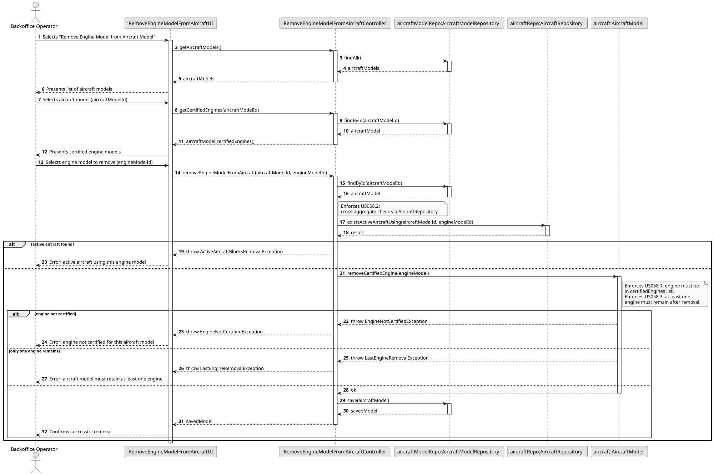
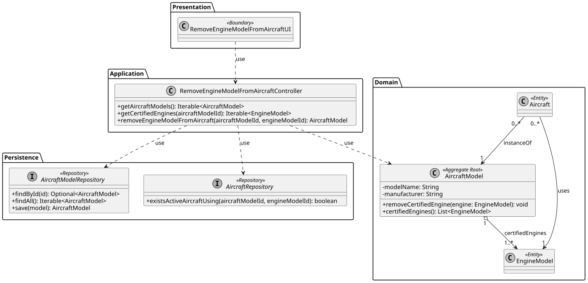

# US058 — Remove an Engine Model from an Aircraft Model

## 1. Context

This task is developed for the first time in Sprint 2, as part of the Backoffice Configuration requirements. The goal is to allow the system to remove a certified engine model from an existing aircraft model, provided the removal does not violate domain invariants.

---

## 2. Requirements

**US058** — As a Backoffice Operator, I want to remove an engine model from an aircraft model's list of certified engines.

### 2.1 Acceptance Criteria

- **US058.1** The engine model to be removed must currently be certified for the selected aircraft model.
- **US058.2** Removal is not possible if there are actual aircraft (instances) using that specific engine model in combination with the aircraft model.
- **US058.3** The aircraft model must retain at least one certified engine model after the removal.

### 2.2 Dependencies

- **US055** — Create an Aircraft Model: the aircraft model must already exist.
- **US056** — Create an Aircraft Engine Model: the engine model must already exist.
- **US057** — Add an Engine Model to an Aircraft Model: the engine model must be certified for the aircraft model before it can be removed.
- **US070** — Add an Aircraft to an Air Transport Company: aircraft instances created in US070 determine whether removal is blocked by US058.2.

---

## 3. Analysis

### 3.1 Domain Model Excerpt

This user story operates on the existing `AircraftModel` aggregate (defined in US055). No new aggregates are introduced.

The operation removes a reference to an existing `EngineModel` from the `certifiedEngines` list of an `AircraftModel`. The `AircraftModel` aggregate root is responsible for enforcing the invariants related to minimum cardinality (US058.3). The controller is responsible for checking whether actual aircraft instances block the removal (US058.2), as this requires cross-aggregate querying.

Key relationships involved:

- `AircraftModel` — association → `EngineModel` (1 to many; this US decreases the cardinality by 1, minimum 1 must remain)
- `Aircraft` (US070) — references a specific `AircraftModel` + `EngineModel` combination; if such an instance exists, removal is blocked

### 3.2 Domain Invariants

When removing an engine model, the following rules are enforced:

1. The `EngineModel` must currently be in the `certifiedEngines` list of the selected `AircraftModel` (checked by the aggregate).
2. At least one `EngineModel` must remain in the `certifiedEngines` list after removal (enforced by the aggregate).
3. No active `Aircraft` instance may be using the combination of this `AircraftModel` and the `EngineModel` to be removed (checked by the controller via `AircraftRepository`).

---

## 4. Design

### 4.1 Architecture

```
RemoveEngineModelFromAircraftUI
    → RemoveEngineModelFromAircraftController
        → AircraftModelRepository (fetch aircraft model)
        → AircraftRepository (check active aircraft using this engine)
        → AircraftModel.removeCertifiedEngine(engineModel)
        → AircraftModelRepository (save updated aircraft model)
```

### 4.2 Main Components

| Class                                  | Layer                    | Responsibility                                                                          |
|----------------------------------------|--------------------------|-----------------------------------------------------------------------------------------|
| `RemoveEngineModelFromAircraftUI`      | UI (Boundary)            | Collects input; presents aircraft models and their certified engines                    |
| `RemoveEngineModelFromAircraftController` | Application           | Orchestrates use case; checks active aircraft; calls domain method                      |
| `AircraftModel`                        | Domain (Aggregate Root)  | Enforces minimum cardinality and engine presence via `removeCertifiedEngine()`          |
| `AircraftModelRepository`              | Persistence (interface)  | Fetches and persists the updated aircraft model                                         |
| `AircraftRepository`                   | Persistence (interface)  | Checks whether active aircraft instances use the engine model to be removed             |

### 4.3 Sequence Diagram

**

The main success scenario proceeds as follows:

1. The Backoffice Operator selects *Remove Engine Model from Aircraft Model*.
2. The UI requests the list of available aircraft models from the controller.
3. The controller retrieves all aircraft models and returns them to the UI.
4. The operator selects an aircraft model.
5. The UI requests the list of certified engines for the selected aircraft model.
6. The controller fetches the aircraft model and returns its certified engine list.
7. The operator selects an engine model to remove.
8. The UI invokes `removeEngineModelFromAircraft(aircraftModelId, engineModelId)` on the controller.
9. The controller fetches the `AircraftModel` from the repository.
10. The controller checks whether any active `Aircraft` instance uses this `AircraftModel` + `EngineModel` combination via `AircraftRepository`.
11. If no active aircraft blocks the removal, the controller calls `aircraftModel.removeCertifiedEngine(engineModel)`, which enforces minimum cardinality and engine presence.
12. The controller persists the updated `AircraftModel`.
13. The system confirms success to the operator.

### 4.4 Class Diagram

**

---

## 5. Tests

All tests follow the **AAA (Arrange / Act / Assert)** convention as required by NFR03. Coverage of domain and controller packages must not fall below 90%.

### 5.1 Unit Test — Last Engine Cannot Be Removed (US058.3)

```java
@Test
public void ensureLastCertifiedEngineCannotBeRemoved() {
    // Arrange
    EngineModel engine = validEngine();
    AircraftModel aircraft = validAircraftModelWith(engine);
    // Act + Assert
    assertThrows(LastEngineRemovalException.class,
        () -> aircraft.removeCertifiedEngine(engine));
}
```

### 5.2 Unit Test — Engine Not Certified Cannot Be Removed (US058.1)

```java
@Test
public void ensureNonCertifiedEngineCannotBeRemoved() {
    // Arrange
    EngineModel certifiedEngine = validEngine();
    EngineModel otherEngine = anotherValidEngine();
    AircraftModel aircraft = validAircraftModelWith(certifiedEngine);
    // Act + Assert
    assertThrows(EngineNotCertifiedException.class,
        () -> aircraft.removeCertifiedEngine(otherEngine));
}
```

### 5.3 Unit Test — Valid Removal Succeeds (US058.1, US058.3)

```java
@Test
public void ensureEngineIsRemovedSuccessfullyWhenMoreThanOneExists() {
    // Arrange
    EngineModel engine1 = engineWithType(MotorizationType.TURBOFAN);
    EngineModel engine2 = engineWithType(MotorizationType.TURBOFAN);
    AircraftModel aircraft = validAircraftModelWith(engine1, engine2);
    // Act
    aircraft.removeCertifiedEngine(engine1);
    // Assert
    assertFalse(aircraft.certifiedEngines().contains(engine1));
    assertEquals(1, aircraft.certifiedEngines().size());
}
```

### 5.4 Integration Test — Active Aircraft Blocks Removal (US058.2)

```java
@Test
public void ensureRemovalIsBlockedWhenActiveAircraftUsesEngine() {
    // Arrange
    EngineModel engine1 = engineWithType(MotorizationType.TURBOFAN);
    EngineModel engine2 = engineWithType(MotorizationType.TURBOFAN);
    AircraftModel aircraftModel = validAircraftModelWith(engine1, engine2);
    aircraftModelRepository.save(aircraftModel);
    Aircraft activeAircraft = aircraftUsingModel(aircraftModel, engine1);
    aircraftRepository.save(activeAircraft);
    // Act + Assert
    assertThrows(ActiveAircraftBlocksRemovalException.class,
        () -> controller.removeEngineModelFromAircraft(
            aircraftModel.id(), engine1.id()));
}
```

> **Note:** US058.2 is enforced at the controller level because it requires cross-aggregate querying (`AircraftRepository`). The aggregate root enforces only the structural invariants (US058.1 and US058.3).

---

## 6. Implementation

### 6.1 Package Structure

```
eapli.aisafe/
  backoffice/
    application/
      RemoveEngineModelFromAircraftController.java
    domain/
      aircraftmodel/
        AircraftModel.java              ← removeCertifiedEngine() added here
    ui/
      backoffice/
        RemoveEngineModelFromAircraftUI.java
```

> No new domain classes are required. The domain change is confined to adding the `removeCertifiedEngine(EngineModel)` method to the existing `AircraftModel` aggregate root.

### 6.2 Key Implementation Notes

- The aggregate root method `removeCertifiedEngine()` enforces US058.1 (engine must be certified) and US058.3 (at least one engine must remain). It throws `EngineNotCertifiedException` and `LastEngineRemovalException` respectively.
- US058.2 is checked at the controller level before calling the domain method, by querying `AircraftRepository` for active aircraft using the `AircraftModel` + `EngineModel` combination. If found, `ActiveAircraftBlocksRemovalException` is thrown.
- The check order in the controller is: (1) fetch aircraft model, (2) check active aircraft, (3) call domain method, (4) save. This order ensures domain invariants are only called after the application-level check passes.
- No builder is needed — this US mutates an existing aggregate, consistent with US057.

---

## 7. Observations and Design Decisions

1. **Responsibility split between controller and aggregate** — US058.2 (active aircraft check) requires querying `AircraftRepository`, which is outside the `AircraftModel` aggregate boundary. This check is therefore placed in the controller. The aggregate enforces only its own structural invariants (US058.1 and US058.3), keeping it free of repository dependencies.

2. **Check order matters** — the active aircraft check (controller) runs before the domain method is called. This avoids mutating the aggregate and then rolling back due to an application-level constraint violation.

3. **No builder needed** — consistent with US057, this US mutates an existing aggregate via a domain method rather than constructing a new one.

4. **Symmetry with US057** — `removeCertifiedEngine()` is the inverse of `addCertifiedEngine()` (US057). Both are methods on `AircraftModel`. This keeps the certified engine management cohesive within the aggregate.

### 7.1 Relation to Other User Stories

| US    | Relationship                                                                                    |
|-------|-------------------------------------------------------------------------------------------------|
| US055 | The `AircraftModel` modified here is created by US055; US055 ensures at least one engine exists at creation |
| US056 | The `EngineModel` removed here is created by US056                                             |
| US057 | The inverse operation — adds an engine to the certified list                                    |
| US070 | Active `Aircraft` instances created by US070 may block the removal (US058.2)                   |

### 7.2 Open Questions

- Should a removed engine model be permanently decertified, or should it be possible to re-add it later via US057?
- Should the system log or audit engine model removals for traceability?
