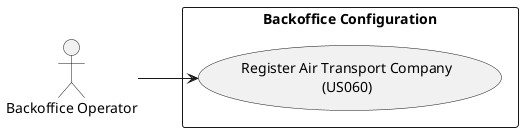
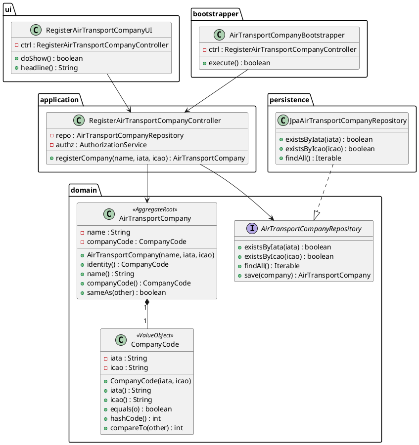
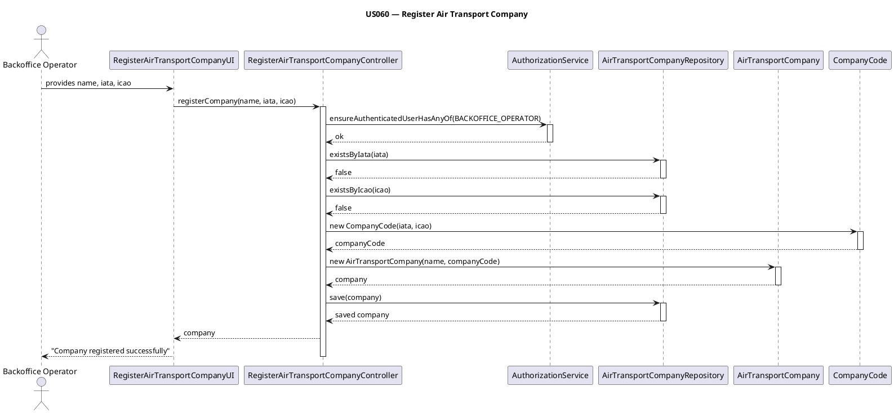

# US060 - Register an Air Transport Company

## 1. Context

This User Story is being developed for the first time in Sprint 2. It is a foundational
requirement for the Air Transport Company domain, as several other functionalities depend on
it — namely the registration of collaborators (US061), aircraft (US070), flight routes
(US073), and pilots (US075).

This US is mandatory for all team sizes and must be implemented after US030 (Authentication
and Authorization) and US031 (Register Users), since it requires an authenticated
Backoffice Operator to perform the registration.

### 1.1 List of Issues

Analysis: Understand the business rules for an air transport company (unique IATA and ICAO
codes, name, bootstrap requirement); identify dependencies on existing domain concepts.

Design: Define the `AirTransportCompany` aggregate root and the `CompanyCode` value object;
design the registration flow following the layered architecture.

Implement: Implement the domain classes, repository interface, application controller, UI,
JPA repository, and bootstrapper.

Test: Verify that duplicate IATA or ICAO codes are rejected; verify that invalid code
formats are rejected; verify that a valid company is persisted correctly.

---

## 2. Requirements

**US060** As a Backoffice Operator, I want to register an air transport company. A company
has a company name, and IATA (2 letters) and ICAO code (2-3 letters) that must be unique.
This must also be achievable by a bootstrap process.

**Acceptance Criteria:**

- US060.1 — The system must allow a Backoffice Operator to register a new air transport
  company by providing a name, IATA code, and ICAO code.
- US060.2 — The IATA code must be exactly 2 uppercase letters and unique across the system.
- US060.3 — The ICAO code must be 2 to 3 uppercase letters and unique across the system.
- US060.4 — The company name must not be empty.
- US060.5 — The system must reject the registration if a company with the same IATA or ICAO
  code already exists, displaying a meaningful error message.
- US060.6 — The registration must be achievable via a bootstrap process without UI
  interaction.
- US060.7 — Only authenticated users with the Backoffice Operator role may register
  companies.

**Dependencies/References:**

- **US030** — Authentication and Authorization must be in place before this US can be
  executed.
- **US031** — At least one Backoffice Operator user must exist in the system.
- This US is a prerequisite for **US061** (Add a customer's collaborator), **US070** (Add
  an aircraft to an air transport company), **US073** (Create a flight route), and **US075**
  (Add a pilot).

---

## 3. Analysis

### 3.1 Domain Understanding

An air transport company is an entity registered in the AISafe system that uses the
platform to register aircraft and flights. It is not a direct client of AISafe — it is a
customer that interacts with the system through its collaborators.

The key business rules are:

| Rule | Description |
|---|---|
| Unique IATA | No two companies can share the same 2-letter IATA code |
| Unique ICAO | No two companies can share the same 2-3 letter ICAO code |
| Non-empty name | The company name must be provided and non-empty |
| Bootstrap | The registration must be achievable without UI interaction |
| Authorization | Only Backoffice Operators can register companies |

### 3.2 Domain Model Excerpt

The `AirTransportCompany` is an **Aggregate Root** identified by its `CompanyCode`, which
is a **Value Object** encapsulating the IATA and ICAO codes. The aggregate has no internal
Entities at this stage — collaborators (ATCC) and pilots are added in subsequent user
stories.

```
AirTransportCompany (AggregateRoot)
  ├── CompanyCode (ValueObject)
  │     ├── iata : String  [2 uppercase letters, unique]
  │     └── icao : String  [2-3 uppercase letters, unique]
  └── name : String        [non-empty]
```

### 3.3 Use Case Diagram



---

## 4. Design

### 4.1 Design Decisions

- **Value Object for identity:** `CompanyCode` encapsulates both IATA and ICAO codes and
  serves as the aggregate identity. Format validation is enforced at construction time,
  ensuring invalid codes can never exist in the domain.
- **Layered Architecture:** The implementation follows the standard
  UI → Controller → Domain → Repository pattern enforced by the EAPLI Framework.
- **Authorization:** The controller calls
  `authorizationService.ensureAuthenticatedUserHasAnyOf` as its first statement, following
  the pattern established in US030.
- **Bootstrap support:** A dedicated bootstrapper class allows the system to be pre-loaded
  with companies without UI interaction, fulfilling the bootstrap acceptance criterion.

### 4.2 Class Diagram (CD)



### 4.3 Sequence Diagram (SD)



### 4.4 Acceptance Tests

**Test 1:** Verifies that a valid company is registered successfully.

**Refers to Acceptance Criteria:** US060.1, US060.4

```java
@Test
void ensureValidCompanyIsCreated() {
    // Arrange + Act
    AirTransportCompany company =
            new AirTransportCompany("TAP Air Portugal", "TP", "TAP");

    // Assert
    assertNotNull(company);
    assertEquals("TAP Air Portugal", company.name());
    assertEquals("TP", company.identity().iata());
    assertEquals("TAP", company.identity().icao());
}
```

**Test 2:** Verifies that an invalid IATA code is rejected.

**Refers to Acceptance Criteria:** US060.2

```java
@Test
void ensureInvalidIataIsRejected() {
    // single letter — invalid
    assertThrows(IllegalArgumentException.class,
            () -> new AirTransportCompany("TAP", "T", "TAP"));

    // three letters — invalid
    assertThrows(IllegalArgumentException.class,
            () -> new AirTransportCompany("TAP", "TAP", "TAP"));
}
```

**Test 3:** Verifies that an invalid ICAO code is rejected.

**Refers to Acceptance Criteria:** US060.3

```java
@Test
void ensureInvalidIcaoIsRejected() {
    // single letter — invalid
    assertThrows(IllegalArgumentException.class,
            () -> new AirTransportCompany("TAP", "TP", "T"));

    // four letters — invalid
    assertThrows(IllegalArgumentException.class,
            () -> new AirTransportCompany("TAP", "TP", "TAPP"));
}
```

**Test 4:** Verifies that an empty name is rejected.

**Refers to Acceptance Criteria:** US060.4

```java
@Test
void ensureEmptyNameIsRejected() {
    assertThrows(IllegalArgumentException.class,
            () -> new AirTransportCompany("", "TP", "TAP"));
}
```

**Test 5:** Verifies that codes are stored as uppercase regardless of input.

**Refers to Acceptance Criteria:** US060.2, US060.3

```java
@Test
void ensureCodesAreStoredAsUppercase() {
    AirTransportCompany company =
            new AirTransportCompany("TAP", "tp", "tap");
    assertEquals("TP", company.identity().iata());
    assertEquals("TAP", company.identity().icao());
}
```

---

## 5. Implementation

### 5.1 CompanyCode (Value Object)

```java
public class CompanyCode implements ValueObject, Comparable<CompanyCode> {

    private final String iata;
    private final String icao;

    public CompanyCode(final String iata, final String icao) {
        Preconditions.nonEmpty(iata, "IATA code cannot be empty");
        Preconditions.nonEmpty(icao, "ICAO code cannot be empty");
        Preconditions.matches(iata.toUpperCase(), "[A-Z]{2}",
                "IATA code must be exactly 2 uppercase letters");
        Preconditions.matches(icao.toUpperCase(), "[A-Z]{2,3}",
                "ICAO code must be 2 or 3 uppercase letters");
        this.iata = iata.toUpperCase();
        this.icao = icao.toUpperCase();
    }

    public String iata() { return iata; }
    public String icao() { return icao; }

    @Override
    public boolean equals(Object o) {
        if (this == o) return true;
        if (!(o instanceof CompanyCode)) return false;
        CompanyCode that = (CompanyCode) o;
        return iata.equals(that.iata) && icao.equals(that.icao);
    }

    @Override
    public int hashCode() { return Objects.hash(iata, icao); }

    @Override
    public int compareTo(CompanyCode other) {
        int c = this.iata.compareTo(other.iata);
        return c != 0 ? c : this.icao.compareTo(other.icao);
    }

    @Override
    public String toString() {
        return String.format("IATA: %s | ICAO: %s", iata, icao);
    }

    protected CompanyCode() { this.iata = null; this.icao = null; }
}
```

### 5.2 AirTransportCompany (Aggregate Root)

```java
@Entity
public class AirTransportCompany implements AggregateRoot<CompanyCode> {

    @EmbeddedId
    private CompanyCode companyCode;

    private String name;

    public AirTransportCompany(final String name,
                                final String iata,
                                final String icao) {
        Preconditions.nonEmpty(name, "Company name cannot be empty");
        this.name = name;
        this.companyCode = new CompanyCode(iata, icao);
    }

    @Override
    public CompanyCode identity() { return companyCode; }

    @Override
    public boolean sameAs(Object other) {
        if (!(other instanceof AirTransportCompany)) return false;
        return this.companyCode.equals(
                ((AirTransportCompany) other).companyCode);
    }

    public String name() { return name; }
    public CompanyCode companyCode() { return companyCode; }

    @Override
    public String toString() {
        return String.format("%s (%s)", name, companyCode);
    }

    protected AirTransportCompany() {}
}
```

### 5.3 Repository Interface

```java
public interface AirTransportCompanyRepository
        extends DomainRepository<CompanyCode, AirTransportCompany> {

    boolean existsByIata(String iata);
    boolean existsByIcao(String icao);
    Iterable<AirTransportCompany> findAll();
}
```

### 5.4 Controller

```java
public class RegisterAirTransportCompanyController {

    private final AirTransportCompanyRepository repo;
    private final AuthorizationService authz;

    public RegisterAirTransportCompanyController() {
        this.repo = PersistenceContext.repositories().airTransportCompanies();
        this.authz = AuthzRegistry.authorizationService();
    }

    public AirTransportCompany registerCompany(final String name,
                                                final String iata,
                                                final String icao) {
        authz.ensureAuthenticatedUserHasAnyOf(Roles.BACKOFFICE_OPERATOR,
                                               Roles.ADMIN);
        if (repo.existsByIata(iata)) {
            throw new IllegalArgumentException(
                    "A company with IATA code '" + iata + "' already exists.");
        }
        if (repo.existsByIcao(icao)) {
            throw new IllegalArgumentException(
                    "A company with ICAO code '" + icao + "' already exists.");
        }
        return repo.save(new AirTransportCompany(name, iata, icao));
    }
}
```

### 5.5 UI

```java
public class RegisterAirTransportCompanyUI extends AbstractUI {

    private final RegisterAirTransportCompanyController ctrl =
            new RegisterAirTransportCompanyController();

    @Override
    protected boolean doShow() {
        System.out.println("--- Register Air Transport Company ---");
        final String name = Console.readNonEmptyLine(
                "Company name: ", "Name cannot be empty");
        final String iata = Console.readNonEmptyLine(
                "IATA code (2 letters): ", "IATA cannot be empty");
        final String icao = Console.readNonEmptyLine(
                "ICAO code (2-3 letters): ", "ICAO cannot be empty");
        try {
            final AirTransportCompany company =
                    ctrl.registerCompany(name, iata, icao);
            System.out.printf("Company '%s' registered successfully.%n",
                    company.name());
        } catch (final IllegalArgumentException e) {
            System.out.println("Error: " + e.getMessage());
        }
        return false;
    }

    @Override
    public String headline() {
        return "Register Air Transport Company";
    }
}
```

### 5.6 Bootstrapper

```java
public class AirTransportCompanyBootstrapper implements Action {

    private final RegisterAirTransportCompanyController ctrl =
            new RegisterAirTransportCompanyController();

    @Override
    public boolean execute() {
        register("TAP Air Portugal", "TP", "TAP");
        register("Ryanair", "FR", "RYR");
        register("EasyJet", "U2", "EZY");
        register("Lufthansa", "LH", "DLH");
        register("Air France", "AF", "AFR");
        return true;
    }

    private void register(final String name,
                           final String iata,
                           final String icao) {
        try {
            ctrl.registerCompany(name, iata, icao);
            System.out.printf("Bootstrapped: %s%n", name);
        } catch (final Exception e) {
            System.out.printf("Skipped '%s': %s%n", name, e.getMessage());
        }
    }
}
```

### 5.7 JPA Repository

```java
public class JpaAirTransportCompanyRepository
        extends BaseJpaRepository<AirTransportCompany, CompanyCode>
        implements AirTransportCompanyRepository {

    public JpaAirTransportCompanyRepository(TransactionalContext tx) {
        super(tx);
    }

    @Override
    public boolean existsByIata(final String iata) {
        return matchOne("e.companyCode.iata = :iata",
                "iata", iata.toUpperCase()).isPresent();
    }

    @Override
    public boolean existsByIcao(final String icao) {
        return matchOne("e.companyCode.icao = :icao",
                "icao", icao.toUpperCase()).isPresent();
    }

    @Override
    public Iterable<AirTransportCompany> findAll() {
        return match("1=1");
    }
}
```

---

## 6. Integration/Demonstration

- The `RegisterAirTransportCompanyUI` is accessible from the Backoffice Operator menu.
- To demonstrate: log in as a Backoffice Operator, navigate to the company registration
  option, and register a new company with a valid name, IATA, and ICAO code.
- To demonstrate bootstrap: run the application bootstrapper and verify that the predefined
  companies (TAP, Ryanair, EasyJet, etc.) are present in the system on first startup.
- To demonstrate validation: attempt to register a company with a duplicate IATA or ICAO
  code — the system should display a meaningful error and not persist the record.

---

## 7. Observations

- The `CompanyCode` is used as the JPA `@EmbeddedId`, meaning both IATA and ICAO are part
  of the composite primary key. This enforces uniqueness at the database level as well as
  the domain level.
- The EAPLI Framework's `Preconditions` utility is used throughout to enforce domain rules
  at construction time, following the fail-fast principle.
- Future user stories (US061, US070, US073, US075) will reference `AirTransportCompany` by
  its `CompanyCode` identity — no direct object references will cross aggregate boundaries.