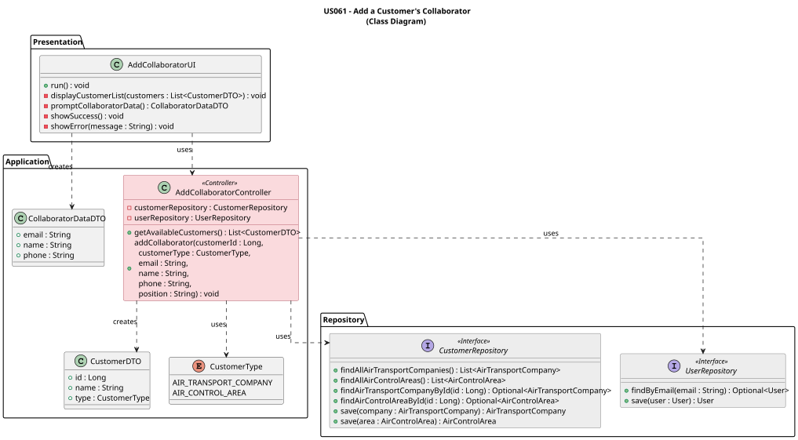

# US061 - Add a Customer's Collaborator

## 1. Context

This User Story is being developed for the first time in Sprint 2. It allows a Backoffice Operator to register a collaborator for a customer of the system. A customer can be either an **Air Transport Company** or an **Air Control Area**. Each collaborator registered here also becomes a system user, meaning they will be able to log in and use the system according to their role.

This US depends on US030 (authentication and authorization) and US060 (register an air transport company) and US050 (register an air control area), as a customer must already exist before a collaborator can be added to it.

### 1.1 List of Issues

Analysis: Understand what a "customer" means in this context (Air Transport Company or Air Control Area); clarify what data is required for a collaborator; confirm that email domain verification is not required.

Design: Define the class diagram covering all four layers (Presentation, Application, Domain, Repository); identify which aggregate root owns the collaborator entity; design the flow for creating both the system User and the collaborator entity.

Implement: Implement `AddCollaboratorController`; implement `addCollaborator()` on `AirTransportCompany` and `AirControlArea`; ensure the `User` aggregate is created and persisted independently; enforce the unique-email invariant before any aggregate is modified.

Test: Verify that adding a collaborator with a duplicate email is rejected; verify that the collaborator is correctly associated with the right customer; verify that the new collaborator is created as active.

---

## 2. Requirements

**US061** As a Backoffice Operator, I want to register a customer's collaborator.

**Acceptance Criteria:**

- US061.1 — A customer must already exist in the system before a collaborator can be added.
- US061.2 — A customer may be an Air Transport Company or an Air Control Area.
- US061.3 — Each collaborator must be a distinct system user; therefore, their email must be unique across the entire system.
- US061.4 — There is no need to verify that the collaborator's email belongs to the customer's domain.
- US061.5 — The new collaborator must be created with an active status.
- US061.6 — This must also be achievable by a bootstrap process.

**Dependencies/References:**

- **US030** — Authentication and authorization must be in place; only a logged-in Backoffice Operator may execute this US.
- **US050** — An Air Control Area must exist to be selected as a customer.
- **US060** — An Air Transport Company must exist to be selected as a customer.
- **NFR09** — Authentication and authorization must be enforced.
- **NFR10** — Implementation language is Java.

---

## 3. Analysis

### 3.1 Domain Understanding

A **collaborator** is a person who works for a customer of AISafe and interacts with the system. There are two kinds of customers:

| Customer Type | Collaborator Entity | Role in System |
|---|---|---|
| Air Transport Company | `ATCC` (Air Transport Company Collaborator) | Manages fleet, routes, pilots |
| Air Control Area | `FlightControlOperator` | Tests flight plans, simulates air control |

The collaborator is represented by two things in the system:
- A **`User`** aggregate — holds the person's identity (email, name, phone). This is what allows them to log in.
- A **collaborator entity** (`ATCC` or `FlightControlOperator`) — held inside the customer's aggregate, recording their position and active status within that organisation.

These two are linked by email, which serves as the cross-aggregate reference. The spec explicitly states that email domain verification is not required, as many users have emails outside the company's main domain.

### 3.2 Key Business Rules

- The collaborator's email must be **unique system-wide** — checked before any aggregate is modified.
- The collaborator is always created with **`active = true`**.
- No two collaborators within the same customer aggregate can share the same email.
- The `User` aggregate is created and persisted **independently** from the collaborator entity — it belongs to the User bounded context, not to the company or area.
- `position` is an attribute of the collaborator role (stored in `ATCC` / `FlightControlOperator`), not of the system `User`.

### 3.3 Customer Type Decision

The Backoffice Operator must first select the customer type and then the specific customer. This choice drives which aggregate root will receive the new collaborator:

```
CustomerType == AIR_TRANSPORT_COMPANY  →  AirTransportCompany.addCollaborator()  →  ATCC entity
CustomerType == AIR_CONTROL_AREA       →  AirControlArea.addCollaborator()        →  FlightControlOperator entity
```

---

## 4. Design

### 4.1 Design Decisions

- **Unique email check first**: Before creating any aggregate or entity, the controller queries `UserRepository` to verify the email is not already taken. This prevents partial state changes if the creation fails.
- **User created independently**: The `User` aggregate is created and saved to `UserRepository` before the collaborator entity is added to the customer aggregate. `User` belongs to its own bounded context.
- **Aggregate enforces its own invariants**: The `addCollaborator()` method lives on the aggregate root (`AirTransportCompany` or `AirControlArea`), not on the controller. The aggregate is responsible for ensuring no duplicate collaborators exist within its own boundary.
- **Cross-aggregate reference by email**: `ATCC` and `FlightControlOperator` reference `User` by email only — they do not hold a direct object reference, keeping aggregate boundaries clean.
- **Single `CustomerRepository`**: Both `AirTransportCompany` and `AirControlArea` are accessed through a unified `CustomerRepository` interface to keep the controller simple. The implementation handles the distinction.

### 4.2 Class Diagram (CD)



The diagram covers four layers:

**Presentation:** `AddCollaboratorUI` — collects input from the operator and displays results. Has no knowledge of business rules.

**Application:** `AddCollaboratorController` — orchestrates the steps: list customers, validate email uniqueness, create `User`, add collaborator to the correct aggregate. Also contains `CustomerDTO`, `CollaboratorDataDTO`, and the `CustomerType` enum.

**Domain:**
- `User <<AggregateRoot>>` with `Email <<ValueObject>>` — identity of the person in the system.
- `AirTransportCompany <<AggregateRoot>>` with `ATCC <<Entity>>` and `CompanyCode <<ValueObject>>`.
- `AirControlArea <<AggregateRoot>>` with `FlightControlOperator <<Entity>>` and `AreaCode <<ValueObject>>`.

**Repository:** `UserRepository` and `CustomerRepository` interfaces — abstractions over persistence, supporting both in-memory (testing) and relational database (production) as required by NFR08.

### 4.3 Sequence Diagram (SD)


The high-level flow is:

1. Operator requests to add a collaborator.
2. System lists available customers (companies + areas).
3. Operator selects a customer and submits collaborator data (email, name, phone, position).
4. Controller checks email uniqueness — aborts with an error if already taken.
5. Controller creates and saves the `User` aggregate.
6. Controller retrieves the selected customer aggregate and calls `addCollaborator()` on it.
7. The aggregate creates the collaborator entity internally and enforces its invariants.
8. The updated aggregate is saved.
9. Success is reported to the operator.

### 4.4 Acceptance Tests

**Test 1:** Collaborator is added to a company successfully.

**Refers to Acceptance Criteria:** US061.1, US061.5

```java
@Test
void ensureCollaboratorIsAddedToCompany() {
    final AirTransportCompany company = savedCompany();
    company.addCollaborator("joao@tap.pt", "João Silva", "Manager");
    customerRepo.save(company);

    final AirTransportCompany loaded =
            (AirTransportCompany) customerRepo.findById("TP/TAP",
                    CustomerDTO.CustomerType.AIR_TRANSPORT_COMPANY).get();
    assertTrue(loaded.findCollaboratorByEmail("joao@tap.pt").isPresent());
}
```

**Test 2:** New collaborator is always active.

**Refers to Acceptance Criteria:** US061.5

```java
@Test
void ensureNewCollaboratorIsActive() {
    final AirTransportCompany company = savedCompany();
    company.addCollaborator("joao@tap.pt", "João Silva", "Manager");
    assertTrue(company.findCollaboratorByEmail("joao@tap.pt").get().isActive());
}
```

**Test 3:** Duplicate email within the same company is rejected.

**Refers to Acceptance Criteria:** US061.3

```java
@Test
void ensureDuplicateEmailWithinSameCompanyThrows() {
    final AirTransportCompany company = savedCompany();
    company.addCollaborator("dup@tap.pt", "First", "Manager");
    assertThrows(IllegalArgumentException.class,
            () -> company.addCollaborator("dup@tap.pt", "Second", "Analyst"));
}
```

---

## 5. Implementation

Key implementation notes:
- `AddCollaboratorController.addCollaborator()` calls `authz.ensureAuthenticatedUserHasAnyOf(BaseRoles.BACKOFFICE_OPERATOR)` as its first statement.
- The bootstrap process (`UserBootstrapper`) creates a Backoffice Operator user (`backoffice@alsafe.com` / `Backoffice1`) on first startup, satisfying US061.6.
- `Collaborator` is a JPA `@Entity` with `@GeneratedValue(strategy = GenerationType.AUTO)`, owned by the customer aggregate via `@OneToMany(cascade = CascadeType.ALL)`.
- Email, phone number, and staff number must all be unique system-wide — enforced by database constraints on `ALSAFE_USER`.

---

## 6. Integration/Demonstration

- Log in as Backoffice Operator (`backoffice@alsafe.com` / `Backoffice1`).
- Navigate to option **7 – Add Customer's Collaborator**.
- Select an existing customer (Air Transport Company or Air Control Area).
- Fill in email, name, phone (9 digits), staff number, position, and initial password.
- Verify the collaborator appears in the listing (US062).

---

## 7. Observations

- Email domain verification is explicitly out of scope per the specification.
- The `Collaborator` entity stores `position` and `name` — these are immutable after creation. Only `email` can be changed (US063).
- Phone number is stored on `User`, not on `Collaborator`. It is displayed in the listing by enriching DTOs from `UserRepository` in the controller.