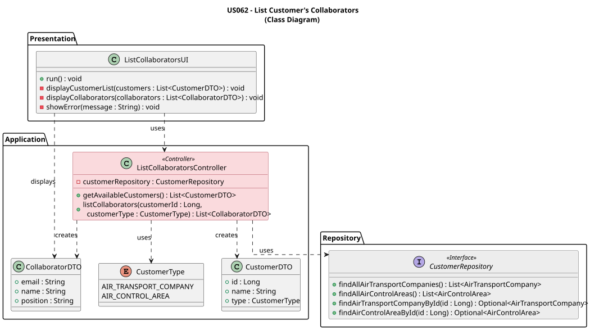
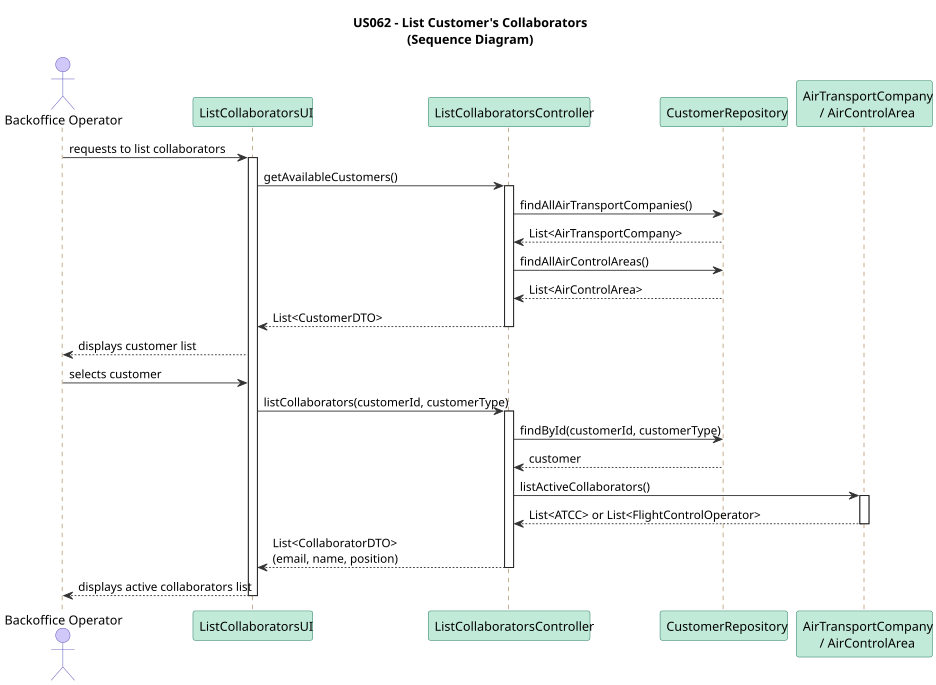

# US062 - List Customer's Collaborators

## 1. Context

This User Story is being developed for the first time in Sprint 2. It allows a Backoffice Operator to view all active collaborators of a given customer. A customer can be either an **Air Transport Company** or an **Air Control Area**. Disabled collaborators must not appear in the listing.

This US depends on US061 (add a customer's collaborator), as collaborators must already exist in the system to be listed. It also depends on US030 for authentication and authorization.

### 1.1 List of Issues

Analysis: Clarify what "disabled collaborators" means and confirm they must be excluded from the list; confirm which fields should be displayed for each collaborator.

Design: Define the class diagram; design the query flow through the aggregate root to respect DDD boundaries.

Implement: Implement `ListCollaboratorsController`; implement `listActiveCollaborators()` on `AirTransportCompany` and `AirControlArea`; map results to a DTO for display.

Test: Verify that disabled collaborators are excluded; verify that the list is correctly filtered by the selected customer.

---

## 2. Requirements

**US062** As a Backoffice Operator, I want to list all collaborators of a given customer. It should not list disabled collaborators.

**Acceptance Criteria:**

- US062.1 — The operator must first select a customer (Air Transport Company or Air Control Area).
- US062.2 — Only active collaborators of the selected customer must be shown.
- US062.3 — Disabled collaborators must be excluded from the listing.
- US062.4 — The list must display at minimum the collaborator's email, name, and position.

**Dependencies/References:**

- **US030** — Only an authenticated Backoffice Operator may execute this US.
- **US061** — Collaborators must have been previously registered.
- **NFR09** — Authentication and authorization must be enforced.
- **NFR10** — Implementation language is Java.

---

## 3. Analysis

### 3.1 Domain Understanding

Collaborators are entities owned by their customer's aggregate root. There are two kinds:

| Customer Type | Collaborator Entity | Active field |
|---|---|---|
| Air Transport Company | `ATCC` | `active : boolean` |
| Air Control Area | `FlightControlOperator` | `active : boolean` |

The `active` flag is the authoritative source for whether a collaborator should appear in the list. The filtering must be done at the aggregate level — the aggregate root exposes `listActiveCollaborators()`, which returns only those collaborators where `active == true`. This keeps the filtering logic inside the domain, not in the controller or UI.

### 3.2 Key Business Rules

- Disabled collaborators (`active == false`) must **never** appear in the listing.
- The listing is scoped to a **single customer** — the operator must select one before seeing the list.
- The aggregate root is the only entry point for accessing its collaborators, in accordance with DDD.

---

## 4. Design

### 4.1 Design Decisions

- **Filtering inside the aggregate**: `listActiveCollaborators()` lives on `AirTransportCompany` and `AirControlArea`, not on the controller. This ensures the business rule ("no disabled collaborators") is enforced at the domain level and cannot be bypassed.
- **DTO for display**: The controller maps collaborator entities to `CollaboratorDTO` objects before passing them to the UI. The UI never touches domain objects directly.
- **Read-only flow**: This US does not modify any state. The controller only reads from the repository and the aggregate — no `save()` is called.

### 4.2 Class Diagram (CD)



The diagram covers four layers:

**Presentation:** `ListCollaboratorsUI` — prompts the operator to select a customer, then displays the resulting list.

**Application:** `ListCollaboratorsController` — retrieves the selected customer from the repository, calls `listActiveCollaborators()` on it, and maps the result to `CollaboratorDTO`. Also uses `CustomerType` to route to the correct aggregate.

**Domain:** `AirTransportCompany` with `ATCC`; `AirControlArea` with `FlightControlOperator`. Both expose `listActiveCollaborators()` which filters by `active == true`.

**Repository:** `CustomerRepository` — used to retrieve the selected customer aggregate.

### 4.3 Sequence Diagram (SD)



The high-level flow is:

1. Operator requests to list collaborators.
2. System lists available customers (companies + areas).
3. Operator selects a customer.
4. Controller retrieves the customer aggregate from the repository.
5. Controller calls `listActiveCollaborators()` on the aggregate.
6. Aggregate returns only collaborators where `active == true`.
7. Controller maps results to `CollaboratorDTO`.
8. UI displays the list to the operator.

### 4.4 Acceptance Tests

**Test 1:** Active collaborators are returned.

**Refers to Acceptance Criteria:** US062.2

```java
@Test
void ensureActiveCompanyCollaboratorsAreReturned() {
    final AirTransportCompany company = savedCompany();
    company.addCollaborator("joao@tap.pt", "João", "Manager");
    customerRepo.save(company);

    final List<CollaboratorDTO> result =
            ctrl.listCollaborators("TP/TAP", CustomerDTO.CustomerType.AIR_TRANSPORT_COMPANY);

    assertEquals(1, result.size());
    assertEquals("joao@tap.pt", result.get(0).email);
}
```

**Test 2:** Disabled collaborators are excluded.

**Refers to Acceptance Criteria:** US062.3

```java
@Test
void ensureDisabledCompanyCollaboratorsAreExcluded() {
    final AirTransportCompany company = savedCompany();
    company.addCollaborator("active@tap.pt",   "Active",   "Manager");
    company.addCollaborator("disabled@tap.pt", "Disabled", "Analyst");
    company.disableCollaborator("disabled@tap.pt");
    customerRepo.save(company);

    final List<CollaboratorDTO> result =
            ctrl.listCollaborators("TP/TAP", CustomerDTO.CustomerType.AIR_TRANSPORT_COMPANY);

    assertEquals(1, result.size());
    assertEquals("active@tap.pt", result.get(0).email);
}
```

**Test 3:** List is scoped to the selected customer.

**Refers to Acceptance Criteria:** US062.1

```java
@Test
void ensureListIsScopedToSelectedCompany() {
    final AirTransportCompany tap     = new AirTransportCompany("TAP",     "TP", "TAP");
    final AirTransportCompany ryanair = new AirTransportCompany("Ryanair", "FR", "RYR");
    tap.addCollaborator("collab@tap.pt",    "TAP Person", "Manager");
    ryanair.addCollaborator("collab@fr.com", "FR Person",  "Analyst");
    customerRepo.save(tap);
    customerRepo.save(ryanair);

    final List<CollaboratorDTO> result =
            ctrl.listCollaborators("TP/TAP", CustomerDTO.CustomerType.AIR_TRANSPORT_COMPANY);

    assertEquals(1, result.size());
    assertEquals("collab@tap.pt", result.get(0).email);
}
```

---

## 5. Implementation

Key implementation notes:
- `ListCollaboratorsController` injects both `CustomerRepository` and `UserRepository`.
- Phone enrichment uses `userRepo.findByEmail(EmailAddress.valueOf(dto.email))`.
- The display format is: `EMAIL | NAME | POSITION | PHONE` with fixed-width columns.

---

## 6. Integration/Demonstration

- Log in as Backoffice Operator.
- Navigate to option **8 – List Customer's Collaborators**.
- Select a customer and verify active collaborators appear with phone numbers.
- Disable a collaborator (US064) and verify they no longer appear in the list.

---

## 7. Observations

- Phone number shows `N/A` for collaborators registered before US061 was fully implemented (i.e. before the domain `User` was being created alongside the `SystemUser`).
- No pagination is implemented. If the number of collaborators grows significantly this may need to be revisited.