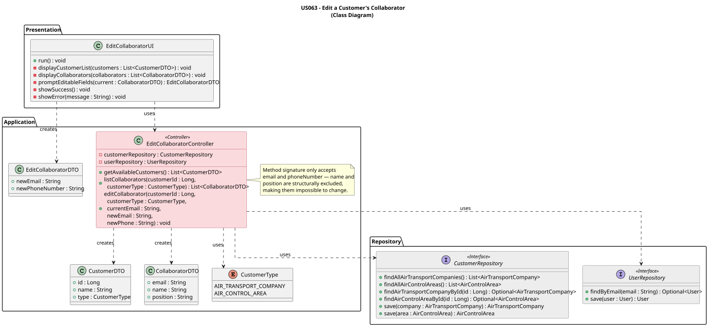
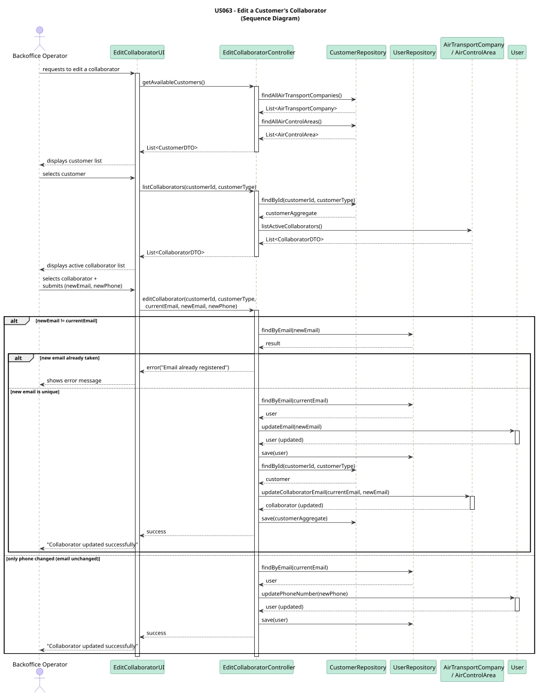

# US063 - Edit a Customer's Collaborator

## 1. Context

This User Story is being developed for the first time in Sprint 2. It allows a Backoffice Operator to edit the information of an existing collaborator of a customer. Per the specification, only **email** and **phone number** may be changed — all other information is immutable after creation.

This US depends on US061 (add a customer's collaborator), as the collaborator must already exist. It also depends on US030 for authentication and authorization.

### 1.1 List of Issues

Analysis: Confirm exactly which fields are editable (email and phone number only); understand the impact of changing an email given that it serves as the cross-aggregate reference to `User`; confirm whether editing applies to both `AirTransportCompany` and `AirControlArea` collaborators.

Design: Define the class diagram; design the update flow ensuring the `User` aggregate and the collaborator entity remain consistent after an email change; enforce the unique-email invariant on the new email value.

Implement: Implement `EditCollaboratorController`; implement `updateCollaborator()` on the relevant aggregates; update the `User` aggregate if the email changes; enforce that name and position cannot be changed.

Test: Verify that email and phone number can be updated; verify that name and position cannot be changed; verify that changing to a duplicate email is rejected; verify consistency between `User` and the collaborator entity after an email change.

---

## 2. Requirements

**US063** As a Backoffice Operator, I want to edit the information (email and phone number) of a customer's collaborator. All other information cannot be changed.

**Acceptance Criteria:**

- US063.1 — Only email and phone number may be edited. Name and position are immutable after creation.
- US063.2 — If the email is changed, the new email must be unique system-wide.
- US063.3 — If the email is changed, the `User` aggregate must be updated to reflect the new email, keeping the collaborator entity and the `User` consistent.
- US063.4 — The collaborator must be identified (selected) before editing.

**Dependencies/References:**

- **US030** — Only an authenticated Backoffice Operator may execute this US.
- **US061** — The collaborator must have been previously registered.
- **US062** — The operator may use the listing to identify which collaborator to edit.
- **NFR09** — Authentication and authorization must be enforced.
- **NFR10** — Implementation language is Java.

---

## 3. Analysis

### 3.1 Domain Understanding

A collaborator is represented by two objects in the system:

- A **`User`** aggregate — holds email, name, and phone number. This is what allows the person to log in.
- A **collaborator entity** (`ATCC` or `FlightControlOperator`) — held inside the customer aggregate, storing email, name, position, and active status.

Both the `User` and the collaborator entity store the email because it is the cross-aggregate reference between the two bounded contexts. This means that if the email changes, **both must be updated atomically** to avoid inconsistency.

Phone number is stored exclusively on `User`, so changing it only requires updating the `User` aggregate.

### 3.2 Key Business Rules

- **Name is immutable** — cannot be changed after creation.
- **Position is immutable** — cannot be changed after creation.
- **Email changes require a uniqueness check** — the new email must not already exist in `UserRepository`.
- **Email changes must be propagated** — both the `User` aggregate and the collaborator entity must be updated.
- **Phone number changes only affect `User`** — no change to the collaborator entity is needed.
- The collaborator must be **active** to be edited — editing a disabled collaborator makes no practical sense and should be prevented.

### 3.3 Email Change Consistency

Because `ATCC` and `FlightControlOperator` reference `User` by email, changing the email requires updating both sides:

```
1. Check new email is unique in UserRepository
2. Update User.email → new email
3. Update ATCC.email (or FlightControlOperator.email) → new email
4. Save both aggregates
```

If either save fails, the system must not be left in an inconsistent state. Both saves must succeed or neither should persist.

---

## 4. Design

### 4.1 Design Decisions

- **Immutability enforced at the aggregate**: The aggregate's `updateCollaborator()` method only accepts `email` and `phoneNumber` as parameters — it has no parameter for `name` or `position`. This makes it structurally impossible to change immutable fields via the intended flow.
- **Uniqueness check before any update**: Before modifying anything, the controller verifies the new email does not already exist in `UserRepository`. This mirrors the same guard used in US061.
- **Both aggregates updated**: The controller is responsible for updating both the `User` aggregate and the customer aggregate (e.g. `AirTransportCompany`) whenever the email changes. The domain does not automatically propagate changes across aggregate boundaries — that is the controller's coordination responsibility.
- **Phone number update only touches `User`**: Since phone number is not stored on `ATCC` or `FlightControlOperator`, only the `User` aggregate needs to be saved in that case.

### 4.2 Class Diagram (CD)



The diagram covers four layers:

**Presentation:** `EditCollaboratorUI` — prompts the operator to select a customer and then a collaborator; presents the current editable values; collects the new values.

**Application:** `EditCollaboratorController` — retrieves the collaborator's `User` from `UserRepository`; checks email uniqueness if the email is being changed; calls `updateEmail()` / `updatePhoneNumber()` on `User`; calls `updateCollaboratorEmail()` on the customer aggregate if the email changed; saves both.

**Domain:**
- `User <<AggregateRoot>>` — exposes `updateEmail(Email)` and `updatePhoneNumber(String)`.
- `AirTransportCompany <<AggregateRoot>>` with `ATCC <<Entity>>` — exposes `updateCollaboratorEmail(oldEmail, newEmail)`.
- `AirControlArea <<AggregateRoot>>` with `FlightControlOperator <<Entity>>` — same pattern.

**Repository:** `UserRepository` and `CustomerRepository`.

### 4.3 Sequence Diagram (SD)



The high-level flow is:

1. Operator selects a customer and then a collaborator from the active list.
2. System displays the current editable fields (email, phone number).
3. Operator submits the new values.
4. If email changed: controller checks uniqueness in `UserRepository` — aborts with error if duplicate.
5. Controller updates `User.email` and/or `User.phoneNumber`.
6. If email changed: controller updates the collaborator entity's email inside the customer aggregate.
7. Both aggregates are saved.
8. Success is reported to the operator.

### 4.4 Acceptance Tests

**Test 1:** Email is updated successfully.

**Refers to Acceptance Criteria:** US063.2, US063.3

```java
@Test
void ensureCompanyCollaboratorEmailIsUpdated() {
    final AirTransportCompany company = savedCompanyWithCollaborator();
    company.updateCollaboratorEmail("joao@tap.pt", "joao.new@tap.pt");
    customerRepo.save(company);

    final AirTransportCompany loaded =
            (AirTransportCompany) customerRepo.findById("TP/TAP",
                    CustomerDTO.CustomerType.AIR_TRANSPORT_COMPANY).get();
    assertFalse(loaded.findCollaboratorByEmail("joao@tap.pt").isPresent());
    assertTrue(loaded.findCollaboratorByEmail("joao.new@tap.pt").isPresent());
}
```

**Test 2:** Name is immutable after email update.

**Refers to Acceptance Criteria:** US063.1

```java
@Test
void ensureNameIsImmutableAfterEmailUpdate() {
    final AirTransportCompany company = savedCompanyWithCollaborator();
    company.updateCollaboratorEmail("joao@tap.pt", "joao.new@tap.pt");
    assertEquals("João Silva",
            company.findCollaboratorByEmail("joao.new@tap.pt").get().name());
}
```

**Test 3:** Position is immutable after email update.

**Refers to Acceptance Criteria:** US063.1

```java
@Test
void ensurePositionIsImmutableAfterEmailUpdate() {
    final AirTransportCompany company = savedCompanyWithCollaborator();
    company.updateCollaboratorEmail("joao@tap.pt", "joao.new@tap.pt");
    assertEquals("Manager",
            company.findCollaboratorByEmail("joao.new@tap.pt").get().position());
}
```

---

## 5. Implementation

Key implementation notes:
- `EditCollaboratorController` has a package-private test constructor `EditCollaboratorController(CustomerRepository, UserRepository)` that bypasses `PersistenceContext`.
- The UI prompts show current values and instruct the operator to press Enter to keep them.
- If both email and phone are unchanged, the UI shows "No changes made to the collaborator" and returns without calling the controller.
- Phone update validation (`\d{9}`) is enforced by `User.updatePhoneNumber()`.

---

## 6. Integration/Demonstration

- Log in as Backoffice Operator.
- Navigate to option **10 – Edit Customer's Collaborator**.
- Select a customer and an active collaborator.
- Change only the phone number (press Enter for email) and verify it updates.
- Attempt to change the email to one already in use — verify the error message.
- Press Enter on both fields — verify "No changes made" message.

---

## 7. Observations

- The delete + re-insert pattern for email changes means the old `User` record is permanently removed. If a rollback is needed (e.g. on partial failure), consider wrapping both saves in a transaction.
- `Collaborator` intentionally has no `setName()` or `setPosition()` methods — immutability is structural, not just documented.