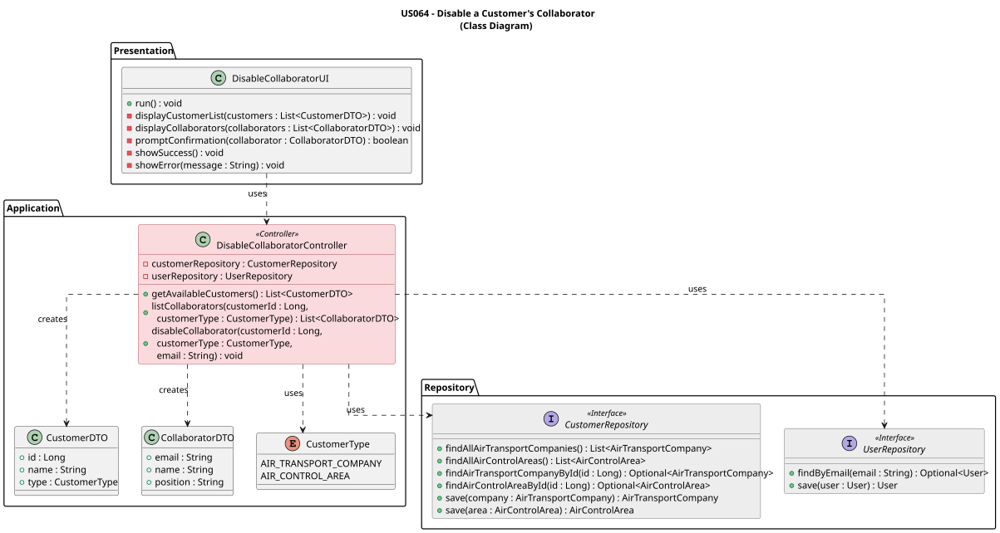
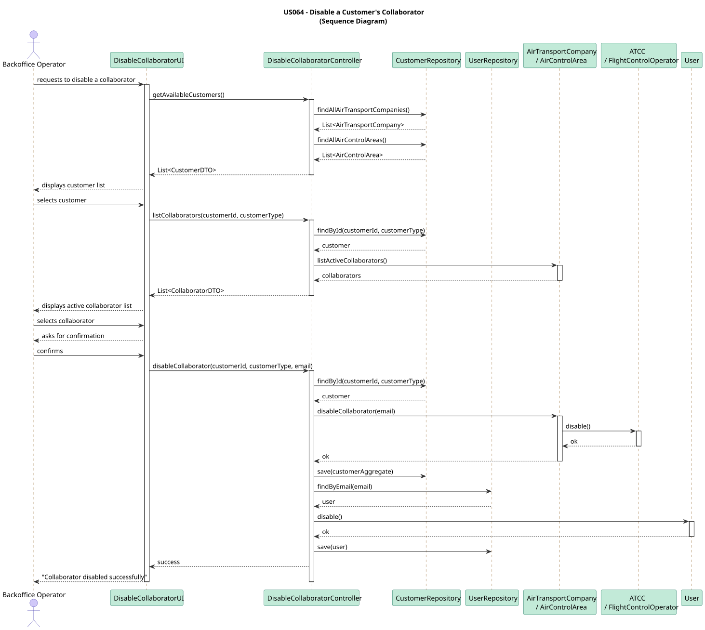

# US064 - Disable a Customer's Collaborator

## 1. Context

This User Story is being developed for the first time in Sprint 2. It allows a Backoffice Operator to disable a customer's collaborator, preventing them from using the system. Disabling is a **soft delete** — the collaborator record is retained in the system but marked as inactive.

This US depends on US061 (add a customer's collaborator) and US030 (authentication and authorization). It is closely related to US062 (list collaborators), which explicitly excludes disabled collaborators from results.

### 1.1 List of Issues

Analysis: Confirm that disabling is a soft delete (not a hard delete); clarify whether the associated `User` account should also be disabled or only the collaborator entity; confirm there are no blocking conditions (e.g. pending flights) for this US.

Design: Define the class diagram; design the disable flow through the aggregate root; decide whether disabling propagates to the `User` aggregate.

Implement: Implement `DisableCollaboratorController`; implement `disableCollaborator()` on `AirTransportCompany` and `AirControlArea`; decide and implement the `User` propagation behaviour.

Test: Verify that a disabled collaborator no longer appears in the active list (US062); verify that the `active` flag is correctly set to `false`; verify that disabling an already-disabled collaborator is handled gracefully.

---

## 2. Requirements

**US064** As a Backoffice Operator, I want to disable a customer's collaborator so that they may not use the system anymore.

**Acceptance Criteria:**

- US064.1 — The operator must select a customer and then a specific collaborator to disable.
- US064.2 — After disabling, the collaborator must not be able to use the system.
- US064.3 — The collaborator record must be retained in the system (soft delete — `active` set to `false`).
- US064.4 — A disabled collaborator must not appear in the active collaborator list (US062).
- US064.5 — Disabling an already-disabled collaborator must be handled gracefully (no crash or inconsistent state).

**Dependencies/References:**

- **US030** — Only an authenticated Backoffice Operator may execute this US.
- **US061** — The collaborator must have been previously registered.
- **US062** — The active collaborator list must exclude disabled collaborators after this US is executed.
- **NFR09** — Authentication and authorization must be enforced.
- **NFR10** — Implementation language is Java.

---

## 3. Analysis

### 3.1 Domain Understanding

Disabling a collaborator involves two concerns:

| Concern | Where it lives | What changes |
|---|---|---|
| Collaborator cannot perform their role | `ATCC` / `FlightControlOperator` entity | `active` set to `false` |
| Person cannot log into the system | `User` aggregate | `active` set to `false` (if applicable) |

The `active` flag on the collaborator entity (`ATCC` / `FlightControlOperator`) controls whether they appear in active listings and can be assigned to tasks. The `active` flag on `User` controls whether they can authenticate.

Both should be set to `false` when disabling a collaborator, as the requirement states they "may not use the system anymore". However, since `User` is a separate aggregate root, propagation is the controller's responsibility.

### 3.2 Key Business Rules

- Disabling is a **soft delete** — the data is preserved, only `active` is set to `false`.
- The collaborator entity's `active` flag is the source of truth for listing purposes (US062).
- The associated `User` account must also be disabled to prevent login.
- Disabling an already-disabled collaborator must not throw an exception — it is idempotent.
- There are **no blocking conditions** specified for this US (unlike US077 — remove a pilot — which blocks if flights are assigned). Disabling a collaborator is always permitted.

### 3.3 Idempotency

Calling `disable()` on an already-disabled collaborator must result in the same final state (`active == false`) without throwing an error. This makes the operation safe to retry and simplifies error handling.

```
if (collaborator.isActive()) {
    collaborator.disable();
}
// Either way, active == false at the end
```

---

## 4. Design

### 4.1 Design Decisions

- **Soft delete via `active` flag**: No records are deleted from the database. The `active` field on both `ATCC` / `FlightControlOperator` and `User` is set to `false`. This preserves audit history and is reversible.
- **Aggregate enforces the state change**: The `disableCollaborator()` method lives on `AirTransportCompany` / `AirControlArea`. The aggregate finds the collaborator by email and calls `disable()` on it. The controller never modifies the entity directly.
- **`User` propagation via controller**: Because `User` is a separate aggregate, the controller is responsible for also disabling the `User` aggregate after the collaborator entity is disabled. The domain does not cross aggregate boundaries.
- **Idempotent `disable()` method**: The `disable()` method on `ATCC` and `FlightControlOperator` checks the current state before acting, making it safe to call multiple times.
- **Only active collaborators are shown for selection**: The UI uses the active list (from US062) to let the operator pick a collaborator to disable, so already-disabled collaborators are never presented for selection in normal flow.

### 4.2 Class Diagram (CD)



The diagram covers four layers:

**Presentation:** `DisableCollaboratorUI` — prompts the operator to select a customer and then a collaborator from the active list; asks for confirmation before proceeding.

**Application:** `DisableCollaboratorController` — retrieves the customer aggregate from `CustomerRepository`; calls `disableCollaborator(email)` on it; retrieves the associated `User` from `UserRepository`; calls `disable()` on `User`; saves both aggregates.

**Domain:**
- `AirTransportCompany <<AggregateRoot>>` with `ATCC <<Entity>>` — exposes `disableCollaborator(email)` which calls `atcc.disable()`.
- `AirControlArea <<AggregateRoot>>` with `FlightControlOperator <<Entity>>` — same pattern.
- `User <<AggregateRoot>>` — exposes `disable()` which sets `active = false`.

**Repository:** `UserRepository` and `CustomerRepository`.

### 4.3 Sequence Diagram (SD)



The high-level flow is:

1. Operator requests to disable a collaborator.
2. System lists available customers.
3. Operator selects a customer.
4. System shows active collaborators of that customer (reuses US062 logic).
5. Operator selects a collaborator and confirms the action.
6. Controller retrieves the customer aggregate and calls `disableCollaborator(email)`.
7. Aggregate sets `ATCC.active = false` (or `FlightControlOperator.active = false`).
8. Controller saves the updated customer aggregate.
9. Controller retrieves the `User` aggregate by email and calls `disable()`.
10. Controller saves the updated `User`.
11. Success is reported to the operator.

### 4.4 Acceptance Tests

**Test 1:** Disabling a collaborator sets active to false.

**Refers to Acceptance Criteria:** US064.2, US064.3

```java
@Test
void ensureCompanyCollaboratorIsDisabled() {
    final AirTransportCompany company = savedCompanyWithCollaborator();
    company.disableCollaborator("joao@tap.pt");
    customerRepo.save(company);

    final AirTransportCompany loaded =
            (AirTransportCompany) customerRepo.findById("TP/TAP",
                    CustomerDTO.CustomerType.AIR_TRANSPORT_COMPANY).get();
    assertFalse(loaded.findCollaboratorByEmail("joao@tap.pt").get().isActive());
}
```

**Test 2:** Disabled collaborator does not appear in active list.

**Refers to Acceptance Criteria:** US064.4

```java
@Test
void ensureDisabledCompanyCollaboratorDoesNotAppearInActiveList() {
    final AirTransportCompany company = savedCompanyWithCollaborator();
    company.disableCollaborator("joao@tap.pt");
    assertTrue(company.listActiveCollaborators().isEmpty());
}
```

**Test 3:** Record is retained after disable (soft delete).

**Refers to Acceptance Criteria:** US064.3

```java
@Test
void ensureCompanyCollaboratorRecordRetainedAfterDisable() {
    final AirTransportCompany company = savedCompanyWithCollaborator();
    company.disableCollaborator("joao@tap.pt");
    assertTrue(company.findCollaboratorByEmail("joao@tap.pt").isPresent());
    assertFalse(company.findCollaboratorByEmail("joao@tap.pt").get().isActive());
}
```

**Test 4:** Disabling is idempotent.

**Refers to Acceptance Criteria:** US064.5

```java
@Test
void ensureDisableCompanyCollaboratorIsIdempotent() {
    final AirTransportCompany company = savedCompanyWithCollaborator();
    company.disableCollaborator("joao@tap.pt");
    assertDoesNotThrow(() -> company.disableCollaborator("joao@tap.pt"));
    assertFalse(company.findCollaboratorByEmail("joao@tap.pt").get().isActive());
}
```

**Test 5:** Only the target collaborator is disabled.

**Refers to Acceptance Criteria:** US064.2

```java
@Test
void ensureOnlyTargetCollaboratorIsDisabled() {
    final AirTransportCompany company = savedCompanyWithCollaborator();
    company.addCollaborator("maria@tap.pt", "Maria", "Analyst");
    company.disableCollaborator("joao@tap.pt");

    final List<CollaboratorDTO> active = company.listActiveCollaborators();
    assertEquals(1, active.size());
    assertEquals("maria@tap.pt", active.get(0).email);
}
```

---

## 5. Implementation

Key implementation notes:
- `DisableCollaboratorController` has a package-private test constructor `DisableCollaboratorController(CustomerRepository, UserRepository)`.
- The UI asks for confirmation before disabling ("yes/no").
- The UI only shows active collaborators for selection — so the operator cannot accidentally select an already-disabled collaborator.
- `disableCollaborator()` on the aggregate throws if the email is not found at all — this is a programming error (e.g. stale UI state), not a user error.

---

## 6. Integration/Demonstration

- Log in as Backoffice Operator.
- Navigate to option **11 – Disable Customer's Collaborator**.
- Select a customer and an active collaborator.
- Confirm the action.
- Navigate to option **8 – List Customer's Collaborators** and verify the collaborator no longer appears.
- Attempt to log in as the disabled collaborator and verify the login is rejected.

---

## 7. Observations

- Unlike US077 (remove pilot), US064 has **no blocking conditions** — a collaborator can always be disabled regardless of any other system state.
- Disabling is not reversible through any currently implemented US. A re-enable functionality would require a new user story.
- The `User.active` flag is also managed by US032 (enable/disable system users). Both mechanisms set the same field — they are consistent.