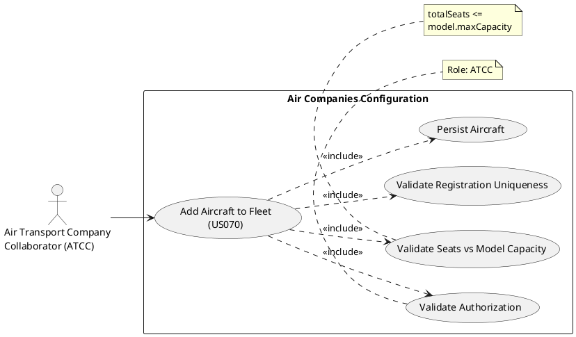
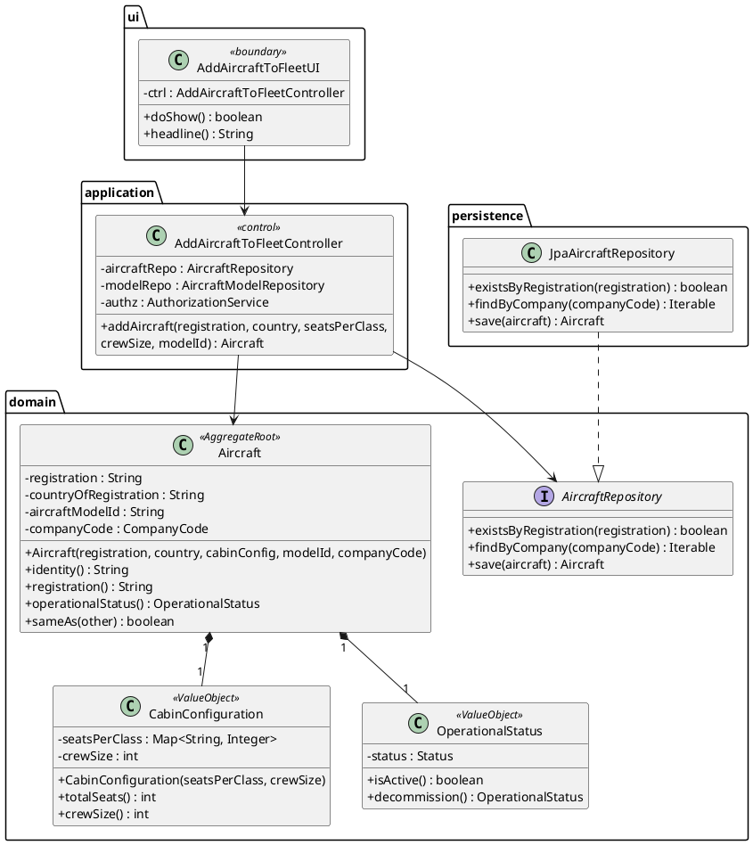
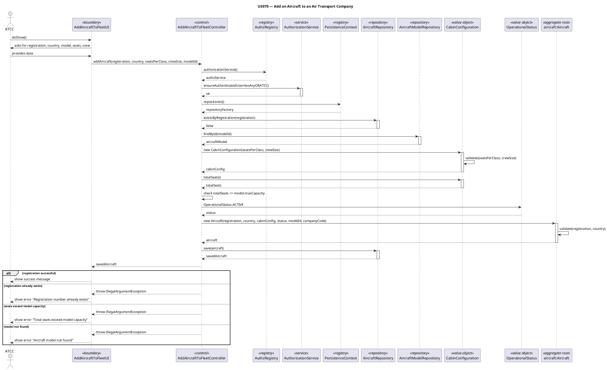

# US070 - Add an Aircraft to an Air Transport Company

## 1. Context

This User Story is being developed for the first time in Sprint 2. It allows an Air
Transport Company Collaborator (ATCC) to register a new aircraft into their company's fleet.
This is a core requirement for the Air Transport Company domain, as aircraft are needed
before flights and flight plans can be created.

This US must be implemented after US030 (Authentication and Authorization), US060 (Register
an Air Transport Company), and US055 (Create an Aircraft Model), since it requires an
authenticated ATCC, an existing company, and an existing aircraft model.

### 1.1 List of Issues

Analysis: Understand the business rules for registering an aircraft (unique registration
number, cabin configuration, operational status, country of registration); identify
dependencies on existing domain concepts.

Design: Define the `Aircraft` aggregate root, `CabinConfiguration` value object, and
`OperationalStatus` value object; design the registration flow following the layered
architecture.

Implement: Implement the domain classes, repository interface, application controller, UI,
and JPA repository.

Test: Verify that duplicate registration numbers are rejected; verify that total seats do
not exceed model capacity; verify that a valid aircraft is persisted correctly.

---

## 2. Requirements

**US070** As an Air Transport Company Collaborator, I want to add an aircraft to my
company's fleet. The aircraft is of a given model, including the engines, and the number of
seats of each type/class must be provided. Total number of seats cannot exceed the model's
capacity. An aircraft is identified by the aircraft registration number, that is unique.
Also, an aircraft is registered in a country (it may not be the company's home country). An
aircraft also has an operational status.

**Acceptance Criteria:**

- US070.1 — The system must allow an ATCC to register a new aircraft by providing a
  registration number, aircraft model, cabin configuration, country of registration, and
  number of crew elements.
- US070.2 — The aircraft registration number must be unique across the system.
- US070.3 — The total number of seats across all classes must not exceed the maximum
  capacity defined by the aircraft model.
- US070.4 — The aircraft must be associated with a valid and existing aircraft model.
- US070.5 — The aircraft must be associated with the ATCC's own company.
- US070.6 — The aircraft must have an operational status set to ACTIVE upon registration.
- US070.7 — The country of registration must be provided and non-empty.
- US070.8 — Only authenticated users with the ATCC role may add aircraft to their company.
- US070.9 — The system must reject the registration if an aircraft with the same
  registration number already exists, displaying a meaningful error message.

**Dependencies/References:**

- **US030** — Authentication and Authorization must be in place before this US can be
  executed.
- **US055** — At least one aircraft model must exist in the system.
- **US060** — The ATCC's company must already be registered in the system.
- This US is a prerequisite for **US071** (Decommission an aircraft), **US072** (List
  company fleet), and **US080** (Create a flight plan).

---

## 3. Analysis

### 3.1 Domain Understanding

An aircraft is a concrete instance of an aircraft model that belongs to an air transport
company. It is identified by a unique registration number (e.g. CS-TUA) and has a cabin
configuration defining the number of seats per class, the number of crew elements, and an
operational status.

The key business rules are:

| Rule | Description |
|---|---|
| Unique registration | No two aircraft can share the same registration number |
| Seats ≤ model capacity | Total seats across all classes cannot exceed the model's max capacity |
| Valid model | The aircraft must reference an existing and valid aircraft model |
| Company ownership | The aircraft is added to the ATCC's own company fleet |
| Active on creation | Operational status is set to ACTIVE upon registration |
| Authorization | Only ATCCs can add aircraft to their company |

### 3.2 Domain Model Excerpt

The `Aircraft` is an **Aggregate Root** identified by its registration number. It composes
a `CabinConfiguration` value object and an `OperationalStatus` value object. It references
the `AircraftModel` and `AirTransportCompany` aggregates by identity — it does not contain
them.

```
Aircraft (AggregateRoot)
  ├── registration : String         [unique ID]
  ├── countryOfRegistration : String [non-empty]
  ├── CabinConfiguration (ValueObject)
  │     ├── seatsPerClass : Map<String, Integer>
  │     └── crewSize : int
  ├── OperationalStatus (ValueObject)
  │     └── status : enum {ACTIVE, DECOMMISSIONED}
  ├── → AircraftModel [by identity]
  └── → AirTransportCompany [by identity]
```

### 3.3 Use Case Diagram



---

## 4. Design

### 4.1 Design Decisions

- **Value Objects for descriptive state:** `CabinConfiguration` encapsulates the seat
  distribution per class and crew size. `OperationalStatus` encapsulates the lifecycle
  state of the aircraft as an enum. Both are replaced entirely when updated, following the
  immutability principle of value objects.
- **References by identity:** The `Aircraft` aggregate references `AircraftModel` and
  `AirTransportCompany` by their identity (ID/code), never by composition. This respects
  the DDD rule that aggregate roots cannot be composed inside other aggregates.
- **Invariant enforcement at construction:** The seat capacity check is performed inside
  the `Aircraft` constructor, ensuring that an invalid aircraft can never be instantiated.
- **Layered Architecture:** The implementation follows the standard
  UI → Controller → Domain → Repository pattern enforced by the EAPLI Framework.
- **Authorization:** The controller calls
  `authorizationService.ensureAuthenticatedUserHasAnyOf` as its first statement, following
  the pattern established in US030.

### 4.2 Class Diagram (CD)



### 4.3 Sequence Diagram (SD)



### 4.4 Acceptance Tests

**Test 1:** Verifies that a valid aircraft is registered successfully.

**Refers to Acceptance Criteria:** US070.1, US070.6

```java
@Test
void ensureValidAircraftIsCreated() {
    // Arrange
    Map<String, Integer> seats = Map.of("economy", 200, "business", 20);
    CabinConfiguration cabin = new CabinConfiguration(seats, 8);

    // Act
    Aircraft aircraft = new Aircraft("CS-TUA", "Portugal", cabin,
            OperationalStatus.ACTIVE, "777-200ER", companyCode);

    // Assert
    assertNotNull(aircraft);
    assertEquals("CS-TUA", aircraft.registration());
    assertTrue(aircraft.operationalStatus().isActive());
}
```

**Test 2:** Verifies that an empty registration number is rejected.

**Refers to Acceptance Criteria:** US070.2

```java
@Test
void ensureEmptyRegistrationIsRejected() {
    Map<String, Integer> seats = Map.of("economy", 200);
    CabinConfiguration cabin = new CabinConfiguration(seats, 4);

    assertThrows(IllegalArgumentException.class,
            () -> new Aircraft("", "Portugal", cabin,
                    OperationalStatus.ACTIVE, "777-200ER", companyCode));
}
```

**Test 3:** Verifies that total seats exceeding model capacity is rejected.

**Refers to Acceptance Criteria:** US070.3

```java
@Test
void ensureSeatsExceedingCapacityIsRejected() {
    // model max capacity = 300
    // total seats = 400 — invalid
    Map<String, Integer> seats = Map.of("economy", 350, "business", 50);
    CabinConfiguration cabin = new CabinConfiguration(seats, 8);

    assertThrows(IllegalArgumentException.class,
            () -> ctrl.addAircraft("CS-TUA", "Portugal",
                    seats, 8, "777-200ER"));
}
```

**Test 4:** Verifies that an empty country of registration is rejected.

**Refers to Acceptance Criteria:** US070.7

```java
@Test
void ensureEmptyCountryIsRejected() {
    Map<String, Integer> seats = Map.of("economy", 200);
    CabinConfiguration cabin = new CabinConfiguration(seats, 4);

    assertThrows(IllegalArgumentException.class,
            () -> new Aircraft("CS-TUA", "", cabin,
                    OperationalStatus.ACTIVE, "777-200ER", companyCode));
}
```

**Test 5:** Verifies that the aircraft operational status is ACTIVE upon registration.

**Refers to Acceptance Criteria:** US070.6

```java
@Test
void ensureAircraftIsActiveUponRegistration() {
    Map<String, Integer> seats = Map.of("economy", 150);
    CabinConfiguration cabin = new CabinConfiguration(seats, 4);

    Aircraft aircraft = new Aircraft("CS-TUB", "Portugal", cabin,
            OperationalStatus.ACTIVE, "777-200ER", companyCode);

    assertTrue(aircraft.operationalStatus().isActive());
}
```

---

## 5. Implementation

> To be filled after implementation.

Key implementation notes:
- `Aircraft` registration number must be validated for non-emptiness at construction time
  using `Preconditions.nonEmpty`.
- The seat capacity check must be performed in the controller before instantiating the
  `Aircraft`, comparing `CabinConfiguration.totalSeats()` against the model's maximum
  capacity retrieved from `AircraftModelRepository`.
- `OperationalStatus` should be implemented as a value object wrapping an enum, with an
  `isActive()` method and a `decommission()` factory method that returns a new instance
  with `DECOMMISSIONED` status.
- The `Aircraft` aggregate references `AircraftModel` and `AirTransportCompany` by their
  identity strings — never by direct object reference, respecting aggregate boundary rules.

---

## 6. Integration/Demonstration

> To be filled after implementation.

- The `AddAircraftToFleetUI` will be accessible from the ATCC menu.
- To demonstrate: log in as an ATCC, navigate to the aircraft registration option, and
  register a new aircraft with a valid registration number, model, cabin configuration, and
  country.
- To demonstrate validation: attempt to register an aircraft with a duplicate registration
  number — the system should display a meaningful error and not persist the record.
- To demonstrate capacity check: attempt to register an aircraft with more seats than the
  model allows — the system should display a meaningful error.

---

## 7. Observations

- The `Aircraft` aggregate does not contain `AircraftModel` or `AirTransportCompany` — it
  references them by identity (registration string and `CompanyCode`). This respects the
  DDD rule that aggregate roots cannot be composed inside other aggregates.
- `OperationalStatus` is designed as a value object so that status transitions produce new
  immutable instances rather than mutating existing state. This makes the status history
  traceable and avoids side effects.
- US071 (Decommission an aircraft) will reuse the `Aircraft` aggregate and its
  `OperationalStatus` value object — the decommission operation will produce a new
  `OperationalStatus.DECOMMISSIONED` instance and replace the existing one.
- The cabin configuration (`seatsPerClass`) is stored as a map of class name to seat count,
  allowing flexibility for different aircraft configurations (economy only, economy +
  business, economy + business + first class, etc.).