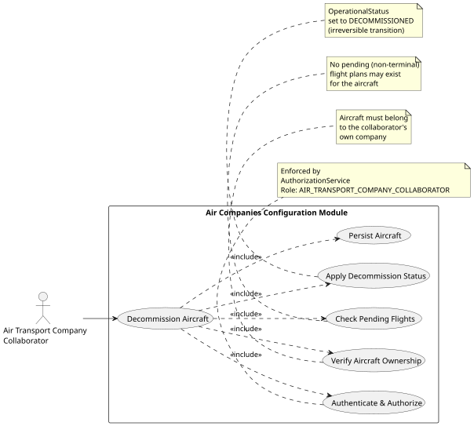
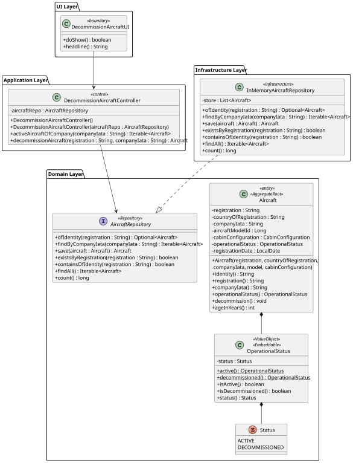

# US071 - Decommission an Aircraft

## 1. Context

This User Story is being developed for the first time in Sprint 2. It represents a lifecycle management operation within the Air Companies Configuration module, allowing an Air Transport Company Collaborator to retire an aircraft from their company's fleet. Decommissioning is a domain-significant transition: once retired, an aircraft may no longer be assigned to new flights, and its operational status is permanently changed in the system.

This US depends on US030 (Authentication and Authorization), as only authenticated users with the `AirTransportCompanyCollaborator` role may perform this operation. It also depends on US070 (Add an Aircraft to an Air Transport Company), as an aircraft must exist in the fleet before it can be decommissioned. A critical business rule constrains the operation: an aircraft with pending flights registered in the system cannot be retired.

### 1.1 List of Issues

Analysis: Understand the domain concept of aircraft decommissioning; clarify what constitutes a "pending flight" that blocks decommissioning; identify the state transition involved in the aircraft lifecycle; confirm that the operation is scoped to the collaborator's own company.

Design: Define the `OperationalStatus` value object and the state transition on the `Aircraft` aggregate; design the `DecommissionAircraftController` and `DecommissionAircraftService`; design the repository query needed to check for pending flights.

Implement: Implement the decommission operation on the `Aircraft` aggregate root; implement the pending flight check in the service layer; implement the controller with role-based authorization; update the repository to expose the pending flight query.

Test: Verify that a valid aircraft with no pending flights can be decommissioned; verify that an aircraft with pending flights cannot be decommissioned; verify that a collaborator cannot decommission aircraft belonging to another company; verify that only `AirTransportCompanyCollaborator` users can perform this operation.

---

## 2. Requirements

**US071** As an Air Transport Company Collaborator, I want to retire an aircraft from my company's fleet. It is not possible to create flights for a retired aircraft, nor is it possible to retire an aircraft that has pending flights registered in the system.

**Acceptance Criteria:**

- US071.1 — The system must allow an Air Transport Company Collaborator to decommission an aircraft belonging to their own company.
- US071.2 — An aircraft with pending flights registered in the system must not be decommissioned; the operation must be rejected with a clear message.
- US071.3 — Once decommissioned, the aircraft's operational status must be permanently set to `DECOMMISSIONED`.
- US071.4 — A decommissioned aircraft may not be assigned to new flight plans.
- US071.5 — A collaborator may only decommission aircraft belonging to their own company; attempts to decommission aircraft of another company must be rejected.
- US071.6 — The system must reject decommissioning of an aircraft that does not exist.
- US071.7 — Only authenticated users with the `AirTransportCompanyCollaborator` role may perform this operation.

**Dependencies/References:**

- Depends on US030 (Authentication and Authorization) — the use case must be protected by role-based access control.
- Depends on US070 (Add an Aircraft to an Air Transport Company) — the aircraft must exist in the fleet before it can be decommissioned.
- This US interacts with the flight plan domain: the presence of pending flights (created via US080) blocks decommissioning.
- The specification (section 3.1.3) states that the set of active collaborators and fleet composition change over time, implying lifecycle management is an expected domain concern.
- NFR09 mandates authentication and authorization throughout the system.
- NFR10 mandates Java as the implementation language.
- NFR08 mandates that persistence must work both in-memory and with a relational database.

---

## 3. Analysis

### 3.1 Domain Understanding

An aircraft in the AISafe system belongs to a specific air transport company and has a lifecycle represented by its operational status. Based on the specification (section 3.2) and the US description, the relevant lifecycle states are:

| Status | Description |
|---|---|
| `ACTIVE` | The aircraft is operational and may be assigned to flight plans |
| `DECOMMISSIONED` | The aircraft has been retired; no new flight plans may be created for it |

A "pending flight" is any flight plan associated with the aircraft whose status is not yet completed or cancelled — i.e. a flight that is still scheduled or in progress at the time of the decommission request. The presence of any such flight must prevent decommissioning.

The operation is scoped to the collaborator's own company: a collaborator may only manage aircraft that belong to the company they are associated with. This is a fundamental access boundary enforced at the service layer, in addition to the role-based check at the controller layer.

### 3.2 Domain-Driven Design Analysis

Following DDD principles:

- **`Aircraft`** is the **Aggregate Root** of this aggregate, as established in US070. The decommission operation is a behaviour on this aggregate root: `aircraft.decommission()`. The aggregate enforces the invariant that a decommissioned aircraft cannot transition to any other active state.
- **`OperationalStatus`** is a **Value Object** (or a type-safe enum implementing `ValueObject`) representing the aircraft's current lifecycle state. It encapsulates the valid transitions and prevents invalid state assignments.
- **`AircraftRegistration`** is the **Value Object** acting as the aggregate's identity, as established in US070.
- **`AircraftRepository`** is the **Repository** interface, already defined in US070. This US adds the query `hasPendingFlights(AircraftRegistration)` to its contract, delegating the persistence concern of the pending flight check to the infrastructure layer.
- **`FlightPlanRepository`** is referenced by the service to query pending flights. The service queries across aggregate boundaries by aircraft registration, which is acceptable as a read-side query that does not modify the `FlightPlan` aggregate.
- The decommission operation does **not** introduce a new aggregate — it is a state transition on the existing `Aircraft` aggregate, keeping the domain model lean.

### 3.3 Use Case Diagram



---

## 4. Design

The design follows the standard EAPLI layered architecture: UI → Controller → Service → Domain/Repository.

### 4.1. Design Decisions

- **Behaviour on the Aggregate**: The decommission logic is implemented as a method `decommission()` on the `Aircraft` aggregate root, not in the service. The aggregate is responsible for enforcing that the status transition is valid (e.g. a decommissioned aircraft cannot be decommissioned again). The service is responsible for the pre-condition check (pending flights) and the ownership check, which require cross-aggregate queries that are not the aggregate's responsibility.
- **Pending Flight Check at the Service Layer**: The check for pending flights is performed by the `DecommissionAircraftService` before calling `aircraft.decommission()`. It queries the `FlightPlanRepository` (or the extended `AircraftRepository`) for any non-terminal flight plans associated with the aircraft. This keeps the domain aggregate free from repository dependencies.
- **Ownership Check**: The service retrieves the company associated with the currently authenticated collaborator (via the session/user context) and compares it with the aircraft's registered company. If they do not match, the operation is rejected before any state change occurs.
- **`OperationalStatus` as Enum**: `OperationalStatus` is implemented as a Java enum (`ACTIVE`, `DECOMMISSIONED`) that implements `ValueObject`. This allows it to be persisted simply as a string column and makes state comparisons explicit and exhaustive.
- **Irreversibility**: Once `decommission()` is called on the aggregate, the status is set to `DECOMMISSIONED`. The aggregate enforces that no further transition out of this state is possible, making the operation irreversible by design. This is consistent with the specification's statement that it is not possible to create flights for a retired aircraft.
- **Authorization**: The `DecommissionAircraftController` calls `authorizationService.ensureAuthenticatedUserHasAnyOf(Roles.AIR_TRANSPORT_COMPANY_COLLABORATOR)` as its first statement, before any domain logic is executed.

### 4.2. Class Diagram (CD)



### 4.3. Sequence Diagram (SD)


### 4.4 Acceptance Tests

**Test 1:** Verifies that a collaborator can successfully decommission an active aircraft with no pending flights.

**Refers to Acceptance Criteria:** US071.1, US071.3

```java
@Test
public void ensureCollaboratorCanDecommissionAircraftWithNoPendingFlights() {
    // Arrange
    authorizationService.authenticateForTesting(collaboratorUser);
    when(aircraftRepository.ofIdentity(registration)).thenReturn(Optional.of(activeAircraft));
    when(aircraftRepository.hasPendingFlights(registration)).thenReturn(false);
    when(activeAircraft.company()).thenReturn(collaboratorCompany);

    DecommissionAircraftController controller =
        new DecommissionAircraftController(authorizationService, decommissionAircraftService);

    // Act
    controller.decommissionAircraft("CS-TUA");

    // Assert
    verify(activeAircraft).decommission();
    verify(aircraftRepository).save(activeAircraft);
}
```

**Test 2:** Verifies that an aircraft with pending flights cannot be decommissioned.

**Refers to Acceptance Criteria:** US071.2

```java
@Test(expected = IllegalStateException.class)
public void ensureAircraftWithPendingFlightsCannotBeDecommissioned() {
    // Arrange
    authorizationService.authenticateForTesting(collaboratorUser);
    when(aircraftRepository.ofIdentity(registration)).thenReturn(Optional.of(activeAircraft));
    when(aircraftRepository.hasPendingFlights(registration)).thenReturn(true);
    when(activeAircraft.company()).thenReturn(collaboratorCompany);

    DecommissionAircraftController controller =
        new DecommissionAircraftController(authorizationService, decommissionAircraftService);

    // Act
    controller.decommissionAircraft("CS-TUA");

    // Assert: exception expected
}
```

**Test 3:** Verifies that a collaborator cannot decommission an aircraft belonging to another company.

**Refers to Acceptance Criteria:** US071.5

```java
@Test(expected = IllegalStateException.class)
public void ensureCollaboratorCannotDecommissionAircraftOfAnotherCompany() {
    // Arrange
    authorizationService.authenticateForTesting(collaboratorUser);
    when(aircraftRepository.ofIdentity(registration)).thenReturn(Optional.of(activeAircraft));
    when(aircraftRepository.hasPendingFlights(registration)).thenReturn(false);
    when(activeAircraft.company()).thenReturn(otherCompany); // different company

    DecommissionAircraftController controller =
        new DecommissionAircraftController(authorizationService, decommissionAircraftService);

    // Act
    controller.decommissionAircraft("CS-TUA");

    // Assert: exception expected
}
```

**Test 4:** Verifies that attempting to decommission a non-existent aircraft is rejected.

**Refers to Acceptance Criteria:** US071.6

```java
@Test(expected = IllegalArgumentException.class)
public void ensureDecommissioningNonExistentAircraftIsRejected() {
    // Arrange
    authorizationService.authenticateForTesting(collaboratorUser);
    when(aircraftRepository.ofIdentity(any())).thenReturn(Optional.empty());

    DecommissionAircraftController controller =
        new DecommissionAircraftController(authorizationService, decommissionAircraftService);

    // Act
    controller.decommissionAircraft("XX-NONE");

    // Assert: exception expected
}
```

**Test 5:** Verifies that attempting to decommission an already decommissioned aircraft is rejected.

**Refers to Acceptance Criteria:** US071.3

```java
@Test(expected = IllegalStateException.class)
public void ensureAlreadyDecommissionedAircraftCannotBeDecommissionedAgain() {
    // Arrange: aircraft is already DECOMMISSIONED
    Aircraft decommissionedAircraft = new Aircraft(); // status = DECOMMISSIONED
    when(aircraftRepository.ofIdentity(registration)).thenReturn(Optional.of(decommissionedAircraft));
    when(aircraftRepository.hasPendingFlights(registration)).thenReturn(false);
    when(decommissionedAircraft.company()).thenReturn(collaboratorCompany);

    DecommissionAircraftController controller =
        new DecommissionAircraftController(authorizationService, decommissionAircraftService);

    // Act: calling decommission() on the aggregate should throw
    controller.decommissionAircraft("CS-TUA");

    // Assert: exception expected (enforced by the aggregate)
}
```

**Test 6:** Verifies that a user without the AirTransportCompanyCollaborator role cannot decommission an aircraft.

**Refers to Acceptance Criteria:** US071.7

```java
@Test(expected = UnauthorizedException.class)
public void ensureNonCollaboratorCannotDecommissionAircraft() {
    // Arrange: logged in as a Backoffice Operator
    authorizationService.authenticateForTesting(backofficeOperatorUser);

    DecommissionAircraftController controller =
        new DecommissionAircraftController(authorizationService, decommissionAircraftService);

    // Act
    controller.decommissionAircraft("CS-TUA");

    // Assert: exception expected
}
```

**Test 7:** Verifies that the `Aircraft` aggregate enforces the `DECOMMISSIONED` status invariant.

**Refers to Acceptance Criteria:** US071.3, US071.4

```java
@Test
public void ensureDecommissionSetsCorrectStatus() {
    // Arrange
    Aircraft aircraft = new Aircraft(
        new AircraftRegistration("CS-TUA"),
        company, cabinConfig, crewCount
    );
    assertEquals(OperationalStatus.ACTIVE, aircraft.operationalStatus());

    // Act
    aircraft.decommission();

    // Assert
    assertEquals(OperationalStatus.DECOMMISSIONED, aircraft.operationalStatus());
}
```

---

## 5. Implementation

> To be filled after implementation.

Key implementation notes:
- The `decommission()` method on `Aircraft` must check the current `OperationalStatus` before applying the transition; if the aircraft is already `DECOMMISSIONED`, it must throw an `IllegalStateException` to enforce aggregate invariants.
- `OperationalStatus` should be implemented as a Java enum with at least `ACTIVE` and `DECOMMISSIONED` values, persisted as a `@Enumerated(EnumType.STRING)` column in the `Aircraft` JPA entity.
- `AircraftRepository` must be extended with a `hasPendingFlights(AircraftRegistration)` method. Its JPA implementation should query the `FlightPlan` table (or equivalent) for any plans associated with the given registration that are not in a terminal state (e.g. not `COMPLETED` or `CANCELLED`).
- The `DecommissionAircraftService` must perform the ownership check before the pending flights check, failing fast with a meaningful exception if the collaborator does not own the aircraft.
- The currently authenticated user's company must be retrievable from the session context (via `AuthorizationService` or a dedicated `UserSessionService`) to perform the ownership check in the service layer.
- The UI must present the collaborator with a list of their company's active aircraft to select from, rather than requiring a manual registration number entry, to improve usability and reduce errors.

---

## 6. Integration/Demonstration

> To be filled after implementation.

- This US depends on US070 (Add an Aircraft to an Air Transport Company) — at least one active aircraft must exist in the fleet before decommissioning can be demonstrated.
- The pending flight check interacts with the flight plan domain introduced in US080. For demonstration purposes, a flight plan in a non-terminal state should be pre-created for one aircraft to demonstrate the blocking behaviour.
- To demonstrate via UI: log in as an Air Transport Company Collaborator, navigate to the fleet management menu, select "Decommission Aircraft", choose an active aircraft with no pending flights — the system should confirm the decommission and the aircraft should no longer appear as active.
- To demonstrate the pending flight block: select an aircraft that has a pending flight plan — the system should display a clear error message and leave the aircraft unchanged.
- To demonstrate the ownership boundary: attempt to decommission an aircraft from a different company — the system should reject the operation.

---

## 7. Observations

- The specification (section 3.1.3) notes that "the set of active collaborators will change over time", implying that fleet lifecycle management, including decommissioning, is an expected and recurring domain operation. The design should be robust and not treat decommissioning as an edge case.
- The definition of "pending flight" must be agreed upon with the Product Owner before implementation. The most conservative interpretation — any flight plan not in a terminal state — is adopted here. If the Product Owner defines "pending" differently (e.g. only flights with a future departure date), the `hasPendingFlights` query must be adjusted accordingly.
- The `DECOMMISSIONED` status is treated as a terminal state with no reversal. If future requirements introduce a reactivation capability, the `OperationalStatus` enum and the `Aircraft` aggregate's transition logic must be revisited without breaking existing clients.
- The US description states it is "not possible to create flights for a retired aircraft". This invariant must also be enforced in US080 (Create a Flight Plan) by checking the aircraft's `OperationalStatus` before allowing a flight plan to be created — this is a cross-US invariant that both teams must be aware of.
