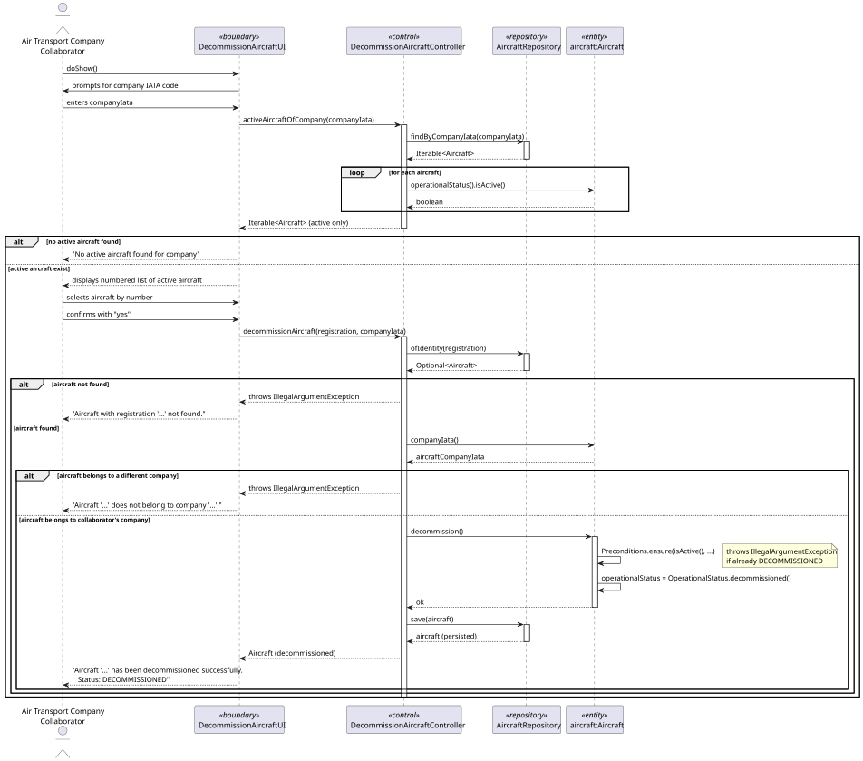

# US071 - Decommission an Aircraft

## 1. Context

This User Story is being developed for the first time in Sprint 2. It represents a lifecycle management operation within the Air Companies Configuration module, allowing an Air Transport Company Collaborator to retire an aircraft from their company's fleet. Decommissioning is a domain-significant transition: once retired, an aircraft may no longer be assigned to new flights, and its operational status is permanently changed in the system.

This US depends on US030 (Authentication and Authorization), as only authenticated users with the `AirTransportCompanyCollaborator` role may perform this operation. It also depends on US070 (Add an Aircraft to an Air Transport Company), as an aircraft must exist in the fleet before it can be decommissioned.

> **Note:** The pending flight check (US071.2) is not yet enforced at runtime because the FlightPlan domain (US080) has not been implemented. The guard is architecturally prepared — the `AircraftRepository` interface can be extended with `hasPendingFlights(String registration)` once US080 is available. This is documented inline in `DecommissionAircraftController`.

### 1.1 List of Issues

**Analysis:** Understand the domain concept of aircraft decommissioning; identify the state transition involved in the aircraft lifecycle; confirm that the operation is scoped to the collaborator's own company.

**Design:** Define `OperationalStatus` as a Value Object class with an internal `Status` enum; design the `DecommissionAircraftController` that combines service logic directly (no separate service class in this sprint); design repository queries needed.

**Implement:** Implement `decommission()` on the `Aircraft` aggregate root; implement the company-ownership check and not-found guard in the controller; implement active-aircraft filtering in the controller; update the repository with `save` semantics.

**Test:** Verify that a valid active aircraft can be decommissioned; verify that an already-decommissioned aircraft cannot be decommissioned again; verify that a collaborator cannot decommission aircraft belonging to another company; verify that decommissioning a non-existent aircraft is rejected.

---

## 2. Requirements

**US071** As an Air Transport Company Collaborator, I want to retire an aircraft from my company's fleet. It is not possible to create flights for a retired aircraft, nor is it possible to retire an aircraft that has pending flights registered in the system.

**Acceptance Criteria:**

- US071.1 — The system must allow an Air Transport Company Collaborator to decommission an aircraft belonging to their own company.
- US071.2 — An aircraft with pending flights registered in the system must not be decommissioned *(pending flight check deferred until US080 is implemented)*.
- US071.3 — Once decommissioned, the aircraft's operational status must be permanently set to `DECOMMISSIONED`.
- US071.4 — A decommissioned aircraft may not be assigned to new flight plans.
- US071.5 — A collaborator may only decommission aircraft belonging to their own company; attempts to decommission aircraft of another company must be rejected.
- US071.6 — The system must reject decommissioning of an aircraft that does not exist.
- US071.7 — Only authenticated users with the `AirTransportCompanyCollaborator` role may perform this operation *(authorization integration deferred to US030 completion)*.

**Dependencies/References:**

- Depends on US030 (Authentication and Authorization).
- Depends on US070 (Add an Aircraft to an Air Transport Company).
- Interacts with the flight plan domain introduced in US080 — pending flight check will be enforced once US080 is implemented.
- NFR09 mandates authentication and authorization throughout the system.
- NFR10 mandates Java as the implementation language.
- NFR08 mandates that persistence must work both in-memory and with a relational database.

---

## 3. Analysis

### 3.1 Domain Understanding

An aircraft in the AISafe system belongs to a specific air transport company and has a lifecycle represented by its operational status. The relevant lifecycle states are:

| Status | Description |
|---|---|
| `ACTIVE` | The aircraft is operational and may be assigned to flight plans |
| `DECOMMISSIONED` | The aircraft has been retired; no new flight plans may be created for it |

The operation is scoped to the collaborator's own company: a collaborator may only manage aircraft that belong to the company they are associated with. This boundary is enforced in the controller by comparing the aircraft's `companyIata` with the company IATA provided in the request.

### 3.2 Domain-Driven Design Analysis

Following DDD principles:

- **`Aircraft`** is the **Aggregate Root**. The `decommission()` method is a behaviour on this aggregate root. The aggregate enforces the invariant that a decommissioned aircraft cannot transition to any other state (throws `IllegalArgumentException` if already `DECOMMISSIONED`).
- **`OperationalStatus`** is a **Value Object** (class implementing `ValueObject`) that wraps an internal `Status` enum (`ACTIVE`, `DECOMMISSIONED`). It is `@Embeddable` and persisted as a `@Enumerated(EnumType.STRING)` column. Factory methods `active()` and `decommissioned()` provide controlled construction.
- **`AircraftRepository`** is the **Repository** interface. The active-aircraft filtering is performed in the controller by iterating `findByCompanyIata(companyIata)` and checking `operationalStatus().isActive()`. The `hasPendingFlights` method is intentionally absent until US080.
- The `DecommissionAircraftController` directly orchestrates the use case without a separate service class. This is a deliberate simplification for this sprint, consistent with the current state of the domain (no cross-aggregate queries are required yet).

---

## 4. Design

The design follows the EAPLI layered architecture: UI → Controller → Domain/Repository.

### 4.1. Design Decisions

- **No separate service class:** The `DecommissionAircraftController` directly calls the repository and the aggregate. A `DecommissionAircraftService` was planned in design but not implemented because no cross-aggregate queries are needed in this sprint. The controller comment documents the point where `hasPendingFlights` will be inserted when US080 is ready.
- **Behaviour on the Aggregate:** The decommission logic is implemented as `decommission()` on `Aircraft`. The aggregate guards against double-decommissioning by checking `operationalStatus.isActive()` via `Preconditions.ensure(...)`.
- **`OperationalStatus` as a Value Object class:** Rather than a bare enum, `OperationalStatus` is a class with an internal enum, implementing `ValueObject`. This keeps the pattern consistent with the rest of the domain model and allows future enrichment (e.g. adding a decommission date) without changing the aggregate's interface.
- **Company ownership check in the controller:** Since `UserSessionService` is not yet available, the UI reads `companyIata` from the console and passes it to the controller. The controller verifies that the found aircraft's `companyIata` matches before calling `decommission()`.
- **Active aircraft list in the UI:** The UI calls `activeAircraftOfCompany(companyIata)` on the controller, which returns only `ACTIVE` aircraft. The user selects from this list, reducing the chance of invalid input.
- **Irreversibility:** `OperationalStatus.decommissioned()` is a terminal state. The aggregate enforces that `decommission()` cannot be called twice.

### 4.2. Class Diagram (CD)


### 4.3. Sequence Diagram (SD)



### 4.4 Acceptance Tests

The following tests are implemented in `DecommissionAircraftControllerTest` and use a real `InMemoryAircraftRepository` (no mocks) injected via the package-private constructor.

**Test 1:** Active aircraft list returns only active ones.

**Refers to Acceptance Criteria:** US071.1

```java
@Test
void ensureActiveAircraftOfCompanyReturnsOnlyActiveOnes() {
    createAndSaveAircraft("CS-TUA", "TP");
    Aircraft toDecommission = createAndSaveAircraft("CS-TUB", "TP");
    toDecommission.decommission();
    aircraftRepo.save(toDecommission);

    List<Aircraft> result = new ArrayList<>();
    ctrl.activeAircraftOfCompany("TP").forEach(result::add);

    assertEquals(1, result.size());
    assertEquals("CS-TUA", result.get(0).registration());
}
```

**Test 2:** Active aircraft list is empty when all aircraft are decommissioned.

**Refers to Acceptance Criteria:** US071.1

```java
@Test
void ensureActiveAircraftOfCompanyReturnsEmptyWhenNoneActive() {
    Aircraft a = createAndSaveAircraft("CS-TUA", "TP");
    a.decommission();
    aircraftRepo.save(a);

    List<Aircraft> result = new ArrayList<>();
    ctrl.activeAircraftOfCompany("TP").forEach(result::add);

    assertTrue(result.isEmpty());
}
```

**Test 3:** Active aircraft list filters other companies' aircraft.

**Refers to Acceptance Criteria:** US071.5

```java
@Test
void ensureActiveAircraftOfCompanyFiltersOtherCompanies() {
    createAndSaveAircraft("CS-TUA", "TP");
    createAndSaveAircraft("EI-ABC", "FR");

    List<Aircraft> result = new ArrayList<>();
    ctrl.activeAircraftOfCompany("TP").forEach(result::add);

    assertEquals(1, result.size());
    assertEquals("CS-TUA", result.get(0).registration());
}
```

**Test 4:** Valid decommission succeeds and returns aircraft with `DECOMMISSIONED` status.

**Refers to Acceptance Criteria:** US071.1, US071.3

```java
@Test
void ensureValidDecommissionSucceeds() {
    createAndSaveAircraft("CS-TUA", "TP");

    Aircraft result = ctrl.decommissionAircraft("CS-TUA", "TP");

    assertTrue(result.operationalStatus().isDecommissioned());
    assertFalse(result.operationalStatus().isActive());
}
```

**Test 5:** Decommissioned status is persisted.

**Refers to Acceptance Criteria:** US071.3

```java
@Test
void ensureDecommissionedAircraftIsPersistedWithNewStatus() {
    createAndSaveAircraft("CS-TUA", "TP");
    ctrl.decommissionAircraft("CS-TUA", "TP");

    Aircraft persisted = aircraftRepo.ofIdentity("CS-TUA").orElseThrow();
    assertTrue(persisted.operationalStatus().isDecommissioned());
}
```

**Test 6:** Decommissioning a non-existent aircraft throws `IllegalArgumentException`.

**Refers to Acceptance Criteria:** US071.6

```java
@Test
void ensureDecommissionNonExistentAircraftThrows() {
    assertThrows(IllegalArgumentException.class,
            () -> ctrl.decommissionAircraft("XX-NONE", "TP"));
}
```

**Test 7:** Decommissioning an aircraft of a different company throws `IllegalArgumentException`.

**Refers to Acceptance Criteria:** US071.5

```java
@Test
void ensureDecommissionAircraftFromWrongCompanyThrows() {
    createAndSaveAircraft("CS-TUA", "TP");

    assertThrows(IllegalArgumentException.class,
            () -> ctrl.decommissionAircraft("CS-TUA", "FR"));
}
```

**Test 8:** Decommissioning an already decommissioned aircraft throws `IllegalArgumentException` (aggregate invariant).

**Refers to Acceptance Criteria:** US071.3

```java
@Test
void ensureDecommissionAlreadyDecommissionedAircraftThrows() {
    createAndSaveAircraft("CS-TUA", "TP");
    ctrl.decommissionAircraft("CS-TUA", "TP");

    assertThrows(IllegalArgumentException.class,
            () -> ctrl.decommissionAircraft("CS-TUA", "TP"));
}
```

**Test 9:** Decommissioning one aircraft does not affect other aircraft.

**Refers to Acceptance Criteria:** US071.3

```java
@Test
void ensureDecommissionDoesNotAffectOtherAircraft() {
    createAndSaveAircraft("CS-TUA", "TP");
    createAndSaveAircraft("CS-TUB", "TP");

    ctrl.decommissionAircraft("CS-TUA", "TP");

    Aircraft other = aircraftRepo.ofIdentity("CS-TUB").orElseThrow();
    assertTrue(other.operationalStatus().isActive());
}
```

---

## 5. Implementation

### Key implementation notes

- `Aircraft.decommission()` calls `Preconditions.ensure(operationalStatus.isActive(), ...)` before applying the transition, throwing `IllegalArgumentException` if already `DECOMMISSIONED`.
- `OperationalStatus` is a `@Embeddable` class wrapping a `Status` enum, persisted as `@Enumerated(EnumType.STRING)`. Factory methods `active()` and `decommissioned()` are used throughout.
- `DecommissionAircraftController` exposes two public methods: `activeAircraftOfCompany(String companyIata)` and `decommissionAircraft(String registration, String companyIata)`. A package-private constructor accepts a repository for testing.
- `InMemoryAircraftRepository.save()` removes any existing entry with the same registration before adding the updated aircraft, ensuring the in-memory store reflects the latest state.
- The pending flight check is intentionally absent pending US080. The comment in the controller marks the exact insertion point.
- The UI reads `companyIata` from the console as a temporary workaround until the session/authentication context is available (US030).

---

## 6. Integration/Demonstration

- Depends on US070: at least one active aircraft must exist in the fleet before decommissioning can be demonstrated.
- To demonstrate via UI: log in as an Air Transport Company Collaborator, enter the company IATA code, select an active aircraft from the list, confirm — the system should confirm the decommission and the aircraft should no longer appear as active.
- To demonstrate the ownership boundary: enter a different company's IATA — the system should reject the operation.
- To demonstrate double-decommission prevention: attempt to decommission the same aircraft twice — the system should reject the second attempt.
- Pending flight block: will be demonstrable once US080 is integrated.

---

## 7. Observations

- The `DECOMMISSIONED` status is a terminal state with no reversal in the current design. If future requirements introduce reactivation, the `OperationalStatus` class and `Aircraft.decommission()` guard must be revisited.
- The US description states it is "not possible to create flights for a retired aircraft". This invariant must also be enforced in US080 by checking `aircraft.operationalStatus().isActive()` before allowing a flight plan to be created.
- The `AircraftRepository` interface includes `hasPendingFlights` as a planned extension point, to be implemented in JPA once the `FlightPlan` entity is available.
- `countryOfRegistration` is stored as a plain `String` in this sprint. A future refactoring may introduce a `Country` value object consistent with other parts of the domain.
