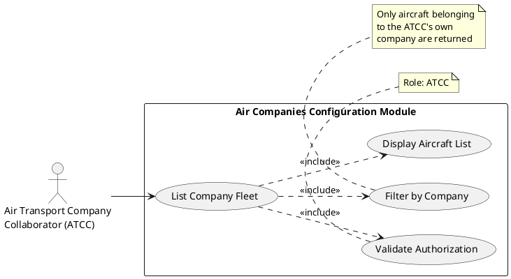
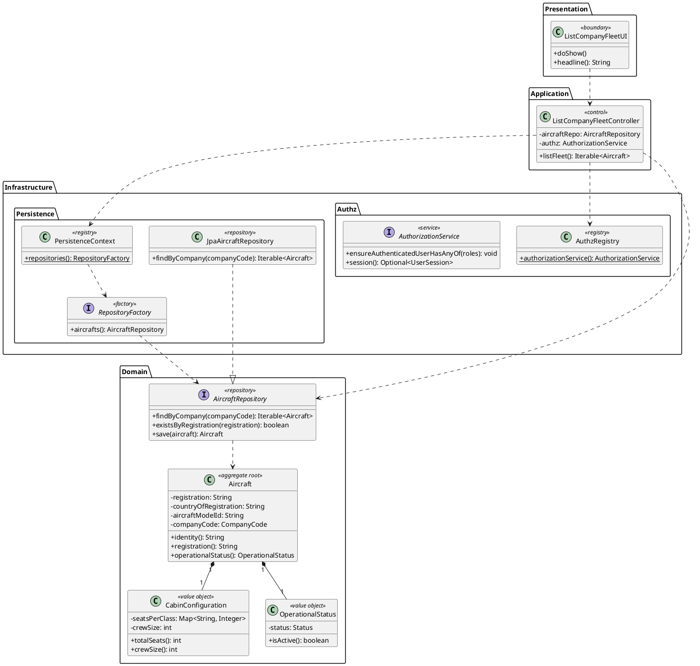
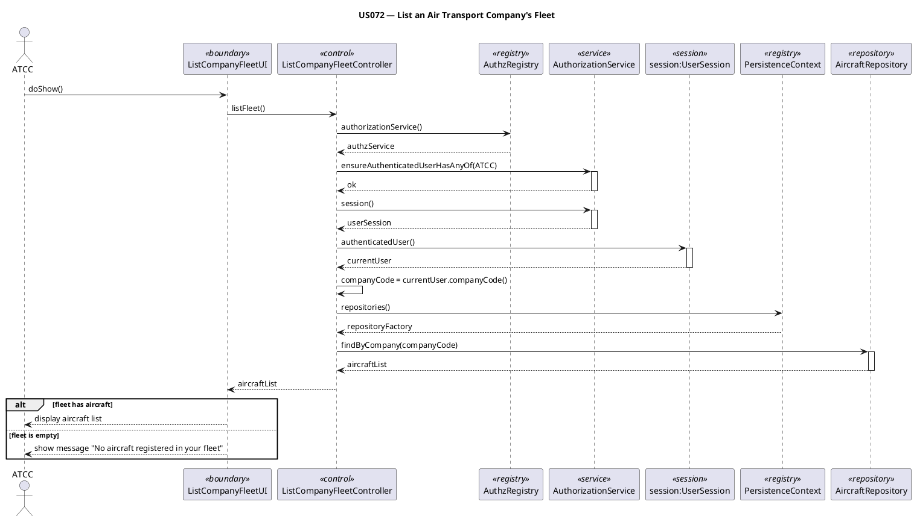

# US072 - List an Air Transport Company's Fleet

## 1. Context

This User Story is being developed for the first time in Sprint 2. It allows an Air
Transport Company Collaborator (ATCC) to list all aircraft belonging to their company's
fleet. This is a supporting requirement for fleet management, providing visibility over
registered aircraft before performing operations such as flight creation or decommissioning.

This US must be implemented after US030 (Authentication and Authorization), US060 (Register
an Air Transport Company), and US070 (Add an Aircraft to an Air Transport Company), since
it requires an authenticated ATCC and at least one aircraft registered in the system.

### 1.1 List of Issues

Analysis: Understand the business rules for listing a company's fleet (only active aircraft,
only the ATCC's own company); identify dependencies on existing domain concepts.

Design: Define the query flow through the layered architecture; identify which data to
display for each aircraft.

Implement: Implement the application controller, UI, and any required repository query
methods.

Test: Verify that only the ATCC's own company aircraft are listed; verify that the list
excludes decommissioned aircraft; verify that an empty fleet is handled gracefully.

---

## 2. Requirements

**US072** As an Air Transport Company Collaborator, I want to list my company's aircraft
fleet.

**Acceptance Criteria:**

- US072.1 — The system must display all aircraft belonging to the authenticated ATCC's
  company.
- US072.2 — Each listed aircraft must show at minimum: registration number, aircraft model,
  country of registration, cabin configuration, and operational status.
- US072.3 — Decommissioned aircraft must still appear in the list with their status clearly
  indicated.
- US072.4 — If the company has no aircraft registered, the system must display an
  appropriate message.
- US072.5 — Only authenticated users with the ATCC role may list their company's fleet.
- US072.6 — An ATCC may only list aircraft belonging to their own company.

**Dependencies/References:**

- **US030** — Authentication and Authorization must be in place before this US can be
  executed.
- **US060** — The ATCC's company must already be registered in the system.
- **US070** — At least one aircraft must have been added to the fleet for the list to be
  non-empty.
- This US is complemented by **US072a** (list by model), **US072b** (list by maker),
  **US072c** (list by capacity), and **US072d** (list by age).

---

## 3. Analysis

### 3.1 Domain Understanding

Listing the fleet is a read-only query operation. The ATCC queries the system for all
aircraft associated with their company. The system retrieves the aircraft from the
repository filtered by the company identity of the currently authenticated user.

The key business rules are:

| Rule | Description |
|---|---|
| Company scoping | Only aircraft belonging to the ATCC's own company are returned |
| All statuses shown | Both ACTIVE and DECOMMISSIONED aircraft are listed |
| Authorization | Only ATCCs can list their company's fleet |
| Empty fleet | If no aircraft exist, a meaningful message is displayed |

### 3.2 Domain Model Excerpt

This US does not introduce new domain classes. It reads from the existing `Aircraft`
aggregate root, which composes `CabinConfiguration` and `OperationalStatus` value objects
and references `AircraftModel` and `AirTransportCompany` by identity.

```
Aircraft (AggregateRoot)          [read]
  ├── registration : String
  ├── countryOfRegistration : String
  ├── CabinConfiguration (ValueObject)
  │     ├── seatsPerClass : Map<String, Integer>
  │     └── crewSize : int
  ├── OperationalStatus (ValueObject)
  │     └── status : enum {ACTIVE, DECOMMISSIONED}
  ├── → AircraftModel [by identity]
  └── → AirTransportCompany [by identity]
```

### 3.3 Use Case Diagram



---

## 4. Design

### 4.1 Design Decisions

- **Read-only operation:** This US does not modify any domain state. The controller simply
  queries the repository and returns the result to the UI. No domain invariants are
  enforced beyond authorization.
- **Company scoping via session:** The ATCC's company identity is retrieved from the
  current session (authenticated user), ensuring that an ATCC can never list another
  company's aircraft.
- **Repository query:** The `AircraftRepository` is extended with a
  `findByCompany(companyCode)` method that filters aircraft by company identity. This keeps
  the query logic in the infrastructure layer and the domain layer clean.
- **Layered Architecture:** The implementation follows the standard
  UI → Controller → Repository pattern enforced by the EAPLI Framework.
- **Authorization:** The controller calls
  `authorizationService.ensureAuthenticatedUserHasAnyOf` as its first statement, following
  the pattern established in US030.

### 4.2 Class Diagram (CD)



### 4.3 Sequence Diagram (SD)



### 4.4 Acceptance Tests

**Test 1:** Verifies that the fleet list returns aircraft belonging to the company.

**Refers to Acceptance Criteria:** US072.1, US072.6

```java
@Test
void ensureFleetListReturnsCompanyAircraft() {
    // Arrange
    CompanyCode companyCode = new CompanyCode("TP", "TAP");
    Aircraft aircraft1 = new Aircraft("CS-TUA", "Portugal", cabin,
            OperationalStatus.ACTIVE, "777-200ER", companyCode);
    Aircraft aircraft2 = new Aircraft("CS-TUB", "Portugal", cabin,
            OperationalStatus.ACTIVE, "777-200ER", companyCode);
    repo.save(aircraft1);
    repo.save(aircraft2);

    // Act
    Iterable<Aircraft> fleet = ctrl.listFleet();

    // Assert
    assertNotNull(fleet);
    assertEquals(2, Iterables.size(fleet));
}
```

**Test 2:** Verifies that decommissioned aircraft are included in the list.

**Refers to Acceptance Criteria:** US072.3

```java
@Test
void ensureDecommissionedAircraftAreIncluded() {
    // Arrange
    CompanyCode companyCode = new CompanyCode("TP", "TAP");
    Aircraft active = new Aircraft("CS-TUA", "Portugal", cabin,
            OperationalStatus.ACTIVE, "777-200ER", companyCode);
    Aircraft decommissioned = new Aircraft("CS-TUB", "Portugal", cabin,
            OperationalStatus.DECOMMISSIONED, "777-200ER", companyCode);
    repo.save(active);
    repo.save(decommissioned);

    // Act
    Iterable<Aircraft> fleet = ctrl.listFleet();

    // Assert
    assertEquals(2, Iterables.size(fleet));
}
```

**Test 3:** Verifies that an empty fleet is handled gracefully.

**Refers to Acceptance Criteria:** US072.4

```java
@Test
void ensureEmptyFleetIsHandledGracefully() {
    // Arrange — no aircraft saved

    // Act
    Iterable<Aircraft> fleet = ctrl.listFleet();

    // Assert
    assertNotNull(fleet);
    assertFalse(fleet.iterator().hasNext());
}
```

**Test 4:** Verifies that aircraft from other companies are not returned.

**Refers to Acceptance Criteria:** US072.6

```java
@Test
void ensureOtherCompanyAircraftAreNotReturned() {
    // Arrange
    CompanyCode myCompany = new CompanyCode("TP", "TAP");
    CompanyCode otherCompany = new CompanyCode("FR", "RYR");
    Aircraft mine = new Aircraft("CS-TUA", "Portugal", cabin,
            OperationalStatus.ACTIVE, "777-200ER", myCompany);
    Aircraft theirs = new Aircraft("EI-ABC", "Ireland", cabin,
            OperationalStatus.ACTIVE, "A380", otherCompany);
    repo.save(mine);
    repo.save(theirs);

    // Act — authenticated as myCompany ATCC
    Iterable<Aircraft> fleet = ctrl.listFleet();

    // Assert
    assertEquals(1, Iterables.size(fleet));
    assertEquals("CS-TUA", fleet.iterator().next().registration());
}
```

---

## 5. Implementation

> To be filled after implementation.

Key implementation notes:
- The `ListCompanyFleetController` must retrieve the authenticated user's company identity
  from the current session using `AuthzRegistry.authorizationService().session()`.
- The `AircraftRepository` must expose a `findByCompany(CompanyCode)` method that filters
  aircraft by the company's composite key (IATA + ICAO).
- The UI must format each aircraft entry clearly, showing at minimum: registration number,
  model ID, country of registration, total seats, crew size, and operational status.
- If the fleet is empty, the UI must display a meaningful message rather than an empty
  table or no output.

---

## 6. Integration/Demonstration

> To be filled after implementation.

- The `ListCompanyFleetUI` will be accessible from the ATCC menu.
- To demonstrate: log in as an ATCC, navigate to the fleet listing option, and verify that
  only aircraft belonging to that ATCC's company are displayed.
- To demonstrate the empty fleet scenario: log in as an ATCC whose company has no aircraft
  registered — the system should display an appropriate message.
- To demonstrate that decommissioned aircraft appear: decommission an aircraft via US071
  and then list the fleet — the decommissioned aircraft should still appear with its status
  clearly indicated.

---

## 7. Observations

- This US is intentionally simple — it is a read-only operation with no domain invariants
  to enforce beyond authorization and company scoping.
- US072a, US072b, US072c, and US072d extend this US by adding filtering criteria (by model,
  maker, capacity, and age respectively). The `ListCompanyFleetController` can be reused
  or extended with additional query parameters to support these variants without duplicating
  the authorization and session logic.
- The `findByCompany` repository method introduced here will also be reused by US071
  (Decommission an aircraft) and US072a-d, making it a foundational query for the fleet
  management domain.