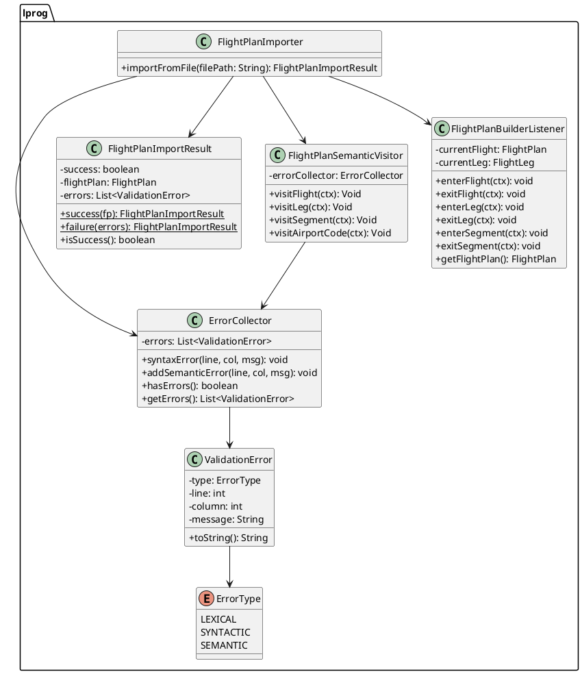
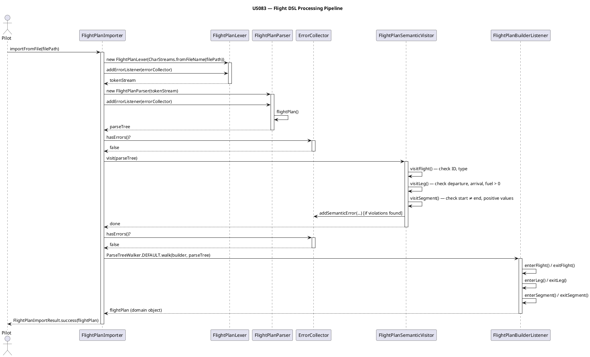

# US083 — Flight DSL Specification and Validation

## 1. Context

This User Story is being developed for the first time in Sprint 2. It is part of the
**LPROG** course unit and is mandatory for all students enrolled in it.

US083 is the foundational requirement for the Flight DSL subsystem. It defines, specifies
and implements the Domain Specific Language (DSL) used to formally describe flight plans
in the AISafe system. All other DSL-related user stories — in particular **US081** (Create
a Flight Plan from a File) — depend directly on the grammar and processing pipeline defined
here.

The DSL must be processed using **ANTLR4**, with at least one visitor and one listener
implemented. The implementation language is **Java**.

---

## 2. Requirements

**US083** As a Project Manager, I want the team to specify and implement the Flight
Description DSL, so that flight plans can be formally defined and validated.

**Acceptance Criteria:**

- US083.1 — The informal lexical and syntactic specification of the DSL is documented.
- US083.2 — A formal grammar is defined using ANTLR4, including lexer rules and parser
  rules.
- US083.3 — The system performs lexical and syntactic validation of flight plan files.
- US083.4 — An internal representation (AST or domain objects) is produced from a valid
  parse tree.
- US083.5 — Invalid inputs generate clear and informative error messages, including error
  type, line and column information.
- US083.6 — At least one ANTLR visitor and one ANTLR listener must be used in the
  processing pipeline.
- US083.7 — The implementation language must be Java.

**Dependencies/References:**

- **US081** — consumes the grammar and processing pipeline defined here to create flight
  plans from files.
- **US080** — the domain model produced by the DSL pipeline must be compatible with
  manually created flight plans.
- Specification sections 3.4.1 – 3.4.7.

---

## 3. Analysis

### 3.1 Informal Lexical Specification

The Flight DSL is a textual language composed of the following lexical elements:

| Element | Description | Examples |
|---|---|---|
| Keywords | Reserved words defining structure (case-insensitive) | `flight`, `leg`, `departure`, `arrival`, `route`, `segment`, `fuel` |
| Identifiers | Flight IDs and named entities (case-sensitive) | `TP001`, `FlightA` |
| Airport codes | IATA (3 letters) or ICAO (4 letters) | `OPO`, `LPPR` |
| Numeric literals | Integers and floating-point numbers | `42`, `3.14`, `-8.68` |
| Date literals | Departure dates | `2026-05-17` |
| Time literals | Departure and arrival times | `14:30` |
| Units | Qualify numeric values | `kg`, `l`, `m`, `m/s`, `deg` |
| Separators | Structure delimiters | `{ }`, `( )`, `[ ]`, `,`, `:`, `;` |
| Whitespace | Freely used; no semantic meaning | spaces, tabs, newlines |

Keywords are **case-insensitive**. Identifiers and literals are **case-sensitive**. Other
lexical elements may be introduced if formally specified, justified, and compatible with
the Core Flight DSL.

### 3.2 Informal Syntax Specification

A flight plan is defined by a `flight` block, which contains a unique flight identifier,
a flight type, and one or more `leg` blocks. Each leg represents a complete non-stop flight
phase and must include departure information, arrival information, a route definition, one
or more flight segments, and fuel information. The DSL is hierarchical and block-based.

#### General structure

```
flight <ID> {
    type: <regular | charter>

    leg {
        departure: <AIRPORT_CODE> <DATE> <TIME>
        arrival:   <AIRPORT_CODE> <TIME>
        fuel:      <QUANTITY> <UNIT>

        segment {
            from: (<lat>, <lon>)
            to:   (<lat>, <lon>)
            altitude_slots: [<alt1>, <alt2>, ...]
            width: <value> m
            wind:  <angle> deg <speed> m/s
        }
        // one or more segments
    }
    // one or more legs
}
```

#### Informal structure diagram

```
flight
  ├── ID
  ├── type
  └── leg (1..n)
        ├── departure
        ├── arrival
        ├── fuel
        └── segment (1..n)
              ├── from (coordinates)
              ├── to (coordinates)
              ├── altitude_slots
              ├── width
              └── wind
```

### 3.3 Semantic Validation Rules (section 3.4.5)

After successful syntactic validation, the system performs semantic validation to ensure
domain coherence.

**Flight level:**
- The flight identifier must be unique within the file.
- The flight type must be one of the allowed values: `regular` or `charter`.

**Leg level:**
- Each leg must contain exactly one departure and one arrival.
- Each leg must contain at least one segment.
- Fuel quantity must be strictly positive and associated with a specific leg.

**Leg sequence coherence:**
- The arrival airport of leg *n* must match the departure airport of leg *n+1*.
- The arrival time of leg *n* must precede the departure time of leg *n+1*.

**Route coherence:**
- Route origin must match the first leg's departure airport.
- Route destination must match the last leg's arrival airport.
- The same airport cannot be visited twice in a flight.

**Segment coherence:**
- Segment start and end coordinates must be different.
- Segments must belong to exactly one leg.

**Domain consistency:**
- Airport codes must respect the defined format: IATA (3 letters) or ICAO (4 letters).
- Numeric values (altitudes, widths, wind speed, fuel) must be positive.
- Date and time values must represent valid calendar values.

All semantic errors must be collected and reported in a single execution — the system does
not stop at the first error.

### 3.4 What is explicitly out of scope

The following aspects are not part of this US:

- Flight physics calculations.
- Fuel consumption estimation.
- Safety or collision detection.
- Weather impact computation.
- Flight simulation.
- The method of integration of the ANTLR solution in the project.

---

## 4. Design

### 4.1 Design Decisions

- **ANTLR4** is used to define the grammar (`FlightPlan.g4`) and generate the lexer,
  parser, visitor base and listener base automatically via the Maven ANTLR plugin.
- **At least one Listener** is used — for building domain objects progressively as the
  parse tree is walked.
- **At least one Visitor** is used — for semantic validation, returning typed results per
  node.
- **Domain objects** are built directly from the parse tree; no separate intermediate AST
  is created.
- **Error collection**: a custom `ErrorCollector` accumulates all errors from all three
  phases; no early exit on first error.
- **Grammar placement**: the `.g4` file is placed in `src/main/antlr4/` so that the Maven
  ANTLR plugin generates sources automatically during the build phase.

### 4.2 ANTLR Component Overview

| Component | Role |
|---|---|
| `FlightPlan.g4` | Grammar file — defines all lexer and parser rules |
| `FlightPlanLexer` | Generated — tokenises the character input stream |
| `FlightPlanParser` | Generated — builds the parse tree from the token stream |
| `FlightPlanListener` | Generated interface + custom implementation for building domain objects |
| `FlightPlanVisitor` | Generated interface + custom implementation for semantic validation |
| `ErrorCollector` | Custom — accumulates lexical, syntactic and semantic errors |
| `FlightPlanImporter` | Orchestrates the full validation and import pipeline |

### 4.3 Class Diagram (CD)



### 4.4 Sequence Diagram (SD)



### 4.5 Acceptance Tests

**Test 1:** Verifies that a valid DSL file is accepted and produces a flight plan.

**Refers to Acceptance Criteria:** US083.3, US083.4

```java
@Test
void validDslFileIsAcceptedAndProducesFlightPlan() {
    FlightPlanImporter importer = new FlightPlanImporter();
    FlightPlanImportResult result = importer.importFromFile("src/test/resources/valid_flight.dsl");

    assertTrue(result.isSuccess());
    assertNotNull(result.getFlightPlan());
}
```

**Test 2:** Verifies that a file with a lexical error produces a meaningful error message.

**Refers to Acceptance Criteria:** US083.3, US083.5

```java
@Test
void fileWithLexicalErrorProducesError() {
    FlightPlanImporter importer = new FlightPlanImporter();
    FlightPlanImportResult result = importer.importFromFile("src/test/resources/lexical_error.dsl");

    assertFalse(result.isSuccess());
    assertTrue(result.getErrors().stream()
            .anyMatch(e -> e.getType() == ErrorType.LEXICAL));
}
```

**Test 3:** Verifies that a file missing a required block produces a syntactic error.

**Refers to Acceptance Criteria:** US083.3, US083.5

```java
@Test
void fileWithMissingFuelBlockProducesSyntacticError() {
    FlightPlanImporter importer = new FlightPlanImporter();
    FlightPlanImportResult result = importer.importFromFile("src/test/resources/missing_fuel.dsl");

    assertFalse(result.isSuccess());
    assertTrue(result.getErrors().stream()
            .anyMatch(e -> e.getType() == ErrorType.SYNTACTIC));
}
```

**Test 4:** Verifies that a file with negative fuel quantity produces a semantic error.

**Refers to Acceptance Criteria:** US083.3, US083.5

```java
@Test
void fileWithNegativeFuelProducesSemanticError() {
    FlightPlanImporter importer = new FlightPlanImporter();
    FlightPlanImportResult result = importer.importFromFile("src/test/resources/negative_fuel.dsl");

    assertFalse(result.isSuccess());
    assertTrue(result.getErrors().stream()
            .anyMatch(e -> e.getType() == ErrorType.SEMANTIC
                    && e.getMessage().contains("fuel")));
}
```

**Test 5:** Verifies that all semantic errors are collected in a single execution.

**Refers to Acceptance Criteria:** US083.5

```java
@Test
void fileWithMultipleSemanticErrorsCollectsAll() {
    FlightPlanImporter importer = new FlightPlanImporter();
    FlightPlanImportResult result =
            importer.importFromFile("src/test/resources/multiple_semantic_errors.dsl");

    assertFalse(result.isSuccess());
    assertTrue(result.getErrors().size() > 1);
}
```

**Test 6:** Verifies that error messages include line and column information.

**Refers to Acceptance Criteria:** US083.5

```java
@Test
void errorMessagesIncludeLineAndColumnInfo() {
    FlightPlanImporter importer = new FlightPlanImporter();
    FlightPlanImportResult result =
            importer.importFromFile("src/test/resources/lexical_error.dsl");

    assertFalse(result.isSuccess());
    ValidationError error = result.getErrors().get(0);
    assertTrue(error.getLine() > 0);
    assertTrue(error.getColumn() >= 0);
}
```

---

## 5. Implementation

### 5.1 Grammar (`FlightPlan.g4`)

The grammar is placed in `src/main/antlr4/` and compiled automatically by the Maven ANTLR
plugin. The generated sources (lexer, parser, visitor, listener) are placed in
`target/generated-sources/antlr4/`.

```antlr
grammar FlightPlan;

// ─── Parser Rules ────────────────────────────────────────────────

flightPlan
    : flight+ EOF
    ;

flight
    : FLIGHT ID LBRACE
        TYPE COLON flightType
        leg+
      RBRACE
    ;

flightType
    : REGULAR
    | CHARTER
    ;

leg
    : LEG LBRACE
        departure
        arrival
        fuel
        segment+
      RBRACE
    ;

departure
    : DEPARTURE COLON airportCode date time
    ;

arrival
    : ARRIVAL COLON airportCode time
    ;

fuel
    : FUEL COLON NUMBER unit
    ;

segment
    : SEGMENT LBRACE
        FROM COLON coordinates
        TO COLON coordinates
        ALTITUDE_SLOTS COLON LBRACKET NUMBER (COMMA NUMBER)* RBRACKET
        WIDTH COLON NUMBER METER
        WIND COLON NUMBER DEG NUMBER MS
      RBRACE
    ;

coordinates
    : LPAREN NUMBER COMMA NUMBER RPAREN
    ;

airportCode
    : ID
    ;

date
    : DATE_LITERAL
    ;

time
    : TIME_LITERAL
    ;

unit
    : KG | LITER | METER | MS
    ;

// ─── Lexer Rules ─────────────────────────────────────────────────

FLIGHT          : [Ff][Ll][Ii][Gg][Hh][Tt] ;
LEG             : [Ll][Ee][Gg] ;
DEPARTURE       : [Dd][Ee][Pp][Aa][Rr][Tt][Uu][Rr][Ee] ;
ARRIVAL         : [Aa][Rr][Rr][Ii][Vv][Aa][Ll] ;
ROUTE           : [Rr][Oo][Uu][Tt][Ee] ;
SEGMENT         : [Ss][Ee][Gg][Mm][Ee][Nn][Tt] ;
FUEL            : [Ff][Uu][Ee][Ll] ;
TYPE            : [Tt][Yy][Pp][Ee] ;
FROM            : [Ff][Rr][Oo][Mm] ;
TO              : [Tt][Oo] ;
ALTITUDE_SLOTS  : [Aa][Ll][Tt][Ii][Tt][Uu][Dd][Ee]'_'[Ss][Ll][Oo][Tt][Ss] ;
WIDTH           : [Ww][Ii][Dd][Tt][Hh] ;
WIND            : [Ww][Ii][Nn][Dd] ;
REGULAR         : [Rr][Ee][Gg][Uu][Ll][Aa][Rr] ;
CHARTER         : [Cc][Hh][Aa][Rr][Tt][Ee][Rr] ;
DEG             : [Dd][Ee][Gg] ;
MS              : 'm/s' ;
KG              : 'kg' ;
LITER           : 'l' ;
METER           : 'm' ;

ID              : [A-Za-z][A-Za-z0-9_-]* ;
NUMBER          : '-'? [0-9]+ ('.' [0-9]+)? ;
DATE_LITERAL    : [0-9]{4} '-' [0-9]{2} '-' [0-9]{2} ;
TIME_LITERAL    : [0-9]{2} ':' [0-9]{2} ;

LBRACE          : '{' ;
RBRACE          : '}' ;
LPAREN          : '(' ;
RPAREN          : ')' ;
LBRACKET        : '[' ;
RBRACKET        : ']' ;
COMMA           : ',' ;
COLON           : ':' ;
SEMI            : ';' ;

WS              : [ \t\r\n]+ -> skip ;
COMMENT         : '//' ~[\r\n]* -> skip ;
```

### 5.2 ErrorCollector

```java
public class ErrorCollector extends BaseErrorListener {

    public enum ErrorType { LEXICAL, SYNTACTIC, SEMANTIC }

    public static class ValidationError {
        private final ErrorType type;
        private final int line;
        private final int column;
        private final String message;

        public ValidationError(ErrorType type, int line, int column, String message) {
            this.type    = type;
            this.line    = line;
            this.column  = column;
            this.message = message;
        }

        public ErrorType getType()    { return type;    }
        public int       getLine()    { return line;    }
        public int       getColumn()  { return column;  }
        public String    getMessage() { return message; }

        @Override
        public String toString() {
            return String.format("[%s] Line %d, Col %d — %s",
                    type, line, column, message);
        }
    }

    private final List<ValidationError> errors = new ArrayList<>();
    private ErrorType currentPhase = ErrorType.LEXICAL;

    public void setPhase(ErrorType phase) { this.currentPhase = phase; }

    @Override
    public void syntaxError(Recognizer<?, ?> recognizer,
                            Object offendingSymbol,
                            int line, int charPositionInLine,
                            String msg, RecognitionException e) {
        errors.add(new ValidationError(currentPhase, line, charPositionInLine, msg));
    }

    public void addSemanticError(int line, int column, String message) {
        errors.add(new ValidationError(ErrorType.SEMANTIC, line, column, message));
    }

    public boolean hasErrors()              { return !errors.isEmpty(); }
    public List<ValidationError> getErrors(){ return Collections.unmodifiableList(errors); }
}
```

### 5.3 FlightPlanImporter

```java
public class FlightPlanImporter {

    public FlightPlanImportResult importFromFile(final String filePath) throws IOException {
        ErrorCollector errorCollector = new ErrorCollector();

        // 1. Lexical analysis
        CharStream input = CharStreams.fromFileName(filePath);
        FlightPlanLexer lexer = new FlightPlanLexer(input);
        errorCollector.setPhase(ErrorCollector.ErrorType.LEXICAL);
        lexer.removeErrorListeners();
        lexer.addErrorListener(errorCollector);

        // 2. Syntactic analysis
        CommonTokenStream tokens = new CommonTokenStream(lexer);
        FlightPlanParser parser = new FlightPlanParser(tokens);
        errorCollector.setPhase(ErrorCollector.ErrorType.SYNTACTIC);
        parser.removeErrorListeners();
        parser.addErrorListener(errorCollector);
        ParseTree tree = parser.flightPlan();

        if (errorCollector.hasErrors()) {
            return FlightPlanImportResult.failure(errorCollector.getErrors());
        }

        // 3. Semantic validation via Visitor
        FlightPlanSemanticVisitor visitor =
                new FlightPlanSemanticVisitor(errorCollector);
        visitor.visit(tree);

        if (errorCollector.hasErrors()) {
            return FlightPlanImportResult.failure(errorCollector.getErrors());
        }

        // 4. Build domain objects via Listener
        FlightPlanBuilderListener builder = new FlightPlanBuilderListener();
        ParseTreeWalker.DEFAULT.walk(builder, tree);

        return FlightPlanImportResult.success(builder.getFlightPlan());
    }
}
```

---

## 6. Integration/Demonstration

- The `FlightPlanImporter` is invoked by **US081** when the Pilot chooses to create a
  flight plan from a file.
- To demonstrate lexical validation: provide a file with an unknown token (e.g. `#`) —
  the system must report the line and column of the error.
- To demonstrate syntactic validation: provide a file with a missing `fuel` block inside
  a leg — the system must report the missing element.
- To demonstrate semantic validation: provide a file where the arrival airport of leg 1
  does not match the departure airport of leg 2 — the system must report the incoherence.
- To demonstrate error collection: provide a file with multiple errors — all errors must
  be listed in a single output, not just the first one.

**Example — valid file accepted:**
```
>> Flight plan imported successfully.
   Flight ID : TP001
   Type      : regular
   Legs      : 2
   Status    : DRAFT
```

**Example — invalid file rejected:**
```
>> Flight plan file is invalid. The following errors were found:

   [SYNTACTIC] Line 5,  Col 1  — Missing 'fuel' block in leg
   [SEMANTIC]  Line 12, Col 8  — Fuel quantity must be positive (got: 0)
   [SEMANTIC]  Line 19, Col 4  — Departure airport of leg 2 ('LPPR')
                                  does not match arrival of leg 1 ('LPPT')

>> Flight plan was NOT created.
```

---

## 7. Observations

- The grammar file (`FlightPlan.g4`) is shared between US083 and US081. This US is
  responsible for defining and documenting it; US081 consumes it.
- Keywords are **case-insensitive** as per the specification (section 3.4.2). This is
  implemented in the lexer using character class alternatives (e.g. `[Ff][Ll][Ii][Gg][Hh][Tt]`).
- Identifiers and literals are **case-sensitive**.
- The DSL is designed to be extensible — new keywords, constructs or validation rules can
  be added without breaking existing valid files, as required by section 3.4.7.
- Semantic errors are all collected before reporting (no fail-fast), as required by
  section 3.4.5.
- The Maven ANTLR plugin must be configured in `pom.xml` to generate sources from the
  `.g4` file during the `generate-sources` phase.