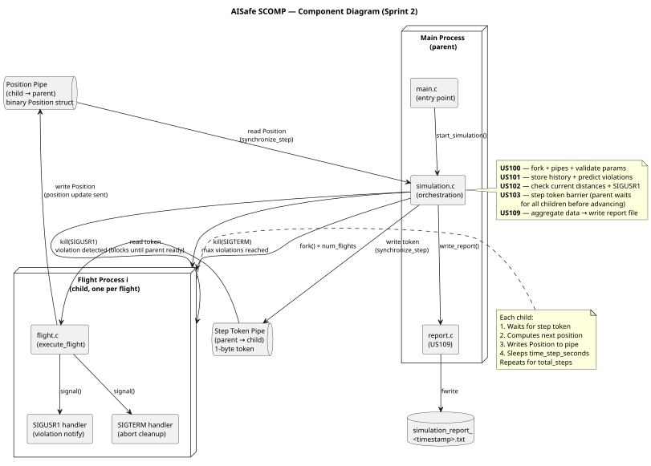

# SCOMP — Sprint 2: Flight Simulation

## How to Build and Run

```
# Compile
make

# Run the simulation
./simulation <num_flights> <total_steps> <time_step_sec> <safety_threshold_m> <max_violations>

# Example — 3 flights, 10 steps, 1 s per step, 50 km threshold, abort after 5 violations
./simulation 3 10 1 50000 5

# Example — force violations (high threshold catches nearby flights)
./simulation 2 10 1 999999 5

# Run tests
make test        # US100/US101 tests
make test102     # US102 tests
make test103     # US103 tests
make test-all    # all tests at once
```

The simulation writes a timestamped report file (`simulation_report_YYYYMMDD_HHMMSS.txt`) to the working directory on completion.

---

## Component Diagram

The diagram below shows all processes, pipes, files and signals involved in the simulation.



---

## Approach per User Story

### US100 — Simulate Flights in a Given Area
The entry point is `start_simulation()` in `simulation.c`. After validating all parameters, it creates **two pipes per flight** (one for position updates, one for step tokens) and calls `fork()` once per flight. The parent enters a step loop; each step it synchronises all flights, checks for violations, and advances. Child processes are cleaned up with `waitpid()` at the end. Implemented in `simulation.c` and `main.c`.

### US101 — Capture and Process Flight Movements
Inside `synchronize_step()`, before overwriting `FlightState.current` with the new position, the old value is pushed into `FlightState.history[]`. This history is then used by `check_predicted_violations()` to extrapolate each flight's next position one step ahead using a linear delta (`next = current + (current − previous)`). If two predicted positions are within 2× the safety threshold, a warning is logged. Prediction is skipped on step 0 (no history yet). Implemented in `simulation.c`.

### US102 — Detect Aircraft Safety Violations in Real Time
`check_safety_violations()` iterates over all pairs of active flights and computes the Euclidean distance between their current positions (degrees converted to metres at ~111 km/degree). If the distance is below `safety_threshold_m`, the event is recorded in the report with timestamp, positions and velocity vectors estimated from history, and `SIGUSR1` is sent to both involved child processes. The signal handler in `flight.c` blocks further signals while processing (`sigprocmask`). Implemented in `simulation.c` and `flight.c`.

### US103 — Synchronize Flight Execution with a Time Step
Synchronisation is achieved with a second pipe per flight (the "step pipe"). At the start of each step the parent writes a 1-byte token to every active flight; each child blocks on `read()` from that pipe and only proceeds after receiving the token. The parent then blocks on `read()` from the position pipe of each flight in order. This guarantees that all position updates for step N are fully processed before the parent advances to step N+1. Implemented in `synchronize_step()` in `simulation.c` and `execute_flight()` in `flight.c`.

### US109 — Generate and Store Final Simulation Report
After the simulation loop ends and all children have exited, `write_report()` in `report.c` writes a structured text file containing: generation timestamp, total flights, total violations, per-flight status (OK / VIOLATED / ABORTED), and full detail for each violation event (timestamp, both flight IDs, positions, velocity vectors). The filename is generated by `make_report_filename()` with a `YYYYMMDD_HHMMSS` suffix. A summary is also printed to stdout. Implemented in `report.c`.

---

## What Was and Was Not Implemented

| US | Status | Notes |
|---|---|---|
| US100 | ✅ Implemented | Fork, pipes, parameter validation, main simulation loop |
| US101 | ✅ Implemented | Position history stored per flight; linear extrapolation for predicted violations |
| US102 | ✅ Implemented | Pairwise distance check; SIGUSR1 notification; signal blocked during handler |
| US103 | ✅ Implemented | Step-token pipe barrier; parent waits for all children before advancing |
| US109 | ✅ Implemented | Full report written to timestamped file; stdout summary |

**Known limitations:**
- Flight paths are **simulated** (linear interpolation between hardcoded coordinates offset per flight ID) rather than read from real flight plan files — integration with the Java/ANTLR layer is out of scope for this sprint.
- Distance uses a simplified Euclidean approximation (1° ≈ 111 km); accuracy degrades at high latitudes and over long distances, but is sufficient for proximity detection.
- The `history[]` array is fixed at `MAX_HISTORY = 100` entries per flight. For simulations with more than 100 steps, older positions are silently dropped. A circular buffer would be a natural improvement.
- `synchronize_step()` reads positions from children **in order** (flight 0, then 1, then 2…). If a child is slow, the parent waits. True lock-step with a barrier semaphore is introduced in US108 (Sprint 3).
---

## Group Contribution

| Student | Contribution (%) |
|---------|------------------|
| 1201020 | 20%              |
| 1230993 | 20%              |
| 1240654 | 20%              |
| 1240657 | 20%              |
| 1240676 | 20%              |
