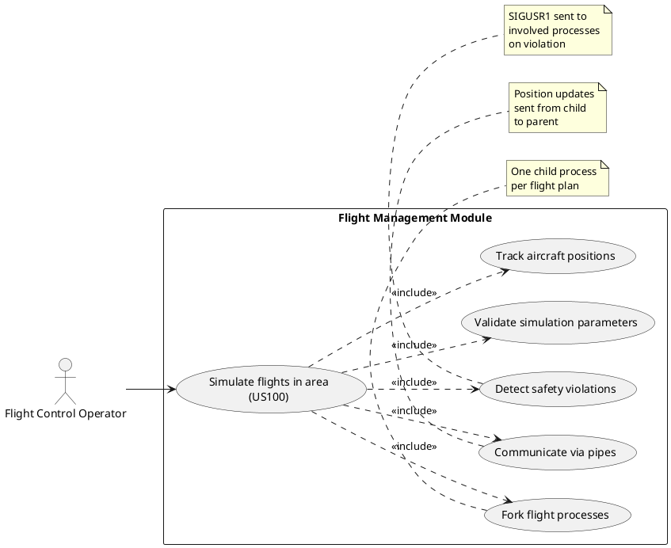
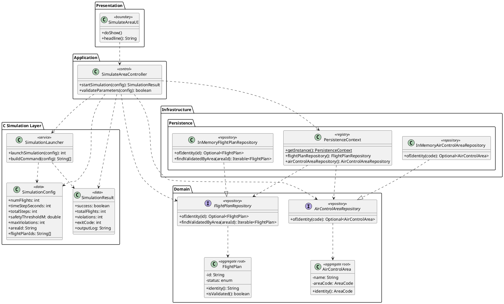
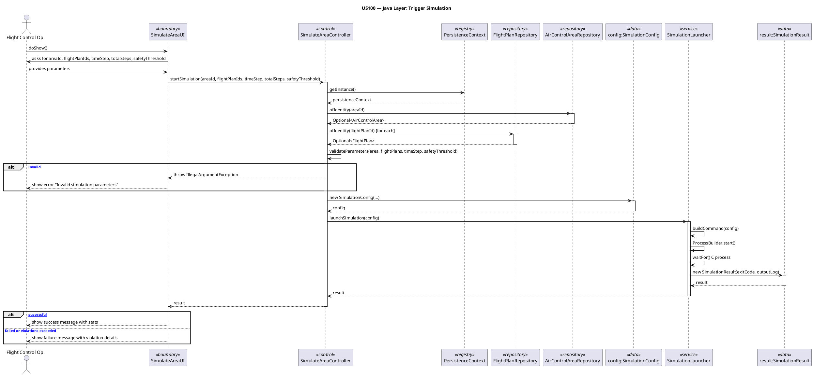
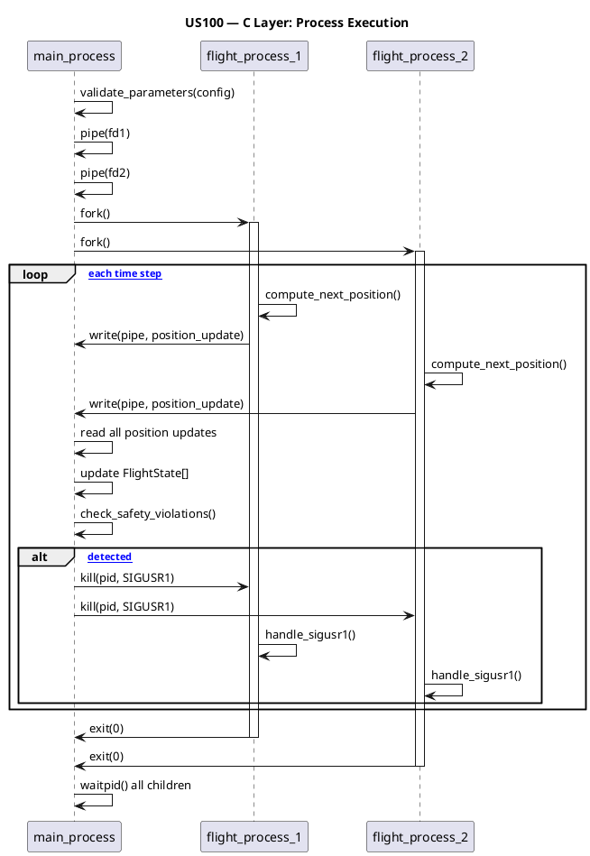

# US100 — Simulate Flights in a Given Area

## 1. Context

This User Story is being developed for the first time in Sprint 2. It is part of the
**SCOMP** course unit and is mandatory for all students enrolled in it.

US100 introduces the ability for a Flight Control Operator to simulate multiple flights
within a geographic area. The simulation is process-based, parallelised, and implemented
in **C**. Each flight runs as an independent child process, communicating with the main
(parent) process via **pipes**. The main process tracks aircraft positions over time using
an appropriate data structure.

This US is the entry point for the simulation subsystem and is a prerequisite for
**US101** (Capture and Process Flight Movements), **US102** (Detect Aircraft Safety
Violations), **US103** (Synchronize Flight Execution with a Time Step), and **US105**
(Initialize Hybrid Simulation Environment with Shared Memory).

---

## 2. Requirements

**US100** As a Flight Control Operator, I want to simulate flights in an area. Simulations
have many parameters, such as time range, geographic area, included flights, weather
conditions, safety thresholds, and performance settings. All required parameters should be
validated.

**Acceptance Criteria:**

- US100.1 — This component must be implemented in **C**.
- US100.2 — The system must utilize **processes**, **pipes**, and **signals**.
- US100.3 — The system must fork a new child process for each flight included in the
  simulation.
- US100.4 — Each flight process must execute its designated flight plan.
- US100.5 — Pipes must facilitate communication between the main process and each flight
  process.
- US100.6 — The main process must track aircraft positions over time using an appropriate
  data structure.
- US100.7 — All simulation parameters must be validated before the simulation starts.

**Dependencies/References:**

- **US080 / US081** — valid flight plans must exist before they can be simulated.
- **US101** — captures and processes position updates sent by flight processes via pipes.
- **US102** — detects safety violations based on positions tracked by the main process.
- **US103** — synchronizes the step-by-step progression of all flight processes.
- **US105** — extends this simulation with shared memory and threads.

---

## 3. Analysis

### 3.1 Domain Understanding

The simulation coordinates multiple flights simultaneously within a geographic area over
a defined time interval. Each flight follows its flight plan, advancing position at each
time step. The main process acts as the simulation controller — it forks one child process
per flight, receives position updates via pipes, tracks all positions, and detects potential
safety violations.

The key concepts are:

| Concept | Description |
|---|---|
| Simulation | The coordinated execution of multiple flight processes over a time interval |
| Flight process | A child process executing one flight plan step by step |
| Pipe | IPC mechanism used for position updates from child to parent |
| Time step | The discrete unit of simulation progression |
| Position | The geographic coordinates and altitude of an aircraft at a given time step |
| Safety threshold | The minimum separation distance below which a violation is detected |

### 3.2 Simulation Parameters

All parameters must be validated before the simulation starts:

| Parameter | Description | Validation rule |
|---|---|---|
| Time range | Start and end of the simulation | End must be after start |
| Geographic area | The air control area being simulated | Must be a registered area |
| Included flights | List of flight plan IDs to simulate | Must have at least one valid plan |
| Weather conditions | Wind and atmospheric data for the area | Must come from weather service |
| Safety threshold | Minimum separation distance (metres) | Must be strictly positive |
| Performance settings | Time step size, max violations before abort | Must be positive integers |

### 3.3 Process Architecture

```
Main Process (simulation controller)
    │
    ├── fork() → Flight Process 1 (flight plan A)
    │               └── pipe → sends position updates to main
    │
    ├── fork() → Flight Process 2 (flight plan B)
    │               └── pipe → sends position updates to main
    │
    └── fork() → Flight Process N (flight plan N)
                    └── pipe → sends position updates to main
```

At each time step:
1. Each flight process computes the next position based on its flight plan and physics.
2. Each flight process sends a position update to the main process via its pipe.
3. The main process reads all updates for the current time step.
4. The main process checks for safety violations among all current positions.
5. If a violation is detected, the main process sends `SIGUSR1` to the involved processes.
6. The simulation advances to the next time step.

### 3.4 Use Case Diagram



---

## 4. Design

### 4.1 Design Decisions

- **C is the implementation language** as mandated by the specification.
- **One process per flight**: each flight plan is executed by an independent child process
  created via `fork()`. This allows true parallelism and independent failure isolation.
- **Pipes for IPC**: each child process has a dedicated pipe to the parent for sending
  position updates. The parent reads from all pipes at each time step.
- **Step-by-step synchronisation**: the simulation advances in discrete time steps. The
  parent does not advance to the next step until all child processes have sent their update
  for the current step (detailed in US103).
- **Signal-based violation notification**: when the parent detects a safety violation, it
  sends `SIGUSR1` to the involved child processes. Each child must handle this signal
  without terminating (detailed in US102).
- **Data structure for position tracking**: the parent maintains an array of structs, one
  per flight, containing the current and past positions. This enables proximity checks
  between all pairs of aircraft at each step.
- **Java + C integration**: the Java application layer (controller and UI) orchestrates
  the simulation by launching the compiled C binary via `ProcessBuilder`. The C layer
  handles all process management, pipes and signals internally.

### 4.2 Class Diagram (CD)



### 4.3 Data Structures (C)

```c
/* Position of an aircraft at a given time step */
typedef struct {
    double latitude;
    double longitude;
    double altitude;
    int    time_step;
} Position;

/* State of one flight in the simulation */
typedef struct {
    int      flight_id;
    pid_t    pid;
    int      pipe_fd;        /* read end of pipe from child */
    Position current;
    Position history[MAX_HISTORY];
    int      history_count;
    int      active;
} FlightState;

/* Simulation configuration */
typedef struct {
    int    num_flights;
    int    time_step_seconds;
    int    total_steps;
    double safety_threshold_m;
    int    max_violations;
} SimulationConfig;
```

### 4.4 Sequence Diagram (SD) — Java Layer



### 4.5 Sequence Diagram (SD) — C Layer



### 4.6 Acceptance Tests

**Test 1:** Verifies that the simulation forks one process per flight.

**Refers to Acceptance Criteria:** US100.3

```c
void test_forks_one_process_per_flight() {
    SimulationConfig cfg = { .num_flights = 3, .total_steps = 5,
                             .safety_threshold_m = 1000.0 };
    FlightState states[3];
    start_simulation(&cfg, states);

    for (int i = 0; i < 3; i++) {
        assert(states[i].pid > 0);
        assert(states[i].active == 1);
    }
    printf("PASS: test_forks_one_process_per_flight\n");
}
```

**Test 2:** Verifies that position updates are received via pipes.

**Refers to Acceptance Criteria:** US100.5, US100.6

```c
void test_position_updates_received_via_pipe() {
    int fd[2];
    pipe(fd);

    Position pos = { .latitude = 41.2, .longitude = -8.6,
                     .altitude = 10000, .time_step = 1 };

    write(fd[1], &pos, sizeof(Position));
    close(fd[1]);

    Position received;
    read(fd[0], &received, sizeof(Position));
    close(fd[0]);

    assert(received.latitude  == pos.latitude);
    assert(received.longitude == pos.longitude);
    assert(received.time_step == pos.time_step);
    printf("PASS: test_position_updates_received_via_pipe\n");
}
```

**Test 3:** Verifies that invalid parameters are rejected before the simulation starts.

**Refers to Acceptance Criteria:** US100.7

```c
void test_invalid_parameters_are_rejected() {
    SimulationConfig cfg = { .num_flights = 0,
                             .total_steps  = 10,
                             .safety_threshold_m = -100.0 };

    int result = validate_parameters(&cfg);
    assert(result == -1);
    printf("PASS: test_invalid_parameters_are_rejected\n");
}
```

**Test 4:** Verifies that SIGUSR1 is sent when a safety violation is detected.

**Refers to Acceptance Criteria:** US100.2

```c
volatile sig_atomic_t sigusr1_received = 0;

void handle_sigusr1(int sig) {
    sigusr1_received = 1;
}

void test_sigusr1_sent_on_violation() {
    signal(SIGUSR1, handle_sigusr1);
    kill(getpid(), SIGUSR1);
    assert(sigusr1_received == 1);
    printf("PASS: test_sigusr1_sent_on_violation\n");
}
```

---

## 5. Implementation

> To be filled after implementation.

Key implementation notes:
- The entry point is `simulate_area()` in `simulation.c`, which reads the configuration,
  validates parameters, creates pipes, forks child processes, and enters the main
  simulation loop.
- Each child process runs `execute_flight_plan()`, which reads the flight plan, computes
  position at each time step using simplified physics, writes the position to the pipe,
  and waits for the next step signal.
- The parent's main loop calls `read_all_positions()` to collect updates from all pipes,
  then `check_safety_violations()` to compare all pairs of aircraft positions.
- Signal handlers must be registered before `fork()` so that both parent and child have
  them in place from the start.
- `waitpid()` must be called for all child PIDs after the simulation ends to avoid
  zombie processes.
- The Java `SimulationLauncher` invokes the C binary using `ProcessBuilder`, passing
  configuration parameters as command-line arguments or via a temporary config file.

---

## 6. Integration/Demonstration

> To be filled after implementation.

- The simulation is triggered from the Flight Control Operator menu in the Java application,
  which calls the compiled C binary via `ProcessBuilder`.
- To demonstrate: select a set of validated flight plans, configure the simulation
  parameters, and start the simulation. The console should show position updates at each
  time step.
- To demonstrate pipe communication: add logging in the child process before each `write()`
  and in the parent before each `read()` — verify that messages flow correctly.
- To demonstrate signal handling: configure a low safety threshold so that a violation is
  detected early, and verify that the involved processes receive and handle `SIGUSR1`.

---

## 7. Observations

- The simulation is implemented entirely in **C** as required by the specification
  (section 4, US100 acceptance criteria).
- The use of `fork()`, `pipe()`, and `kill()` / `signal()` is mandatory per the acceptance
  criteria. No threading is used in this US — that is introduced in US105.
- The position data structure uses `double` for coordinates to maintain sufficient
  precision for geographic calculations.
- The safety violation check compares Euclidean distance between pairs of aircraft in
  3D space (latitude, longitude, altitude). A more accurate haversine distance may be
  used if required.
- The two sequence diagrams (Java layer and C layer) are kept separate to reflect the
  architectural boundary between the Java orchestration layer and the C simulation layer.
- US101, US102, US103, US105, US106, US107, and US108 extend and build upon the
  architecture defined here. Changes to the core data structures in this US will affect
  all subsequent simulation user stories.