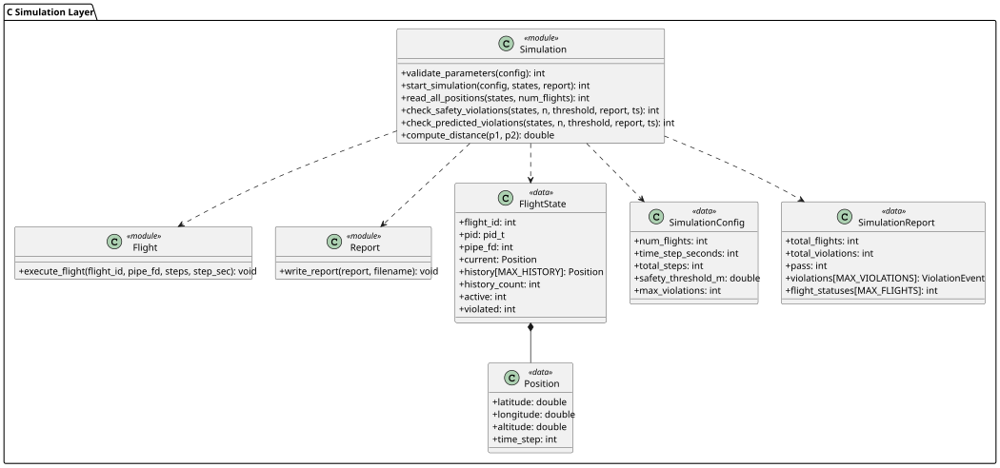
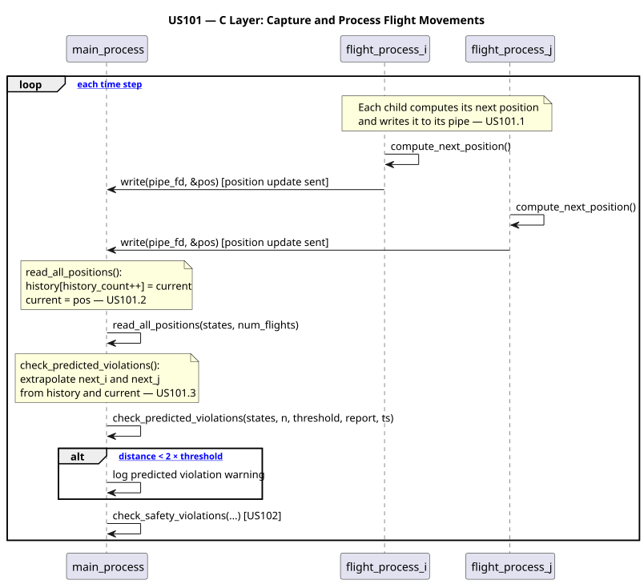

# US101 — Capture and Process Flight Movements

## 1. Context

This User Story is being developed for the first time in Sprint 2. It is part of the
**SCOMP** course unit and is mandatory for all students enrolled in it.

US101 introduces the ability for the simulation system to capture position updates sent
by each flight process and store them over time, so that the main process can track
aircraft positions across all simulation steps. It also uses the stored history to
**anticipate** potential safety violations before they occur, by extrapolating the next
position of each flight from its recent trajectory.

This US builds directly on top of **US100**, which establishes the process architecture,
pipes, and `FlightState` data structure. The position history stored here is also consumed
by **US102** (real-time safety violation detection) and **US109** (final report generation).

---

## 2. Requirements

**US101** As a simulation process, I want to receive movement commands from flight
processes so that I can track aircraft positions over time.

**Acceptance Criteria:**

- US101.1 — Each flight process must send position updates to the main process via a pipe.
- US101.2 — The main process must track aircraft positions.
- US101.3 — The system must store past positions to anticipate and detect potential safety
  violations.

**Dependencies/References:**

- **US100** — provides the pipe infrastructure, `fork()` architecture, and `FlightState`
  data structure that this US relies on.
- **US102** — uses the current positions tracked here to detect real-time safety violations.
- **US103** — synchronises the step-by-step progression so that all position updates for a
  given step are processed before the simulation advances.
- **US109** — reads the stored position history and violation events to generate the final
  simulation report.

---

## 3. Analysis

### 3.1 Domain Understanding

At each simulation time step, every active flight process computes its next position and
sends it to the parent process via a dedicated pipe. The parent reads all updates for the
current step, stores the previous position in a history array, and updates the current
position. Once at least one historical position is available, the parent can extrapolate
the next expected position of each flight and compare predicted future positions between
all pairs of aircraft to anticipate violations before they happen.

The key concepts are:

| Concept | Description |
|---|---|
| Position update | A `Position` struct written by the child to the pipe at each time step |
| Position history | Array of past positions stored per flight in `FlightState.history[]` |
| Extrapolation | Linear projection of the next position from the last two known positions |
| Predicted violation | A pair of aircraft whose extrapolated positions are within 2× the safety threshold |

### 3.2 Position Update Flow

```
Child process (flight i)          Parent process (main)
        │                                  │
        │  compute_next_position()         │
        │  write(pipe_fd, &pos, ...)  ───► │  read(pipe_fd, &pos, ...)
        │                                  │  history[history_count++] = current
        │                                  │  current = pos
        │                                  │  (extrapolate next position)
        │                                  │  check_predicted_violations()
```

### 3.3 History Storage

The `FlightState` struct (defined in `simulation.h`, established in US100) already
includes the fields needed for this US:

```c
Position history[MAX_HISTORY];   /* past positions, oldest first */
int      history_count;          /* number of stored past positions */
```

`read_all_positions()` (US100) pushes `current` into `history` before overwriting it with
the new update — so after step 1, `history[0]` holds the position from step 0, and
`current` holds the position from step 1. This is sufficient to extrapolate step 2.

### 3.4 Predicted Violation Detection

The extrapolation uses a simple linear model: given positions at step *n−1* (history) and
step *n* (current), the predicted position at step *n+1* is:

```
next = current + (current − previous)
```

If the predicted distance between two flights is below **2× the safety threshold**, a
predicted violation warning is logged. The factor of 2 provides an anticipation margin —
it warns before the actual threshold is breached, giving the system time to react.

---

## 4. Design

### 4.1 Design Decisions

- **No new data structures needed**: the `history[]` array in `FlightState` (US100) is
  sufficient. US101 only adds the logic that uses it.
- **Linear extrapolation**: chosen for simplicity and correctness within the scope of this
  project. A more sophisticated model (e.g. quadratic) could be added later.
- **2× threshold for prediction**: warns early enough to be actionable, while avoiding
  excessive false positives when flights are simply passing near each other at safe speed.
- **Separation of concerns**: `check_predicted_violations()` is a distinct function from
  `check_safety_violations()` (US102). The former anticipates; the latter reacts.
  Both are called in sequence in the main simulation loop.
- **Guard on history_count**: prediction is only attempted when at least one historical
  position exists (`history_count >= 1`). On step 0 there is no history, so no prediction
  is made — this is correct behaviour.

### 4.2 Class Diagram (CD)

The class diagram for US101 is identical to US100 at the Java layer — no new Java classes
are introduced. The only change is the addition of `check_predicted_violations()` in the
C simulation layer, shown below.



### 4.3 Sequence Diagram (SD) — C Layer



### 4.4 Acceptance Tests

**Test 1:** Verifies that position updates sent via pipe are received and stored correctly
by the main process.

**Refers to Acceptance Criteria:** US101.1, US101.2

```c
void test_position_update_stored_in_state() {
    int fd[2];
    pipe(fd);

    FlightState state;
    memset(&state, 0, sizeof(FlightState));
    state.pipe_fd       = fd[0];
    state.active        = 1;
    state.history_count = 0;

    /* simulate a child writing two updates */
    Position pos1 = { .latitude = 41.0, .longitude = -8.5,
                      .altitude = 10000, .time_step = 0 };
    Position pos2 = { .latitude = 41.1, .longitude = -8.4,
                      .altitude = 10100, .time_step = 1 };

    write(fd[1], &pos1, sizeof(Position));
    write(fd[1], &pos2, sizeof(Position));
    close(fd[1]);

    /* first read */
    read_all_positions(&state, 1);
    assert(state.current.latitude  == pos1.latitude);
    assert(state.current.time_step == 0);
    assert(state.history_count     == 0); /* no previous to push yet */

    /* second read — pos1 should move to history */
    read_all_positions(&state, 1);
    assert(state.current.latitude  == pos2.latitude);
    assert(state.current.time_step == 1);
    assert(state.history_count     == 1);
    assert(state.history[0].latitude == pos1.latitude);

    close(fd[0]);
    printf("PASS: test_position_update_stored_in_state\n");
}
```

**Test 2:** Verifies that a predicted violation is detected when two flights are on a
converging trajectory within 2× the safety threshold.

**Refers to Acceptance Criteria:** US101.3

```c
void test_predicted_violation_detected() {
    FlightState states[2];
    memset(states, 0, sizeof(states));

    /* flight 0: moving south-east, currently at 41.0, -8.5 */
    states[0].flight_id     = 0;
    states[0].active        = 1;
    states[0].history_count = 1;
    states[0].history[0]    = (Position){40.9, -8.6, 10000, 0};
    states[0].current       = (Position){41.0, -8.5, 10000, 1};

    /* flight 1: moving north-west, on collision course */
    states[1].flight_id     = 1;
    states[1].active        = 1;
    states[1].history_count = 1;
    states[1].history[0]    = (Position){41.1, -8.4, 10000, 0};
    states[1].current       = (Position){41.0, -8.5, 10000, 1};

    SimulationReport report;
    memset(&report, 0, sizeof(report));

    int predictions = check_predicted_violations(
            states, 2, 50000.0, &report, 1.0);

    /* both flights at identical current pos — predicted distance is 0 */
    assert(predictions > 0);
    printf("PASS: test_predicted_violation_detected\n");
}
```

**Test 3:** Verifies that no prediction is made when history is not yet available (step 0).

**Refers to Acceptance Criteria:** US101.3

```c
void test_no_prediction_without_history() {
    FlightState states[2];
    memset(states, 0, sizeof(states));

    states[0].flight_id     = 0;
    states[0].active        = 1;
    states[0].history_count = 0;   /* no history yet */
    states[0].current       = (Position){41.0, -8.5, 10000, 0};

    states[1].flight_id     = 1;
    states[1].active        = 1;
    states[1].history_count = 0;
    states[1].current       = (Position){41.0, -8.5, 10000, 0};

    SimulationReport report;
    memset(&report, 0, sizeof(report));

    int predictions = check_predicted_violations(
            states, 2, 50000.0, &report, 0.0);

    assert(predictions == 0);
    printf("PASS: test_no_prediction_without_history\n");
}
```

---

## 5. Implementation

The implementation required changes to three files:

**`simulation.h`** — declaration of `check_predicted_violations()` added after
`check_safety_violations()`.

**`simulation.c`** — implementation of `check_predicted_violations()` added after
`check_safety_violations()`. Called in the main simulation loop immediately after
`check_safety_violations()` at each time step.

**`flight.c`** — the `printf` after each `write()` in `execute_flight()` updated to
explicitly label the output as a "position update sent", making it clear that US101.1
is being satisfied at each step.

Key implementation notes:
- `read_all_positions()` (established in US100) already handles US101.1 and US101.2 as a
  side effect: it reads from each pipe and stores the previous position in `history[]`
  before overwriting `current`. No changes were needed to this function.
- `check_predicted_violations()` requires `history_count >= 1`. On step 0 no prediction
  is attempted, which is the correct and expected behaviour.
- The prediction uses a linear delta: `next = current + (current - history[last])`.
  The warning threshold is `2 × safety_threshold_m` to provide an anticipation margin.

---

## 6. Integration/Demonstration

- The simulation is triggered from the Flight Control Operator menu in the Java application,
  which calls the compiled C binary via `ProcessBuilder`.
- To demonstrate **US101.1 and US101.2**: run the simulation normally and observe the
  console output. Each child prints `[FLIGHT i] Step N — position update sent: ...`
  and the parent prints position reads implicitly through the violation checks.
- To demonstrate **US101.3** (predicted violations): run with a low safety threshold and
  flights that start close together, e.g.:
  ```
  ./simulation 2 10 1 200000 5
  ```
  With 2 flights and a 200 km threshold, predicted violations will be logged in the early
  steps as the flights' extrapolated paths overlap.

---

## 7. Observations

- This US does not introduce new processes, pipes, or signals — all of that is US100.
  US101's scope is strictly: receive updates, store them, and use the history to anticipate.
- The `history[]` array has a capacity of `MAX_HISTORY` (100 entries). For long simulations
  this could overflow; a circular buffer would be a natural future improvement.
- The predicted violation check does not send signals — it only logs a warning. Signal
  notification on actual violations is the responsibility of US102.
- The two-step sequence (predicted check → real check) in the main loop reflects the
  intended layering: anticipate first, then react.
