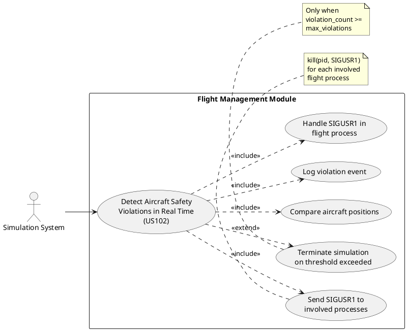
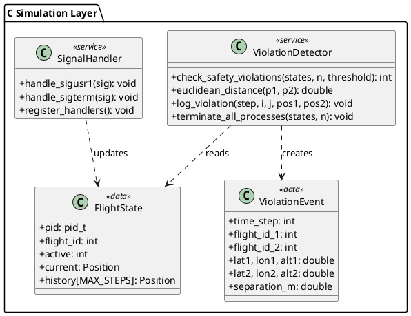
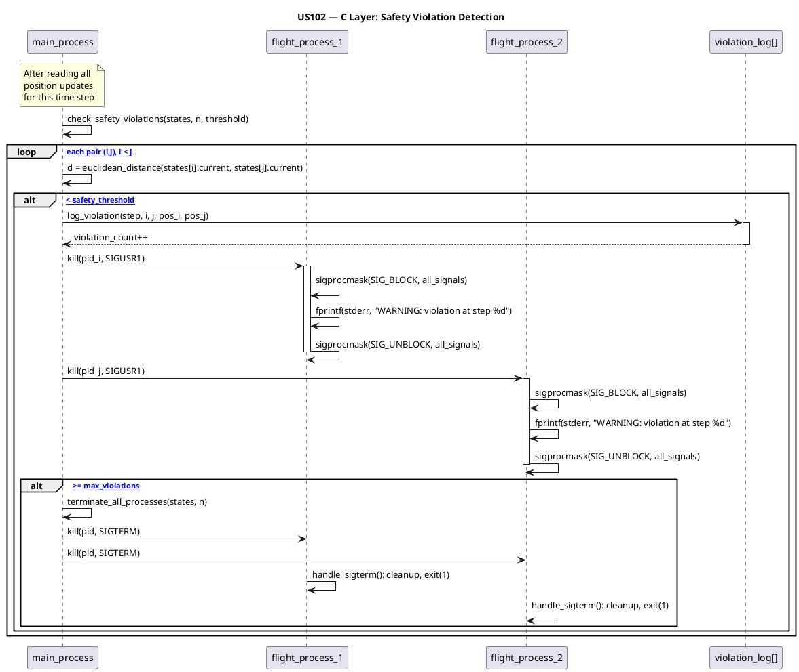
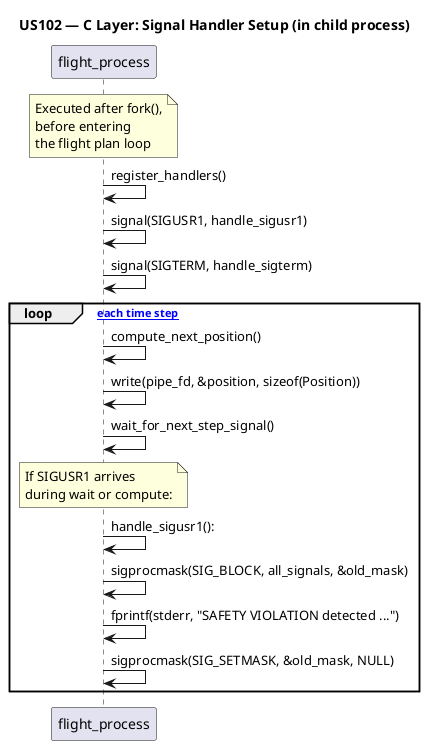

# US102 — Detect Aircraft Safety Violations in Real Time

## 1. Context

This User Story is being developed for the first time in Sprint 2. It is part of the
**SCOMP** course unit and is mandatory for all students enrolled in it.

US102 introduces the ability for the simulation system to continuously monitor aircraft
positions for proximity violations and notify the involved flight processes via signals.
When two or more aircraft violate the safety threshold, the event is logged and `SIGUSR1`
is sent to the involved processes. If violations exceed a predefined threshold, the
simulation terminates by sending termination signals to all flight processes.

This US depends on **US100** (Simulate Flights in a Given Area) and **US101** (Capture
and Process Flight Movements), which establish the process architecture and the position
tracking data structure that this US monitors.

---

## 2. Requirements

**US102** As a simulation system, I want to continuously monitor aircraft positions for
overlaps so that I can identify and report safety violations.

**Acceptance Criteria:**

- US102.1 — The system must detect when two or more aircraft may eventually violate
  safety rules based on their current positions and separation distance.
- US102.2 — Upon detecting a violation, the system must log the event (timestamp,
  positions of involved aircraft).
- US102.3 — Upon detecting a violation, the system must notify the involved aircraft
  processes via `SIGUSR1`.
- US102.4 — Each flight process must handle `SIGUSR1` and notify the system user with
  a message, without terminating.
- US102.5 — When a flight process receives `SIGUSR1`, it must block other signals while
  handling it.
- US102.6 — The system must allow early termination if safety violations exceed a
  predefined threshold by sending termination signals to all flight processes.
- US102.7 — Flight processes must properly handle termination signals and perform any
  necessary cleanup before exiting.

**Dependencies/References:**

- **US100** — defines the process architecture (fork, pipes) and the `FlightState` data
  structure used for position tracking.
- **US101** — captures position updates from flight processes; the positions stored by
  US101 are what US102 monitors.
- **US103** — synchronises the time step; violation checks are performed at the end of
  each step after all position updates have been received.
- **US105** — in the shared memory extension, violation data is written to shared memory
  for the report generation thread (US106/US107/US109).

---

## 3. Analysis

### 3.1 Domain Understanding

At each simulation time step, after all flight processes have sent their position updates,
the main process (or safety violation detection thread in US105+) compares the positions
of all pairs of aircraft. If the separation distance between any pair falls below the
configured safety threshold, a violation is recorded and the involved processes are
notified via `SIGUSR1`.

The key concepts are:

| Concept | Description |
|---|---|
| Safety threshold | Minimum allowed separation distance (metres) between two aircraft |
| Violation | Occurrence where separation between two aircraft is below the threshold |
| Separation distance | Euclidean distance in 3D space (lat, lon, alt) between two aircraft |
| SIGUSR1 | POSIX signal sent to flight processes upon violation detection |
| Termination signal | SIGTERM sent to all flight processes when violation count exceeds max |
| Violation log | In-memory and on-disk record of each violation event |

### 3.2 Violation Detection Algorithm

The safety check is performed at the end of each time step, after all position updates
have been read from the pipes:

```
for each pair (i, j) where i < j:
    distance = euclidean_distance(positions[i], positions[j])
    if distance < safety_threshold:
        log_violation(time_step, i, j, positions[i], positions[j])
        kill(pids[i], SIGUSR1)
        kill(pids[j], SIGUSR1)
        violation_count++
        if violation_count >= max_violations:
            terminate_all_processes()
            return
```

The Euclidean distance in 3D space is:

```
d = sqrt((lat2-lat1)^2 + (lon2-lon1)^2 + (alt2-alt1)^2)
```

> Note: for higher accuracy a haversine-based distance may be used for the horizontal
> component, converting degrees to metres before combining with altitude difference.

### 3.3 Signal Handling Architecture

```
Main Process (simulation controller)
    │
    ├── detects violation between Flight 1 and Flight 3
    │
    ├── kill(pid_1, SIGUSR1)  ────────────────────────────►  Flight Process 1
    │                                                              └── handle_sigusr1():
    │                                                                    block other signals
    │                                                                    print warning message
    │                                                                    restore signal mask
    │
    └── kill(pid_3, SIGUSR1)  ────────────────────────────►  Flight Process 3
                                                                   └── handle_sigusr1():
                                                                         block other signals
                                                                         print warning message
                                                                         restore signal mask

If violation_count >= max_violations:
    Main → kill(all pids, SIGTERM)
    Each child → handle_sigterm(): cleanup, exit(1)
```

### 3.4 Use Case Diagram



---

## 4. Design

### 4.1 Design Decisions

- **C is the implementation language** as mandated by the specification.
- **Pairwise comparison at each time step**: violation detection compares all pairs of
  aircraft after every time step. The complexity is O(n²) per step, which is acceptable
  for a small number of simultaneous flights.
- **SIGUSR1 for non-fatal notification**: `SIGUSR1` is used because it is a user-defined
  signal that does not terminate the process by default. The flight process can handle it
  gracefully, print a warning, and continue executing.
- **Signal masking during handler**: while executing `handle_sigusr1()`, other signals
  (including further `SIGUSR1`) are blocked using `sigprocmask`. This prevents re-entrant
  signal handling and ensures the handler completes atomically.
- **SIGTERM for termination**: when the violation count exceeds `max_violations`, the main
  process sends `SIGTERM` to all remaining child processes. Each child handles `SIGTERM`
  by performing cleanup and calling `exit(1)`.
- **Violation logging**: each violation is stored in a `ViolationEvent` struct array in
  the parent process. This data is later written to the simulation report (US109).
- **Integration with US105+**: in the shared memory extension, violation events are
  written to the shared memory segment so that the report generation thread (US106/US107)
  can access them without IPC overhead.

### 4.2 Data Structures (C)

```c
/* Position of an aircraft at a given time step */
typedef struct {
    double latitude;
    double longitude;
    double altitude;
    int    time_step;
    int    flight_id;
} Position;

/* A recorded safety violation event */
typedef struct {
    int    time_step;
    int    flight_id_1;
    int    flight_id_2;
    double lat1, lon1, alt1;
    double lat2, lon2, alt2;
    double separation_m;
} ViolationEvent;

/* State of a flight process tracked by the main process */
typedef struct {
    pid_t  pid;
    int    flight_id;
    int    active;          /* 1 = running, 0 = terminated */
    Position current;
    Position history[MAX_STEPS];
} FlightState;
```

### 4.3 Class Diagram (CD) — Java Layer



### 4.4 Sequence Diagram (SD) — C Layer: Violation Detection



### 4.5 Sequence Diagram (SD) — C Layer: Signal Handler Registration



### 4.6 Acceptance Tests

**Test 1:** Verifies that a violation is detected when two aircraft are closer than the
safety threshold.

**Refers to Acceptance Criteria:** US102.1

```c
void test_violation_detected_below_threshold() {
    Position p1 = { .latitude = 41.0, .longitude = -9.0, .altitude = 10000 };
    Position p2 = { .latitude = 41.0, .longitude = -9.0, .altitude = 10200 };

    double d = euclidean_distance(&p1, &p2);
    double threshold = 500.0;

    assert(d < threshold);
    printf("PASS: test_violation_detected_below_threshold\n");
}
```

**Test 2:** Verifies that no violation is detected when aircraft are farther apart than
the threshold.

**Refers to Acceptance Criteria:** US102.1

```c
void test_no_violation_above_threshold() {
    Position p1 = { .latitude = 41.0, .longitude = -9.0, .altitude = 10000 };
    Position p2 = { .latitude = 42.0, .longitude = -8.0, .altitude = 15000 };

    double d = euclidean_distance(&p1, &p2);
    double threshold = 500.0;

    assert(d >= threshold);
    printf("PASS: test_no_violation_above_threshold\n");
}
```

**Test 3:** Verifies that SIGUSR1 is handled without terminating the process.

**Refers to Acceptance Criteria:** US102.4, US102.5

```c
volatile sig_atomic_t sigusr1_count = 0;

void handle_sigusr1_test(int sig) {
    sigset_t block_all;
    sigfillset(&block_all);
    sigprocmask(SIG_BLOCK, &block_all, NULL);
    sigusr1_count++;
    sigprocmask(SIG_UNBLOCK, &block_all, NULL);
}

void test_sigusr1_handled_without_termination() {
    signal(SIGUSR1, handle_sigusr1_test);
    kill(getpid(), SIGUSR1);

    assert(sigusr1_count == 1);
    printf("PASS: test_sigusr1_handled_without_termination\n");
}
```

**Test 4:** Verifies that the violation event is logged with correct data.

**Refers to Acceptance Criteria:** US102.2

```c
void test_violation_event_is_logged() {
    ViolationEvent log[MAX_VIOLATIONS];
    int count = 0;

    Position p1 = { .latitude = 41.0, .longitude = -9.0,
                    .altitude = 10000, .flight_id = 1, .time_step = 3 };
    Position p2 = { .latitude = 41.0, .longitude = -9.0,
                    .altitude = 10200, .flight_id = 2, .time_step = 3 };

    log_violation_to_array(log, &count, 3, &p1, &p2, 200.0);

    assert(count == 1);
    assert(log[0].time_step    == 3);
    assert(log[0].flight_id_1  == 1);
    assert(log[0].flight_id_2  == 2);
    assert(log[0].separation_m < 500.0);
    printf("PASS: test_violation_event_is_logged\n");
}
```

**Test 5:** Verifies that simulation terminates when violation count exceeds the maximum.

**Refers to Acceptance Criteria:** US102.6, US102.7

```c
volatile sig_atomic_t sigterm_received = 0;

void handle_sigterm_test(int sig) {
    sigterm_received = 1;
}

void test_termination_on_max_violations() {
    signal(SIGTERM, handle_sigterm_test);
    kill(getpid(), SIGTERM);

    assert(sigterm_received == 1);
    printf("PASS: test_termination_on_max_violations\n");
}
```

---

## 5. Implementation

> To be filled after implementation.

Key implementation notes:
- `check_safety_violations()` is called in the main simulation loop after all position
  updates for the current time step have been read from the pipes (US101).
- `euclidean_distance()` computes the 3D separation. Coordinates are in degrees and
  altitude in metres — convert degrees to metres (≈ 111 000 m per degree latitude) before
  computing to get a meaningful distance in metres.
- Signal handlers must be registered in the child process immediately after `fork()`,
  before the flight plan loop begins.
- `sigprocmask(SIG_BLOCK, ...)` must be called at the start of `handle_sigusr1()` to
  block all other signals during handler execution, as required by US102.5.
- The violation log array is pre-allocated with `MAX_VIOLATIONS` entries. If more
  violations occur than `MAX_VIOLATIONS`, the simulation terminates via
  `terminate_all_processes()`.
- `terminate_all_processes()` iterates over all active `FlightState` entries and sends
  `SIGTERM` to each. It then calls `waitpid()` for each child to prevent zombie processes.

---

## 6. Integration/Demonstration

> To be filled after implementation.

- Violation detection runs automatically as part of the simulation loop — no explicit
  trigger is needed from the Flight Control Operator.
- To demonstrate violation detection: configure a low safety threshold (e.g. 1 000 000 m)
  so that violations are detected immediately, and observe `SIGUSR1` being received by
  the flight processes.
- To demonstrate signal masking: add a log inside `handle_sigusr1()` before and after
  `sigprocmask` to confirm that other signals are blocked during handler execution.
- To demonstrate early termination: set `max_violations = 1` and verify that after the
  first violation all flight processes receive `SIGTERM` and exit cleanly.
- Violation events are visible in the simulation report generated by US109.

---

## 7. Observations

- The safety violation check is intentionally simple (Euclidean distance) for this sprint.
  A more sophisticated predictive check (based on velocity vectors and trajectory
  extrapolation) may be introduced in a future sprint.
- The use of `volatile sig_atomic_t` for shared variables between the main execution and
  signal handlers is mandatory to prevent compiler optimisation issues and ensure
  visibility across signal context boundaries.
- US102 introduces the `ViolationEvent` data structure that is reused by US109 (report
  generation) and US105 (shared memory). Any changes to this struct must be coordinated
  across those user stories.
- The distinction between `SIGUSR1` (non-fatal, process continues) and `SIGTERM`
  (termination) is a core design decision: it allows the simulation to continue collecting
  data even after isolated violations, only aborting when the situation becomes unsafe
  beyond the configured threshold.