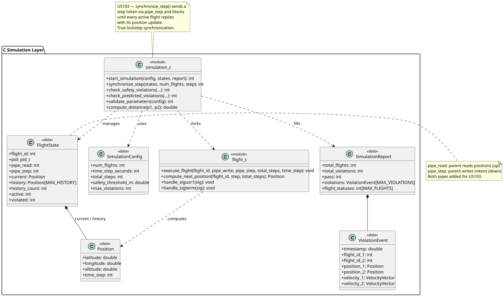
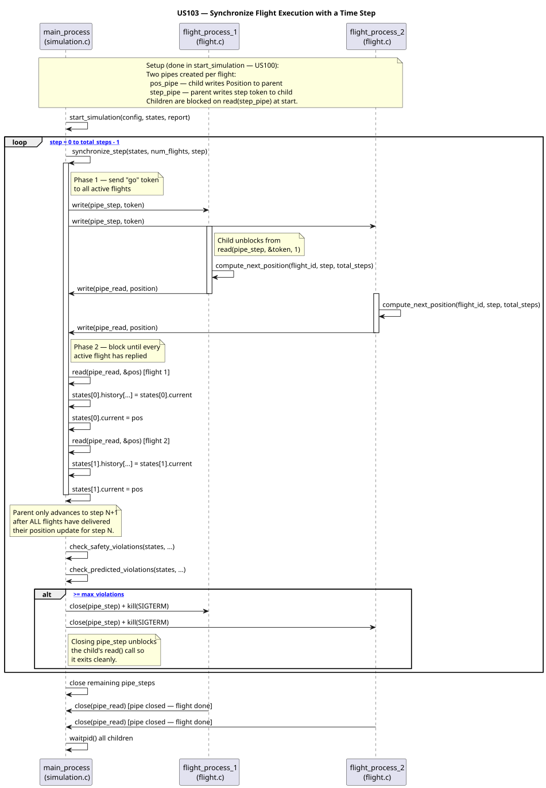

# US103 — Synchronize Flight Execution with a Time Step

## 1. Context

This User Story is being developed for the first time in Sprint 2. It is part of the
**SCOMP** course unit.

US103 introduces **step-by-step lockstep synchronization** into the simulation subsystem
built in US100. Without this, the parent process could advance to the next time step
before all flight processes had delivered their position updates, leading to inconsistent
state and incorrect safety violation detection.

This US depends on **US100** (Simulate Flights in a Given Area) which establishes the
process architecture, pipe setup, and `FlightState` data structure used here. It is also
a prerequisite for **US105** (Initialize Hybrid Simulation Environment with Shared Memory).

---

## 2. Requirements

**US103** As a simulation engine, I want to synchronize aircraft movements based on time
steps so that I can accurately simulate real-world execution.

**Acceptance Criteria:**

- US103.1 — The simulation must progress step by step.
- US103.2 — Each flight process must send position updates at defined intervals.
- US103.3 — The main process must ensure all updates for a given time step are processed
  before advancing to the next step.

**Dependencies/References:**

- **US100** — defines the process architecture (`fork`, pipes) and the `FlightState` data
  structure used here.
- **US101** — captures position updates; US103 ensures those updates are complete before
  US101 processes them.
- **US102** — safety violation detection; US103 ensures all positions are current before
  violations are checked.
- **US105** — extends the synchronization mechanism with shared memory and semaphores.

---

## 3. Analysis

### 3.1 Domain Understanding

The simulation advances in discrete **time steps**. At each step, every active flight
process must compute and report its new position before the main process checks for safety
violations or advances to the next step.

Without synchronization, a faster flight process could be at step N+1 while a slower one
is still at step N. The parent would then compare positions from different time steps,
producing meaningless safety checks.

The parent acts as a **barrier**: it releases all children to compute step N, collects
all their results, processes them, and only then releases them for step N+1.

### 3.2 Synchronization Protocol

The protocol uses a second dedicated pipe per flight — the **step pipe** — which flows
from parent to child. This acts as the "go" signal for each step.

| Phase | Direction | Action |
|---|---|---|
| 1 — Token send | parent → child | Parent writes 1 byte to each active child's step pipe |
| 2 — Child unblocks | child | Child's `read(pipe_step)` returns; it computes its position |
| 3 — Position send | child → parent | Child writes `Position` struct to position pipe |
| 4 — Collect | parent | Parent reads from every active flight; blocks until all reply |
| 5 — Process | parent | Parent runs violation detection on the now-complete state |

Because the parent writes all tokens **before** reading any positions, it cannot deadlock
on itself. Because the parent reads all positions **before** writing the next batch of
tokens, no child can advance to step N+1 until the parent has processed step N.

### 3.3 Data Structures Changed from US100

One new field was added to `FlightState` and `pipe_fd` was renamed to `pipe_read` to
make the direction of each pipe explicit:

```c
typedef struct {
    int      flight_id;
    pid_t    pid;
    int      pipe_read;    /* parent reads positions from child — renamed from pipe_fd */
    int      pipe_step;    /* parent writes step tokens to child — US103 */
    Position current;
    Position history[MAX_HISTORY];
    int      history_count;
    int      active;
    int      violated;
} FlightState;
```

The function `read_all_positions()` from US100 is replaced by `synchronize_step()`,
which combines both phases of the barrier into a single atomic operation.

---

## 4. Design

### 4.1 Design Decisions

- **Second pipe per flight**: a single pipe cannot be bidirectional without risking
  deadlock. Using a dedicated step pipe (parent → child) keeps the two directions
  strictly separate and makes the protocol easy to reason about.
- **1-byte token**: the child only needs to know that a token arrived, not its value.
  Using `step & 0xFF` as the token value aids debugging without adding overhead.
- **`synchronize_step()` replaces `read_all_positions()`**: the new function encapsulates
  both phases. The old function is removed to prevent any code path from reading positions
  without first having sent the step token.
- **Abort path closes `pipe_step`**: when the parent aborts due to too many violations,
  it closes each child's step pipe before sending `SIGTERM`. This ensures the child
  unblocks from its `read(pipe_step)` call and exits cleanly.
- **`flight.c` change is minimal**: the only addition to `execute_flight()` is a
  `read(pipe_step, &token, 1)` call at the top of the loop before position computation.
  All existing signal handling, position computation, and pipe write logic is unchanged.

### 4.2 Class Diagram (CD)



### 4.3 Sequence Diagram (SD)



### 4.4 Acceptance Tests

**Test 1:** `synchronize_step` receives one position update per active flight.

**Refers to Acceptance Criteria:** US103.1, US103.3

```c
void test_synchronize_step_receives_one_position() {
    int pos_pipe[2], step_pipe[2];
    assert(pipe(pos_pipe) == 0);
    assert(pipe(step_pipe) == 0);

    pid_t pid = fork();
    if (pid == 0) {
        close(pos_pipe[0]); close(step_pipe[1]);
        char token; read(step_pipe[0], &token, 1);
        Position pos = { 41.2481, -8.6814, 5000.0, 0 };
        write(pos_pipe[1], &pos, sizeof(Position));
        close(pos_pipe[1]); close(step_pipe[0]);
        exit(0);
    }
    close(pos_pipe[1]); close(step_pipe[0]);

    FlightState states[1];
    memset(states, 0, sizeof(states));
    states[0].flight_id = 0; states[0].pid = pid;
    states[0].pipe_read = pos_pipe[0];
    states[0].pipe_step = step_pipe[1];
    states[0].active    = 1;

    int updates = synchronize_step(states, 1, 0);

    int status; waitpid(pid, &status, 0);
    assert(updates == 1);
    printf("PASS: test_synchronize_step_receives_one_position\n");
}
```

**Test 2:** Child blocks until the step token is received.

**Refers to Acceptance Criteria:** US103.2

```c
void test_child_blocks_until_token_received() {
    int pos_pipe[2], step_pipe[2];
    assert(pipe(pos_pipe) == 0);
    assert(pipe(step_pipe) == 0);

    pid_t pid = fork();
    if (pid == 0) {
        close(pos_pipe[0]); close(step_pipe[1]);
        char token; read(step_pipe[0], &token, 1); /* blocks */
        Position p = { 41.0, -8.0, 3000.0, 0 };
        write(pos_pipe[1], &p, sizeof(p));
        close(pos_pipe[1]); close(step_pipe[0]);
        exit(0);
    }
    close(pos_pipe[1]); close(step_pipe[0]);

    /* non-blocking read before token — must return no data */
    int flags = fcntl(pos_pipe[0], F_GETFL, 0);
    fcntl(pos_pipe[0], F_SETFL, flags | O_NONBLOCK);
    Position dummy;
    int no_data = (read(pos_pipe[0], &dummy, sizeof(dummy)) < 0);

    /* send token — child unblocks and replies */
    fcntl(pos_pipe[0], F_SETFL, flags);
    char token = 0; write(step_pipe[1], &token, 1);
    int got_data = (read(pos_pipe[0], &dummy, sizeof(dummy))
                    == (ssize_t)sizeof(Position));

    int status; waitpid(pid, &status, 0);
    assert(no_data && got_data);
    printf("PASS: test_child_blocks_until_token_received\n");
}
```

**Test 3:** Two flights both reply before parent advances.

**Refers to Acceptance Criteria:** US103.3

```c
void test_two_flights_advance_in_lockstep() {
    /* full implementation: see tests/test_synchronization.c */
    int updates = synchronize_step(states, 2, 0);
    assert(updates == 2);
    printf("PASS: test_two_flights_advance_in_lockstep\n");
}
```

---

## 5. Implementation

Key implementation notes:

- The only new function is `synchronize_step()` in `simulation.c`. It replaces
  `read_all_positions()` entirely.
- `execute_flight()` in `flight.c` gains one new parameter (`pipe_step`) and one new line
  at the top of its loop: `read(pipe_step, &token, 1)`. All other logic is unchanged.
- `start_simulation()` in `simulation.c` now creates two pipes per flight (`pos_pipe` and
  `step_pipe`) and stores the parent-side ends in `states[i].pipe_read` and
  `states[i].pipe_step` respectively.
- On abort, the parent calls `close(states[i].pipe_step)` before `kill(SIGTERM)` so the
  child unblocks from its blocking `read()` and exits cleanly.
- After the main loop, a cleanup pass closes any remaining open step pipes for flights
  that finished naturally.
- The existing tests (US100, US102) continue to pass unchanged.

---

## 6. Integration/Demonstration

- Build with `make all` and run:
  ```bash
  ./simulation 3 5 1 50000 3
  ```
- In the output, verify that `[MAIN] Step N: received 3 position update(s)` always
  appears after all three `[FLIGHT X] Step N — position sent` lines for that step, and
  before any flight advances to step N+1. This confirms lockstep behaviour.
- Run the US103 test suite with `make test103` — all 6 tests must pass.
- To test the abort path: use a small safety threshold (e.g. `1000`) so violations are
  detected immediately. Verify that all children exit cleanly after the parent closes
  their step pipes and sends SIGTERM.

---

## 7. Observations

- The synchronization mechanism uses a 1-byte pipe token to remain compatible with the
  existing pipe-based architecture from US100 without introducing semaphores or shared
  memory (those are introduced in US105).
- The two-pipe design keeps the two directions of communication strictly separated,
  avoiding the risk of deadlock that would arise from a single bidirectional pipe.
- `pipe_fd` was renamed to `pipe_read` in `FlightState` to make the direction of each
  pipe explicit now that two pipe fields exist. This does not affect any other US since
  the field is only accessed inside `simulation.c`.
- US105 will supersede parts of this synchronization with semaphores for the shared
  memory architecture. The pipe-based barrier defined here remains as the synchronization
  mechanism for the process-only simulation path.