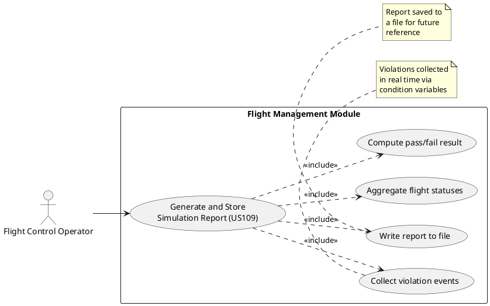
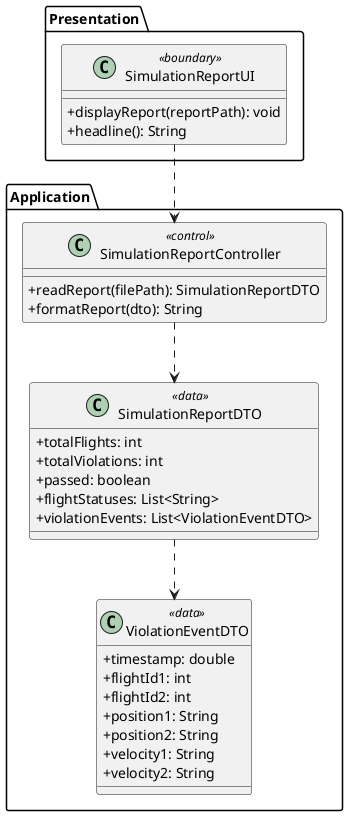
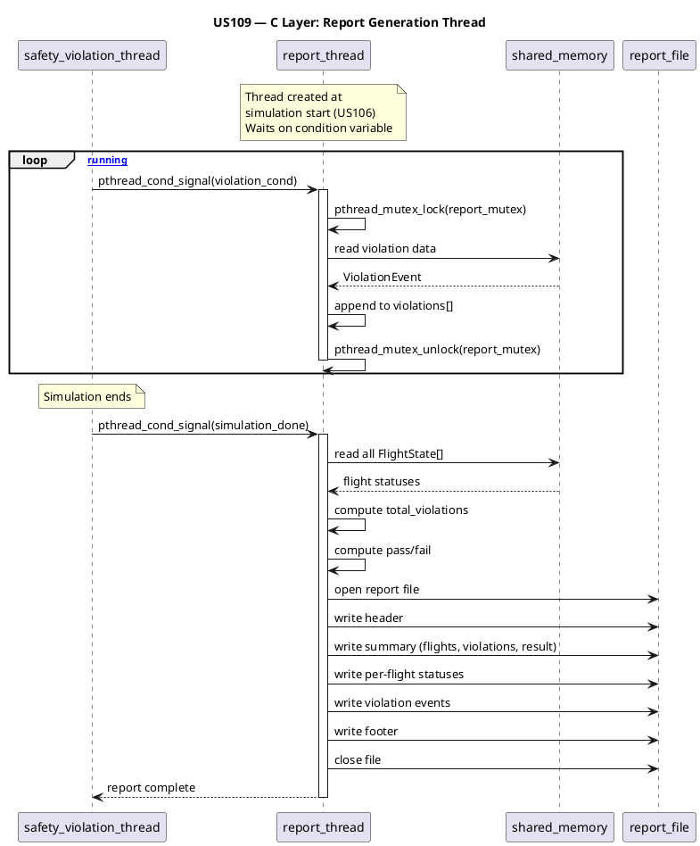
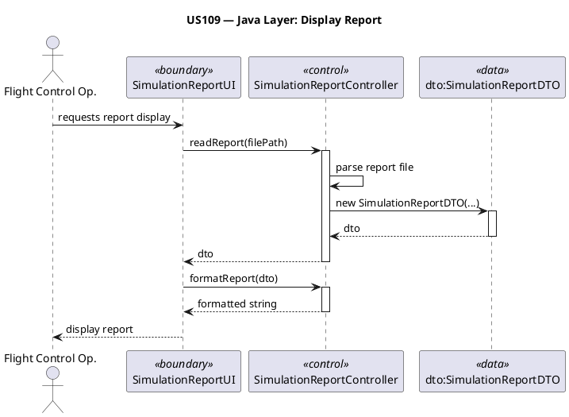

# US109 — Generate and Store Final Simulation Report

## 1. Context

This User Story is being developed for the first time in Sprint 2. It is part of the
**SCOMP** course unit and is mandatory for all students enrolled in it.

US109 introduces the ability for a Flight Control Operator to obtain a comprehensive
report after a simulation concludes. The report is generated by the report generation
thread (introduced in US106) and saved to a file for future reference. It includes the
total number of flights, individual execution statuses, safety violation events with
timestamps and positions, and the overall validation result (pass/fail).

This US depends on **US100** (Simulate Flights in a Given Area), **US101** (Capture and
Process Flight Movements), **US102** (Detect Aircraft Safety Violations), **US105**
(Initialize Hybrid Simulation Environment with Shared Memory), **US106** (Implement
Function-Specific Threads), and **US107** (Notify Report Thread via Condition Variables).

---

## 2. Requirements

**US109** As a Flight Control Operator, I want a comprehensive report that details the
simulation outcomes — including flight execution statuses, safety violation events (with
timestamps, positions and velocity vectors), and overall validation results —, so that I
can assess the safety and performance of the flights post-simulation.

**Acceptance Criteria:**

- US109.1 — The report generation thread aggregates data once the simulation concludes.
- US109.2 — The report includes the total number of flights and individual execution
  statuses.
- US109.3 — The report includes detailed safety violation events, including timestamps,
  positions and velocity vectors.
- US109.4 — The final validation result (pass/fail) is clearly indicated in the report.
- US109.5 — The complete report is saved to a file for future reference.

**Dependencies/References:**

- **US100** — the simulation framework that this report covers.
- **US101** — provides position updates that feed into the report.
- **US102** — provides safety violation events that are logged in the report.
- **US105** — the shared memory segment from which the report thread reads data.
- **US106** — defines the report generation thread that produces the report.
- **US107** — the condition variable mechanism that triggers report updates on violation.

---

## 3. Analysis

### 3.1 Domain Understanding

The simulation report is generated at the end of a simulation run. It consolidates all
data accumulated during execution — flight statuses, safety violations, and the final
outcome — into a structured document saved to disk. The report is produced by a dedicated
report generation thread that runs concurrently with the simulation and is notified of
safety violations in real time via condition variables.

The key concepts are:

| Concept | Description |
|---|---|
| Report | A structured document summarising simulation outcomes |
| Flight status | The final execution state of each flight process (completed, violated, aborted) |
| Safety violation event | A recorded instance where two aircraft violated the safety threshold |
| Velocity vector | The 3D velocity of an aircraft at the moment of violation |
| Pass/fail result | The overall outcome — pass if no violations exceeded threshold, fail otherwise |
| Report file | A text file written to disk at the end of the simulation |

### 3.2 Report Structure

The report contains the following sections:

| Section | Content |
|---|---|
| Header | Simulation ID, start time, end time, area |
| Summary | Total flights, total violations, overall result (PASS/FAIL) |
| Flight statuses | Per-flight: ID, status (completed/violated/aborted) |
| Violation events | Per-violation: timestamp, position, velocity vectors of both aircraft |
| Footer | Report generation timestamp |

### 3.3 Thread Architecture

The report generation thread is one of the dedicated threads created by the parent process
(defined in US106). It waits on a condition variable for violation notifications (US107)
and accumulates violation data in real time. When the simulation ends, it finalises the
report and writes it to disk.

```
Parent Process
    │
    ├── Safety Violation Detection Thread
    │       └── signals condition variable on violation
    │
    └── Report Generation Thread  ← US109
            ├── waits on condition variable
            ├── accumulates violations in real time
            ├── on simulation end: aggregates all data
            └── writes report to file
```

### 3.4 Use Case Diagram



---

## 4. Design

### 4.1 Design Decisions

- **C is the implementation language** as mandated by the specification.
- **Dedicated report thread**: the report generation thread runs concurrently with the
  simulation, receiving violation notifications in real time via condition variables
  (US107). This avoids blocking the main simulation loop.
- **Shared memory for data access**: the report thread reads flight state data from the
  shared memory segment (US105) to compile execution statuses and positions.
- **Mutex-protected access**: all reads from shared memory by the report thread use mutex
  locking to ensure thread safety.
- **File output**: the report is written to a plain text file with a timestamped filename,
  making it easy to identify and archive.
- **Pass/fail determination**: the simulation fails if the number of safety violations
  exceeds the configured threshold (`max_violations`); otherwise it passes.

### 4.2 Data Structures (C)

```c
/* A recorded safety violation event */
typedef struct {
    double    timestamp;
    double    lat1, lon1, alt1;
    double    vx1, vy1, vz1;       /* velocity vector of aircraft 1 */
    double    lat2, lon2, alt2;
    double    vx2, vy2, vz2;       /* velocity vector of aircraft 2 */
    int       flight_id_1;
    int       flight_id_2;
} ViolationEvent;

/* The simulation report */
typedef struct {
    int            total_flights;
    int            total_violations;
    int            pass;            /* 1 = PASS, 0 = FAIL */
    ViolationEvent violations[MAX_VIOLATIONS];
    int            flight_statuses[MAX_FLIGHTS]; /* 0=ok, 1=violated, 2=aborted */
} SimulationReport;
```

### 4.3 Class Diagram (CD) — Java Layer



### 4.4 Sequence Diagram (SD) — C Layer



### 4.5 Sequence Diagram (SD) — Java Layer



### 4.6 Acceptance Tests

**Test 1:** Verifies that the report includes the total number of flights.

**Refers to Acceptance Criteria:** US109.2

```c
void test_report_includes_total_flights() {
    SimulationReport report = { .total_flights = 3,
                                .total_violations = 0,
                                .pass = 1 };
    char filename[] = "test_report.txt";
    write_report(&report, filename);

    FILE *f = fopen(filename, "r");
    assert(f != NULL);

    char line[256];
    int found = 0;
    while (fgets(line, sizeof(line), f)) {
        if (strstr(line, "Total flights: 3")) {
            found = 1;
            break;
        }
    }
    fclose(f);
    assert(found);
    printf("PASS: test_report_includes_total_flights\n");
}
```

**Test 2:** Verifies that the report includes violation events with timestamps.

**Refers to Acceptance Criteria:** US109.3

```c
void test_report_includes_violation_events() {
    ViolationEvent v = { .timestamp = 42.5,
                         .flight_id_1 = 1, .flight_id_2 = 2,
                         .lat1 = 41.2, .lon1 = -8.6, .alt1 = 10000,
                         .vx1 = 100, .vy1 = 50, .vz1 = 0 };
    SimulationReport report = { .total_flights = 2,
                                .total_violations = 1,
                                .pass = 0 };
    report.violations[0] = v;

    char filename[] = "test_violations.txt";
    write_report(&report, filename);

    FILE *f = fopen(filename, "r");
    assert(f != NULL);

    char line[256];
    int found = 0;
    while (fgets(line, sizeof(line), f)) {
        if (strstr(line, "42.5")) {
            found = 1;
            break;
        }
    }
    fclose(f);
    assert(found);
    printf("PASS: test_report_includes_violation_events\n");
}
```

**Test 3:** Verifies that the report clearly indicates pass/fail.

**Refers to Acceptance Criteria:** US109.4

```c
void test_report_indicates_pass_fail() {
    SimulationReport pass_report = { .total_flights = 2,
                                     .total_violations = 0,
                                     .pass = 1 };
    SimulationReport fail_report = { .total_flights = 2,
                                     .total_violations = 5,
                                     .pass = 0 };

    write_report(&pass_report, "test_pass.txt");
    write_report(&fail_report, "test_fail.txt");

    FILE *fp = fopen("test_pass.txt", "r");
    char line[256];
    int found_pass = 0;
    while (fgets(line, sizeof(line), fp)) {
        if (strstr(line, "PASS")) { found_pass = 1; break; }
    }
    fclose(fp);
    assert(found_pass);

    FILE *ff = fopen("test_fail.txt", "r");
    int found_fail = 0;
    while (fgets(line, sizeof(line), ff)) {
        if (strstr(line, "FAIL")) { found_fail = 1; break; }
    }
    fclose(ff);
    assert(found_fail);

    printf("PASS: test_report_indicates_pass_fail\n");
}
```

**Test 4:** Verifies that the report is saved to a file.

**Refers to Acceptance Criteria:** US109.5

```c
void test_report_is_saved_to_file() {
    SimulationReport report = { .total_flights = 1,
                                .total_violations = 0,
                                .pass = 1 };
    char filename[] = "test_saved.txt";
    write_report(&report, filename);

    FILE *f = fopen(filename, "r");
    assert(f != NULL);
    fclose(f);
    printf("PASS: test_report_is_saved_to_file\n");
}
```

---

## 5. Implementation

> To be filled after implementation.

Key implementation notes:
- The report generation thread is created in the parent process at simulation start
  (US106) and runs until the simulation ends.
- The thread waits on `violation_cond` (condition variable from US107) to receive real-time
  violation notifications. Each notification triggers a read from shared memory to extract
  the `ViolationEvent` data.
- When the simulation ends, the main process signals the report thread via a dedicated
  `done_cond` condition variable. The report thread then reads all `FlightState` entries
  from shared memory to compile individual flight statuses.
- The report file is named with a timestamp (e.g. `report_20260517_143022.txt`) to ensure
  uniqueness across multiple simulation runs.
- The `write_report()` function formats the report as plain text with clearly labelled
  sections. Future extensions may support JSON or XML output.
- All shared memory reads by the report thread must be protected by `pthread_mutex_lock`
  to prevent data races with the safety violation detection thread.

---

## 6. Integration/Demonstration

> To be filled after implementation.

- The report is generated automatically at the end of every simulation run — the Flight
  Control Operator does not need to request it explicitly.
- To demonstrate: run a simulation with at least one safety violation (configure a low
  safety threshold) and verify that the report file is created in the working directory.
- To demonstrate the violation events section: open the report file and verify that each
  violation entry contains the timestamp, positions, and velocity vectors of the involved
  aircraft.
- To demonstrate pass/fail: run one simulation without violations (PASS) and one with
  violations exceeding the threshold (FAIL) and compare the two report files.
- The Java layer reads and displays the report file contents in the Flight Control
  Operator menu after simulation completes.

---

## 7. Observations

- The report generation thread is one of at least two dedicated threads required by US106.
  The other is the safety violation detection thread. Both run concurrently and communicate
  via the condition variable mechanism defined in US107.
- The velocity vector stored in each `ViolationEvent` is the 3D velocity of the aircraft
  at the moment of violation — not its position velocity. This distinction is important
  for safety analysis.
- The report format is intentionally simple (plain text) for this sprint. US112 (Monthly
  Report Generation) introduces a more structured reporting framework with consistent
  branding and sections that should be aligned with this report's output format.
- All report files must be retained — the system must never overwrite a previous report.
  The timestamped filename convention ensures this.