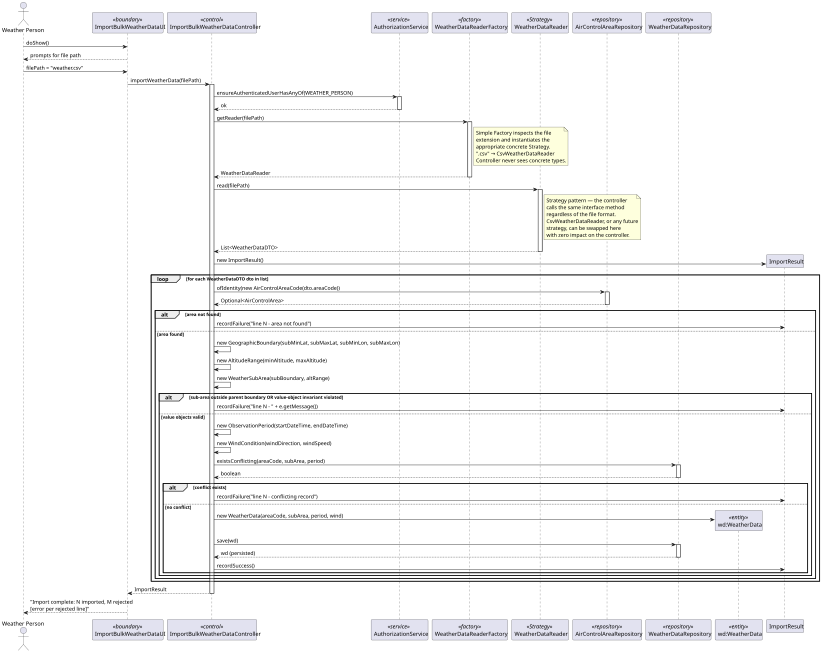
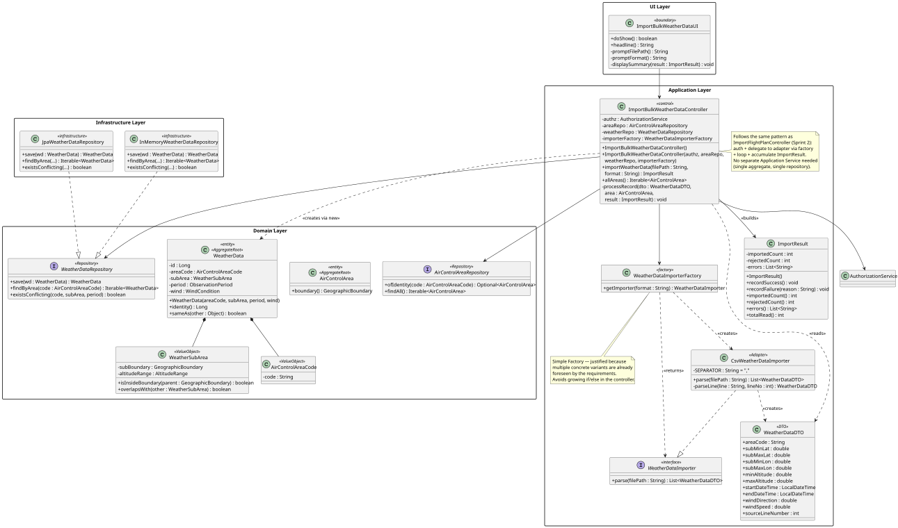

# US042 – Import Bulk Weather Data

## 1. Context

This user story is implemented for the first time in **Sprint 3**.

It builds directly on US041 (Register Weather Data), reusing the `WeatherData`aggregate, its value objects, and the `WeatherDataRepository`. 
The novelty is loading many records at once from a file, with support for multiple external weather service providers (different file formats).

## 2. Requirements

**US042** As a Weather Person, I want to import bulk weather data into the system.

> Weather data might be from multiple external weather service providers, so the
> system can aggregate data from various sources for better accuracy. While a
> simple CSV file format will be available for initial system development, the
> system should be easy to expand to new weather data sources.

**Acceptance Criteria:**

- **US042.1** The system must accept at least one file format (CSV) for bulk import.
- **US042.2** Each record must be validated against the same business rules as US041
  (area must exist, sub-area inside boundary, no conflicting records, positive
  wind speed, valid period).
- **US042.3** Records that fail validation must be individually reported with a
  meaningful error message; valid records in the same file must still be imported.
- **US042.4** The architecture must allow adding new file formats (new providers)
  without modifying existing import logic — achieved via the Strategy pattern.
- **US042.5** Only authenticated users with role `WEATHER_PERSON` may perform
  this operation.
- **US042.6** The system must report a summary: total records read, records
  successfully imported, records rejected (with reasons per line).
  
**Dependencies/References:**

- **US041** – Register Weather Data: the domain model and `WeatherDataRepository`
  are reused unchanged.
- **US050** – Register an Air Control Area: areas must exist before weather data
  can be registered against them.
---

## 3. Analysis

### 3.1 Identified Problem

The requirement explicitly states that data may come from **multiple external providers**, each with its own file format.
The solution must be open for extension (new formats) but closed for modification (existing logic unchanged) — Open/Closed Principle.

### 3.2 Design Decisions

**Strategy pattern (GoF Behavioural) for file format abstraction**

The theory defines Strategy as: *"Define a family of algorithms, encapsulate
each one, and make them interchangeable. Strategy lets the algorithm vary
independently from clients that use it."*

Each file format corresponds to a different algorithm for reading and converting
data into `WeatherDataDTO` objects. The `WeatherDataReader` interface defines the
contract; each concrete strategy encapsulates the reading algorithm for one
format. The controller only depends on the interface — it never sees
format-specific code. Adding a new format means adding a new strategy class,
with zero changes to the controller or existing strategies — OCP satisfied.

**`WeatherDataReaderFactory` (Simple Factory)**

Without a factory, the controller would contain a growing `if/else` over the
file extension. The factory inspects the file extension and returns the
appropriate strategy. Justified here because multiple concrete variants are
already foreseen by the requirements — this is not premature abstraction.

**DTO (`WeatherDataDTO`)**

Each concrete strategy reads raw external data (strings/doubles from a file).
Passing these directly to domain constructors inside the strategy would make
per-line error attribution impossible and would couple the strategy to domain
construction logic. The DTO is a plain data carrier: the strategy reads into
DTOs; the controller builds domain objects from them, catching failures per
record.

**`ImportResult` as a plain value carrier**

Groups `importedCount`, `rejectedCount`, and `List<String> errors`. Returned by
the controller to the UI for display.
---

## 4. Design

### 4.1 Realization

Sequence diagram: 

Class diagram: 

### 4.2 Acceptance Tests

**Test 1 – Valid CSV file imports all records**

```java
@Test
public void ensureValidCsvImportsAllRecords() {
    // Arrange: mock repos, prepare path to CSV with 3 valid rows
    // Act: controller.importWeatherData("weather.csv")
    // Assert: save() called 3 times; result.importedCount() == 3
}
```
Refers to: US042.1, US042.2, US042.6
 
---

**Test 2 – Invalid rows are skipped; valid rows are still imported**

```java
@Test
public void ensureInvalidRowsAreSkippedButOthersImported() {
    // Arrange: CSV with rows [valid, invalid(windSpeed=-1), valid]
    // Act
    // Assert: importedCount == 2, rejectedCount == 1, errors.size() == 1
}
```
Refers to: US042.3, US042.6
 
---

**Test 3 – Unauthenticated access is rejected**

```java
@Test(expected = UnauthenticatedException.class)
public void ensureUnauthenticatedUserCannotImport() {
    // Arrange: authz returns no session
    // Act: controller.importWeatherData(...)
}
```
Refers to: US042.5
 
---

**Test 4 – Controller is format-agnostic (Strategy contract)**

```java
@Test
public void ensureControllerWorksWithAnyReaderStrategy() {
    // Arrange: mock WeatherDataReader returning 2 valid DTOs
    // Act: controller processes them via mock strategy
    // Assert: importedCount == 2 — controller never sees CSV-specific code
}
```
Refers to: US042.4
 
---

## 5. Implementation

### 5.1 New Classes

| Class                             | Package       | Module | Role |
|-----------------------------------|---------------|---|---|
| `WeatherDataImportDTO`            | `dto`         | `exemplo.core` | Plain data carrier from file reader to controller |
| `WeatherDataReader`               | `application` | `exemplo.core` | Strategy interface — contract for all format readers |
| `CsvWeatherDataReader`            | `application` | `exemplo.core` | Concrete Strategy for delimiter-separated files |
| `WeatherDataReaderFactory`        | `application` | `exemplo.core` | Simple Factory — detects separator, selects and configures strategy |
| `ImportWeatherResult`             | `application` | `exemplo.core` | Value carrier with import summary (counts + error list) |
| `ImportBulkWeatherDataController` | `controller`  | `exemplo.core` | Application controller — orchestrates the import |
| `ImportBulkWeatherDataUI`         | `ui`          | `exemplo.app.backoffice.console` | Console UI — prompts for file path, displays summary |

### 5.2 Modified Files

| File | Module | Change |
|---|---|---|
| `MainMenu.java` | `exemplo.app.backoffice.console` | Added option `2. Import Bulk Weather Data` to the `WEATHER_PERSON` menu section and the corresponding `case 2` in `handleOption()` |

No domain classes or repositories were modified — US041 artefacts are reused as-is.

### 5.3 File Format Supported

The client provided example data in Excel format. The agreed import format is **CSV exported from Excel**, which in European locale settings produces:

- **Separator:** semicolon (`;`). The reader also transparently accepts tab and comma, detected automatically from the header line by `WeatherDataReaderFactory`.
- **Decimal separator:** comma (`,`), as produced by European locale (e.g. `43,840454`).
- **Date format:** `dd/MM/yyyy` (e.g. `22/06/2026`).
- **Time format:** `HH:mm`, in two separate columns (`Star` and `End`).
- **Total columns:** 12.
  **Column mapping:**

| Position | Header | Domain field |
|---|---|---|
| 0 | ACA | `areaCode` |
| 1 | Lat. (first) | `subMaxLat` |
| 2 | Long. (first) | `subMinLon` |
| 3 | Lat. (second) | `subMinLat` |
| 4 | Long. (second) | `subMaxLon` |
| 5 | Alt_inf (ft) | `minAltitude` |
| 6 | Alt_Sup (ft) | `maxAltitude` |
| 7 | Direction (degree) | `windDirection` |
| 8 | Value (knot) | `windSpeed` |
| 9 | Day | date part of `startDateTime` / `endDateTime` |
| 10 | Star | time part of `startDateTime` |
| 11 | End | time part of `endDateTime` |

### 5.4 Key Implementation Notes

**Separator detection is the factory's responsibility, not the reader's.**
`WeatherDataReaderFactory.detectSeparator()` opens the file once, reads the header line, and infers the separator. The separator is then injected into `CsvWeatherDataReader` via its constructor. This keeps the reader focused solely on parsing, consistent with SRP.

**Per-record error handling without stopping the import.**
The controller wraps each record's processing in a try/catch. A failure on one record (domain invariant violation, missing area, conflict) is recorded in `ImportResult` and the loop continues.

**`WeatherDataImportDTO` vs `WeatherDataDTO`.**
Two distinct DTOs exist with different purposes and packages. `WeatherDataImportDTO` is an inbound carrier from file to controller, containing `sourceLineNumber` for error reporting. `WeatherDataDTO` is an outbound carrier from domain to UI, used by US043.
 
---

## 6. Integration/Demonstration

### 6.1 How to Run

1. Start the application and log in as a user with the `WEATHER_PERSON` role.
2. From the main menu, select **"2. Import Bulk Weather Data"**.
3. When prompted, enter the full path to the data file (e.g. `/home/user/weather.csv`).
4. The system displays an import summary on screen.
 
---

## 7. Observations

**Why Strategy and not Adapter:** The Adapter pattern is most appropriate when wrapping a pre-existing external library or system with an incompatible API.
Here the parsers are written from scratch — there is no incompatible pre-existing interface to wrap. The requirement is a *family of interchangeable reading
algorithms*, which is precisely what Strategy describes. Both produce similar code structures, but the intent and the correct pattern name for EAPLI purposes
is Strategy.

**Adding a new format in the future** requires only two steps: implement `WeatherDataReader` for the new format, and add one `if` block to `WeatherDataReaderFactory.getReader()`. No existing class is modified — OCP is preserved.

