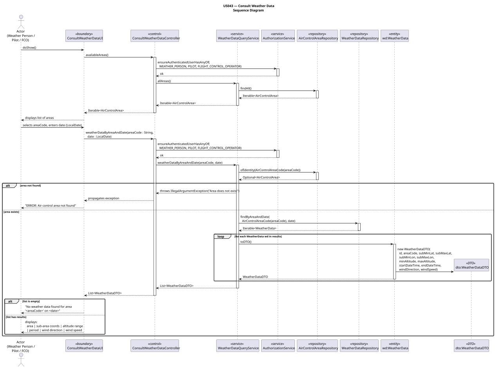
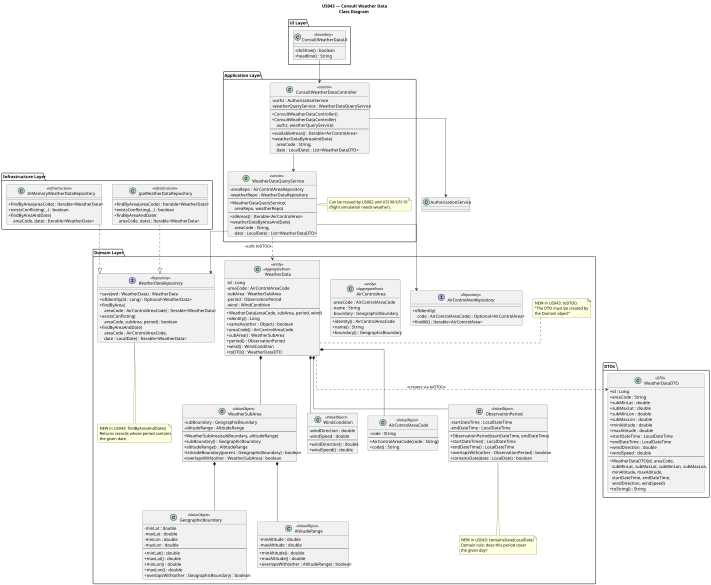

# US043 — Consult Weather Data

## 1. Context

This User Story is implemented for the first time in Sprint 3. The goal is to allow a **Weather Person**, a **Pilot**, or a **Flight Control Operator** to consult weather data registered in the system, filtering by a specific day and a specific air control area.

This is a pure read/query use case — no aggregates are created or modified. The architectural focus is on: (1) structuring the application layer with a genuinely reusable **Application Service**, and (2) having the domain aggregate create its own DTO.

This US depends on:
- **US041** — defines the `WeatherData` aggregate, all associated Value Objects, and `WeatherDataRepository`.
- **US050** — defines `AirControlArea` and `AirControlAreaRepository`.

---

## 2. Requirements

**US043** — *As a Weather Person, a Pilot, or a Flight Control Operator, I want to consult weather data in the system in a given day and in a specific air control area.*

**Acceptance Criteria:**

- **US043.1** The system must present the user with the list of available air control areas for selection.
- **US043.2** The system must allow the user to enter a date to filter records whose observation period includes that day.
- **US043.3** The result list must show, for each record: the sub-area (geographic boundaries and altitude range), the observation period, and the wind conditions (direction and speed).
- **US043.4** Only authenticated users with the role `WEATHER_PERSON` may access this feature.
- **US043.5** If no records exist for the given criteria, the system must inform the user with an appropriate message.
- **US043.6** Data must be returned to the UI via DTOs (`WeatherDataDTO`), created by the `WeatherData` aggregate itself via `toDTO()`.

**Dependencies/References:**

- **US041** — `WeatherData`, `WeatherDataRepository`, and all Value Objects reused without modification.
- **US050** — `AirControlAreaRepository` used to list available areas.
- **US082** — *Insert weather data in a flight* — reuses `WeatherDataQueryService`.
- **NFR03** — Test coverage >= 90% for `controller`, `application`, and `domain` packages.
- **NFR08** — Support for both in-memory and relational database persistence.
- **NFR10** — Implementation in Java.

---

## 3. Analysis

### 3.1 How data reaches the UI — DTO created by the Aggregate

The theory states:

> *"Since we don't want to expose getters and setters, the DTO must be created by the Domain object"*

The reasoning is: if the aggregate does not expose its internals, the only entity with sufficient access to construct the DTO is the aggregate itself. The solution is for the aggregate to have a `toDTO()` method that builds and returns the DTO — without exposing getters of its internal Value Objects to the outside.

**What to do per theory**: `WeatherData.toDTO()` — the aggregate constructs the DTO, exposing only the data needed for display, without leaking its Value Objects or business methods.

`WeatherDataDTO` is then a simple object with public final fields (or read-only getters), no business logic, no JPA annotations, no framework dependencies.

### 3.2 Application Service

For US043, a `WeatherDataQueryService` is **justified** because:
- **US082** (*Insert weather data in a flight*) needs to query weather data by area.
- **US100/US110** (*Simulate flights with weather*) also need to access the same data.

The controller becomes thin: it checks authorization and delegates to the service. The service executes the query and performs the conversion.

### 3.3 Where the "period contains a day" rule belongs

The rule *"does an ObservationPeriod cover a given day"* is domain logic. By the **Information Expert** principle (GRASP): responsibility should be assigned to the class that has the information needed to fulfil it — which is `ObservationPeriod` itself.

Therefore: `ObservationPeriod.containsDate(LocalDate)` is a new method to be added to the existing Value Object.

The repository (`findByAreaAndDate`) delegates to this rule — in-memory: `filter(w -> w.period().containsDate(date))`; JPA: equivalent JPQL date-range query.

---

## 4. Design

### 4.1 Realization

Sequence diagram: 

Class diagram: 

### 4.2 Acceptance Tests

**Test 1:** Verifies that an authenticated user with a valid role gets results for an area and date with existing records.

**Refers to Acceptance Criteria:** US043.1, US043.2, US043.4

```java
@Test
public void ensureWeatherPersonGetsResultsForValidAreaAndDate() {
    // Arrange: authenticated as WEATHER_PERSON, area and date with records
    LocalDate date = LocalDate.of(2026, 6, 1);
    // Act
    List<WeatherDataDTO> results = svc.weatherDataByAreaAndDate("LPPC", date);
    // Assert
    assertFalse(results.isEmpty());
}
```

**Test 2:** Verifies that an empty list is returned (no exception) when no records match the criteria.

**Refers to Acceptance Criteria:** US043.5

```java
@Test
public void ensureEmptyListWhenNoDataMatchesCriteria() {
    LocalDate futureDate = LocalDate.of(2099, 1, 1);
    List<WeatherDataDTO> results = svc.weatherDataByAreaAndDate("LPPC", futureDate);
    assertTrue(results.isEmpty());
}
```

**Test 3:** Verifies that an unknown area code throws an appropriate exception.

**Refers to Acceptance Criteria:** US043.1

```java
@Test(expected = IllegalArgumentException.class)
public void ensureUnknownAreaCodeThrowsException() {
    svc.weatherDataByAreaAndDate("XXXX", LocalDate.now());
}
```

**Test 4:** Verifies that a user without an authorized role cannot consult weather data.

**Refers to Acceptance Criteria:** US043.4

```java
@Test(expected = IllegalStateException.class)
public void ensureUnauthorizedUserCannotConsult() {
    // authenticated as BACKOFFICE_OPERATOR
    ctrl.weatherDataByAreaAndDate("LPPC", LocalDate.now());
}
```

**Test 5:** Verifies that `ObservationPeriod.containsDate` correctly identifies a day within the period (domain rule).

**Refers to Acceptance Criteria:** US043.2

```java
@Test
public void ensureContainsDateCorrectlyIdentifiesDayWithinPeriod() {
    ObservationPeriod period = new ObservationPeriod(
        LocalDateTime.of(2026, 6, 1, 0, 0),
        LocalDateTime.of(2026, 6, 2, 23, 59));
    assertTrue(period.containsDate(LocalDate.of(2026, 6, 1)));
    assertTrue(period.containsDate(LocalDate.of(2026, 6, 2)));
    assertFalse(period.containsDate(LocalDate.of(2026, 6, 3)));
    assertFalse(period.containsDate(LocalDate.of(2026, 5, 31)));
}
```

**Test 6:** Verifies that `WeatherData.toDTO()` returns a DTO with the correct field values.

**Refers to Acceptance Criteria:** US043.6

```java
@Test
public void ensureToDTOReturnsCorrectData() {
    // Arrange
    WeatherData wd = new WeatherData(
        new AirControlAreaCode("LPPC"),
        new WeatherSubArea(new GeographicBoundary(38.0, 42.0, -9.5, -6.0),
                           new AltitudeRange(0.0, 10000.0)),
        new ObservationPeriod(LocalDateTime.of(2026, 6, 1, 0, 0),
                              LocalDateTime.of(2026, 6, 1, 12, 0)),
        new WindCondition(270.0, 15.5));
    // Act
    WeatherDataDTO dto = wd.toDTO();
    // Assert
    assertEquals("LPPC", dto.areaCode);
    assertEquals(270.0,  dto.windDirection, 0.001);
    assertEquals(15.5,   dto.windSpeed,     0.001);
}
```

---

## 5. Implementation

### 5.1 Artefacts created or modified

| Artefact | Action | Justification |
|---|---|---|
| `ObservationPeriod` | Add `containsDate(LocalDate)` | Domain rule — Information Expert principle |
| `WeatherData` | Add `toDTO() : WeatherDataDTO` | The aggregate creates its own DTO |
| `WeatherDataDTO` | Create (package `dto`) | Simple data carrier, no logic, no annotations |
| `WeatherDataQueryService` | Create (package `application`) | Application Service reused by US082/US100 |
| `ConsultWeatherDataController` | Create (package `controller`) | Thin controller — authorization + delegation only |
| `ConsultWeatherDataUI` | Create (package `ui`) | Boundary — user interaction |
| `WeatherDataRepository` | Add `findByAreaAndDate` | New query required for date filtering |
| `JpaWeatherDataRepository` | Implement `findByAreaAndDate` | JPQL with date-range filter |
| `InMemoryWeatherDataRepository` | Implement `findByAreaAndDate` | Stream filter using `period().containsDate(date)` |
| `MainMenu` | Add "Consult Weather Data" option | Expose US043 to WEATHER_PERSON menu |

### 5.2 Domain changes

#### `ObservationPeriod` — new method `containsDate`

Added to `domain/ObservationPeriod.java`. Placed before `equals()` as it is a domain query, not structural equality.

```java
public boolean containsDate(final LocalDate date) {
    if (date == null) return false;
    final LocalDate startDate = startDateTime.toLocalDate();
    final LocalDate endDate   = endDateTime.toLocalDate();
    return !date.isBefore(startDate) && !date.isAfter(endDate);
}
```

#### `WeatherData` — new method `toDTO`

Added to `domain/WeatherData.java`.

The aggregate accesses its own Value Objects directly (no need for their public getters to be visible outside the aggregate) and constructs the DTO. This avoids coupling the DTO layer to the domain's internal structure.

```java
public WeatherDataDTO toDTO() {
    return new WeatherDataDTO(
            id,
            areaCode.code(),
            subArea.subBoundary().minLat(),
            subArea.subBoundary().maxLat(),
            subArea.subBoundary().minLon(),
            subArea.subBoundary().maxLon(),
            subArea.altitudeRange().minAltitude(),
            subArea.altitudeRange().maxAltitude(),
            period.startDateTime(),
            period.endDateTime(),
            wind.windDirection(),
            wind.windSpeed());
}
```

### 5.3 New artefacts

#### `WeatherDataDTO` — `dto/WeatherDataDTO.java`

Simple data carrier with `public final` fields, no business logic, no JPA annotations, no framework dependencies. The `toString()` is provided for easy display in the UI.

#### `WeatherDataQueryService` — `application/WeatherDataQueryService.java`

Application Service. Contains the query logic that will be reused by US082 and US100/US110. No Factory is introduced — single implementation, constructed directly by the controller via `PersistenceContext`.

#### `ConsultWeatherDataController` — `controller/ConsultWeatherDataController.java`

Thin controller. Responsible only for authorization and delegation to the service. Contains a package-visible test constructor to allow injection of collaborators in unit tests without a Factory.

### 5.4 Repository changes

#### `WeatherDataRepository` — new method `findByAreaAndDate`

```java
Iterable<WeatherData> findByAreaAndDate(AirControlAreaCode areaCode, LocalDate date);
```

#### `InMemoryWeatherDataRepository` — implementation

Delegates date filtering to `ObservationPeriod.containsDate`, consistent with the Information Expert principle: the domain rule lives in the domain, and the repository merely invokes it.

```java
@Override
public Iterable<WeatherData> findByAreaAndDate(final AirControlAreaCode areaCode,final LocalDate date) {
    return store.stream().filter(w -> w.areaCode().equals(areaCode)).filter(w -> w.period().containsDate(date))
            .collect(Collectors.toList());
}
```

#### `JpaWeatherDataRepository` — implementation

Uses a JPQL date-range query rather than loading all records into memory. A period covers a date if it starts before the end of that day **and** ends after the start of that day.

```java
@Override
public Iterable<WeatherData> findByAreaAndDate(final AirControlAreaCode areaCode, final LocalDate date) {
    final LocalDateTime dayStart = date.atStartOfDay();
    final LocalDateTime dayEnd = date.plusDays(1).atStartOfDay();
 
    final Map<String, Object> params = new HashMap<>();
    params.put("code", areaCode.code());
    params.put("dayStart", dayStart);
    params.put("dayEnd", dayEnd);
 
    return match("e.areaCode.code = :code AND e.period.startDateTime < :dayEnd AND e.period.endDateTime   > :dayStart", params);
}
```
 
---

## 6. Integration/Demonstration

### 6.1 Integration points

US043 is a read-only use case. It does not modify any aggregate. Its integration with the rest of the system is through:

- **`WeatherDataRepository.findByAreaAndDate`** — new query method added to the existing repository interface and implemented by both `InMemoryWeatherDataRepository` (used in tests and development) and `JpaWeatherDataRepository` (used in production, per NFR08).
- **`ObservationPeriod.containsDate`** — new domain method, called by the in-memory repository and indirectly expressed as a JPQL date-range condition in the JPA repository.
- **`WeatherData.toDTO()`** — new aggregate method, called by `WeatherDataQueryService` after each query result. The DTO is the only object that crosses the domain boundary towards the UI.
- **`MainMenu`** — the `ConsultWeatherDataUI` is registered as an option in the menu of `WEATHER_PERSON`.
- 
### 6.2 How to demonstrate

1. Bootstrap the system with at least one air control area (US050 bootstrap) and at least one weather data record (US041 / US042).
2. Log in as a **Weather Person**.
3. Select **"Consult Weather Data"** from the menu.
4. The system lists all registered air control areas. Select one by code.
5. Enter a date that falls within an existing observation period (e.g. `2026-06-01`).
6. The system displays all matching records with sub-area coordinates, altitude range, observation period, and wind conditions.
7. Enter a date for which no records exist — the system displays: *"No weather data found for area 'LPPC' on 2026-06-01."*
8. Enter an unknown area code — the system displays: *"ERROR: Air control area 'XXXX' does not exist."*

### 6.3 Test execution

Unit tests are located in:

- `exemplo.core/src/test/java/controller/ConsultWeatherDataControllerTest.java` — tests the controller with in-memory repositories and a real authenticated session.
- `exemplo.core/src/test/java/domain/ObservationPeriodTest.java` — includes tests for the new `containsDate` method.
- `exemplo.core/src/test/java/domain/WeatherDataTest.java` — includes a test for `toDTO()`.
  All tests use in-memory repositories and follow the AAA (Arrange-Act-Assert) convention as required by NFR03.

---

## 7. Observations

### Why `WeatherData.toDTO()` and not a static factory method on the DTO

A static factory method `WeatherDataDTO.from(WeatherData)` on the DTO would force the DTO to know the aggregate's internal structure — coupling in the wrong direction. The theory is: *"the DTO must be created by the Domain object"*. `WeatherData.toDTO()` is the correct approach: the aggregate knows its own internals and builds the DTO without leaking its Value Objects or business methods to outer layers.

### Why no Factory for the Service

EAPLI warns against *"Premature abstraction: Creating a Strategy/Factory before you have more than one concrete variant."* `WeatherDataQueryService` has a single implementation — there is no reason to introduce a Factory to instantiate it. It is constructed directly in the Controller via `PersistenceContext`, exactly as the repositories already are.
