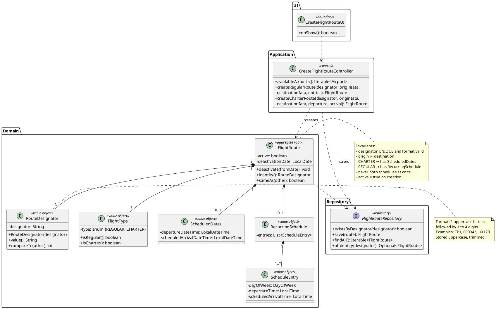
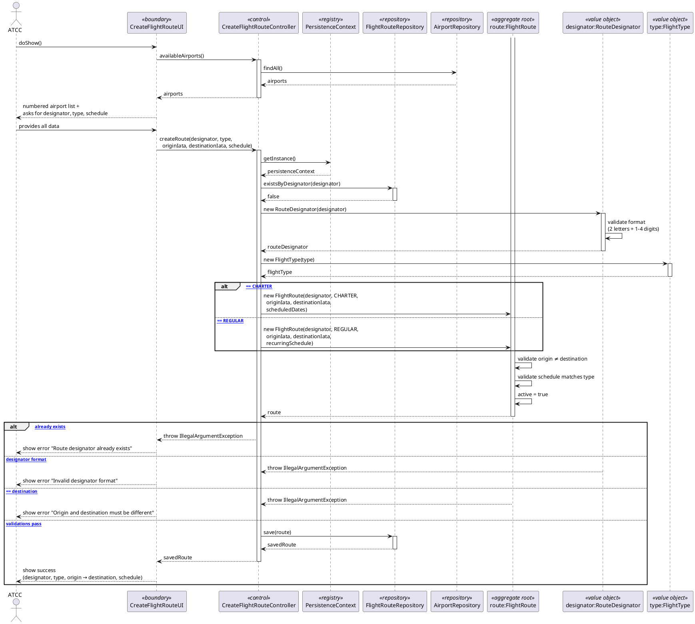

# US073 — Create a Flight Route

## 1. Context

This User Story is being developed for the first time in Sprint 3. It is part of the
**EAPLI** course unit.

A flight route represents a connection between two airports owned by an Air Transport
Company. It has a unique designator composed of 2 letters (the company's initials) and
up to 4 numbers (e.g. `TP123`). Routes are the basis for creating flights (US080) and
flight plans (US081).

### 1.1 List of Issues

Analysis: Understand the route domain model — designator format, type (regular/charter),
schedule structure (mutual exclusivity), origin/destination airports.

Design: Design the `CreateFlightRouteController`; design the UI for airport and company
selection; define domain invariants.

Implement: Implement `FlightRoute` aggregate, `RouteDesignator` value object, schedule
value objects; implement controller and UI.

Test: Test valid route creation; test designator uniqueness; test format validation;
test mutual exclusivity of schedule types.

---

## 2. Requirements

**US073** As an Air Transport Company Collaborator, I want to add a flight route for
my company. A route is between two airports (start and end) and has a name with 2
letters (my company's initials) and up to 4 numbers (e.g. TP123). The route's name
must be unique.

**Acceptance Criteria:**

- US073.1 — The route designator must be unique within the system.
- US073.2 — The route designator format is: 2 letters + up to 4 digits (e.g. `TP123`).
- US073.3 — The route must have an origin and a destination airport (different airports).
- US073.4 — The route must have a type: `REGULAR` or `CHARTER`.
- US073.5 — `CHARTER` routes have a `ScheduledDates` (departure and arrival datetime).
- US073.6 — `REGULAR` routes have a `RecurringSchedule` with at least one `ScheduleEntry`.
- US073.7 — Schedule type and route type are mutually exclusive.

**Dependencies/References:**

- Depends on **US052** — airports must exist before a route can be created.
- Depends on **US060** — the company must exist before a route can be owned by it.
- Extended by **US074** — deactivate a flight route.
- Extended by **US080** — flights are created from routes.
- Referenced in the specification, section 6.4 (Sprint 3 EAPLI user stories).

---

## 3. Analysis

### 3.1 Route Designator Format

The designator identifies a flight route uniquely within the system:

| Part | Format | Example |
|---|---|---|
| Company initials | 2 uppercase letters | `TP` |
| Flight number | 1–4 digits | `123`, `1`, `0042` |
| Full designator | 2 letters + 1–4 digits | `TP123`, `FR1`, `UX0042` |

The designator must be **unique** across all companies — two companies cannot have
the same route code even if their initials differ.

### 3.2 Schedule Mutual Exclusivity

| Route Type | Schedule | Meaning |
|---|---|---|
| `CHARTER` | `ScheduledDates` | One specific departure + arrival datetime |
| `REGULAR` | `RecurringSchedule` | Weekly recurring schedule with day + time entries |

A route cannot have both. This is enforced in the `FlightRoute` constructor.

### 3.3 Domain Model

```
FlightRoute [Aggregate Root]
  ├── RouteDesignator [Value Object]    — 2 letters + up to 4 digits, UNIQUE
  ├── FlightType [Value Object]         — REGULAR | CHARTER
  ├── ScheduledDates [Value Object]     — 0..1 (charter only)
  ├── RecurringSchedule [Value Object]  — 0..1 (regular only)
  │     └── ScheduleEntry [Value Object] — 1..* (dayOfWeek + departureTime + arrivalTime)
  ├── origin → Airport (reference by IATA code)
  ├── destination → Airport (reference by IATA code)
  └── active : boolean
```

---

## 4. Design

### 4.1 Design Decisions

- **`RouteDesignator` as identity** — the designator is the aggregate's identity. It
  implements `Comparable` for sorting and is stored uppercase.
- **Mutual exclusivity enforced in constructor** — `FlightRoute` throws
  `IllegalArgumentException` if both `ScheduledDates` and `RecurringSchedule` are
  provided, or if neither matches the `FlightType`.
- **Origin ≠ destination enforced** — `Preconditions.ensure()` in the constructor
  rejects routes where origin and destination are the same airport.
- **Active by default** — every new route is `active = true`. Deactivation is US074.
- **Airport referenced by IATA code** — the route stores the airport IATA code as a
  string reference, not a JPA foreign key, to keep the aggregate boundary clean.

### 4.2 Class Diagram (CD)



### 4.3 Sequence Diagram (SD)



### 4.4 Acceptance Tests

**Test 1:** Verifies that a valid regular route is created successfully.

**Refers to Acceptance Criteria:** US073.1, US073.2, US073.4, US073.6

```java
@Test
void ensureValidRegularRouteIsCreated() {
    final InMemoryFlightRouteRepository repo = new InMemoryFlightRouteRepository();
    final CreateFlightRouteController ctrl =
            new CreateFlightRouteController(repo, airportRepo);

    final FlightRoute route = ctrl.createRegularRoute(
            "TP001", "OPO", "LIS",
            List.of(new ScheduleEntry(DayOfWeek.MONDAY,
                    LocalTime.of(14, 0), LocalTime.of(15, 0))));

    assertNotNull(route);
    assertEquals("TP001", route.identity().value());
    assertTrue(route.flightType().isRegular());
    assertTrue(route.isActive());
}
```

**Test 2:** Verifies that a duplicate designator is rejected.

**Refers to Acceptance Criteria:** US073.1

```java
@Test
void ensureDuplicateDesignatorIsRejected() {
    ctrl.createRegularRoute("TP001", "OPO", "LIS", entries);

    assertThrows(IllegalArgumentException.class, () ->
            ctrl.createRegularRoute("TP001", "LIS", "OPO", entries));
}
```

**Test 3:** Verifies that an invalid designator format is rejected.

**Refers to Acceptance Criteria:** US073.2

```java
@Test
void ensureInvalidDesignatorFormatIsRejected() {
    // only 1 letter — invalid
    assertThrows(IllegalArgumentException.class, () ->
            ctrl.createRegularRoute("T001", "OPO", "LIS", entries));

    // 5 digits — invalid
    assertThrows(IllegalArgumentException.class, () ->
            ctrl.createRegularRoute("TP12345", "OPO", "LIS", entries));
}
```

**Test 4:** Verifies that origin and destination must be different.

**Refers to Acceptance Criteria:** US073.3

```java
@Test
void ensureOriginAndDestinationMustBeDifferent() {
    assertThrows(IllegalArgumentException.class, () ->
            ctrl.createRegularRoute("TP002", "OPO", "OPO", entries));
}
```

**Test 5:** Verifies that a charter route has scheduled dates and not a recurring schedule.

**Refers to Acceptance Criteria:** US073.5, US073.7

```java
@Test
void ensureCharterRouteHasScheduledDates() {
    final FlightRoute route = ctrl.createCharterRoute(
            "TP003", "OPO", "LIS",
            LocalDateTime.of(2026, 6, 1, 14, 0),
            LocalDateTime.of(2026, 6, 1, 15, 0));

    assertTrue(route.flightType().isCharter());
    assertNotNull(route.scheduledDates());
    assertNull(route.recurringSchedule());
}
```

**Test 6:** Verifies that a new route is active by default.

**Refers to Acceptance Criteria:** US073.4

```java
@Test
void ensureNewRouteIsActiveByDefault() {
    final FlightRoute route = ctrl.createRegularRoute(
            "TP004", "OPO", "LIS", entries);

    assertTrue(route.isActive());
}
```

---

## 5. Implementation

**`domain/flightroute/RouteDesignator.java`**
- `@Embeddable` Value Object.
- Constructor validates: exactly 2 uppercase letters followed by 1–4 digits.
- Stores uppercase, trimmed.
- Implements `Comparable<RouteDesignator>` for sorting.

**`domain/flightroute/FlightType.java`**
- `@Embeddable` Value Object with enum `{REGULAR, CHARTER}`.
- Factory methods `regular()` and `charter()`.

**`domain/flightroute/ScheduledDates.java`**
- `@Embeddable` Value Object.
- `departureDateTime` and `scheduledArrivalDateTime` as `LocalDateTime`.
- Validates: arrival must be after departure.

**`domain/flightroute/RecurringSchedule.java`**
- `@Embeddable` Value Object.
- Contains `List<ScheduleEntry>` — at least one entry required.

**`domain/flightroute/ScheduleEntry.java`**
- `@Embeddable` Value Object.
- `dayOfWeek: DayOfWeek`, `departureTime: LocalTime`, `scheduledArrivalTime: LocalTime`.

**`domain/flightroute/FlightRoute.java`**
- `@Entity`, `@Table(name = "FLIGHT_ROUTE")`.
- `@EmbeddedId` — `RouteDesignator`.
- Constructor validates: origin ≠ destination; schedule matches type; mutual exclusivity.
- `active = true` on creation.
- `deactivate(fromDate)` — used by US074.

**`controller/CreateFlightRouteController.java`**
- Checks designator uniqueness via `FlightRouteRepository.existsByDesignator()`.
- Creates `RouteDesignator` and `FlightType` VOs.
- Creates appropriate schedule VO based on type.
- Creates `FlightRoute` and saves via repository.

**`ui/CreateFlightRouteUI.java`**
- Lists airports by number (from `AirportRepository`).
- Asks for designator, type (REGULAR/CHARTER), origin, destination, schedule.
- For CHARTER: asks for departure and arrival datetime.
- For REGULAR: loop to add `ScheduleEntry` records.

---

## 6. Integration/Demonstration

**Valid REGULAR route:**
```
--- Create Flight Route ---
Available airports:
  1. OPO / LPPR — Porto
  2. LIS / LPPT — Lisboa
  3. FAO / LPFR — Faro

Route designator : TP001
Type             : 1 (REGULAR)
Origin airport   : 1 (OPO)
Destination      : 2 (LIS)

Add schedule entry:
  Day of week       : MONDAY
  Departure time    : 14:00
  Arrival time      : 15:00
Add another? (y/n) : n

>> Route 'TP001' created successfully.
   Type     : REGULAR
   Route    : OPO → LIS
   Schedule : MONDAY 14:00 → 15:00
   Status   : ACTIVE
```

**Valid CHARTER route:**
```
Route designator : FR9001
Type             : 2 (CHARTER)
Origin airport   : 2 (LIS)
Destination      : 3 (FAO)
Departure        : 2026-07-01 10:00
Arrival          : 2026-07-01 11:00

>> Route 'FR9001' created successfully.
   Type     : CHARTER
   Route    : LIS → FAO
   Departure: 2026-07-01 10:00
   Arrival  : 2026-07-01 11:00
   Status   : ACTIVE
```

**Error — duplicate designator:**
```
>> ERROR: Route with designator 'TP001' already exists.
```

**Error — invalid format:**
```
>> ERROR: Route designator must be 2 letters followed by 1 to 4 digits (e.g. TP123).
```

---

## 7. Observations

- The route designator is the **identity** of the `FlightRoute` aggregate — it must be
  unique across the system, not just within a company.
- Schedule mutual exclusivity is enforced in the domain constructor — it is a business
  invariant that cannot be bypassed by the UI or controller.
- Origin and destination being different airports is also enforced in the constructor —
  a route from and to the same airport makes no operational sense.
- The `active` flag is `true` on creation. Deactivation (US074) requires checking that
  no planned flights exist after the deactivation date — that check is in the controller,
  not the domain, because it requires access to the `FlightRepository`.