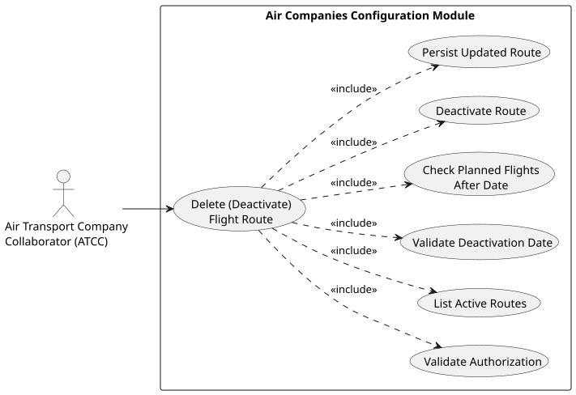
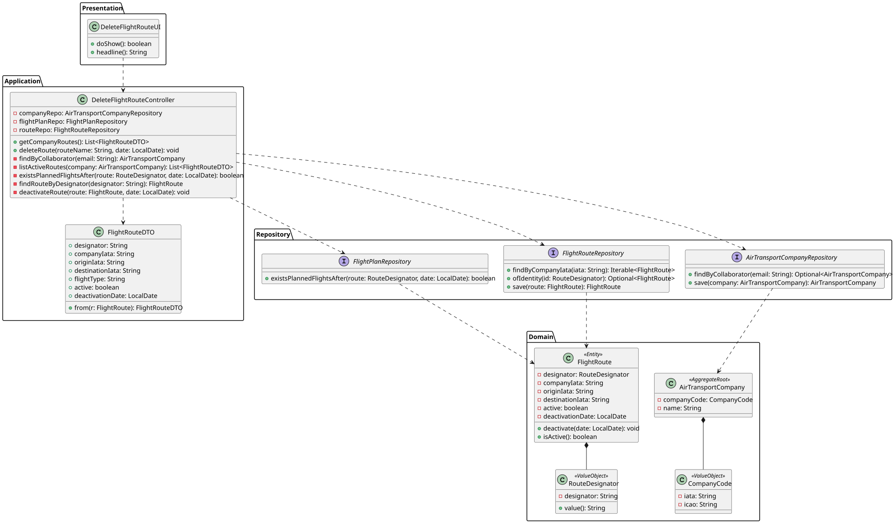
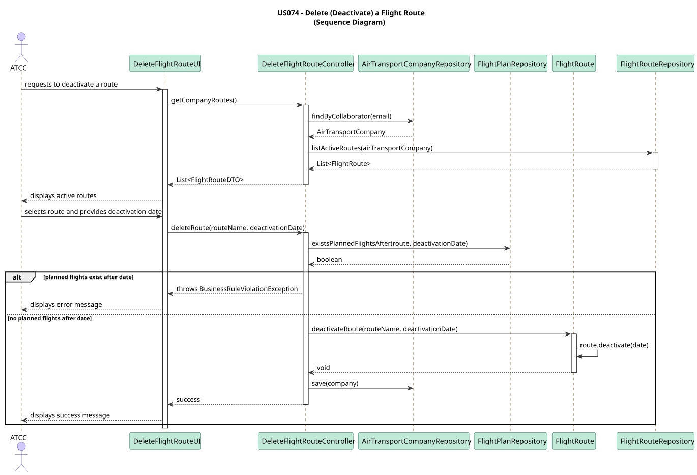

# US074 - Delete (Deactivate) a Flight Route

## 1. Context

This User Story is being developed for the first time in Sprint 3. It allows an Air Transport Company Collaborator to deactivate a flight route from a given date onwards, meaning no new flights can be created on that route after that date. However, already planned flights before that date are unaffected.

This US depends on US030 (authentication and authorization), US060 (register an air transport company), US061 (add a collaborator), and US073 (create a flight route), as a route must already exist before it can be deactivated.

### 1.1 List of Issues

Analysis: Clarify what "deactivate" means — the route is not deleted but marked as inactive from a given date; confirm what happens to existing flights on that route; confirm who may perform this action.

Design: Define the class diagram covering all four layers; identify where routes are stored since `AirTransportCompany` does not own routes directly; design the deactivation flow including the blocking condition (planned flights after the given date).

Implement: Implement `DeleteFlightRouteController`; add `findByCollaborator()` to `AirTransportCompanyRepository`; add `existsPlannedFlightsAfter()` to `FlightPlanRepository`; enforce the blocking condition; fetch routes from `FlightRouteRepository` since routes are not owned by the company aggregate.

Test: Verify that a route with no planned flights after the date can be deactivated; verify that a route with planned flights after the date cannot be deactivated; verify that inactive routes are excluded from the listing; verify that a collaborator with no associated company is rejected.

---

## 2. Requirements

**US074** As an Air Transport Company Collaborator, I want to deactivate a flight route from a given date onwards.

**Acceptance Criteria:**

- US074.1 — The collaborator may only deactivate routes belonging to their own company.
- US074.2 — A route cannot be deactivated if there are planned flights on that route after the specified date.
- US074.3 — After deactivation, no new flights can be created on that route.
- US074.4 — Flights already planned before the deactivation date are unaffected.
- US074.5 — The route record is retained in the system (soft deactivation — not a physical delete).

**Dependencies/References:**

- **US030** — Authentication and authorization must be in place; only a logged-in Air Transport Company Collaborator may execute this US.
- **US060** — An Air Transport Company must exist.
- **US061** — The actor must be a registered collaborator of the company.
- **US073** — A flight route must have been previously created.
- **NFR09** — Authentication and authorization must be enforced.
- **NFR10** — Implementation language is Java.

---

## 3. Analysis

### 3.1 Domain Understanding

A **Flight Route** connects two airports and belongs to an Air Transport Company. It has a designator, origin/destination airports, and an active status. Deactivating a route means setting its active status to false from a given date, preventing future flight creation on that route.

The key business constraint is that deactivation is blocked if there are any planned flights scheduled after the deactivation date. This protects existing operational commitments.

Routes are stored in their own `FlightRoute` aggregate and linked to a company via `companyIata`. Since the `AirTransportCompany` aggregate does not directly own routes in the current domain model, the `FlightRouteRepository` is used to fetch routes by company IATA code.

### 3.2 Key Business Rules

- Deactivation is a **soft operation** — the route record is retained for historical reference.
- The deactivation date must be provided by the collaborator.
- The system must check for planned flights after the given date before proceeding.
- The system identifies the company of the logged-in collaborator automatically — the collaborator does not need to enter their company code.
- Once deactivated, the route must not appear in the list of available active routes.

### 3.3 Use-Case Diagram



---

## 4. Design

### 4.1 Design Decisions

- **Soft deactivation**: The route is marked inactive from the given date rather than physically deleted, preserving historical data and audit trails.
- **Blocking condition enforced in the controller**: The check for planned flights is performed in the application layer before delegating to the domain, keeping the domain focused on its own invariants.
- **Company resolved from session**: The controller receives the authenticated user's email from the UI and uses `AirTransportCompanyRepository.findByCollaborator(email)` to identify the company automatically — the collaborator never types their company code.
- **Routes fetched from `FlightRouteRepository`**: Since `AirTransportCompany` does not own routes directly in the current domain model, routes are fetched via `FlightRouteRepository.findByCompanyIata()`.
- **DTOs returned to UI**: The controller converts `FlightRoute` domain objects to `FlightRouteDTO` before returning them. The UI never handles domain objects directly, following the low coupling principle from the lectures.
- **Authentication in the UI**: `AuthzRegistry` is called in the UI, not the controller. The controller receives plain values and contains no session logic, making it fully testable without a session.

### 4.2 Class Diagram (CD)



The diagram covers four layers:

**Presentation:** `DeleteFlightRouteUI` — gets the authenticated user's email, calls the controller to list active routes, collects the route selection and deactivation date from the collaborator, and displays results or error messages.

**Application:** `DeleteFlightRouteController` — resolves the company from the collaborator email, filters active routes, checks for blocking planned flights, and delegates deactivation to the domain. Also contains `FlightRouteDTO`.

**Domain:** `FlightRoute <<Entity>>` — the route's `deactivate(date)` method sets it inactive from the given date and stores the deactivation date.

**Repository:** `AirTransportCompanyRepository`, `FlightRouteRepository`, and `FlightPlanRepository` interfaces — used respectively to resolve the company, fetch and persist routes, and check for blocking planned flights.

### 4.3 Sequence Diagram (SD)



The high-level flow is:

1. Collaborator requests to deactivate a route.
2. UI gets the authenticated user's email and calls `getCompanyRoutes(email)`.
3. Controller resolves the company via `findByCollaborator(email)` and lists active routes via `listActiveRoutes(company)`.
4. System displays the active routes.
5. Collaborator selects a route and provides the deactivation date.
6. UI calls `deleteRoute(routeName, deactivationDate)`.
7. Controller fetches the route, checks for planned flights — aborts with an error if any exist.
8. Controller calls `route.deactivate(date)` and saves via `FlightRouteRepository`.
9. Success is reported to the collaborator.

### 4.4 Acceptance Tests

**Test 1:** A route is deactivated successfully when no planned flights exist after the date.

**Refers to Acceptance Criteria:** US074.3, US074.5

```java
@Test
void ensureRouteIsDeactivatedSuccessfully() {
    when(routeRepo.ofIdentity(new RouteDesignator("TP001")))
            .thenReturn(Optional.of(route));
    when(flightPlanRepo.existsPlannedFlightsAfter(any(), any())).thenReturn(false);
    when(routeRepo.save(any())).thenAnswer(i -> i.getArgument(0));

    ctrl.deleteRoute("TP001", LocalDate.now());

    assertFalse(route.isActive());
    verify(routeRepo).save(route);
}
```

**Test 2:** A route with planned flights after the deactivation date cannot be deactivated.

**Refers to Acceptance Criteria:** US074.2

```java
@Test
void ensureRouteWithPlannedFlightsCannotBeDeactivated() {
    when(routeRepo.ofIdentity(new RouteDesignator("TP001")))
            .thenReturn(Optional.of(route));
    when(flightPlanRepo.existsPlannedFlightsAfter(any(), any())).thenReturn(true);

    assertThrows(IllegalArgumentException.class,
            () -> ctrl.deleteRoute("TP001", LocalDate.now()));
    verify(routeRepo, never()).save(any());
}
```

**Test 3:** Inactive routes are excluded from the active route listing.

**Refers to Acceptance Criteria:** US074.3

```java
@Test
void ensureInactiveRoutesAreExcluded() {
    final FlightRoute inactive = activeRoute("TP001", "TP");
    inactive.deactivate(LocalDate.now().minusDays(1));
    when(companyRepo.findByCollaborator(EMAIL)).thenReturn(Optional.of(company()));
    when(routeRepo.findByCompanyIata("TP")).thenReturn(List.of(inactive));

    assertTrue(ctrl.getCompanyRoutes(EMAIL).isEmpty());
}
```

---

## 5. Implementation

Key implementation notes:

- `DeleteFlightRouteController` has no `AuthzRegistry` calls — authentication is handled by the `MainMenu` which only routes ATCC users to this UI, and the authenticated email is passed in by the UI.
- `getCompanyRoutes(String collaboratorEmail)` calls `findByCollaborator(email)` to resolve the company, then `listActiveRoutes(company)` to filter and convert active routes to DTOs.
- `deleteRoute(String routeName, LocalDate deactivationDate)` calls `findRouteByDesignator()` to load the route, `existsPlannedFlightsAfter()` to check the blocking condition, and `deactivateRoute()` to apply the change and save.
- All internal steps (`findByCollaborator`, `listActiveRoutes`, `findRouteByDesignator`, `existsPlannedFlightsAfter`, `deactivateRoute`) are private methods, following the sequence diagram structure.
- `FlightRoute.deactivate(date)` stores the deactivation date and sets `active = false`. The method is idempotent.
- `AirTransportCompanyRepository` was extended with `findByCollaborator(String email)` — implemented in `InMemoryAirTransportCompanyRepository` via stream filtering and in `JpaAirTransportCompanyRepository` via a JPQL `EXISTS` query.
- `FlightPlanRepository` was extended with `existsPlannedFlightsAfter(RouteDesignator, LocalDate)` — takes a `RouteDesignator` value object rather than a raw `String` for type safety.
- `JpaFlightRouteRepository` was created as the production implementation of `FlightRouteRepository`.
- `PersistenceContext` was updated to use `JpaFlightRouteRepository` instead of `InMemoryFlightRouteRepository` in production.

---

## 6. Integration/Demonstration

- Log in as an Air Transport Company Collaborator (`atcc@alsafe.com` / `Atcc1234`).
- Navigate to option **5 – Delete Flight Route** in the Route Management section.
- The system automatically lists the active routes of the collaborator's company — no company code needs to be entered.
- Select an active route with no planned flights in the future and provide a deactivation date.
- Verify the route no longer appears in the active route listing.
- Attempt to deactivate a route that has planned flights after the given date and verify the error message is shown.

---

## 7. Observations

- The route is not physically removed from the database, preserving historical data for reporting and audit purposes.
- Flights already planned on the route before the deactivation date continue to exist and are unaffected.
- The current domain model does not have routes owned by `AirTransportCompany`. Once the domain model is corrected in a future sprint, `listActiveRoutes()` can delegate to `company.listActiveRoutes()` instead of querying `FlightRouteRepository` directly.
- A future US could implement route reactivation if the business requires it.