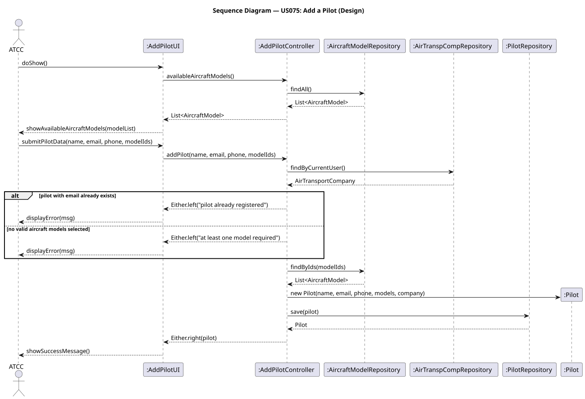
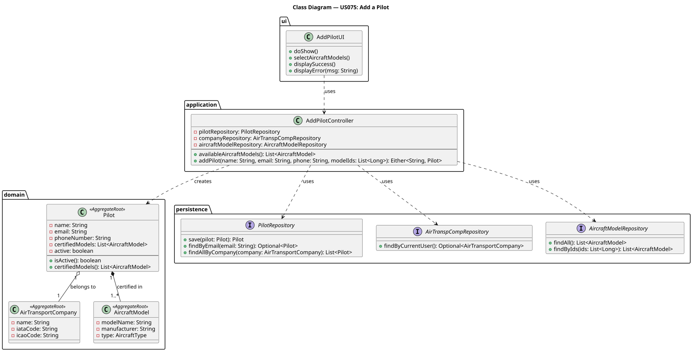

# US075 — Add a Pilot

## 1. User Story

> As an Air Transport Company Collaborator, I want to add a pilot to my company.
> A pilot is a system's user. A pilot is certified to pilot one or more aircraft models.

---

## 2. Acceptance Criteria

- The pilot is a system user (has email, name, phone number).
- The pilot must be certified in at least one aircraft model.
- A pilot can only be added to the ATCC's own company.
- A pilot with the same email cannot be registered twice.
- The pilot is created with an active status.

---

## 3. Analysis

### 3.1 Pre-conditions

- The user is authenticated as an Air Transport Company Collaborator (ATCC).
- The ATCC's company is registered in the system.
- At least one aircraft model exists in the system.

### 3.2 Post-conditions

- A new `Pilot` aggregate is persisted.
- The pilot is associated with the ATCC's company.
- The pilot is certified for the selected aircraft models.

### 3.3 Business Rules

- A pilot must be certified for at least one aircraft model.
- The same email cannot be associated with more than one pilot in the same company.
- The pilot is created with `active = true`.

---

## 4. Design

### 4.1 Architecture

The solution follows the layered architecture of the EAPLI framework:

```
AddPilotUI
    → AddPilotController
        → AirTransportCompanyRepository  (find current user's company)
        → AircraftModelRepository        (list available models)
        → new Pilot(...)                 (domain object creation)
        → PilotRepository                (persistence)
```

### 4.2 Main Components

| Class | Layer | Responsibility |
|---|---|---|
| `AddPilotUI` | UI (Boundary) | Collects input; presents aircraft model list |
| `AddPilotController` | Application | Orchestrates use case; calls repositories and creates pilot |
| `Pilot` | Domain (Aggregate Root) | Enforces all domain invariants; certified models |
| `AirTransportCompany` | Domain (Aggregate Root) | Owns the pilot roster |
| `PilotRepository` | Persistence (interface) | Persists the new pilot |
| `AirTransportCompanyRepository` | Persistence (interface) | Retrieves the current ATCC's company |
| `AircraftModelRepository` | Persistence (interface) | Provides aircraft models for selection |

### 4.3 Return pattern for business rule violations

As per professor feedback, domain methods (not constructors) should not throw exceptions for business rule violations. Instead, they should return the error using `Either`, `Result`, or `Optional` patterns.

The `addPilot` method in the controller returns `Either<String, Pilot>`:

```java
// ✅ correct — returns error instead of throwing
public Either<String, Pilot> addPilot(
        final String name,
        final String email,
        final String phoneNumber,
        final List<Long> aircraftModelIds) {

    final AirTransportCompany company =
        companyRepository.findByCurrentUser()
            .orElseThrow(() -> new IllegalStateException("No company found for current user"));

    if (pilotRepository.findByEmail(email).isPresent()) {
        return Either.left("A pilot with this email already exists.");
    }

    final List<AircraftModel> models = aircraftModelRepository.findByIds(aircraftModelIds);
    if (models.isEmpty()) {
        return Either.left("At least one valid aircraft model must be selected.");
    }

    final Pilot pilot = new Pilot(name, email, phoneNumber, models, company);
    pilotRepository.save(pilot);
    return Either.right(pilot);
}
```

### 4.4 Value Objects

| Attribute | Type | Validation |
|---|---|---|
| `name` | `String` | Non-empty |
| `email` | `String` | Non-empty, valid email format |
| `phoneNumber` | `String` | Non-empty |
| `certifiedModels` | `List<AircraftModel>` | At least one element |
| `active` | `boolean` | Defaults to `true` |

### 4.5 Sequence Diagram (SD)



Main success scenario:

1. The ATCC selects *Add Pilot*.
2. The UI requests available aircraft models from the controller.
3. The controller fetches all models from `AircraftModelRepository` and returns them to the UI.
4. The UI presents the models and collects all required input.
5. The UI invokes `addPilot(name, email, phone, modelIds)` on the controller.
6. The controller retrieves the current user's company from `AirTransportCompanyRepository`.
7. The controller checks if a pilot with the given email already exists; if so, returns `Either.left(error)`.
8. The controller fetches the selected `AircraftModel` instances by ID.
9. The controller creates a new `Pilot` via its constructor.
10. The controller saves the pilot via `PilotRepository`.
11. The controller returns `Either.right(pilot)` to the UI.
12. The UI displays a success message.

### 4.6 Class Diagram (CD)



---

## 5. Tests

Unit tests follow the **AAA (Arrange, Act, Assert)** convention and must ensure ≥ 90% coverage of domain and controller packages.

### 5.1 Domain Tests — `PilotTest`

```java
@Test
void ensurePilotCannotBeCreatedWithoutCertifiedModels() {
    // Arrange
    final List<AircraftModel> models = Collections.emptyList();
    // Act + Assert
    assertThrows(IllegalArgumentException.class,
        () -> new Pilot("John Doe", "john@airline.com", "+351910000000", models, company));
}

@Test
void ensurePilotIsCreatedWithActiveStatus() {
    // Arrange
    final List<AircraftModel> models = List.of(validAircraftModel());
    // Act
    final Pilot pilot = new Pilot("John Doe", "john@airline.com", "+351910000000", models, company);
    // Assert
    assertTrue(pilot.isActive());
}
```

### 5.2 Controller Tests — `AddPilotControllerTest`

```java
@Test
void ensureAddPilotFailsIfEmailAlreadyExists() {
    // Arrange
    when(pilotRepo.findByEmail("john@airline.com")).thenReturn(Optional.of(existingPilot()));
    // Act
    final Either<String, Pilot> result =
        controller.addPilot("John", "john@airline.com", "+351910000000", List.of(1L));
    // Assert
    assertTrue(result.isLeft());
}

@Test
void ensureAddPilotSucceedsWithValidData() {
    // Arrange
    when(pilotRepo.findByEmail(any())).thenReturn(Optional.empty());
    when(aircraftModelRepo.findByIds(any())).thenReturn(List.of(validAircraftModel()));
    when(companyRepo.findByCurrentUser()).thenReturn(Optional.of(validCompany()));
    // Act
    final Either<String, Pilot> result =
        controller.addPilot("John", "john@airline.com", "+351910000000", List.of(1L));
    // Assert
    assertTrue(result.isRight());
    verify(pilotRepo).save(any(Pilot.class));
}
```

---

## 6. Dependencies

| Depends on | Reason |
|---|---|
| US060 — Register an air transport company | The company must exist before a pilot can be added |
| US030 — Authentication and authorization | The ATCC must be authenticated |
| US055 — Create an aircraft model | Aircraft models must exist for certification |

| Enables | Reason |
|---|---|
| US076 — List pilot roster | Lists pilots created by this US |
| US077 — Remove a pilot | Deactivates pilots created by this US |
| US080 — Create a flight plan | Validates that pilot belongs to the route's company |