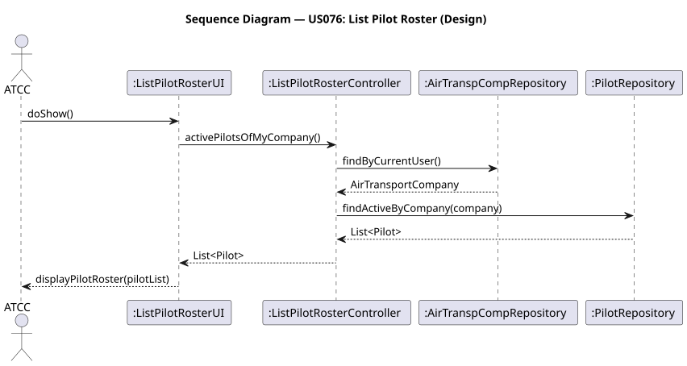
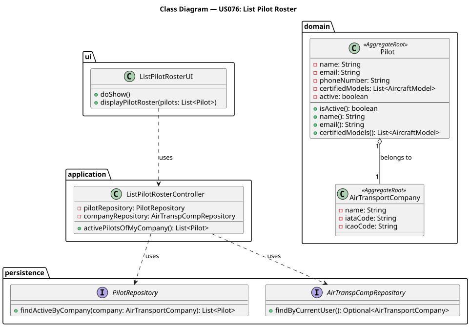

# US076 — List Pilot Roster

## 1. User Story

> As an Air Transport Company Collaborator, I want to list my company's pilot roster.

---

## 2. Acceptance Criteria

- Only active pilots are listed.
- Only pilots belonging to the ATCC's own company are shown.
- The list includes at minimum: name, email, phone number and certified aircraft models.
- If there are no active pilots, an appropriate message is shown.

---

## 3. Analysis

### 3.1 Pre-conditions

- The user is authenticated as an Air Transport Company Collaborator (ATCC).
- The ATCC's company is registered in the system.

### 3.2 Post-conditions

- No state change — this is a read-only operation.

### 3.3 Business Rules

- Inactive (deactivated) pilots must not appear in the list.
- The ATCC can only list pilots from their own company.

---

## 4. Design

### 4.1 Architecture

The solution follows the layered architecture of the EAPLI framework:

```
ListPilotRosterUI
    → ListPilotRosterController
        → AirTransportCompanyRepository  (find current user's company)
        → PilotRepository                (fetch active pilots of that company)
```

### 4.2 Main Components

| Class | Layer | Responsibility |
|---|---|---|
| `ListPilotRosterUI` | UI (Boundary) | Triggers listing and displays the result |
| `ListPilotRosterController` | Application | Retrieves company and delegates query to repository |
| `Pilot` | Domain (Aggregate Root) | Holds pilot data and active status |
| `AirTransportCompany` | Domain (Aggregate Root) | Scopes the query to the correct company |
| `PilotRepository` | Persistence (interface) | Queries active pilots filtered by company |
| `AirTranspCompRepository` | Persistence (interface) | Retrieves the current ATCC's company |

### 4.3 Sequence Diagram (SD)



Main success scenario:

1. The ATCC selects *List Pilot Roster*.
2. The UI calls `activePilotsOfMyCompany()` on the controller.
3. The controller retrieves the current user's company from `AirTranspCompRepository`.
4. The controller calls `findActiveByCompany(company)` on `PilotRepository`.
5. The repository returns the list of active pilots.
6. The controller returns the list to the UI.
7. The UI displays the pilot roster.

### 4.4 Class Diagram (CD)



### 4.5 Controller Implementation

```java
public List<Pilot> activePilotsOfMyCompany() {
    final AirTransportCompany company =
        companyRepository.findByCurrentUser()
            .orElseThrow(() -> new IllegalStateException("No company found for current user"));

    return pilotRepository.findActiveByCompany(company);
}
```

> Note: this is a query method with no business rule violations to signal,
> so returning a plain `List` is appropriate here — no `Either` needed.

---

## 5. Tests

Unit tests follow the **AAA (Arrange, Act, Assert)** convention and must ensure ≥ 90% coverage of domain and controller packages.

### 5.1 Controller Tests — `ListPilotRosterControllerTest`

```java
@Test
void ensureOnlyActivePilotsAreReturned() {
    // Arrange
    final AirTransportCompany company = validCompany();
    when(companyRepo.findByCurrentUser()).thenReturn(Optional.of(company));
    when(pilotRepo.findActiveByCompany(company)).thenReturn(List.of(activePilot()));
    // Act
    final List<Pilot> result = controller.activePilotsOfMyCompany();
    // Assert
    assertFalse(result.isEmpty());
    assertTrue(result.stream().allMatch(Pilot::isActive));
}

@Test
void ensureEmptyListIsReturnedWhenNoPilotsExist() {
    // Arrange
    final AirTransportCompany company = validCompany();
    when(companyRepo.findByCurrentUser()).thenReturn(Optional.of(company));
    when(pilotRepo.findActiveByCompany(company)).thenReturn(Collections.emptyList());
    // Act
    final List<Pilot> result = controller.activePilotsOfMyCompany();
    // Assert
    assertTrue(result.isEmpty());
}

@Test
void ensurePilotsFromOtherCompaniesAreNotListed() {
    // Arrange
    final AirTransportCompany myCompany = validCompany();
    final AirTransportCompany otherCompany = otherValidCompany();
    when(companyRepo.findByCurrentUser()).thenReturn(Optional.of(myCompany));
    when(pilotRepo.findActiveByCompany(myCompany)).thenReturn(List.of(activePilot()));
    when(pilotRepo.findActiveByCompany(otherCompany)).thenReturn(List.of(otherPilot()));
    // Act
    final List<Pilot> result = controller.activePilotsOfMyCompany();
    // Assert
    assertTrue(result.stream().noneMatch(p -> p.equals(otherPilot())));
}
```

---

## 6. Dependencies

| Depends on | Reason |
|---|---|
| US075 — Add a pilot | Pilots must exist to be listed |
| US060 — Register an air transport company | The company must exist |
| US030 — Authentication and authorization | The ATCC must be authenticated |

| Enables | Reason |
|---|---|
| US077 — Remove a pilot | The roster list is the natural entry point for selecting a pilot to deactivate |