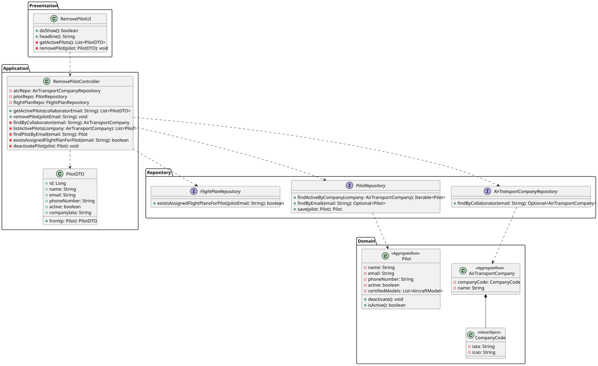
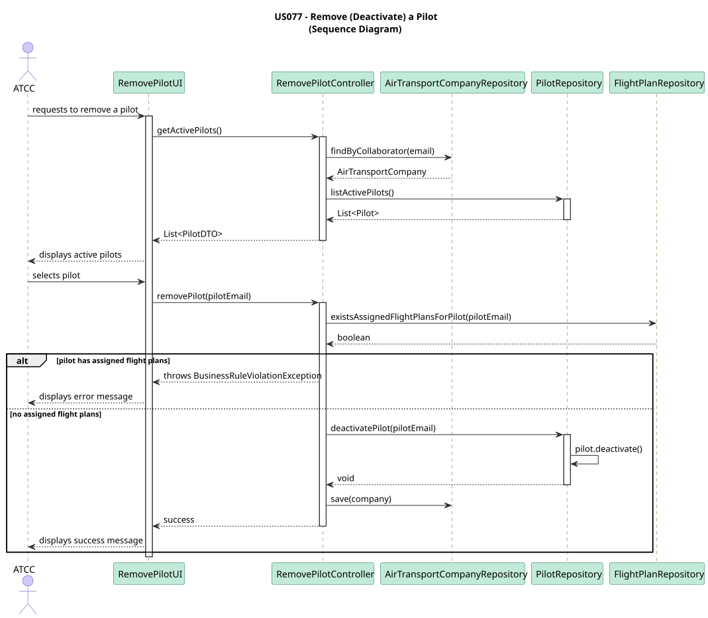

# US077 - Remove a Pilot

## 1. Context

This User Story is being developed for the first time in Sprint 3. It allows an Air Transport Company Collaborator to make a pilot inactive in their company's roster. A pilot cannot be deactivated if they have flight plans assigned to them.

This US depends on US030 (authentication and authorization), US060 (register an air transport company), US061 (add a collaborator), and US075 (add a pilot), as a pilot must already exist in the roster before being removed.

### 1.1 List of Issues

Analysis: Clarify what "remove" means — the pilot is not deleted but made inactive; clarify the blocking condition (assigned flight plans); confirm who may perform this action.

Design: Define the class diagram covering all four layers; identify that `Pilot` is its own aggregate root queried via `PilotRepository`; design the deactivation flow including the blocking condition.

Implement: Implement `RemovePilotController`; add `findByCollaborator()` to `AirTransportCompanyRepository`; add `findActiveByCompany()` and `findByEmail()` to `PilotRepository`; enforce the blocking condition by checking `FlightPlanRepository` before deactivating.

Test: Verify that a pilot with no assigned flight plans can be deactivated; verify that a pilot with assigned flight plans cannot be deactivated; verify that only the target pilot is deactivated; verify that a collaborator with no associated company is rejected.

---

## 2. Requirements

**US077** As an Air Transport Company Collaborator, I want to make a pilot inactive in my company's roster.

**Acceptance Criteria:**

- US077.1 — The collaborator may only deactivate pilots belonging to their own company.
- US077.2 — A pilot cannot be deactivated if they have flight plans assigned to them.
- US077.3 — After deactivation, the pilot must not appear in the active pilot roster.
- US077.4 — The pilot record is retained in the system (soft deactivation — not a physical delete).

**Dependencies/References:**

- **US030** — Authentication and authorization must be in place; only a logged-in Air Transport Company Collaborator may execute this US.
- **US060** — An Air Transport Company must exist.
- **US061** — The actor must be a registered collaborator of the company.
- **US075** — A pilot must have been previously added to the company's roster.
- **US080** — Flight plans reference pilots; this US must check for assigned flight plans before deactivating.
- **NFR09** — Authentication and authorization must be enforced.
- **NFR10** — Implementation language is Java.

---

## 3. Analysis

### 3.1 Domain Understanding

A **pilot** is certified to pilot one or more aircraft models and belongs to an Air Transport Company. Making a pilot inactive means they can no longer be assigned to new flight plans, but their historical assignments are preserved.

The key business constraint is that a pilot cannot be deactivated if they have any flight plans currently assigned to them. This protects existing operational commitments.

`Pilot` is its own aggregate root — it is not owned by `AirTransportCompany`. It is linked to a company via a `@ManyToOne` reference and queried via `PilotRepository.findActiveByCompany()`.

### 3.2 Key Business Rules

- Deactivation is a **soft operation** — the pilot record is retained for historical reference.
- The system must check for assigned flight plans before proceeding.
- The system identifies the company of the logged-in collaborator automatically via `AirTransportCompanyRepository.findByCollaborator(email)`.
- Once deactivated, the pilot must not appear in the active roster listing.
- A deactivated pilot cannot be assigned to new flight plans.
- `Pilot.deactivate()` is idempotent — calling it on an already-inactive pilot is safe.

### 3.3 Use-Case Diagram


---

## 4. Design

### 4.1 Design Decisions

- **Soft deactivation**: The pilot is marked inactive rather than physically deleted, preserving historical data and flight plan references.
- **Blocking condition enforced in the controller**: The check for assigned flight plans is performed in the application layer before delegating to the domain.
- **Company resolved from session**: The UI gets the authenticated user's email and passes it to `getActivePilots(email)`. The controller resolves the company via `findByCollaborator(email)` — the collaborator never types their company code.
- **Authentication in the UI**: `AuthzRegistry` is called in the UI, not the controller. The controller receives plain values and is fully testable without a session.
- **DTOs returned to UI**: The controller converts `Pilot` domain objects to `PilotDTO` before returning them. The UI never handles domain objects directly, following the low coupling principle from the lectures.
- **`Pilot` as aggregate root**: `Pilot` is queried directly via `PilotRepository`, not through `AirTransportCompany`. This reflects the actual domain model where pilots are independent aggregates.

### 4.2 Class Diagram (CD)



The diagram covers four layers:

**Presentation:** `RemovePilotUI` — gets the authenticated user's email, calls the controller to list active pilots, collects the pilot selection, and displays the result or error messages.

**Application:** `RemovePilotController` — resolves the company from the collaborator email, lists active pilots, checks for blocking flight plans, and delegates deactivation to the domain. Also contains `PilotDTO`.

**Domain:** `Pilot <<AggregateRoot>>` — the pilot's `deactivate()` method sets it inactive. `AirTransportCompany <<AggregateRoot>>` is used only to resolve the company from the collaborator's email.

**Repository:** `AirTransportCompanyRepository`, `PilotRepository`, and `FlightPlanRepository` interfaces — used respectively to resolve the company, fetch and persist pilots, and check for blocking flight plans.

### 4.3 Sequence Diagram (SD)



The high-level flow is:

1. Collaborator requests to remove a pilot.
2. UI gets the authenticated user's email and calls `getActivePilots(email)`.
3. Controller resolves the company via `findByCollaborator(email)` and lists active pilots via `listActivePilots(company)`.
4. System displays the active pilots.
5. Collaborator selects a pilot.
6. UI calls `removePilot(pilotEmail)`.
7. Controller fetches the pilot, checks for assigned flight plans — aborts with an error if any exist.
8. Controller calls `pilot.deactivate()` and saves via `PilotRepository`.
9. Success is reported to the collaborator.

### 4.4 Acceptance Tests

**Test 1:** A pilot with no assigned flight plans is deactivated successfully.

**Refers to Acceptance Criteria:** US077.3, US077.4

```java
@Test
void ensurePilotIsDeactivatedSuccessfully() {
    when(pilotRepo.findByEmail("joao@tap.pt")).thenReturn(Optional.of(p));
    when(flightPlanRepo.existsAssignedFlightPlansForPilot("joao@tap.pt"))
            .thenReturn(false);
    when(pilotRepo.save(any())).thenAnswer(i -> i.getArgument(0));

    ctrl.removePilot("joao@tap.pt");

    assertFalse(p.isActive());
    verify(pilotRepo).save(p);
}
```

**Test 2:** A pilot with assigned flight plans cannot be deactivated.

**Refers to Acceptance Criteria:** US077.2

```java
@Test
void ensurePilotWithAssignedFlightPlansCannotBeDeactivated() {
    when(pilotRepo.findByEmail("joao@tap.pt")).thenReturn(Optional.of(p));
    when(flightPlanRepo.existsAssignedFlightPlansForPilot("joao@tap.pt"))
            .thenReturn(true);

    assertThrows(IllegalArgumentException.class,
            () -> ctrl.removePilot("joao@tap.pt"));
    verify(pilotRepo, never()).save(any());
}
```

**Test 3:** Only the target pilot is deactivated.

**Refers to Acceptance Criteria:** US077.1

```java
@Test
void ensureOnlyTargetPilotIsDeactivated() {
    when(pilotRepo.findByEmail("joao@tap.pt")).thenReturn(Optional.of(joao));
    when(flightPlanRepo.existsAssignedFlightPlansForPilot("joao@tap.pt"))
            .thenReturn(false);
    when(pilotRepo.save(any())).thenAnswer(i -> i.getArgument(0));

    ctrl.removePilot("joao@tap.pt");

    assertFalse(joao.isActive());
    assertTrue(maria.isActive());
    verify(pilotRepo, never()).save(maria);
}
```

---

## 5. Implementation

Key implementation notes:

- `RemovePilotController` has no `AuthzRegistry` calls — authentication is handled by the `MainMenu` which only routes ATCC users to this UI, and the authenticated email is passed in by the UI.
- `getActivePilots(String collaboratorEmail)` calls `findByCollaborator(email)` to resolve the company, then `listActivePilots(company)` to fetch active pilots from `PilotRepository` and convert them to DTOs.
- `removePilot(String pilotEmail)` calls `findPilotByEmail()` to load the pilot, `existsAssignedFlightPlanForPilot()` to check the blocking condition, and `deactivatePilot()` to apply the change and save.
- All internal steps (`findByCollaborator`, `listActivePilots`, `findPilotByEmail`, `existsAssignedFlightPlanForPilot`, `deactivatePilot`) are private methods following the sequence diagram structure.
- `Pilot.deactivate()` sets `active = false` and is idempotent — calling it on an already-inactive pilot does not throw.
- `AirTransportCompanyRepository` was extended with `findByCollaborator(String email)` — implemented in `InMemoryAirTransportCompanyRepository` via stream filtering and in `JpaAirTransportCompanyRepository` via a JPQL `EXISTS` query.
- `FlightPlanRepository` was extended with `existsAssignedFlightPlansForPilot(String pilotEmail)`.
- The UI only displays active pilots, so the collaborator cannot accidentally select an already-inactive pilot.

---

## 6. Integration/Demonstration

- Log in as an Air Transport Company Collaborator (`atcc@alsafe.com` / `Atcc1234`).
- Navigate to option **8 – Remove Pilot** in the Pilot Management section.
- The system automatically lists the active pilots of the collaborator's company — no company code needs to be entered.
- Select an active pilot with no assigned flight plans and confirm.
- Verify the pilot no longer appears in the active roster (US076).
- Attempt to deactivate a pilot with assigned flight plans and verify the error message is shown.

---

## 7. Observations

- The pilot is not physically removed from the database, preserving historical flight plan data.
- A deactivated pilot's past flight records remain intact and accessible for historical reporting.
- `Pilot` is an aggregate root independent of `AirTransportCompany` in the current domain model. The company is used only to scope the listing to the authenticated collaborator's company.
- If a pilot's flight plans are completed or cancelled in the future, re-enabling them would require a new US.