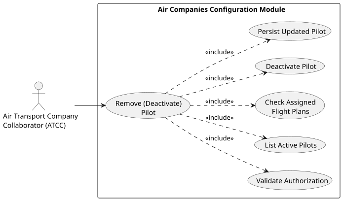

# US077 - Remove a Pilot

## 1. Context

This User Story is being developed for the first time in Sprint 3. It allows an Air Transport Company Collaborator to make a pilot inactive in their company's roster. A pilot cannot be deactivated if they have flight plans assigned to them.

This US depends on US030 (authentication and authorization), US060 (register an air transport company), US061 (add a collaborator), and US075 (add a pilot), as a pilot must already exist in the roster before being removed.

### 1.1 List of Issues

Analysis: Clarify what "remove" means — the pilot is not deleted but made inactive; clarify the blocking condition (assigned flight plans); confirm who may perform this action.

Design: Define the class diagram covering all four layers; identify the aggregate root that owns the pilot; design the deactivation flow including the blocking condition.

Implement: Implement `RemovePilotController`; implement `deactivatePilot()` on `AirTransportCompany`; enforce the blocking condition by checking for assigned flight plans before proceeding.

Test: Verify that a pilot with no assigned flight plans can be deactivated; verify that a pilot with assigned flight plans cannot be deactivated; verify that inactive pilots no longer appear in the active roster.

---

## 2. Requirements

**US077** As an Air Transport Company Collaborator, I want to make a pilot inactive in my company's roster.

**Acceptance Criteria:**

- US077.1 — The collaborator may only deactivate pilots belonging to their own company.
- US077.2 — A pilot cannot be deactivated if they have flight plans assigned to them.
- US077.3 — After deactivation, the pilot must not appear in the active pilot roster.
- US077.4 — The pilot record is retained in the system (soft deactivation — not a physical delete).

**Dependencies/References:**

- **US030** — Authentication and authorization must be in place; only a logged-in Air Transport Company Collaborator may execute this US.
- **US060** — An Air Transport Company must exist.
- **US061** — The actor must be a registered collaborator of the company.
- **US075** — A pilot must have been previously added to the company's roster.
- **US080** — Flight plans reference pilots; this US must check for assigned flight plans before deactivating.
- **NFR09** — Authentication and authorization must be enforced.
- **NFR10** — Implementation language is Java.

---

## 3. Analysis

### 3.1 Domain Understanding

A **pilot** is a system user who is certified to pilot one or more aircraft models and belongs to an Air Transport Company. Making a pilot inactive means they can no longer be assigned to new flight plans, but their historical assignments are preserved.

The key business constraint is that a pilot cannot be deactivated if they have any flight plans currently assigned to them. This protects existing operational commitments.

### 3.2 Key Business Rules

- Deactivation is a **soft operation** — the pilot record is retained for historical reference.
- The system must check for assigned flight plans before proceeding.
- A collaborator may only deactivate pilots belonging to **their own company**.
- Once deactivated, the pilot must not appear in the active roster listing.
- A deactivated pilot cannot be assigned to new flight plans.

### 3.3 Use-Case Diagram



---

## 4. Design

### 4.1 Design Decisions

- **Soft deactivation**: The pilot is marked inactive rather than physically deleted, preserving historical data and flight plan references.
- **Blocking condition enforced in the controller**: The check for assigned flight plans is performed in the application layer before delegating to the aggregate.
- **Aggregate ownership**: `Pilot` is an entity owned by `AirTransportCompany`. The deactivation method lives on the aggregate root.
- **Authorization scoped to company**: The controller retrieves only pilots belonging to the authenticated collaborator's company.
- **Cross-aggregate reference**: Flight plans reference pilots by their identifier. The check queries `FlightPlanRepository` without crossing aggregate boundaries directly.

### 4.2 Class Diagram (CD)


The diagram covers four layers:

**Presentation:** `RemovePilotUI` — lists the company's active pilots, allows selection, and displays the result or error.

**Application:** `RemovePilotController` — retrieves the company's active pilots, checks for assigned flight plans, and delegates deactivation to the aggregate. Also contains `PilotDTO`.

**Domain:** `AirTransportCompany <<AggregateRoot>>` with `Pilot <<Entity>>` — the pilot's `deactivate()` method sets it inactive.

**Repository:** `PilotRepository` and `FlightPlanRepository` interfaces — used respectively to persist the updated pilot and to check for blocking assigned flight plans.

### 4.3 Sequence Diagram (SD)


The high-level flow is:

1. Collaborator requests to remove a pilot.
2. System lists the company's active pilots.
3. Collaborator selects a pilot.
4. Controller checks for assigned flight plans — aborts with an error if any exist.
5. Controller calls `pilot.deactivate()` on the aggregate.
6. The updated pilot is saved.
7. Success is reported to the collaborator.

### 4.4 Acceptance Tests

**Test 1:** A pilot with no assigned flight plans is deactivated successfully.

**Refers to Acceptance Criteria:** US077.3, US077.4

```java
@Test
void ensurePilotWithNoFlightPlansIsDeactivated() {
    final AirTransportCompany company = savedCompany();
    company.addPilot("joao@tap.pt", "João Silva", licenseNumber);
    company.deactivatePilot("joao@tap.pt");

    assertFalse(company.findPilotByEmail("joao@tap.pt").get().isActive());
}
```

**Test 2:** A pilot with assigned flight plans cannot be deactivated.

**Refers to Acceptance Criteria:** US077.2

```java
@Test
void ensurePilotWithAssignedFlightPlansCannotBeDeactivated() {
    // Arrange: pilot has assigned flight plans
    assertThrows(BusinessRuleViolationException.class,
            () -> ctrl.removePilot("joao@tap.pt"));
}
```

**Test 3:** A deactivated pilot does not appear in the active roster.

**Refers to Acceptance Criteria:** US077.3

```java
@Test
void ensureDeactivatedPilotDoesNotAppearInActiveRoster() {
    final AirTransportCompany company = savedCompany();
    company.addPilot("joao@tap.pt", "João Silva", licenseNumber);
    company.deactivatePilot("joao@tap.pt");

    assertTrue(company.listActivePilots().stream()
            .noneMatch(p -> p.email().equals("joao@tap.pt")));
}
```

---

## 5. Implementation

Key implementation notes:
- `RemovePilotController.removePilot()` calls `authz.ensureAuthenticatedUserHasAnyOf(BaseRoles.AIR_TRANSPORT_COMPANY_COLLABORATOR)` as its first statement.
- The blocking condition check queries `FlightPlanRepository` for any flight plans where the pilot is assigned.
- `Pilot.deactivate()` sets `active = false`. The method is idempotent.
- The UI only lists active pilots, so the collaborator cannot accidentally select an already-inactive pilot.

---

## 6. Integration/Demonstration

- Log in as an Air Transport Company Collaborator.
- Navigate to **Remove Pilot**.
- Select an active pilot with no assigned flight plans.
- Confirm the action.
- Verify the pilot no longer appears in the active roster (US076).
- Attempt to deactivate a pilot with assigned flight plans and verify the error message.

---

## 7. Observations

- The pilot is not physically removed from the database, preserving historical flight plan data.
- A deactivated pilot's past flight records remain intact and accessible for historical reporting.
- If a pilot's flight plans are completed or cancelled in the future, re-enabling them would require a new US.