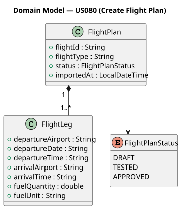
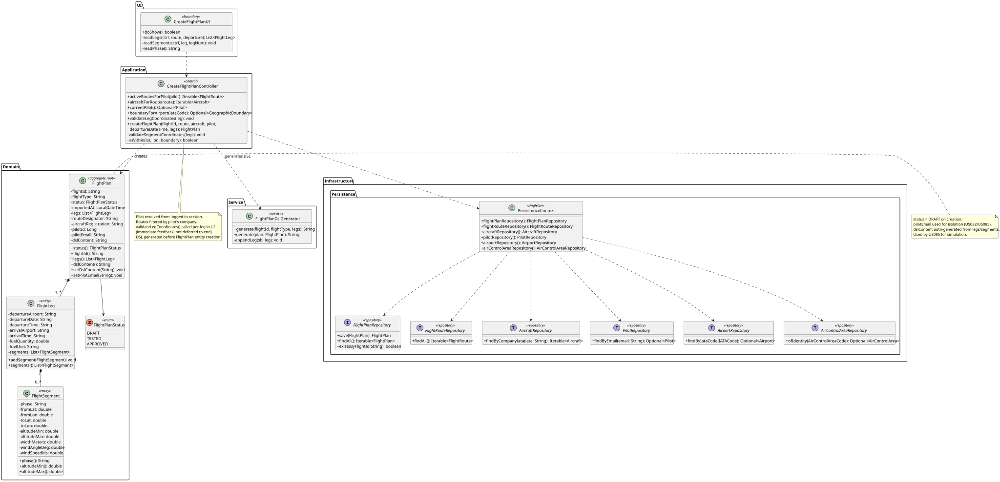

# US080 — Create a Flight Plan

## 1. Context

This User Story is being developed for the first time in Sprint 3. It introduces the ability for a Pilot to manually create a flight plan for a route within the system.

A flight plan follows a multi-step validation lifecycle: it starts as `DRAFT` when created, becomes `TESTED` after validation (US085), and is finally `APPROVED`. This US covers the creation step only.

This US depends on US073 (Create a Flight Route) since a flight plan must be associated with an existing route, and on US075 (Add a Pilot) since the pilot assigned must belong to the route's company.

### 1.1 List of Issues

Analysis: Understand what constitutes a valid flight plan; identify mandatory fields (route, aircraft, departure date/time, fuel, pilot, legs with segments); understand the status lifecycle.

Design: Design `CreateFlightPlanController`, `FlightPlan` aggregate, `FlightLeg`, `FlightSegment`, `FlightPlanRepository`, `FlightPlanDslGenerator`; define validation against `AirControlArea` boundaries.

Implement: Implement the controller, UI, domain entities and repository; auto-generate DSL from leg/segment data.

Test: Unit tests for all business rules; integration tests for full creation flow and DSL round-trip.

---

## 2. Requirements

**US080** As a Pilot, I want to register a flight plan for a route. I must add the aircraft, departure date/time, fuel quantity and legs with segments. The pilot is resolved from the logged-in user. The route list is filtered by the pilot's company. Flight plan status is set to `DRAFT` when created.

**Acceptance Criteria:**

- US080.1 — The pilot must select an existing **active** route from their company.
- US080.2 — The aircraft must be registered in the route's company fleet.
- US080.3 — The pilot (resolved from the logged-in user) must belong to the route's company.
- US080.4 — The departure date and time must be a valid future value.
- US080.5 — The fuel quantity per leg must be strictly positive.
- US080.6 — The flight plan status is set to `DRAFT` upon creation.
- US080.7 — A flight plan must have at least one leg.
- US080.8 — Segment coordinates must lie within the `AirControlArea` boundary of the leg's departure airport (skipped silently if airport is not registered).
- US080.9 — A flight ID must be unique — only one flight plan may exist per flight. A second plan for the same flight ID is rejected.

**Dependencies/References:**

- Depends on **US073** (Create a Flight Route) — a flight plan must be associated with an existing route.
- Depends on **US075** (Add a Pilot) — the assigned pilot must exist in the system.
- Depends on **US070** (Add Aircraft to Fleet) — the aircraft must exist in the company's fleet.
- Extended by **US081** (Create Flight Plan from File) — alternative creation method.
- Extended by **US085** (Test/Validate Flight Plan) — the plan undergoes simulation after creation.
- Referenced in the specification, section 3.4.

---

## 3. Analysis

### 3.1 Domain Understanding

A **FlightPlan** in the AISafe system represents a planned flight for a given route. It includes:

- A **route** (origin and destination airports, company)
- An **aircraft** (registered in the company's fleet)
- A **pilot** (resolved from the logged-in user; must belong to the route's company)
- A **departure date and time**
- One or more **FlightLeg** entities, each with:
  - Departure/arrival airports and times (pre-filled from route for first/last leg)
  - Fuel quantity (always in kg)
  - One or more **FlightSegment** entities with: from/to coordinates, altitude slots, corridor width, wind conditions
- A **DSL content** string (auto-generated from the leg/segment data — used by US085)
- A **status** — lifecycle: `DRAFT` → `TESTED` → `APPROVED`

### 3.2 Flight Plan Lifecycle

```
Creation (US080 / US081)
        │
        ▼
    [DRAFT]
        │
        ▼
Test/Validate (US085)
        │
        ▼
    [TESTED]
        │
        ▼
  (Future approval US)
        │
        ▼
   [APPROVED]
```

### 3.3 Domain Model (relevant excerpt)



---

## 4. Design

### 4.1. Design Decisions

- **Aggregate Root**: `FlightPlan` is the aggregate root identified by a generated `Long` id. The flight ID (e.g. `TP001`) is a business identifier stored as a unique string column.
- **Status as Enum**: `FlightPlanStatus` (`DRAFT`, `TESTED`, `APPROVED`) is stored as a JPA `@Enumerated(EnumType.STRING)`.
- **Legs and Segments as child entities**: `FlightLeg` entities are owned by `FlightPlan` via `@OneToMany(cascade = CascadeType.ALL)`. `FlightSegment` entities are owned by `FlightLeg` in the same way.
- **Pilot resolved from session**: The controller calls `currentPilot()` which resolves the `Pilot` from the currently authenticated user's email. No manual pilot selection.
- **Routes filtered by company**: `activeRoutesForPilot(pilot)` returns only active routes matching the pilot's company IATA code — prevents wrong-company errors downstream.
- **Departure airport pre-filled**: Leg 1 departure = `route.originIata()`; each subsequent leg departure = previous leg's arrival. Final leg arrival = `route.destinationIata()`.
- **Fuel unit fixed to kg**: The UI always passes `"kg"` — no unit selection required.
- **DSL auto-generated before entity creation**: `FlightPlanDslGenerator.generate(flightId, flightType, legs)` is called with the raw legs list **before** creating the `FlightPlan` entity, to avoid JPA collection lifecycle interference. The generated DSL is stored in `FlightPlan.dslContent` for use by US085.
- **Coordinate validation**: `validateSegmentCoordinates(legs)` looks up each leg's departure airport by IATA code, retrieves the associated `AirControlArea` boundary, and checks all segment `from`/`to` coordinates. If the airport is not registered, validation is silently skipped.

### 4.2. Class Diagram (CD)



### 4.3. Sequence Diagram (SD)


### 4.4 Acceptance Tests

**Test 1:** Verifies that a flight plan is created with DRAFT status.

**Refers to Acceptance Criteria:** US080.6

```java
@Test
void ensureFlightPlanIsCreatedWithDraftStatus() {
    final FlightPlan plan = ctrl.createFlightPlan(
            "TP001", activeRoute(), tapAircraft(), tapPilot(),
            futureDate(), oneValidLeg());
    assertEquals(FlightPlanStatus.DRAFT, plan.status());
}
```

**Test 2:** Verifies that aircraft from wrong company is rejected.

**Refers to Acceptance Criteria:** US080.2

```java
@Test
void ensureAircraftFromWrongCompanyIsRejected() {
    assertThrows(IllegalArgumentException.class, () ->
            ctrl.createFlightPlan(
                    "TP003", activeRoute(), otherAircraft(), tapPilot(),
                    futureDate(), oneValidLeg()));
}
```

**Test 3:** Verifies that pilot from wrong company is rejected.

**Refers to Acceptance Criteria:** US080.3

```java
@Test
void ensurePilotFromWrongCompanyIsRejected() {
    assertThrows(IllegalArgumentException.class, () ->
            ctrl.createFlightPlan(
                    "TP004", activeRoute(), tapAircraft(), otherPilot(),
                    futureDate(), oneValidLeg()));
}
```

**Test 4:** Verifies that past departure date is rejected.

**Refers to Acceptance Criteria:** US080.4

```java
@Test
void ensurePastDepartureDateIsRejected() {
    assertThrows(IllegalArgumentException.class, () ->
            ctrl.createFlightPlan(
                    "TP005", activeRoute(), tapAircraft(), tapPilot(),
                    LocalDateTime.now().minusDays(1), oneValidLeg()));
}
```

**Test 5:** Verifies that at least one leg is required.

**Refers to Acceptance Criteria:** US080.7

```java
@Test
void ensureEmptyLegsIsRejected() {
    assertThrows(IllegalArgumentException.class, () ->
            ctrl.createFlightPlan(
                    "TP006", activeRoute(), tapAircraft(), tapPilot(),
                    futureDate(), List.of()));
}
```

**Test 6:** Verifies that DSL is auto-generated and contains segment data.

**Refers to Acceptance Criteria:** US080 (DSL generation)

```java
@Test
void ensureDslContentContainsSegmentData() {
    final FlightPlan plan = ctrl.createFlightPlan(
            "TP008", activeRoute(), tapAircraft(), tapPilot(),
            futureDate(), legWithSegment());
    assertTrue(plan.dslContent().contains("segment"));
    assertTrue(plan.dslContent().contains("41.2481"));
}
```

**Test 7:** Verifies that segment coordinates outside AirControlArea boundary are rejected.

**Refers to Acceptance Criteria:** US080.8

```java
@Test
void ensureSegmentCoordinatesOutsideBoundaryAreRejected() {
    // set up boundary covering Portugal only
    // segment 'to' coord points to Madrid (outside)
    assertThrows(IllegalArgumentException.class, () ->
            ctrl.createFlightPlan(
                    "TP018", activeRoute(), tapAircraft(), tapPilot(),
                    futureDate(), List.of(legWithOutOfBoundsSegment())));
}
```

**Test 8:** Verifies that routes are filtered by pilot's company.

**Refers to Acceptance Criteria:** US080.1

```java
@Test
void ensureActiveRoutesForPilotReturnsOnlyCompanyRoutes() {
    when(routeRepo.findAll()).thenReturn(List.of(tpRoute, frRoute));
    final List<FlightRoute> result = new ArrayList<>();
    ctrl.activeRoutesForPilot(tapPilot()).forEach(result::add);
    assertEquals(1, result.size());
    assertEquals("TP001", result.get(0).identity().value());
}
```

---

## 5. Implementation

**`lprog/FlightPlan.java` — Aggregate Root**
- US080 constructor: `FlightPlan(flightId, flightType, legs, routeDesignator, aircraftRegistration, pilotId)`.
- Status set to `FlightPlanStatus.DRAFT` on creation.
- `dslContent` field stores the auto-generated DSL for use by US085.

**`lprog/FlightLeg.java` — Entity**
- Fields: `departureAirport`, `departureDate`, `departureTime`, `arrivalAirport`, `arrivalTime`, `fuelQuantity`, `fuelUnit`.
- `@OneToMany` collection of `FlightSegment` via `addSegment(FlightSegment)`.
- Fuel must be > 0; all string fields non-empty.

**`lprog/FlightSegment.java` — Entity**
- Fields: `fromLat`, `fromLon`, `toLat`, `toLon`, `altitudeSlots` (List<Double>), `widthMeters`, `windAngleDeg`, `windSpeedMs`.
- At least one altitude slot required; width must be > 0.

**`lprog/FlightPlanDslGenerator.java`**
- `generate(flightId, flightType, legs)` — generates DSL from raw legs (used before JPA entity creation).
- `generate(FlightPlan)` — convenience overload delegating to the above.

**`lprog/FlightPlanStatus.java` — Enum**: `DRAFT`, `TESTED`, `APPROVED`.

**`controller/CreateFlightPlanController.java`**
- `activeRoutesForPilot(pilot)` — filters active routes by pilot's company IATA.
- `aircraftForRoute(route)` — returns aircraft for the route's company.
- `currentPilot()` — resolves pilot from the authenticated session email.
- `boundaryForAirport(iataCode)` — looks up AirControlArea boundary for an airport.
- `createFlightPlan(flightId, route, aircraft, pilot, departureDateTime, legs)` — enforces all business rules, generates DSL from raw legs, creates and persists the plan.

**`ui/CreateFlightPlanUI.java`**
- Resolves pilot from session first; only then fetches filtered route list.
- Leg 1 departure airport and date/time pre-filled from route/global departure.
- Each subsequent leg's departure pre-filled from previous leg's arrival.
- Prompts for segments per leg (from/to coords, altitude slots, width, wind).
- Fuel unit fixed to kg — no question asked.

**Persistence**
- `FLIGHT_PLAN` table — flight plan with `dsl_content`, `route_designator`, `aircraft_registration`, `pilot_id`.
- `FLIGHT_LEG` table — leg data with FK to flight plan.
- `FLIGHT_SEGMENT` table — segment data with FK to flight leg.
- `FLIGHT_SEGMENT_ALTITUDE_SLOTS` table — altitude slot values.

---

## 6. Integration/Demonstration

1. Login as Pilot → choose `1. Create Flight Plan`.
2. Only routes from the pilot's company are shown.
3. Only aircraft from that company are shown.
4. Pilot is resolved automatically from the logged-in session.
5. Enter Flight ID, departure date/time.
6. For each leg: arrival airport pre-filled for direct flight (press Enter), or enter stopover IATA. Enter arrival time, fuel quantity (kg). Then enter segments (from/to coords, altitude slots, width, wind).
7. System confirms: Flight ID, type, route, aircraft, legs with segment count, status `DRAFT`, DSL stored.

---

## 7. Observations

- The `FlightPlan` domain class is shared between manual creation (US080) and file import (US081).
- DSL is generated before the JPA entity is created to avoid Hibernate collection proxy interference.
- The `dslContent` is used directly by US085 to run the C simulator — no re-parsing needed.
- Coordinate validation is a best-effort check: if the airport is not registered, the check is silently skipped rather than blocking creation.
