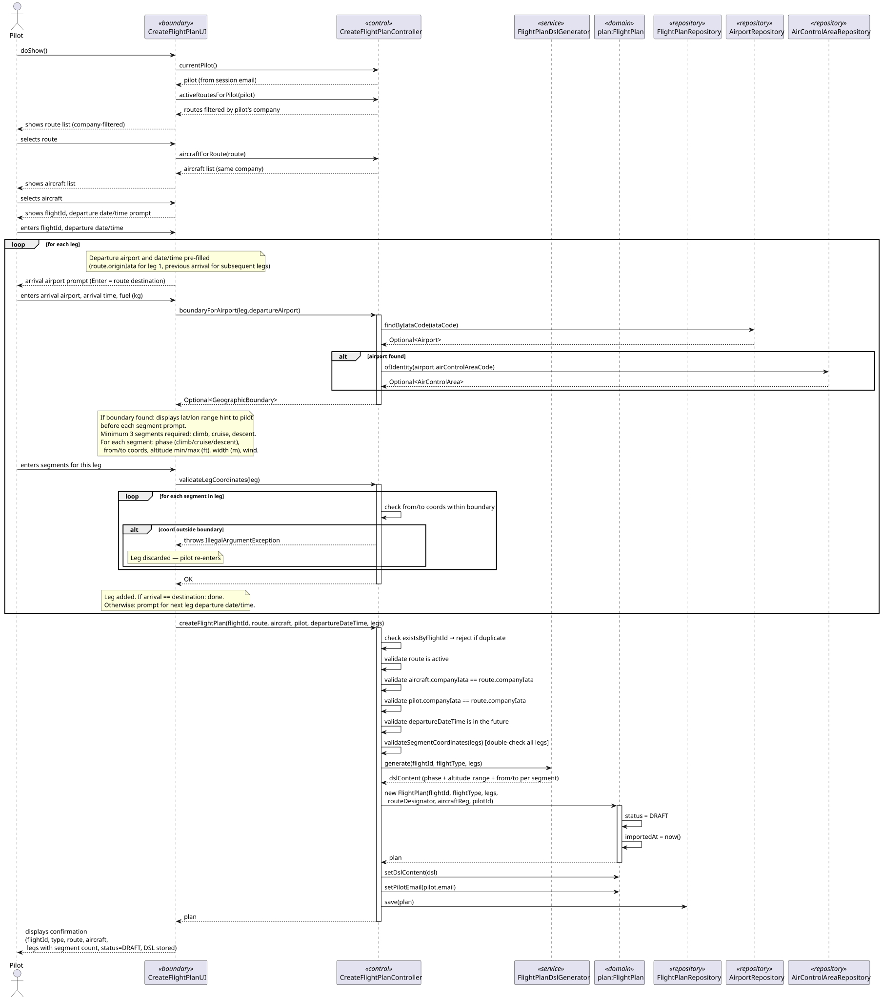

# US080 — Create a Flight Plan

## 1. Context

This User Story is being developed for the first time in Sprint 3. It introduces the ability for a Pilot to manually create a flight plan for a route within the system.

A flight plan follows a multi-step validation lifecycle: it starts as `DRAFT` when created, becomes `TESTED` after validation (US085), and is finally `APPROVED`. This US covers the creation step only.

This US depends on US073 (Create a Flight Route) since a flight plan must be associated with an existing route, and on US075 (Add a Pilot) since the pilot assigned must belong to the route's company.

### 1.1 List of Issues

Analysis: Understand what constitutes a valid flight plan; identify mandatory fields (route, aircraft, departure date/time, fuel quantity, pilot); understand the status lifecycle.

Design: Design the `CreateFlightPlanController`, `FlightPlan` aggregate and `FlightPlanRepository`; define the relationship between flight plan, route, aircraft and pilot.

Implement: Implement the controller, UI, domain entity and repository.

Test: Test valid flight plan creation; test invalid field formats; test that pilot must belong to route's company.

---

## 2. Requirements

**US080** As a Pilot, I want to register a flight plan for a route. I must add the aircraft, departure date/time, fuel quantity and pilot. The pilot must be of the route's company. Flight plan status is set to "draft" when created and must undergo a multi-step validation process.

**Acceptance Criteria:**

- US080.1 — The pilot must select an existing route for the flight plan.
- US080.2 — The aircraft must be registered in the route's company fleet.
- US080.3 — The pilot assigned must belong to the route's company.
- US080.4 — The departure date and time must be valid future values.
- US080.5 — The fuel quantity must be strictly positive.
- US080.6 — The flight plan status is set to `DRAFT` upon creation.
- US080.7 — A flight plan must have at least one leg.

**Dependencies/References:**

- Depends on **US073** (Create a Flight Route) — a flight plan must be associated with an existing route.
- Depends on **US075** (Add a Pilot) — the assigned pilot must exist in the system.
- Depends on **US070** (Add Aircraft to Fleet) — the aircraft must exist in the company's fleet.
- Extended by **US081** (Create Flight Plan from File) — alternative creation method.
- Extended by **US082** (Insert Weather Data) — weather data may be added to the plan.
- Extended by **US085** (Test/Validate Flight Plan) — the plan undergoes validation after creation.
- Referenced in the specification, section 3.4.

---

## 3. Analysis

### 3.1 Domain Understanding

A **FlightPlan** in the AISafe system represents a planned flight for a given route. Based on the specification (section 3.4), a flight plan must include:

- A **route** (origin and destination airports)
- An **aircraft** (registered in the company's fleet)
- A **pilot** (belonging to the route's company)
- A **departure date and time**
- A **fuel quantity**
- A **status** — lifecycle: `DRAFT` → `TESTED` → `APPROVED`

The status progression ensures the plan is validated before it can be used in simulation.

### 3.2 Flight Plan Lifecycle

```
Creation (US080 / US081)
        │
        ▼
    [DRAFT]
        │
        ▼
Test/Validate (US085)
        │
        ▼
    [TESTED]
        │
        ▼
  (Future approval US)
        │
        ▼
   [APPROVED]
```

### 3.3 Domain Model (relevant excerpt)


---

## 4. Design

### 4.1. Design Decisions

- **Aggregate Root**: `FlightPlan` is the aggregate root identified by a generated `Long` id. The flight ID (e.g. `TP001`) is a business identifier stored as a unique string column.
- **Status as Enum**: `FlightPlanStatus` (`DRAFT`, `TESTED`, `APPROVED`) is stored as a JPA `@Enumerated(EnumType.STRING)` to be readable in the database.
- **Legs as child entities**: `FlightLeg` entities are owned by `FlightPlan` via `@OneToMany(cascade = CascadeType.ALL)`. They are created together with the plan.
- **Validation at controller level**: Business rules (pilot belongs to company, aircraft belongs to company, date in future) are enforced in `CreateFlightPlanController` before the aggregate is created.

### 4.2. Class Diagram (CD)


### 4.3. Sequence Diagram (SD)



### 4.4 Acceptance Tests

**Test 1:** Verifies that a flight plan is created with DRAFT status.

**Refers to Acceptance Criteria:** US080.6

```java
@Test
void ensureFlightPlanIsCreatedAsDraft() {
    // Arrange
    final List<FlightLeg> legs = List.of(
            new FlightLeg("OPO", "2028-06-01", "08:00", "LIS", "09:00", 5000.0, "kg"));
    // Act
    final FlightPlan plan = new FlightPlan("TP001", "regular", legs);
    // Assert
    assertEquals(FlightPlanStatus.DRAFT, plan.status());
}
```

**Test 2:** Verifies that a flight plan requires at least one leg.

**Refers to Acceptance Criteria:** US080.7

```java
@Test
void ensureFlightPlanRequiresAtLeastOneLeg() {
    assertThrows(IllegalArgumentException.class, () ->
            new FlightPlan("TP001", "regular", List.of()));
}
```

**Test 3:** Verifies that fuel quantity must be positive.

**Refers to Acceptance Criteria:** US080.5

```java
@Test
void ensureFlightLegRejectNegativeFuel() {
    assertThrows(IllegalArgumentException.class, () ->
            new FlightLeg("OPO", "2028-06-01", "08:00", "LIS", "09:00", -100.0, "kg"));
}
```

**Test 4:** Verifies that flight ID must not be blank.

**Refers to Acceptance Criteria:** US080.1

```java
@Test
void ensureFlightPlanRejectsBlankId() {
    final List<FlightLeg> legs = List.of(
            new FlightLeg("OPO", "2028-06-01", "08:00", "LIS", "09:00", 5000.0, "kg"));
    assertThrows(IllegalArgumentException.class, () ->
            new FlightPlan("", "regular", legs));
}
```

---

## 5. Implementation

**`domain/FlightPlan.java` — Aggregate Root**
- Constructor: `FlightPlan(flightId, flightType, legs)`.
- Enforces: flightId not blank, flightType not blank, legs not null and not empty.
- `status` set to `FlightPlanStatus.DRAFT` on creation.
- `importedAt` set to `LocalDateTime.now()` on creation.

**`domain/FlightLeg.java` — Entity**
- Constructor validates all fields: airports not blank, fuel > 0, unit not blank.
- Stored as child entity with `@GeneratedValue` id.

**`domain/FlightPlanStatus.java` — Enum**
- Three states: `DRAFT`, `TESTED`, `APPROVED`.

**`controller/CreateFlightPlanController.java`**
- Validates route, aircraft and pilot belong to the same company.
- Creates `FlightPlan` aggregate and saves via `FlightPlanRepository`.

**Persistence**
- `FLIGHT_PLAN` table — flight plan data.
- `FLIGHT_LEG` table — leg data with foreign key to flight plan.
- H2 file-based database with `hbm2ddl.auto=update`.

---

## 6. Integration/Demonstration

**Create Flight Plan demonstration (US080):**
1. Login as Pilot → choose `1. Create Flight Plan`.
2. Select an existing route (e.g. OPO → LIS).
3. Select an aircraft from the company's fleet.
4. Enter departure date/time, fuel quantity.
5. The system confirms creation: Flight ID, type, legs, status `DRAFT`.
6. Attempt to create a plan with no legs → rejected.
7. Attempt to assign a pilot from a different company → rejected.

---

## 7. Observations

- The `FlightPlan` domain class is shared between manual creation (US080) and file import (US081) — both produce the same aggregate.
- The status lifecycle (`DRAFT` → `TESTED` → `APPROVED`) is intentionally simple in this sprint; future sprints may add more states or transitions.
- Weather data integration (US082) and plan testing (US085) are separate US that extend this one.
