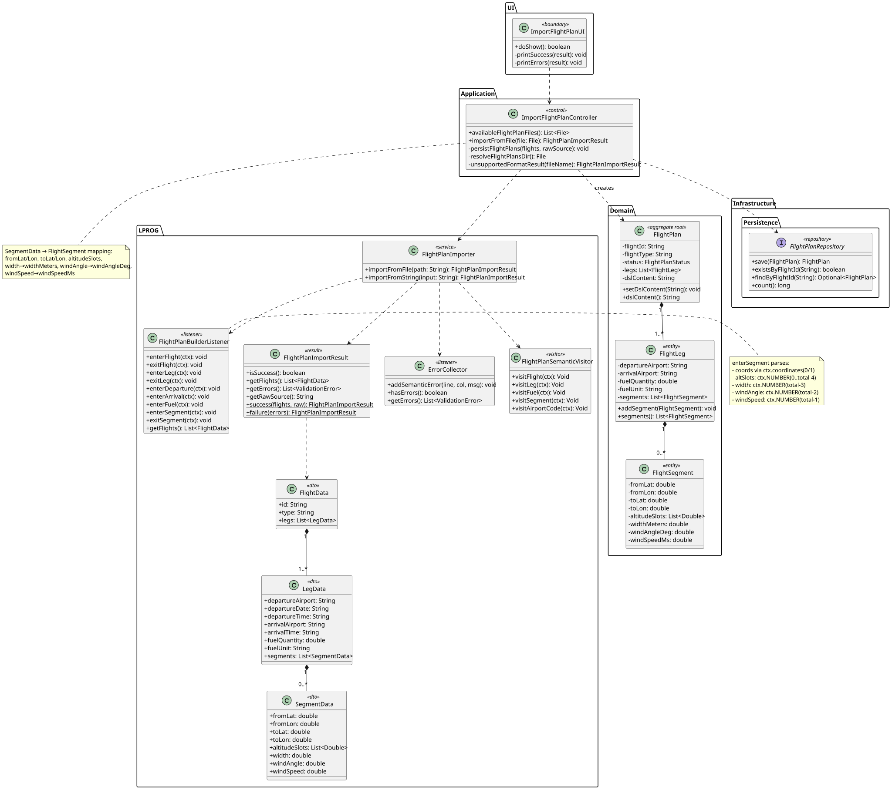
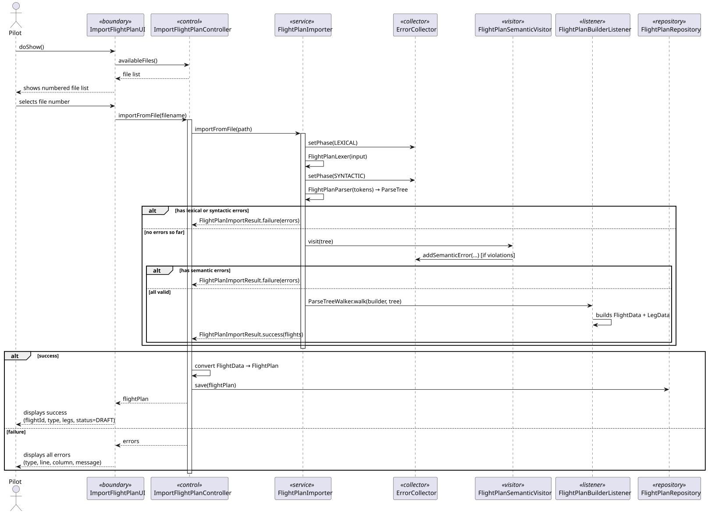

# US081 — Create a Flight Plan from a File

## 1. Context

This User Story is being developed for the first time in Sprint 3 (EAPLI side). The LPROG implementation of the DSL parser was completed in Sprint 2 (US081/US083 LPROG). This Sprint 3 EAPLI version integrates that parser into the backoffice system, allowing a Pilot to select a `.fp` file and have its contents imported as a `FlightPlan` domain object.

This US reuses the full ANTLR-based validation pipeline from Sprint 2: lexical analysis → syntactic analysis → semantic validation → domain object construction.

### 1.1 List of Issues

Analysis: Understand how the LPROG `FlightPlanImporter` connects to the EAPLI domain model; identify how `FlightData` maps to `FlightPlan` and `LegData` maps to `FlightLeg`.

Design: Design the `ImportFlightPlanController` that orchestrates the LPROG importer and persists the result; design the UI for file selection and error display.

Implement: Implement the controller and UI; connect `FlightPlanImporter` output to the `FlightPlanRepository`.

Test: Test valid file import; test that invalid files are rejected with meaningful errors; test all three error types (lexical, syntactic, semantic).

---

## 2. Requirements

**US081** As a Pilot, I want to create a flight plan from a file.

> There may be multiple file formats, and I want to validate the file format before using it.

**Acceptance Criteria:**

- US081.1 — The flight plan file must conform to the Core Flight DSL.
- US081.2 — The file must be validated through **lexical**, **syntactic** and **semantic** analysis before being accepted.
- US081.3 — Invalid files must produce **meaningful error messages**, including the type of error and the line and column where it occurred.
- US081.4 — Only valid flight plans may be imported and used by the system.
- US081.5 — The system must use **at least one ANTLR visitor and one ANTLR listener** in the processing pipeline.

**Dependencies/References:**

- Depends on **US083/US120** (LPROG) — defines the Core Flight DSL grammar and the ANTLR pipeline.
- Depends on **US080** — the imported flight plan follows the same domain model (`FlightPlan`, `FlightLeg`) as manually created plans.
- Referenced in the specification, sections 3.4.1 – 3.4.5.

---

## 3. Analysis

### 3.1 Core Flight DSL — Structure

A `.fp` file is hierarchical and block-based. Top-level structure:

```
flight <ID> {
    type: <regular | charter>

    leg {
        departure: <AIRPORT_CODE> <DATE> <TIME>
        arrival:   <AIRPORT_CODE> <TIME>
        fuel:      <QUANTITY> <UNIT>

        segment {
            from: (<lat>, <lon>)
            to:   (<lat>, <lon>)
            altitude_slots: [<alt1>, <alt2>, ...]
            width: <value> m
            wind:  <angle> deg <speed> m/s
        }
    }
}
```

### 3.2 Validation Pipeline (LPROG → EAPLI)

```
.fp file
    │
    ▼
FlightPlanImporter (LPROG)
    ├── Step 1: Lexical   (FlightPlanLexer)
    ├── Step 2: Syntactic (FlightPlanParser)
    ├── Step 3: Semantic  (FlightPlanSemanticVisitor)
    └── Step 4: Build     (FlightPlanBuilderListener)
    │
    ▼
FlightData / LegData (LPROG intermediate objects)
    │
    ▼
ImportFlightPlanController (EAPLI)
    └── converts to FlightPlan + FlightLeg domain objects
    └── saves via FlightPlanRepository
```

### 3.3 Semantic Validation Rules

| Rule | Where enforced |
|---|---|
| Flight ID must be unique in the file | `FlightPlanSemanticVisitor.visitFlight()` |
| Arrival airport of leg N = departure of leg N+1 | `FlightPlanSemanticVisitor.visitLeg()` |
| Arrival time of leg N must precede departure of leg N+1 | `FlightPlanSemanticVisitor.visitLeg()` |
| Fuel quantity must be > 0 | `FlightPlanSemanticVisitor.visitFuel()` |
| Segment start ≠ end coordinates | `FlightPlanSemanticVisitor.visitSegment()` |
| Airport code: IATA (3 letters) or ICAO (4 letters) | `FlightPlanSemanticVisitor.visitAirportCode()` |

---

## 4. Design

### 4.1. Design Decisions

- **Reuse of LPROG pipeline**: `FlightPlanImporter` is the single entry point — no ANTLR classes are directly used in the EAPLI layer.
- **ErrorCollector**: accumulates all errors from all three phases; no early exit on first error — the pilot sees all problems at once.
- **Conversion**: `FlightData` → `FlightPlan`, `LegData` → `FlightLeg` is done in `ImportFlightPlanController`, keeping the LPROG and EAPLI layers decoupled.
- **File selection**: The UI lists available `.fp` files from a configured directory and lets the pilot select by number.

### 4.2. Class Diagram (CD)



### 4.3. Sequence Diagram (SD)



### 4.4 Acceptance Tests

**Test 1:** Verifies that a valid file is imported successfully.

**Refers to Acceptance Criteria:** US081.1, US081.4

```java
@Test
void ensureValidFileIsImportedSuccessfully() {
    // Arrange
    final FlightPlanImporter importer = new FlightPlanImporter();
    // Act
    final FlightPlanImportResult result =
            importer.importFromString(VALID_FLIGHT_PLAN_DSL);
    // Assert
    assertTrue(result.isSuccess());
    assertEquals(1, result.getFlights().size());
}
```

**Test 2:** Verifies that negative fuel is rejected with a semantic error.

**Refers to Acceptance Criteria:** US081.2, US081.3

```java
@Test
void ensureNegativeFuelProducesSemanticError() {
    // Arrange
    final FlightPlanImporter importer = new FlightPlanImporter();
    // Act
    final FlightPlanImportResult result =
            importer.importFromString(FLIGHT_PLAN_WITH_NEGATIVE_FUEL);
    // Assert
    assertFalse(result.isSuccess());
    assertTrue(result.getErrors().stream()
            .anyMatch(e -> e.getType() == ErrorCollector.ErrorType.SEMANTIC
                    && e.getMessage().contains("Fuel quantity")));
}
```

**Test 3:** Verifies that mismatched leg airports produce a semantic error.

**Refers to Acceptance Criteria:** US081.2, US081.3

```java
@Test
void ensureMismatchedLegAirportsProduceSemanticError() {
    // Arrange
    final FlightPlanImporter importer = new FlightPlanImporter();
    // Act
    final FlightPlanImportResult result =
            importer.importFromString(FLIGHT_PLAN_WITH_INVALID_LEG_SEQUENCE);
    // Assert
    assertFalse(result.isSuccess());
    assertTrue(result.getErrors().stream()
            .anyMatch(e -> e.getMessage().contains("does not match arrival airport")));
}
```

**Test 4:** Verifies that a syntactic error is detected.

**Refers to Acceptance Criteria:** US081.2, US081.3

```java
@Test
void ensureMissingBlockProducesSyntacticError() {
    // Arrange
    final FlightPlanImporter importer = new FlightPlanImporter();
    // Act
    final FlightPlanImportResult result =
            importer.importFromString(FLIGHT_PLAN_MISSING_LEG_BLOCK);
    // Assert
    assertFalse(result.isSuccess());
    assertTrue(result.getErrors().stream()
            .anyMatch(e -> e.getType() == ErrorCollector.ErrorType.SYNTACTIC));
}
```

---

## 5. Implementation

**`lprog/FlightPlanImporter.java`**
- `importFromFile(filePath)` — main pipeline for production use.
- `importFromString(input)` — pipeline for unit testing without filesystem.
- Returns `FlightPlanImportResult`: either `success(flights)` or `failure(errors)`.

**`lprog/FlightPlanSemanticVisitor.java`**
- Extends `FlightPlanBaseVisitor<Void>` (ANTLR generated).
- Overrides `visitFlight`, `visitLeg`, `visitFuel`, `visitSegment`, `visitAirportCode`.
- Calls `errorCollector.addSemanticError()` for each rule violation.

**`lprog/FlightPlanBuilderListener.java`**
- Extends `FlightPlanBaseListener` (ANTLR generated).
- Uses `enterFlight/exitFlight`, `enterLeg/exitLeg`, `enterDeparture`, `enterArrival`, `enterFuel`, `enterSegment` to build `FlightData` and `LegData`.

**`lprog/ErrorCollector.java`**
- Extends `BaseErrorListener` (ANTLR) to capture lexical and syntactic errors automatically.
- Exposes `addSemanticError()` for manual semantic error registration.
- Each error has: `ErrorType` (LEXICAL/SYNTACTIC/SEMANTIC), line, column, message.

**`controller/ImportFlightPlanController.java`** *(EAPLI)*
- Calls `FlightPlanImporter.importFromFile()`.
- On success: converts `FlightData` → `FlightPlan`, `LegData` → `FlightLeg`, saves to repository.
- On failure: returns error list to the UI for display.

**`ui/ImportFlightPlanUI.java`** *(EAPLI)*
- Lists available `.fp` files by number.
- Displays success summary or all errors with type/line/column.

---

## 6. Integration/Demonstration

**Valid file demonstration:**
1. Login as Pilot → choose `1. Import Flight Plan from File`.
2. Select `charter_flight.fp` → imported successfully, status `DRAFT`, leg shown.
3. Select `multi_leg_flight.fp` → 2 legs imported, OPO→LIS→FAO.

**Invalid file demonstration:**
1. Select `invalid_flight.fp` → 2 semantic errors shown: negative fuel + equal coordinates.
2. Select `invalid_leg_sequence.fp` → 1 semantic error: departure airport mismatch.
3. Flight plan is **not** created in either case.

---

## 7. Observations

- All semantic errors are collected before reporting — no fail-fast — so the pilot sees all problems at once (section 3.4.5: *"All semantic errors must be collected and reported in a single execution."*)
- Keywords in the DSL are **case-insensitive** (`flight`, `FLIGHT`, `Flight` are all valid).
- The `FlightPlanImporter` is the boundary between the LPROG and EAPLI layers — the EAPLI layer never directly uses ANTLR classes.
