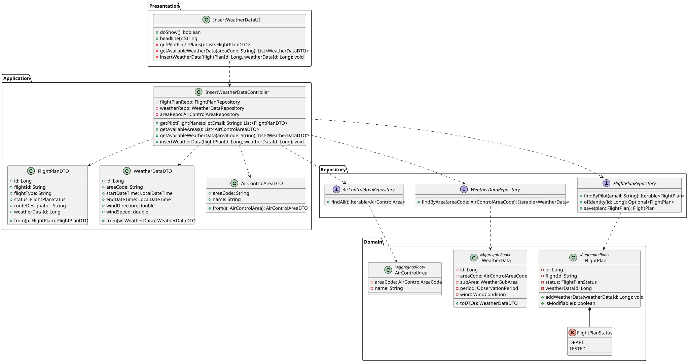

# US082 - Insert Weather Data in a Flight

## 1. Context

This User Story is being developed for the first time in Sprint 3. It allows a Pilot to add weather data to one of their flight plans. If the flight plan had been previously tested, that test is deemed void because the new weather data changes the conditions under which the test was valid.

This US depends on US030 (authentication and authorization), US080 (create a flight plan), and US041/US043 (register and consult weather data), as both a flight plan and weather data must already exist before they can be associated.

### 1.1 List of Issues

Analysis: Clarify what weather data is associated with a flight plan (per air control area or per segment); clarify what "test is deemed void" means — the flight plan status must revert; confirm who may perform this action (only the pilot who owns the flight plan).

Design: Define the class diagram covering all four layers; design the association between a flight plan and weather data; design the status reversion flow.

Implement: Implement `InsertWeatherDataController`; implement `addWeatherData()` on `FlightPlan`; implement the test-voiding logic — reset the flight plan's test status when weather data is updated.

Test: Verify that weather data can be added to a flight plan; verify that adding weather data voids a previous test result; verify that a pilot cannot add weather data to another pilot's flight plan.

---

## 2. Requirements

**US082** As a Pilot, I want to add weather data to one of my flight plans. If the flight plan has been previously tested, the test is deemed void because of the new weather data.

**Acceptance Criteria:**

- US082.1 — A pilot may only add weather data to their own flight plans.
- US082.2 — The weather data must already exist in the system (registered via US041 or US042).
- US082.3 — When weather data is added to a flight plan that has been previously tested, the test result is automatically voided.
- US082.4 — The flight plan must be in a state that allows modification (e.g., not yet approved or in flight).

**Dependencies/References:**

- **US030** — Authentication and authorization must be in place; only a logged-in Pilot may execute this US.
- **US041** — Weather data must have been previously registered in the system.
- **US042** — Weather data may also have been imported in bulk.
- **US043** — The pilot may consult available weather data before associating it with the flight plan.
- **US080** — A flight plan must already exist before weather data can be added to it.
- **US085** — Testing a flight plan uses the weather data associated with it; adding new weather data invalidates the previous test.
- **NFR09** — Authentication and authorization must be enforced.
- **NFR10** — Implementation language is Java.

---

## 3. Analysis

### 3.1 Domain Understanding

A **flight plan** describes how a flight takes place, including departure time, aircraft, fuel load, and route segments. Weather conditions affect the validity of the test — if the weather changes after a test has been run, the test result is no longer valid for the updated conditions.

Weather data in the system is registered per air control area and per date. Associating weather data with a flight plan means linking the relevant weather conditions to the flight's segments so they can be used in the flight test (US085).

### 3.2 Key Business Rules

- A pilot may only modify **their own** flight plans.
- The weather data must **already exist** in the system — this US does not create new weather data.
- If a flight plan has a test status of `TESTED`, adding weather data **reverts it to `DRAFT`** or `UNTESTED`, voiding the previous test result.
- Weather data is associated per air control area traversed by the flight — one weather entry per area.

### 3.3 Use-Case Diagram


---

## 4. Design

### 4.1 Design Decisions

- **Status reversion inside the aggregate**: The `addWeatherData()` method on `FlightPlan` is responsible for both associating the weather data and reverting the status if the plan was previously tested. This keeps the business rule inside the aggregate where it belongs.
- **Weather data referenced by value**: The flight plan stores a reference to the weather data identifier (area + date), not a direct object reference, keeping aggregate boundaries clean.
- **Ownership check in the controller**: The controller verifies that the flight plan belongs to the authenticated pilot before delegating to the aggregate.
- **Read from WeatherRepository**: The controller queries `WeatherDataRepository` to present available weather data for the pilot to select from.

### 4.2 Class Diagram (CD)



The diagram covers four layers:

**Presentation:** `InsertWeatherDataUI` — lists the pilot's flight plans, allows selection, presents available weather data, and displays the result.

**Application:** `InsertWeatherDataController` — retrieves the pilot's flight plans, retrieves available weather data, checks ownership, and delegates the association to the aggregate. Also contains `FlightPlanDTO` and `WeatherDataDTO`.

**Domain:** `FlightPlan <<AggregateRoot>>` — `addWeatherData(weatherDataId)` associates the weather data and voids any previous test result by reverting the status to `DRAFT`.

**Repository:** `FlightPlanRepository` and `WeatherDataRepository` interfaces — used to retrieve and persist the relevant aggregates.

### 4.3 Sequence Diagram (SD)


The high-level flow is:

1. Pilot requests to add weather data to a flight plan.
2. System lists the pilot's modifiable flight plans.
3. Pilot selects a flight plan.
4. System lists available weather data for the flight's air control areas.
5. Pilot selects the weather data to associate.
6. Controller verifies ownership and that the flight plan is in a modifiable state.
7. Controller calls `flightPlan.addWeatherData(weatherDataId)` on the aggregate.
8. The aggregate associates the weather data and voids any previous test result.
9. The updated flight plan is saved.
10. Success is reported to the pilot.

### 4.4 Acceptance Tests

**Test 1:** Weather data is successfully added to a flight plan.

**Refers to Acceptance Criteria:** US082.1, US082.2

```java
@Test
void ensureWeatherDataIsAddedToFlightPlan() {
    final FlightPlan plan = savedFlightPlan(pilot);
    plan.addWeatherData(weatherDataId);

    assertTrue(plan.weatherData().isPresent());
    assertEquals(weatherDataId, plan.weatherData().get());
}
```

**Test 2:** Adding weather data to a tested flight plan voids the test result.

**Refers to Acceptance Criteria:** US082.3

```java
@Test
void ensureAddingWeatherDataVoidsPreviousTestResult() {
    final FlightPlan plan = savedFlightPlan(pilot);
    plan.markAsTested(); // simulate a previous successful test

    assertEquals(FlightPlanStatus.TESTED, plan.status());

    plan.addWeatherData(weatherDataId);

    assertEquals(FlightPlanStatus.DRAFT, plan.status());
}
```

**Test 3:** A pilot cannot add weather data to another pilot's flight plan.

**Refers to Acceptance Criteria:** US082.1

```java
@Test
void ensurePilotCannotModifyAnotherPilotsFlightPlan() {
    final FlightPlan otherPilotPlan = savedFlightPlan(otherPilot);

    assertThrows(IllegalAccessException.class,
            () -> ctrl.insertWeatherData(otherPilotPlan.id(), weatherDataId));
}
```

---

## 5. Implementation

Key implementation notes:
- `InsertWeatherDataController.insertWeatherData()` calls `authz.ensureAuthenticatedUserHasAnyOf(BaseRoles.PILOT)` as its first statement.
- The ownership check compares the flight plan's assigned pilot with the authenticated user's email.
- `FlightPlan.addWeatherData()` first checks the current status — throws if the plan is in a non-modifiable state (e.g., `SUBMITTED` or `IN_FLIGHT`), then associates the weather data, and finally resets the status to `DRAFT` if it was `TESTED`.
- Weather data is retrieved from `WeatherDataRepository` and filtered to the air control areas relevant to the flight's route.

---

## 6. Integration/Demonstration

- Log in as a Pilot.
- Navigate to **Insert Weather Data in Flight**.
- Select one of your existing flight plans.
- Select the relevant weather data for the flight's area.
- Verify the weather data is now associated with the flight plan.
- If the flight plan was previously tested, verify the test status has been reset to Draft.
- Attempt to add weather data to another pilot's flight plan and verify the operation is rejected.

---

## 7. Observations

- The test voiding behaviour is intentional — weather conditions are a key input to the flight test, so any change to the weather data invalidates the previous result. The pilot must re-run the test after updating weather data.
- Weather data is associated per air control area. A flight that traverses multiple areas may need multiple weather data entries.
- US085 (Test/Validate Flight Plan) is the natural next step after this US — the pilot adds weather data and then runs the test with the updated conditions.