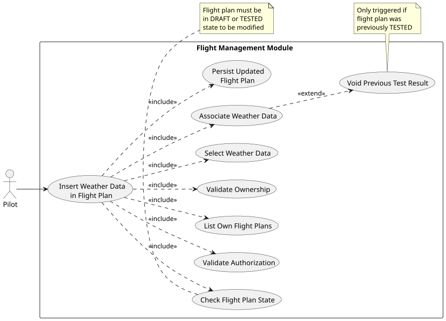
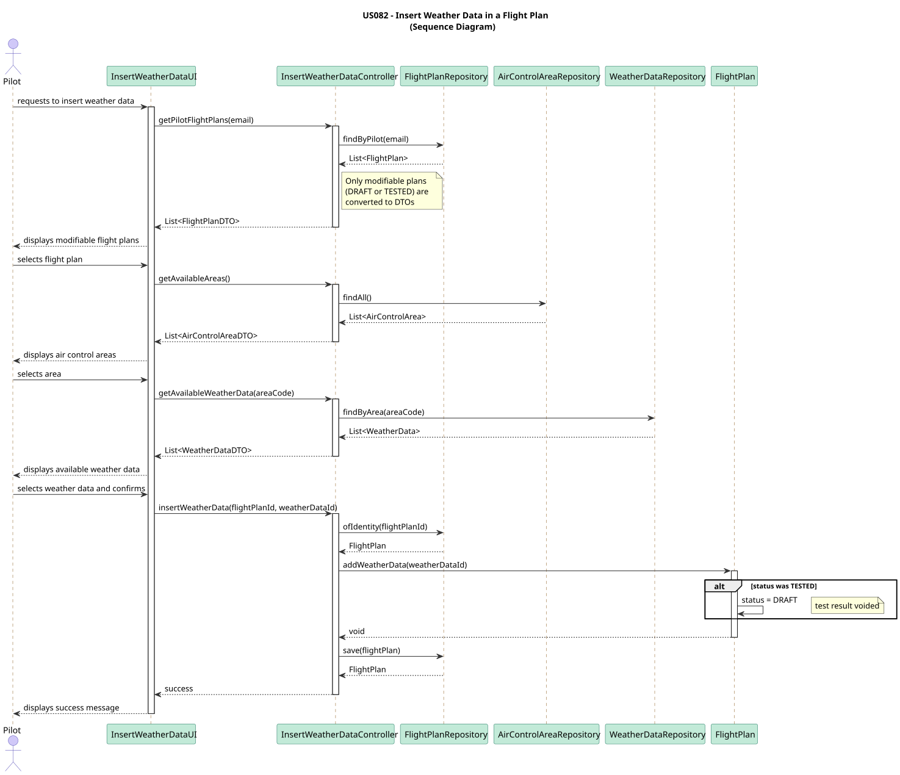

# US082 - Insert Weather Data in a Flight Plan

## 1. Context

This User Story is being developed for the first time in Sprint 3. It allows a Pilot to add weather data to one of their flight plans. If the flight plan had been previously tested, that test is deemed void because the new weather data changes the conditions under which the test was valid.

This US depends on US030 (authentication and authorization), US080 (create a flight plan), and US041/US043 (register and consult weather data), as both a flight plan and weather data must already exist before they can be associated.

### 1.1 List of Issues

Analysis: Clarify what weather data is associated with a flight plan; clarify what "test is deemed void" means — the flight plan status must revert to DRAFT; confirm that only modifiable plans (DRAFT or TESTED) can receive weather data.

Design: Define the class diagram covering all four layers; design the association between a flight plan and weather data; design the status reversion flow; decide how to present air control areas to the pilot.

Implement: Implement `InsertWeatherDataController`; implement `addWeatherData()` on `FlightPlan`; implement the test-voiding logic; add `AirControlAreaRepository.findAll()` to list areas for selection; filter only modifiable flight plans in the listing.

Test: Verify that weather data can be added to a modifiable flight plan; verify that adding weather data to a TESTED plan voids the test; verify that only modifiable plans are listed; verify that a non-existent plan is rejected.

---

## 2. Requirements

**US082** As a Pilot, I want to add weather data to one of my flight plans. If the flight plan has been previously tested, the test is deemed void because of the new weather data.

**Acceptance Criteria:**

- US082.1 — A pilot may only add weather data to their own flight plans.
- US082.2 — The weather data must already exist in the system (registered via US041 or US042).
- US082.3 — When weather data is added to a flight plan that has been previously tested, the test result is automatically voided.
- US082.4 — The flight plan must be in a modifiable state (DRAFT or TESTED) to accept weather data.

**Dependencies/References:**

- **US030** — Authentication and authorization must be in place; only a logged-in Pilot may execute this US.
- **US041** — Weather data must have been previously registered in the system.
- **US042** — Weather data may also have been imported in bulk.
- **US043** — The pilot may consult available weather data before associating it with the flight plan.
- **US080** — A flight plan must already exist before weather data can be added to it.
- **US085** — Testing a flight plan uses the weather data associated with it; adding new weather data invalidates the previous test.
- **NFR09** — Authentication and authorization must be enforced.
- **NFR10** — Implementation language is Java.

---

## 3. Analysis

### 3.1 Domain Understanding

A **flight plan** describes how a flight takes place, including departure time, aircraft, fuel load, and route segments. Weather conditions affect the validity of the test — if the weather data changes after a test has been run, the test result is no longer valid for the updated conditions.

Weather data in the system is registered per air control area. Associating weather data with a flight plan means linking the relevant weather conditions to the plan so they can be used in the flight test (US085).

### 3.2 Key Business Rules

- Only flight plans in **DRAFT** or **TESTED** state can receive weather data — the UI only displays modifiable plans.
- The weather data must **already exist** in the system — this US does not create new weather data.
- If a flight plan is in **TESTED** state, adding weather data reverts it to **DRAFT**, voiding the previous test result.
- If a flight plan is already in **DRAFT** state, the status remains DRAFT after adding weather data.
- Authentication is handled by the UI — the pilot's email is fetched from the session and passed to the controller.

### 3.3 Use-Case Diagram



---

## 4. Design

### 4.1 Design Decisions

- **Status reversion inside the aggregate**: `FlightPlan.addWeatherData()` is responsible for both associating the weather data and reverting the status if the plan was TESTED. This keeps the business rule inside the domain.
- **Only modifiable plans shown**: `getPilotFlightPlans()` filters for `isModifiable()` before converting to DTOs — the pilot never sees plans they cannot modify.
- **Areas listed via repository**: Instead of asking the pilot to type an area code, `getAvailableAreas()` lists all registered air control areas via `AirControlAreaRepository.findAll()`.
- **Authentication in the UI**: `AuthzRegistry` is called in the UI, not the controller. The controller receives the pilot's email as a parameter and is fully testable without a session.
- **DTOs returned to UI**: The controller converts domain objects to DTOs before returning them. The UI never handles domain objects directly.
- **No ownership check**: Since `getPilotFlightPlans(email)` scopes the listing to the pilot's own plans, and the UI only presents IDs from that list, a separate `isOwnedBy` check is not needed.

### 4.2 Class Diagram (CD)


The diagram covers four layers:

**Presentation:** `InsertWeatherDataUI` — gets the authenticated pilot's email from the session, calls the controller to list modifiable flight plans, lists available areas and weather data, prompts for confirmation, and displays the result.

**Application:** `InsertWeatherDataController` — lists modifiable flight plans for the pilot, lists air control areas, lists weather data for a given area, and delegates the association to the domain. Contains `FlightPlanDTO`, `WeatherDataDTO`, and `AirControlAreaDTO`.

**Domain:** `FlightPlan <<AggregateRoot>>` — `addWeatherData(weatherDataId)` stores the weather data id and voids any previous test by reverting status to DRAFT.

**Repository:** `FlightPlanRepository`, `WeatherDataRepository`, and `AirControlAreaRepository` — used to fetch flight plans, weather data, and areas respectively.

### 4.3 Sequence Diagram (SD)



The high-level flow is:

1. Pilot requests to insert weather data.
2. UI gets the email from the session and calls `getPilotFlightPlans(email)`.
3. Controller fetches plans from `FlightPlanRepository` and filters for modifiable ones.
4. Pilot selects a flight plan.
5. UI calls `getAvailableAreas()` — controller lists all air control areas.
6. Pilot selects an area.
7. UI calls `getAvailableWeatherData(areaCode)` — controller fetches weather data for that area.
8. Pilot selects weather data and confirms.
9. UI calls `insertWeatherData(flightPlanId, weatherDataId)`.
10. Controller loads the plan, checks `isModifiable()`, calls `addWeatherData()`, and saves.
11. Success is reported to the pilot.

### 4.4 Acceptance Tests

**Test 1:** Weather data is successfully associated with a modifiable flight plan.

**Refers to Acceptance Criteria:** US082.2, US082.4

```java
@Test
void ensureWeatherDataIsAssociatedSuccessfully() {
    when(flightPlanRepo.ofIdentity(1L)).thenReturn(Optional.of(plan));
    when(flightPlanRepo.save(any())).thenAnswer(i -> i.getArgument(0));

    ctrl.insertWeatherData(1L, 42L);

    assertEquals(42L, plan.weatherDataId());
    verify(flightPlanRepo).save(plan);
}
```

**Test 2:** Adding weather data to a TESTED plan voids the test result.

**Refers to Acceptance Criteria:** US082.3

```java
@Test
void ensureAddingWeatherDataToTestedPlanVoidsTest() {
    setStatus(plan, FlightPlanStatus.TESTED);
    when(flightPlanRepo.ofIdentity(1L)).thenReturn(Optional.of(plan));
    when(flightPlanRepo.save(any())).thenAnswer(i -> i.getArgument(0));

    ctrl.insertWeatherData(1L, 42L);

    assertEquals(FlightPlanStatus.DRAFT, plan.status());
}
```

**Test 3:** Only modifiable flight plans are returned in the listing.

**Refers to Acceptance Criteria:** US082.4

```java
@Test
void ensureTestedPlansAreIncluded() {
    setStatus(plan, FlightPlanStatus.TESTED);
    when(flightPlanRepo.findByPilot(PILOT_EMAIL)).thenReturn(List.of(plan));

    final List<FlightPlanDTO> result = ctrl.getPilotFlightPlans(PILOT_EMAIL);

    assertEquals(1, result.size());
}
```

---

## 5. Implementation

Key implementation notes:

- `InsertWeatherDataController` has no `AuthzRegistry` calls — the pilot's email is passed in by the UI.
- `getPilotFlightPlans(String pilotEmail)` calls `flightPlanRepo.findByPilot(email)` and filters with `p.isModifiable()` before converting to DTOs.
- `getAvailableAreas()` calls `areaRepo.findAll()` and converts to `AirControlAreaDTO`.
- `getAvailableWeatherData(String areaCode)` calls `weatherRepo.findByArea(new AirControlAreaCode(areaCode))` and converts using `WeatherDataDTO.from(wd)`.
- `insertWeatherData(Long flightPlanId, Long weatherDataId)` loads the plan, checks `isModifiable()`, calls `flightPlan.addWeatherData(weatherDataId)`, and saves.
- `FlightPlan.addWeatherData()` stores the `weatherDataId` and sets `status = DRAFT` if it was previously `TESTED`.
- `FlightPlan.isModifiable()` returns `true` for `DRAFT` and `TESTED` states only.
- `AirControlAreaRepository` was used to list all registered areas — no new methods were needed since `findAll()` was already defined.
- `FlightPlanRepository` was extended with `findByPilot(String pilotEmail)` and `existsAssignedFlightPlansForPilot(String pilotEmail)`.

---

## 6. Integration/Demonstration

- Log in as a Weather Person (`wtps@alsafe.com` / `1234`) and register weather data for area `LPPC` via US041.
- Log in as a Pilot (`pilot@alsafe.com` / `Pilot1234`) and create a flight plan via US080.
- Navigate to option **3 – Insert Weather Data in Flight Plan**.
- The system lists only modifiable flight plans — select one.
- The system lists all air control areas — select `LPPC`.
- The system lists available weather data for that area — select one and confirm.
- Verify the success message is displayed.
- To verify the link was created, check the `FLIGHT_PLAN` table in H2 and confirm `WEATHER_DATA_ID` is populated.

---

## 7. Observations

- The test voiding behaviour is intentional — weather conditions are a key input to the flight test, so any change to the weather data invalidates the previous result. The pilot must re-run the test after updating weather data.
- There is currently no UI that displays the `weatherDataId` field of a flight plan. Verification of the link must be done via the H2 database console or will become visible when US085 (Test/Validate Flight Plan) is implemented.
- US085 is the natural next step — the pilot adds weather data and then runs the test with the updated conditions.
- The area code entered to filter weather data does not need to match the flight plan's route — the pilot selects any area that has relevant weather data.