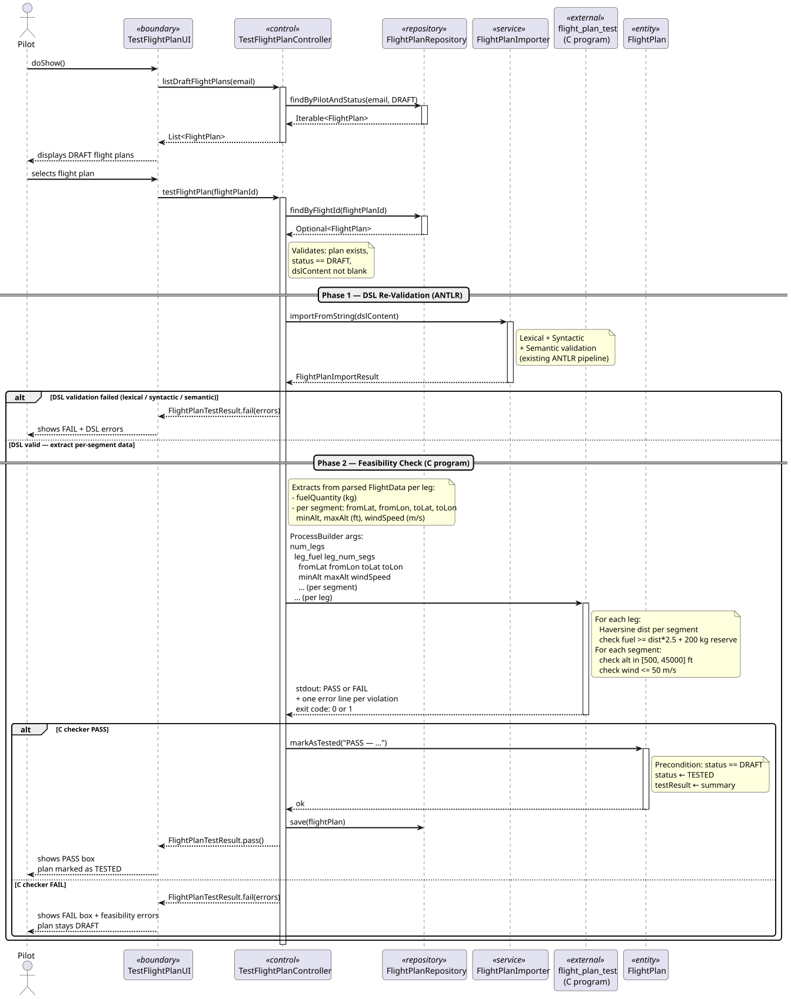

# US085 — Test/Validate Flight Plan

## 1. Context

This User Story is being developed for the first time in Sprint 3. It introduces the ability for a Pilot to test and validate a flight plan they have created or imported.

This US depends on **US080** (Create Flight Plan manually) and **US081** (Import Flight Plan from file) — both persist a `FlightPlan` entity with `dslContent` set and status `DRAFT`. US085 takes a `DRAFT` plan and transitions it to `TESTED` after a two-phase validation.

### 1.1 List of Issues

Analysis: Understand what "test/validate" means in this context — DSL re-validation plus feasibility check. Clarify the role of the C component.

Design: Design the two-phase validation flow; define the `TestFlightPlanController` and the C program interface.

Implement: Implement ANTLR re-validation + C feasibility checker + status transition.

Test: Test that invalid DSL produces FAIL; test that insufficient fuel produces FAIL; test that valid DSL + sufficient fuel produces PASS and marks the plan TESTED.

---

## 2. Requirements

**US085** As Pilot, I want to test/validate a flight I've made.

> Acceptance criteria:
> - The validation must include validation of the flight plan described using the DSL and its test.
> - The test component must be implemented in the C language.

*Client clarification:* "the flight simulations in US100 and others don't use a physical model... in US085 the simulation is completely different and may be implemented in either C or Java."

**Acceptance Criteria:**

- US085.1 — The Pilot must be able to select a DRAFT flight plan to test.
- US085.2 — The validation must include lexical, syntactic and semantic validation of the DSL content.
- US085.3 — The C feasibility checker must validate three constraints per flight plan: (1) declared fuel ≥ estimated consumption (Haversine distance × 2.5 kg/km + 200 kg reserve); (2) all altitude slots in [500 ft, 45 000 ft]; (3) wind speed ≤ 50 m/s per segment.
- US085.4 — The test component (feasibility check) must be implemented in C.
- US085.5 — On PASS, the flight plan status must transition from DRAFT to TESTED.
- US085.6 — On FAIL, the flight plan stays in DRAFT and the errors are reported to the Pilot.

**Dependencies/References:**

- Depends on **US080** (Create Flight Plan) and **US081** (Import Flight Plan) — both produce DRAFT plans with DSL content.
- Depends on **US121** (LPROG DSL) — the ANTLR grammar and parser used for DSL re-validation.
- Extended by future US (flight plan approval/submission).

---

## 3. Analysis

### 3.1 Domain Understanding

A `FlightPlan` in the system has a lifecycle: `DRAFT` → `TESTED` → `APPROVED`. US085 covers the DRAFT → TESTED transition.

A flight plan can only be tested if:
- It exists in the repository.
- Its status is `DRAFT`.
- It has non-empty DSL content (`dslContent` field).

### 3.2 Two-Phase Validation

**Phase 1 — DSL Re-validation (Java/ANTLR):**
Reuses the existing `FlightPlanImporter.importFromString()` pipeline:
- Lexical analysis (ANTLR lexer)
- Syntactic analysis (ANTLR parser)
- Semantic validation (unique flight IDs, leg sequence continuity, airport codes, fuel > 0, segment widths)

If Phase 1 fails → FAIL immediately, no C program is called.

**Phase 2 — Feasibility Check (C program):**
The Java controller passes per-segment geodetic data to the C program `flight_plan_test` via command-line arguments:

```
flight_plan_test <num_legs>
    <leg_fuel> <leg_num_segs>
        <fromLat> <fromLon> <toLat> <toLon> <minAlt> <maxAlt> <windSpeed>
        ... (one set of 7 values per segment)
    ... (repeated per leg)
```

The C program performs three checks per flight plan:

1. **Fuel sufficiency** — calculates the Haversine distance per segment, sums per leg, and checks: `fuel ≥ total_dist_km × 2.5 kg/km + 200 kg reserve`.
2. **Altitude range** — all altitude slots must be in [500 ft, 45 000 ft].
3. **Wind safety** — wind speed must be ≤ 50 m/s per segment.

If any check fails → FAIL with one error line per violation.

**Result:** Only if both phases pass does the plan transition to TESTED.

---

## 4. Design

### 4.1 Design Decisions

- **Reuse existing ANTLR pipeline** for Phase 1 — avoids code duplication with US081.
- **C program via ProcessBuilder** — the Java controller extracts per-segment data from the parsed `FlightData` (fuel, segment count, coordinates, altitude slots, wind speed) and passes it as command-line arguments to `flight_plan_test`. Non-blocking from the user's perspective.
- **Haversine fuel model** — the C checker calculates the real geodetic distance between segment waypoints (using the Haversine formula) and verifies `fuel ≥ distance × 2.5 kg/km + 200 kg reserve` per leg. This is more realistic than a flat per-segment constant while still avoiding a full physics engine.
- **Altitude and wind checks** — the C checker also rejects plans where altitude slots fall outside [500, 45 000] ft or wind speed exceeds 50 m/s per segment. These pass the ANTLR semantic validator (which only checks fuel > 0 and width > 0) but represent operationally unsafe conditions.
- **Status transition in domain** — `FlightPlan.markAsTested()` enforces the precondition (must be DRAFT) and transitions to TESTED. The controller does not change the status directly.
- **FAIL does not modify the plan** — if either phase fails, the plan stays DRAFT and is not saved.

### 4.2 Class Diagram (CD)


### 4.3 Sequence Diagram (SD)



### 4.4 Acceptance Tests

**Test 1:** Non-existent flight plan throws exception.

**Refers to Acceptance Criteria:** US085.1

```java
@Test
void ensureNonExistentPlanThrows() {
    when(repo.findByFlightId("MISSING")).thenReturn(Optional.empty());
    assertThrows(IllegalArgumentException.class,
            () -> ctrl.testFlightPlan("MISSING"));
}
```

**Test 2:** Invalid DSL returns FAIL without calling C checker.

**Refers to Acceptance Criteria:** US085.2

```java
@Test
void ensureInvalidDslReturnsFail() throws Exception {
    planWithDsl("F003", INVALID_DSL);
    final FlightPlanTestResult result = ctrl.testFlightPlan("F003");
    assertFalse(result.isPassed());
    assertFalse(result.errors().isEmpty());
    verify(repo, never()).save(any());
}
```

**Test 3:** Valid DSL + C checker PASS → plan marked TESTED.

**Refers to Acceptance Criteria:** US085.2, US085.3, US085.5

```java
@Test
void ensureValidDslAndPassCheckerMarksTested() throws Exception {
    final FlightPlan plan = planWithDsl("F001", VALID_DSL);
    final FlightPlanTestResult result = ctrl.testFlightPlan("F001");
    assertTrue(result.isPassed());
    assertEquals(FlightPlanStatus.TESTED, plan.status());
    verify(repo, times(1)).save(plan);
}
```

**Test 4:** Valid DSL + C checker FAIL → plan stays DRAFT.

**Refers to Acceptance Criteria:** US085.3, US085.6

```java
@Test
void ensureValidDslButFailCheckerReturnsFail() throws Exception {
    planWithDsl("F002", LOW_FUEL_DSL);
    final FlightPlanTestResult result = ctrl.testFlightPlan("F002");
    assertFalse(result.isPassed());
    assertEquals(FlightPlanStatus.DRAFT, plan.status());
    verify(repo, never()).save(any());
}
```

---

## 5. Implementation

**`Scomp/src/flight_plan_test.c`** — C feasibility checker

Receives per-leg and per-segment data as command-line arguments:
```
flight_plan_test <num_legs>
    <leg_fuel> <leg_num_segs>
        <fromLat> <fromLon> <toLat> <toLon> <minAlt> <maxAlt> <windSpeed>
        ...
    ...
```
Performs three checks: (1) fuel ≥ Haversine distance × 2.5 + 200 reserve, (2) altitudes in [500, 45 000] ft, (3) wind ≤ 50 m/s. Outputs `PASS` (exit 0) or `FAIL\n<one error per violation>` (exit 1). Compiled with `gcc src/flight_plan_test.c -o bin/flight_plan_test -lm`.

**`lprog/FlightPlanTestResult.java`** — Value object
- Factory methods: `pass()`, `fail(List<String> errors)`
- `isPassed()`, `errors()`, `summary()`

**`lprog/FlightPlan.java`** — Updated entity
- New field: `testResult` (LOB column) — stores last test result summary.
- New method: `markAsTested(String summary)` — enforces DRAFT precondition, sets status = TESTED.

**`repositories/FlightPlanRepository.java`** — Updated interface
- New method: `findByPilotAndStatus(String pilotEmail, FlightPlanStatus status)`

**`controller/TestFlightPlanController.java`**
- `listDraftFlightPlans(pilotEmail)` — returns DRAFT plans for the pilot.
- `testFlightPlan(flightPlanId)` — two-phase validation, updates status on PASS.
- `runFeasibilityCheck(flights)` — extracts per-segment data from parsed `FlightData` (fuel, coordinates, altitude slots min/max, wind speed) and spawns `flight_plan_test` via `ProcessBuilder` with the full argument list.

**`ui/TestFlightPlanUI.java`**
- Lists DRAFT plans, lets pilot select one.
- Shows result box: PASS ✓ or FAIL ✗ with error list.

**`MainMenu.java`** — Updated PILOT menu
- Added option `4. Test/Validate Flight Plan` → `TestFlightPlanUI`.

---

## 6. Integration/Demonstration

1. Login as Pilot (`pilot@tap.pt`).
2. Create or import a flight plan (US080/US081) → status: DRAFT.
3. Select `4. Test/Validate Flight Plan`.
4. Select the DRAFT plan.
5. System runs DSL validation + C checker.

**PASS scenario:**
```
╔══════════════════════════════════════════╗
║  Result : PASS ✓                         ║
║  Flight plan is valid and feasible.      ║
╚══════════════════════════════════════════╝
Flight plan 'F001' marked as TESTED.
```

**FAIL scenario (insufficient fuel — LIS→FRA, 500 kg declared, ~4884 kg required):**
```
╔══════════════════════════════════════════╗
║  Result : FAIL ✗                         ║
╠══════════════════════════════════════════╣
║  • Leg 1: declared fuel 500.0 kg is be...║
╚══════════════════════════════════════════╝
```

**FAIL scenario (dangerous wind — 75 m/s > 50 m/s limit):**
```
╔══════════════════════════════════════════╗
║  Result : FAIL ✗                         ║
╠══════════════════════════════════════════╣
║  • Leg 1, Seg 1: wind speed 75.0 m/s e...║
╚══════════════════════════════════════════╝
```

**FAIL scenario (unsafe altitude — 200–300 ft below 500 ft minimum):**
```
╔══════════════════════════════════════════╗
║  Result : FAIL ✗                         ║
╠══════════════════════════════════════════╣
║  • Leg 1, Seg 1: minimum altitude 200 ...║
╚══════════════════════════════════════════╝
```

---

## 7. Observations

- The C program (`flight_plan_test`) is separate from the SCOMP simulator (US100–US109). It has no shared memory, semaphores or pipes — it is a simple standalone checker compiled with `gcc -lm`.
- The client clarified that US085 does not require a physical flight simulation. The Haversine + altitude + wind checks are operationally meaningful without being a full physics engine.
- If the C binary is not compiled, the Java controller throws `IOException` and the UI shows a helpful message: `cd Scomp && gcc src/flight_plan_test.c -o bin/flight_plan_test -lm`.
- The `.fp` test files in `exemplo.core/flightplans/` include four scenarios that pass DSL validation but fail the C checker (`fail_low_fuel.fp`, `fail_high_wind.fp`, `fail_low_altitude.fp`) and one that passes both phases (`valid_lis_mad.fp`).
