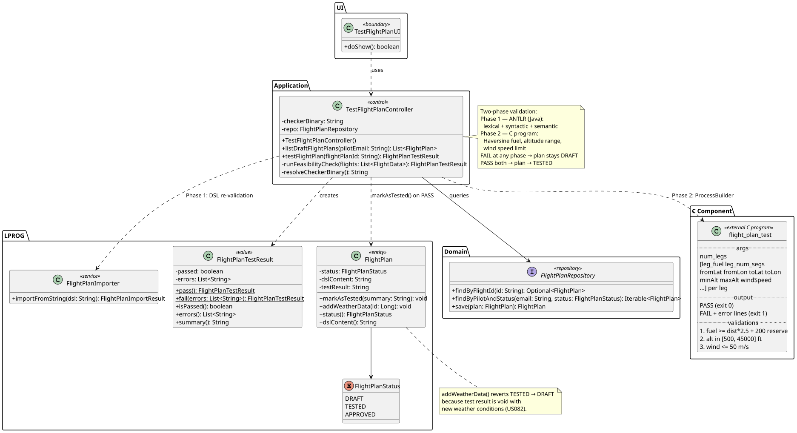

# US085 — Test/Validate Flight Plan

## 1. Context

This User Story is being developed for the first time in Sprint 3. It introduces the ability for a Pilot to test and validate a flight plan they have created or imported.

This US depends on **US080** (Create Flight Plan manually) and **US081** (Import Flight Plan from file) — both persist a `FlightPlan` entity with `dslContent` set and status `DRAFT`. US085 takes a `DRAFT` plan and transitions it to `TESTED` after a two-phase validation.

### 1.1 List of Issues

Analysis: Understand what "test/validate" means in this context — DSL re-validation plus feasibility check. Clarify the role of the C component.

Design: Design the two-phase validation flow; define the `TestFlightPlanController` and the C program interface; integrate aircraft model characteristics.

Implement: Implement ANTLR re-validation + C feasibility checker + status transition + post-test statistics.

Test: Test that invalid DSL produces FAIL; test that insufficient fuel produces FAIL; test that valid DSL + sufficient fuel produces PASS and marks the plan TESTED.

---

## 2. Requirements

**US085** As Pilot, I want to test/validate a flight I've made.

> Acceptance criteria:
> - The validation must include validation of the flight plan described using the DSL and its test.
> - The test component must be implemented in the C language.

*Client clarification:* "the flight simulations in US100 and others don't use a physical model... in US085 the simulation is completely different and may be implemented in either C or Java." Wind validation is **not** required.

**Acceptance Criteria:**

- US085.1 — The Pilot must be able to select a DRAFT flight plan to test.
- US085.2 — The validation must include lexical, syntactic and semantic validation of the DSL content, including phase sequence (climb→cruise→descent) and minimum 3 segments per leg.
- US085.3 — The C feasibility checker must validate: (1) total declared fuel ≤ aircraft's `maxFuelCapacity`; (2) declared fuel per leg ≥ estimated consumption (Haversine distance × 2.5 kg/km + 200 kg reserve); (3) all segment `altitudeMax` ≤ aircraft's `serviceCeiling`.
- US085.4 — The test component (feasibility check) must be implemented in C.
- US085.5 — On PASS, the flight plan status must transition from DRAFT to TESTED and flight statistics are shown (total distance, estimated flight duration, fuel burn, remaining fuel).
- US085.6 — On FAIL, the flight plan stays in DRAFT and the errors are reported to the Pilot.

**Dependencies/References:**

- Depends on **US080** (Create Flight Plan) and **US081** (Import Flight Plan) — both produce DRAFT plans with DSL content.
- Depends on **US121** (LPROG DSL) — the ANTLR grammar and parser used for DSL re-validation.
- Extended by future US (flight plan approval/submission).

---

## 3. Analysis

### 3.1 Domain Understanding

A `FlightPlan` in the system has a lifecycle: `DRAFT` → `TESTED` → `APPROVED`. US085 covers the DRAFT → TESTED transition.

A flight plan can only be tested if:
- It exists in the repository.
- Its status is `DRAFT`.
- It has non-empty DSL content (`dslContent` field).

### 3.2 Two-Phase Validation

**Phase 1 — DSL Re-validation (Java/ANTLR):**
Reuses the existing `FlightPlanImporter.importFromString()` pipeline:
- Lexical analysis (ANTLR lexer)
- Syntactic analysis (ANTLR parser)
- Semantic validation: unique flight IDs, leg sequence continuity, airport codes, fuel > 0, segment widths, phase sequence (climb→cruise→descent), ≥ 3 segments per leg, altitude range validity

If Phase 1 fails → FAIL immediately, no C program is called.

**Phase 2 — Feasibility Check (C program):**
The Java controller resolves the aircraft's `FlightCharacteristics` (via `AircraftRepository` → `AircraftModelRepository`) and passes real model parameters to the C checker. If no aircraft is assigned, generous defaults are used (maxFuelCapacity = 999 999 kg, serviceCeiling = 45 000 ft, cruiseSpeed = 800 km/h).

If weather data is associated with the plan (via US082), the wind angle and wind speed of each segment whose midpoint falls within the weather sub-area and whose altitude range overlaps are overridden before calling the C checker.

```
flight_plan_test <num_legs> <maxFuelCapacity> <serviceCeiling(ft)> <cruiseSpeedKmh>
    <leg_fuel> <leg_num_segs>
        <fromLat> <fromLon> <toLat> <toLon> <minAlt(ft)> <maxAlt(ft)> <windAngle> <windSpeed> <phase>
        ... (one set of 9 values per segment)
    ... (repeated per leg)
```

The C program performs three checks:

1. **Fuel capacity** — total declared fuel across all legs ≤ `maxFuelCapacity`.
2. **Fuel sufficiency** — declared fuel per leg ≥ Haversine distance × 2.5 kg/km + 200 kg reserve.
3. **Service ceiling** — all segment `altitudeMax` ≤ `serviceCeiling` (both in feet).

**Output on success:**
```
PASS <totalDistKm> <totalFuelKg> <fuelBurnKg>
```

**Output on failure:**
```
FAIL
<one error line per violation>
```

**Post-test statistics (on PASS):**
The Java layer parses the PASS output and computes:
- Total distance (km)
- Estimated flight duration (`totalDistKm / cruiseSpeedKmh`, formatted as `Xh Yymin`)
- Declared fuel (kg)
- Estimated fuel burn (kg)
- Remaining fuel = declared − burn (kg)

---

## 4. Design

### 4.1 Design Decisions

- **Reuse existing ANTLR pipeline** for Phase 1 — avoids code duplication with US081.
- **C program via ProcessBuilder** — the Java controller passes 4 global args (`num_legs`, `maxFuelCapacity`, `serviceCeiling` in feet, `cruiseSpeedKmh`) plus per-leg and per-segment data (9 values per segment: coords, altitudes, windAngle, windSpeed, phase). stderr is merged with stdout.
- **Aircraft characteristics lookup** — `resolveCharacteristics(plan)` uses `AircraftRepository` and `AircraftModelRepository` to find the real `maxFuelCapacity`, `serviceCeiling` (stored in metres, converted to feet for the C checker), and `cruiseSpeed`. Falls back to safe defaults if no aircraft is assigned or repositories are unavailable (test mode).
- **Weather data integration** — `resolveWeatherData(plan)` fetches the `WeatherData` linked to the plan via US082. `applyWeatherToSegments(legs, weather)` overrides segment wind values (windAngle, windSpeed) for segments whose midpoint is inside the weather sub-area and whose altitude range overlaps.
- **Haversine fuel model** — the C checker calculates geodetic distance per segment (Haversine) and verifies fuel sufficiency with a 200 kg reserve.
- **No wind validation** — removed per professor clarification.
- **Pilot isolation** — `listDraftFlightPlans(pilotEmail)` only returns DRAFT plans belonging to the authenticated pilot, so plans imported by other pilots are never shown.
- **Status transition in domain** — `FlightPlan.markAsTested(summary)` enforces the precondition (must be DRAFT) and transitions to TESTED. The controller does not change the status directly.
- **FAIL does not modify the plan** — if either phase fails, the plan stays DRAFT and is not saved.
- **Flight statistics** — on PASS, `FlightPlanTestResult.pass(dist, fuel, burn, cruiseSpeedKmh)` computes `estimatedDuration` (formatted as `Xh Yymin`) and `remainingFuelKg` for display in the UI.

### 4.2 Class Diagram (CD)



### 4.3 Sequence Diagram (SD)


### 4.4 Acceptance Tests

**Test 1:** Non-existent flight plan throws exception.

**Refers to Acceptance Criteria:** US085.1

```java
@Test
void ensureNonExistentPlanThrows() {
    when(repo.findByFlightId("MISSING")).thenReturn(Optional.empty());
    assertThrows(IllegalArgumentException.class,
            () -> ctrl.testFlightPlan("MISSING"));
}
```

**Test 2:** Invalid DSL returns FAIL without calling C checker.

**Refers to Acceptance Criteria:** US085.2

```java
@Test
void ensureInvalidDslReturnsFail() throws Exception {
    planWithDsl("F003", INVALID_DSL);
    final FlightPlanTestResult result = ctrl.testFlightPlan("F003");
    assertFalse(result.isPassed());
    assertFalse(result.errors().isEmpty());
    verify(repo, never()).save(any());
}
```

**Test 3:** Valid DSL + C checker PASS → plan marked TESTED.

**Refers to Acceptance Criteria:** US085.2, US085.3, US085.5

```java
@Test
void ensureValidDslAndPassCheckerMarksTested() throws Exception {
    final FlightPlan plan = planWithDsl("F001", VALID_DSL);
    final FlightPlanTestResult result = ctrl.testFlightPlan("F001");
    assertTrue(result.isPassed());
    assertEquals(FlightPlanStatus.TESTED, plan.status());
    verify(repo, times(1)).save(plan);
}
```

**Test 4:** Valid DSL + C checker FAIL → plan stays DRAFT.

**Refers to Acceptance Criteria:** US085.3, US085.6

```java
@Test
void ensureValidDslButFailCheckerReturnsFail() throws Exception {
    final FlightPlan plan = planWithDsl("F002", LOW_FUEL_DSL);
    final FlightPlanTestResult result = ctrl.testFlightPlan("F002");
    assertFalse(result.isPassed());
    assertEquals(FlightPlanStatus.DRAFT, plan.status());
    verify(repo, never()).save(any());
}
```

---

## 5. Implementation

**`Scomp/src/flight_plan_test.c`** — C feasibility checker

Receives parameters as command-line arguments:
```
flight_plan_test <num_legs> <maxFuelCapacity> <serviceCeiling(ft)> <cruiseSpeedKmh>
    <leg_fuel> <leg_num_segs>
        <fromLat> <fromLon> <toLat> <toLon> <minAlt(ft)> <maxAlt(ft)> <windAngle> <windSpeed> <phase>
        ...
    ...
```
Performs three checks: (1) total fuel ≤ maxFuelCapacity, (2) fuel per leg ≥ Haversine × 2.5 + 200 reserve, (3) altitudeMax ≤ serviceCeiling. Outputs `PASS <distKm> <fuelKg> <burnKg>` (exit 0) or `FAIL\n<one error per violation>` (exit 1). Compiled with `gcc src/flight_plan_test.c -o bin/flight_plan_test -lm`.

**`lprog/FlightPlanTestResult.java`** — Value object
- Factory methods: `pass(double distKm, double fuelKg, double burnKg, double cruiseSpeedKmh)`, `fail(List<String> errors)`
- Accessors: `isPassed()`, `errors()`, `totalDistanceKm()`, `totalDeclaredFuelKg()`, `estimatedFuelBurnKg()`, `remainingFuelKg()`, `estimatedDuration()` (formatted as `Xh Yymin`).

**`lprog/FlightPlan.java`** — Updated entity
- Fields: `testResult` (LOB), `aircraftRegistration`, `pilotEmail`, `weatherDataId`.
- `markAsTested(String summary)` — enforces DRAFT precondition, sets status = TESTED.
- `aircraftRegistration()`, `pilotEmail()`, `weatherDataId()` — accessors used by US085.

**`repositories/FlightPlanRepository.java`** — Updated interface
- `findByPilotAndStatus(String pilotEmail, FlightPlanStatus status)` — returns only plans belonging to the authenticated pilot (pilot isolation).

**`controller/TestFlightPlanController.java`**
- `listDraftFlightPlans(pilotEmail)` — returns DRAFT plans for the pilot only.
- `testFlightPlan(flightPlanId)` — two-phase validation; updates status and persists on PASS.
- `resolveCharacteristics(plan)` — looks up `AircraftRepository` → `AircraftModelRepository` → `FlightCharacteristics` (maxFuelCapacity, serviceCeiling in metres, cruiseSpeed). Returns null if not found (triggers defaults).
- `resolveWeatherData(plan)` — fetches `WeatherData` by `plan.weatherDataId()` if set; returns null otherwise.
- `applyWeatherToSegments(legs, weather)` — overrides windAngle/windSpeed on matching segments (geographic + altitude overlap).
- `runFeasibilityCheck(flights, chars, weather)` — applies weather, builds argv with 4 global args + 9 per segment, calls C checker via ProcessBuilder; returns `FlightPlanTestResult.pass(dist, fuel, burn, cruiseSpeedKmh)` or `fail(errors)`.
  - `serviceCeiling` stored in metres in `AircraftModel` is converted to feet before passing to the C checker.

**`ui/TestFlightPlanUI.java`**
- Lists DRAFT plans, lets pilot select one.
- Shows result box: PASS ✓ or FAIL ✗ with error list.
- On PASS, shows statistics block: Total distance, Estimated flight duration, Declared fuel, Estimated fuel burn, Remaining fuel.

**`MainMenu.java`** — Updated PILOT menu
- Added option `4. Test/Validate Flight Plan` → `TestFlightPlanUI`.

---

## 6. Integration/Demonstration

1. Login as Pilot (`pilot@tap.pt`).
2. Create or import a flight plan (US080/US081) → status: DRAFT.
3. Select `4. Test/Validate Flight Plan`.
4. Select the DRAFT plan.
5. System runs DSL validation (phase sequence, ≥ 3 segments) + C checker (fuel, service ceiling).

**PASS scenario (LIS → MAD, sufficient fuel, A320 service ceiling 41 000 ft):**
```
╔══════════════════════════════════════════════╗
║  Result : PASS ✓                             ║
╠══════════════════════════════════════════════╣
║  Total distance   :    952 km                ║
║  Estimated flight :   1h 11m                 ║
║  Declared fuel    :   1600 kg                ║
║  Estimated burn   :   2380 kg                ║
║  Remaining fuel   :  -780 kg  ← would fail  ║
╚══════════════════════════════════════════════╝
```

**FAIL scenario (insufficient fuel — 100 kg declared, ~2 575 kg required):**
```
╔══════════════════════════════════════════════╗
║  Result : FAIL ✗                             ║
╠══════════════════════════════════════════════╣
║  • Leg 1: declared fuel 100.0 kg is below    ║
║    estimated minimum 2575.0 kg               ║
╚══════════════════════════════════════════════╝
```

**FAIL scenario (altitude exceeds service ceiling — 52 000 ft > 41 000 ft):**
```
╔══════════════════════════════════════════════╗
║  Result : FAIL ✗                             ║
╠══════════════════════════════════════════════╣
║  • Leg 1, Seg 1: maximum altitude 52000 ft   ║
║    exceeds aircraft service ceiling 41000 ft ║
╚══════════════════════════════════════════════╝
```

**FAIL scenario (phase 1 — wrong segment order, no C checker called):**
```
╔══════════════════════════════════════════════╗
║  Result : FAIL ✗                             ║
╠══════════════════════════════════════════════╣
║  • [SEMANTIC] line 8: First segment must     ║
║    be 'climb', found 'cruise'                ║
╚══════════════════════════════════════════════╝
```

---

## 7. Observations

- The C program (`flight_plan_test`) is separate from the SCOMP simulator (US100–US109). It has no shared memory, semaphores or pipes — it is a simple standalone checker compiled with `gcc -lm`.
- The client clarified that wind validation is **not** required for US085.
- Aircraft characteristics (`maxFuelCapacity`, `serviceCeiling`, `cruiseSpeed`) come from `AircraftModel.characteristics()`. If the plan has no assigned aircraft, defaults (999 999 kg / 45 000 ft / 800 km/h) are used so the checker still runs.
- If the C binary is not compiled, the Java controller throws `IOException` and the UI shows a hint: `cd Scomp && gcc src/flight_plan_test.c -o bin/flight_plan_test -lm`.
