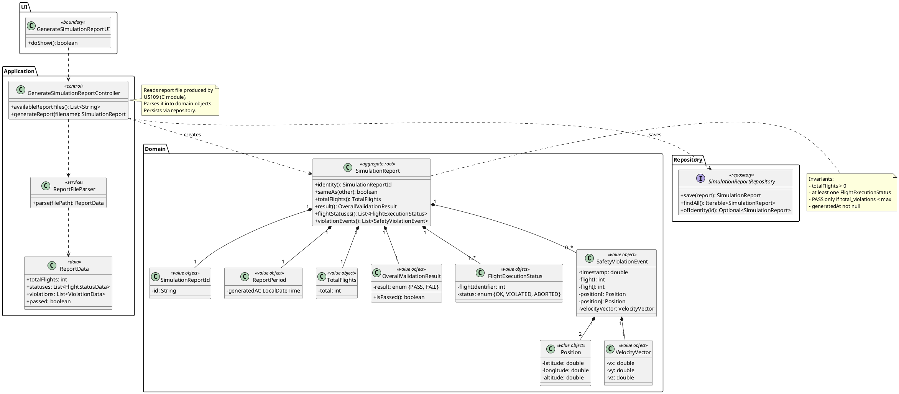
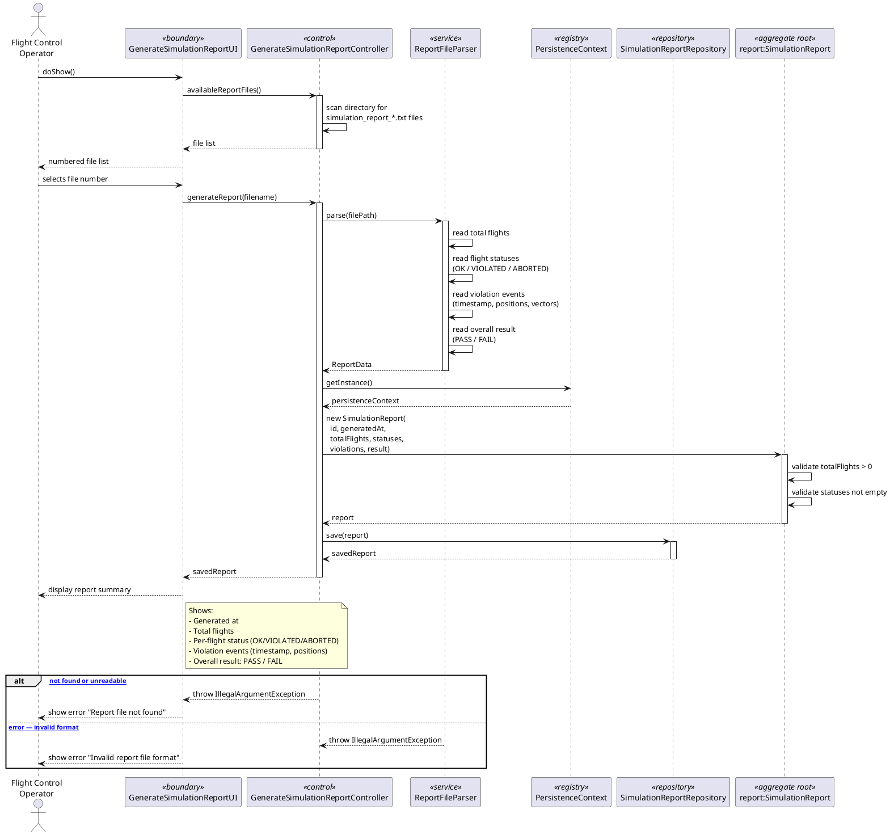

# US111 — Generate a Simulation Report

## 1. Context

This User Story is being developed for the first time in Sprint 3. It is part of the
**EAPLI** course unit.

US111 is the EAPLI counterpart of **US109** (SCOMP) — while US109 generates the raw
report file from the C simulation module, US111 reads that report, persists it as a
`SimulationReport` domain aggregate, and makes it available for consultation in the
backoffice system.

A Flight Control Operator runs a simulation and wants to see whether the programmed
flights are safe to execute — the report tells them: how many flights were simulated,
what happened to each one, whether any safety violations occurred, and whether the
overall result was PASS or FAIL.

### 1.1 List of Issues

Analysis: Understand the `SimulationReport` domain model; understand how the C module
report file maps to EAPLI domain objects; identify the repository and controller needed.

Design: Design the `GenerateSimulationReportController`; design the `SimulationReport`
aggregate with `FlightExecutionStatus` and `SafetyViolationEvent`; design the UI.

Implement: Implement the aggregate, controller, repository and UI; connect to the
report file produced by the C module (US109).

Test: Test report creation with violations; test PASS/FAIL determination; test that
all flight statuses are recorded.

---

## 2. Requirements

**US111** As a Flight Control Operator, I want to receive a summary of the simulation
results so that I can determine if the programmed flights are safe to run.

**Acceptance Criteria:**

- US111.1 — The system must generate a report and store it in a file.
- US111.2 — The report must include the total number of flights and their execution status.
- US111.3 — If safety violations occur, the report must list timestamps and positions.
- US111.4 — The report must indicate whether the scheduled flights plan passed or failed
  validation.

**Dependencies/References:**

- Depends on **US109** (SCOMP) — the C simulation module produces the raw report file
  that this US reads and persists.
- Depends on **US080** — flight plans must exist before a simulation can be run.
- Extended by **US112** — monthly report generation reuses the `SimulationReport` data.
- Referenced in the specification, section 6.4 (Sprint 3 EAPLI user stories).

---

## 3. Analysis

### 3.1 What the C Module Produces (US109)

The C simulation module writes a timestamped report file:

```
simulation_report_20260601_143022.txt
```

Contents:
```
=== SIMULATION REPORT ===
Generated: 2026-06-01 14:30:22
Flights  : 3
Result   : PASS

--- Flight Statuses ---
Flight 0 : OK
Flight 1 : VIOLATED
Flight 2 : OK

--- Safety Violations ---
Violation #1
  Timestamp : 12.00 s
  Flight 0  : Lat=41.25 Lon=-8.68 Alt=10000.0
  Flight 1  : Lat=41.26 Lon=-8.69 Alt=10000.0
  Velocity  : vx=41.25 vy=-8.68 vz=10000.0

--- Result: PASS ---
```

### 3.2 Domain Model

```
SimulationReport [Aggregate Root]
  ├── SimulationReportId [Value Object]   — unique identifier
  ├── ReportPeriod [Value Object]         — startDateTime, endDateTime
  ├── TotalFlights [Value Object]         — total count
  ├── OverallValidationResult [Value Object] — PASS | FAIL
  ├── FlightExecutionStatus [Value Object]   — 1..* per flight
  │     ├── flightIdentifier: int
  │     └── status: enum {OK, VIOLATED, ABORTED}
  └── SafetyViolationEvent [Value Object]   — 0..*
        ├── timestamp: double
        ├── flightI: int
        ├── flightJ: int
        ├── positionI: Position
        ├── positionJ: Position
        └── velocityVector: VelocityVector
```

### 3.3 Report Parsing Flow

```
C module report file (US109)
    │
    ▼
ReportFileParser (EAPLI utility)
    ├── reads total flights
    ├── reads flight statuses (OK / VIOLATED / ABORTED)
    ├── reads violation events (timestamp, positions, vectors)
    └── reads overall result (PASS / FAIL)
    │
    ▼
GenerateSimulationReportController
    ├── builds SimulationReport domain object
    └── saves via SimulationReportRepository
    │
    ▼
SimulationReportRepository
    └── persists to database
```

---

## 4. Design

### 4.1 Design Decisions

- **`SimulationReport` as Aggregate Root** — the report is a first-class domain object
  with its own lifecycle and identity. It is not embedded in `Simulation`.
- **`FlightExecutionStatus` and `SafetyViolationEvent` as Value Objects** — they have
  no identity beyond their data and are owned by the report.
- **Report file parsed by controller** — the controller reads the file produced by US109
  and constructs the domain object. This keeps the domain clean of file I/O.
- **PASS/FAIL determination** — `OverallValidationResult` is read from the file (US109
  already determined it). The EAPLI layer does not recalculate it.
- **Stored in database** — the report is persisted via `SimulationReportRepository` so
  it can be consulted later (US112 monthly report).

### 4.2 Class Diagram (CD)



### 4.3 Sequence Diagram (SD)



### 4.4 Acceptance Tests

**Test 1:** Verifies that a report with no violations produces a PASS result.

**Refers to Acceptance Criteria:** US111.4

```java
@Test
void ensureReportWithNoViolationsIsPass() {
    final SimulationReport report = new SimulationReport(
            SimulationReportId.of("RPT-001"),
            LocalDateTime.now(),
            new TotalFlights(3),
            List.of(
                    new FlightExecutionStatus(0, Status.OK),
                    new FlightExecutionStatus(1, Status.OK),
                    new FlightExecutionStatus(2, Status.OK)),
            List.of(),
            OverallValidationResult.pass());

    assertTrue(report.result().isPassed());
    assertEquals(0, report.violationEvents().size());
}
```

**Test 2:** Verifies that a report with violations includes them in the result.

**Refers to Acceptance Criteria:** US111.3

```java
@Test
void ensureReportIncludesViolationEvents() {
    final SafetyViolationEvent violation = new SafetyViolationEvent(
            12.0, 0, 1,
            new Position(41.25, -8.68, 10000.0),
            new Position(41.26, -8.69, 10000.0),
            new VelocityVector(41.25, -8.68, 10000.0));

    final SimulationReport report = new SimulationReport(
            SimulationReportId.of("RPT-002"),
            LocalDateTime.now(),
            new TotalFlights(2),
            List.of(
                    new FlightExecutionStatus(0, Status.VIOLATED),
                    new FlightExecutionStatus(1, Status.VIOLATED)),
            List.of(violation),
            OverallValidationResult.fail());

    assertFalse(report.result().isPassed());
    assertEquals(1, report.violationEvents().size());
    assertEquals(12.0, report.violationEvents().get(0).timestamp());
}
```

**Test 3:** Verifies that total flights matches the number of statuses.

**Refers to Acceptance Criteria:** US111.2

```java
@Test
void ensureTotalFlightsMatchesStatuses() {
    final SimulationReport report = new SimulationReport(
            SimulationReportId.of("RPT-003"),
            LocalDateTime.now(),
            new TotalFlights(3),
            List.of(
                    new FlightExecutionStatus(0, Status.OK),
                    new FlightExecutionStatus(1, Status.ABORTED),
                    new FlightExecutionStatus(2, Status.VIOLATED)),
            List.of(),
            OverallValidationResult.fail());

    assertEquals(3, report.totalFlights().value());
    assertEquals(3, report.flightStatuses().size());
}
```

**Test 4:** Verifies that report is saved to the repository.

**Refers to Acceptance Criteria:** US111.1

```java
@Test
void ensureReportIsSavedToRepository() {
    final InMemorySimulationReportRepository repo =
            new InMemorySimulationReportRepository();
    final GenerateSimulationReportController ctrl =
            new GenerateSimulationReportController(repo);

    final SimulationReport report = ctrl.generateReport(VALID_REPORT_FILE);

    assertNotNull(report);
    assertTrue(repo.findAll().iterator().hasNext());
}
```

**Test 5:** Verifies that zero total flights is rejected.

**Refers to Acceptance Criteria:** US111.2

```java
@Test
void ensureZeroTotalFlightsIsRejected() {
    assertThrows(IllegalArgumentException.class, () ->
            new SimulationReport(
                    SimulationReportId.of("RPT-004"),
                    LocalDateTime.now(),
                    new TotalFlights(0),
                    List.of(),
                    List.of(),
                    OverallValidationResult.pass()));
}
```

**Test 6:** Verifies that FAIL result is set when violations exceed threshold.

**Refers to Acceptance Criteria:** US111.4

```java
@Test
void ensureFailResultIsSetWhenViolationsExceedThreshold() {
    final SimulationReport report = new SimulationReport(
            SimulationReportId.of("RPT-005"),
            LocalDateTime.now(),
            new TotalFlights(2),
            List.of(
                    new FlightExecutionStatus(0, Status.ABORTED),
                    new FlightExecutionStatus(1, Status.ABORTED)),
            List.of(new SafetyViolationEvent(
                    5.0, 0, 1,
                    new Position(41.0, -8.0, 9000.0),
                    new Position(41.1, -8.1, 9000.0),
                    new VelocityVector(41.0, -8.0, 9000.0))),
            OverallValidationResult.fail());

    assertFalse(report.result().isPassed());
}
```

---

## 5. Implementation

**`domain/simulationreport/SimulationReportId.java`**
- `@Embeddable` Value Object. Factory method `of(String id)`.
- Auto-generated from timestamp if not provided.

**`domain/simulationreport/TotalFlights.java`**
- `@Embeddable` Value Object. Validates `total > 0`.

**`domain/simulationreport/OverallValidationResult.java`**
- `@Embeddable` Value Object. Enum `{PASS, FAIL}`.
- Factory methods `pass()` and `fail()`. `isPassed()` helper.

**`domain/simulationreport/FlightExecutionStatus.java`**
- `@Embeddable` Value Object. `flightIdentifier: int`, `status: enum {OK, VIOLATED, ABORTED}`.

**`domain/simulationreport/SafetyViolationEvent.java`**
- `@Embeddable` Value Object. `timestamp`, `flightI`, `flightJ`, `positionI`,
  `positionJ`, `velocityVector`.

**`domain/simulationreport/SimulationReport.java`**
- `@Entity`, `@Table(name = "SIMULATION_REPORT")`.
- `@EmbeddedId` — `SimulationReportId`.
- Constructor validates: `totalFlights > 0`, `statuses` not empty.
- `@ElementCollection` for `FlightExecutionStatus` and `SafetyViolationEvent`.

**`controller/GenerateSimulationReportController.java`**
- `availableReportFiles()` — scans configured directory for `simulation_report_*.txt`.
- `generateReport(filename)` — calls `ReportFileParser.parse()`, builds domain object,
  saves via repository.

**`controller/ReportFileParser.java`**
- Reads the text file produced by US109.
- Parses sections: header, flight statuses, violations, result.
- Returns `ReportData` POJO.

**`ui/GenerateSimulationReportUI.java`**
- Lists available report files by number.
- Shows full report summary on success.
- Shows error message on failure.

---

## 6. Integration/Demonstration

**Successful report generation:**
```
--- Generate Simulation Report ---
Available report files:
  1. simulation_report_20260601_143022.txt
  2. simulation_report_20260602_091500.txt

Select file: 1

>> Report generated and stored successfully.

=== SIMULATION REPORT ===
Generated : 2026-06-01 14:30:22
Flights   : 3
Result    : PASS

Flight Statuses:
  Flight 0 : OK
  Flight 1 : VIOLATED
  Flight 2 : OK

Safety Violations:
  #1 — t=12.00s
       Flight 0: (41.25, -8.68, 10000.0m)
       Flight 1: (41.26, -8.69, 10000.0m)
       Vector  : vx=41.25 vy=-8.68 vz=10000.0

Overall Result: PASS
```

**Error — file not found:**
```
>> ERROR: Report file not found: simulation_report_invalid.txt
```

**Error — invalid format:**
```
>> ERROR: Could not parse report file. Invalid format.
```

---

## 7. Observations

- US111 is the **EAPLI side** of the simulation report — US109 (SCOMP) generates the
  raw file, US111 reads, persists and displays it. They are complementary.
- The `ReportFileParser` is a simple utility class — it does not belong to the domain.
  It bridges the C module output format and the EAPLI domain model.
- `FlightExecutionStatus` and `SafetyViolationEvent` are Value Objects embedded in the
  report — they have no independent lifecycle.
- The `@ElementCollection` JPA annotation is used to persist the lists of statuses and
  violation events — each maps to a separate table with a foreign key back to the report.
- The PASS/FAIL result is **read from the file** — the EAPLI layer trusts the C module's
  determination and does not recalculate it.