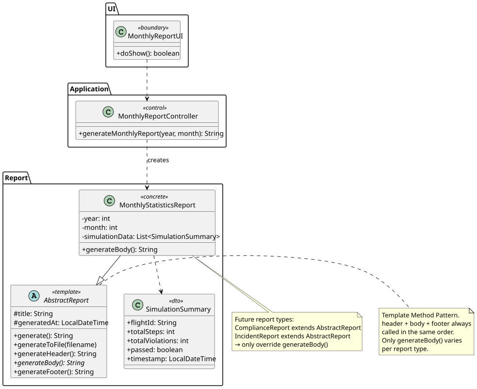
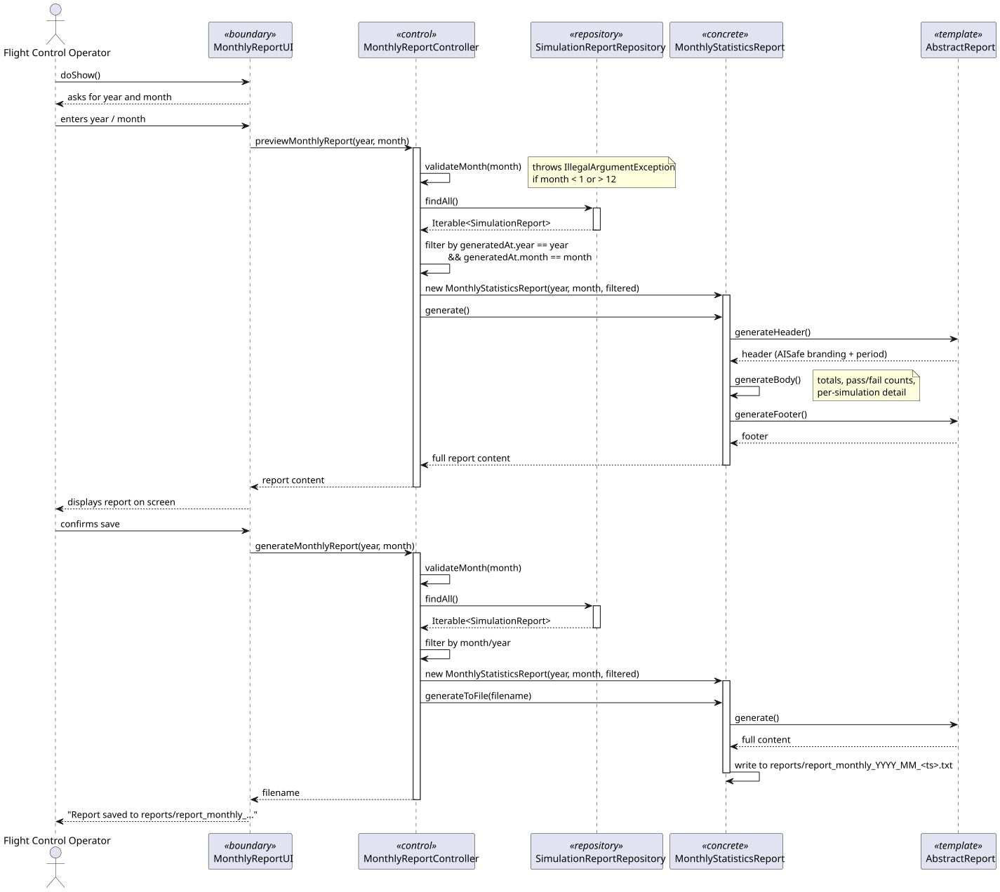

# US112 — Monthly Report Generation

## 1. Context

This User Story is being developed for the first time in Sprint 3. It introduces the ability for a Flight Control Operator to generate a monthly statistics report for the simulated flights.

The specification states this will be one of several report types (compliance, incident, etc.) and that this work should be **foundational** — establishing a consistent structure and branding for all future reports. The design must therefore be extensible and reusable.

This US depends on **US111** (Generate Simulation Report) because the monthly report is aggregated from the `SimulationReport` domain entities that US111 persists to the JPA database.

### 1.1 List of Issues

Analysis: Understand what data constitutes a monthly statistics report; understand the "foundational" requirement — define a report structure that all future report types can follow.

Design: Design a reusable report architecture; define the `MonthlyReportController` and the `AbstractReport` abstraction.

Implement: Implement the monthly statistics report generation; implement the report output (text file and on-screen preview).

Test: Test that the report contains the correct data for a given month; test that the report structure is consistent.

---

## 2. Requirements

**US112** As a Flight Control Operator, I want to generate a monthly statistics report.

> This will be one of a number (e.g. compliance, incident, etc.) of reports the system will have to generate in the future and this work should be foundational to these to guarantee all follow a consistent branding and structure. We imagine each report type has a specific way of collecting data, specific sections and graphics.

**Acceptance Criteria:**

- US112.1 — The Flight Control Operator must be able to request a monthly statistics report for a given month (1–12) and year.
- US112.2 — The report must include statistics for all simulated flights in the selected month.
- US112.3 — The report must follow a **consistent structure and branding** that all future report types will also follow.
- US112.4 — The report must be saved to a file.
- US112.5 — The report architecture must be **extensible** — adding a new report type should not require changes to the core report infrastructure.

**Dependencies/References:**

- Depends on **US111** (Generate Simulation Report) — `SimulationReport` entities persisted by US111 are the data source for the monthly report.
- Depends on **US100–US109** (SCOMP) — the simulation data that feeds US111 originates here.

---

## 3. Analysis

### 3.1 Domain Understanding

A **monthly report** in the AISafe system is a structured document that summarises flight simulation activity for a given month. It includes:

- **Header**: report type, generation date, period covered (month/year) — shared by all report types.
- **Summary section**: total simulations run, total flights simulated, total violations, pass/fail count, pass rate.
- **Detail section**: per-simulation breakdown (flights, violations, result, flight statuses).
- **Footer**: AISafe branding — shared by all report types.

The specification requires the structure to be **foundational** — meaning it must define a template that other report types (compliance, incident) can follow without code duplication.

### 3.2 Report Architecture — Template Method Pattern

The foundational requirement is implemented using the **Template Method Pattern**:

```
AbstractReport (abstract)
    ├── generate()          ← final: calls header + body + footer in order
    ├── generateHeader()    ← final: consistent branding (same for all)
    ├── generateFooter()    ← final: consistent footer (same for all)
    ├── generateBody()      ← abstract: each report defines its own
    ├── reportTitle()       ← abstract: human-readable title
    └── reportPeriod()      ← abstract: human-readable period

MonthlyStatisticsReport extends AbstractReport
    ├── generateBody()      ← specific to monthly stats
    ├── reportTitle()       ← "Monthly Statistics Report"
    └── reportPeriod()      ← "May 2026"

ComplianceReport extends AbstractReport  (future)
    └── generateBody() / reportTitle() / reportPeriod()

IncidentReport extends AbstractReport    (future)
    └── generateBody() / reportTitle() / reportPeriod()
```

This guarantees that all reports share the same header, footer and file structure, while each report type defines only its own data section.

---

## 4. Design

### 4.1. Design Decisions

- **Template Method Pattern**: `AbstractReport` defines the skeleton. Each concrete report only overrides `generateBody()`, `reportTitle()` and `reportPeriod()`. This directly satisfies the "foundational" and "extensible" requirements.
- **Report saved to file**: The report is written to a `.txt` file named `reports/report_monthly_YYYY_MM_<timestamp>.txt`.
- **Data source — JPA repository**: The controller queries `SimulationReportRepository.findAll()` and filters in-memory by `generatedAt` year and month. This reuses the persistence infrastructure from US111.
- **Month validation**: The controller validates the month parameter (1–12) and throws `IllegalArgumentException` for invalid values.
- **On-screen preview**: `previewMonthlyReport()` returns the report as a String for display before saving; `generateMonthlyReport()` writes the file and returns the path.

### 4.2. Class Diagram (CD)



### 4.3. Sequence Diagram (SD)



### 4.4 Acceptance Tests

**Test 1:** Reports from other months are excluded.

**Refers to Acceptance Criteria:** US112.1, US112.2

```java
@Test
void ensureOnlyReportsFromRequestedMonthAreIncluded() {
    when(repo.findAll()).thenReturn(List.of(
            reportFor(2026, 5, "sim_may",  true),
            reportFor(2026, 6, "sim_june", false)
    ));
    final String preview = ctrl.previewMonthlyReport(2026, 5);
    assertTrue(preview.contains("sim_may"));
    assertFalse(preview.contains("sim_june"));
}
```

**Test 2:** Empty month produces a valid report with no-data message.

**Refers to Acceptance Criteria:** US112.1, US112.2

```java
@Test
void ensureEmptyMonthProducesValidReport() {
    when(repo.findAll()).thenReturn(List.of());
    final String preview = ctrl.previewMonthlyReport(2026, 5);
    assertNotNull(preview);
    assertTrue(preview.contains("No simulation reports found"));
}
```

**Test 3:** Header always contains AISafe branding.

**Refers to Acceptance Criteria:** US112.3

```java
@Test
void ensureReportHeaderContainsBranding() {
    when(repo.findAll()).thenReturn(List.of());
    final String preview = ctrl.previewMonthlyReport(2026, 5);
    assertTrue(preview.contains("AISafe"));
    assertTrue(preview.contains("Monthly Statistics Report"));
}
```

**Test 4:** Generated file name matches the expected pattern.

**Refers to Acceptance Criteria:** US112.4

```java
@Test
void ensureGeneratedFilenameMatchesPattern() {
    when(repo.findAll()).thenReturn(List.of());
    final String filename = ctrl.generateMonthlyReport(2026, 5);
    assertTrue(filename.contains("report_monthly_2026_05_"));
    assertTrue(filename.endsWith(".txt"));
}
```

**Test 5:** Invalid month throws `IllegalArgumentException`.

**Refers to Acceptance Criteria:** US112.1

```java
@Test
void ensureInvalidMonthIsRejected() {
    assertThrows(IllegalArgumentException.class,
            () -> ctrl.previewMonthlyReport(2026, 13));
    assertThrows(IllegalArgumentException.class,
            () -> ctrl.previewMonthlyReport(2026, 0));
}
```

---

## 5. Implementation

**`report/AbstractReport.java`** — Template
- Abstract class with `generate()` (final) that calls `generateHeader()`, `generateBody()`, `generateFooter()` in order.
- `generateHeader()` and `generateFooter()` are `final` — same branding for all report types.
- `generateBody()`, `reportTitle()` and `reportPeriod()` are abstract — each subclass defines its own.
- `generateToFile(filePath)` writes the result to disk.

**`report/MonthlyStatisticsReport.java`** — Concrete Report
- Extends `AbstractReport`.
- Constructor receives `year`, `month` and a `List<SimulationReport>` for that period.
- `generateBody()` builds the statistics section: total simulations, total flights, total violations, pass/fail count, pass rate, and a per-simulation detail block with flight statuses and violations.
- `reportTitle()` returns `"Monthly Statistics Report"`.
- `reportPeriod()` returns `"<MonthName> <year>"` (e.g. `"May 2026"`).

**`controller/MonthlyReportController.java`**
- Holds a `SimulationReportRepository` injected via `PersistenceContext`.
- `validateMonth(month)` — throws `IllegalArgumentException` for values outside 1–12.
- `previewMonthlyReport(year, month)` — returns the report content as a String (for on-screen display).
- `generateMonthlyReport(year, month)` — writes the report to `reports/report_monthly_YYYY_MM_<timestamp>.txt` and returns the file path.
- `reportsForMonth(year, month)` — queries `repo.findAll()` and filters by `generatedAt` year and month.

**`ui/MonthlyReportUI.java`**
- Prompts the Flight Control Operator for year (default: current year) and month (default: current month).
- Calls `previewMonthlyReport()` to show the report on screen.
- Asks confirmation, then calls `generateMonthlyReport()` and shows the saved file path.

---

## 6. Integration/Demonstration

**Monthly Report demonstration (US112):**
1. Login as Flight Control Operator (`ftctrl@alsafe.com`).
2. Import simulation reports via US111 (they are persisted to the JPA database).
3. Choose `Monthly Statistics Report` from the menu.
4. Enter year `2026` and month `6` (June).
5. The report is shown on screen and saved to `reports/report_monthly_2026_06_<timestamp>.txt`.

**Report output example:**
```
========================================
  AISafe — Flight Control Management
  Monthly Statistics Report
  Period : June 2026
  Generated: 2026-06-06 22:13:27
========================================
SUMMARY
  Total simulations run    : 5
  Total flights simulated  : 12
  Total violations         : 11
  Simulations passed       : 4
  Simulations failed       : 1
  Pass rate                : 80.0%
DETAIL
  Report simulation_report_20260606_210017 | flights:  1 | violations:  0 | PASS
      Flight 0   → OK
  Report simulation_report_20260606_220534 | flights:  4 | violations:  3 | FAIL
      Flight 0   → VIOLATED
      Flight 1   → OK
      Flight 2   → OK
      Flight 3   → VIOLATED
    Violations:
      #1 — t=1.00s Flight0 vs Flight3
      ...
========================================
  AISafe Flight Control Management System
  Report generated automatically — do not alter
========================================
```

---

## 7. Observations

- The Template Method Pattern was chosen over a Strategy pattern because the report structure (header → body → footer) is fixed for all report types — only the body varies. Strategy would be more appropriate if the entire structure varied.
- Future report types (compliance, incident) only need to extend `AbstractReport` and implement `generateBody()`, `reportTitle()` and `reportPeriod()` — no changes to the infrastructure.
- The monthly report reads data from the JPA database via `SimulationReportRepository`, which persists `SimulationReport` entities imported by US111.
- Graphics mentioned in the specification are out of scope for Sprint 3 — the report is text-based only.
