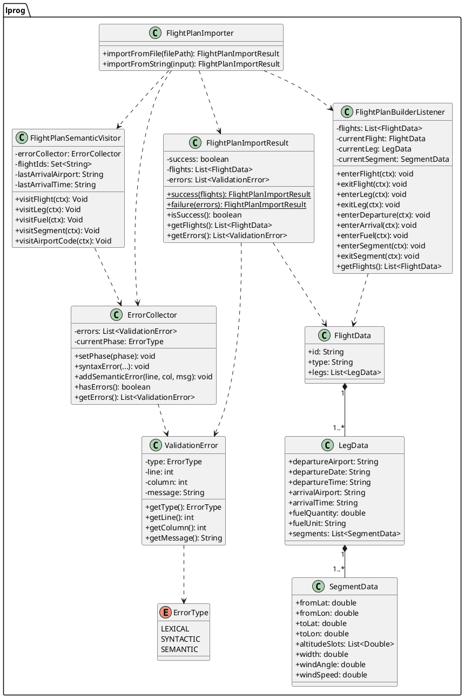
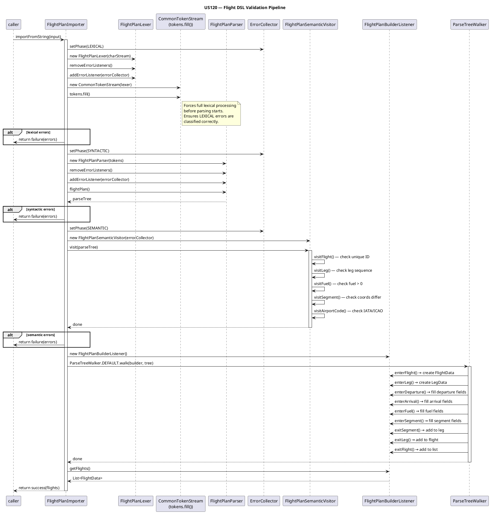

# US120 — Flight DSL Specification and Validation

## 1. Context

This User Story is being developed in Sprint 3 as an evolution of **US083** (Sprint 2).
US083 established the foundation — the ANTLR grammar, the 4-step validation pipeline,
the `ErrorCollector`, the `FlightPlanSemanticVisitor` and the `FlightPlanBuilderListener`.

US120 extends it with:

- A more complete and rigorous **formal grammar** in ANTLR4.
- Extended **semantic validation** rules (all 6 rules fully documented and enforced).
- Explicit use of both **Visitor** (semantic validation) and **Listener** (domain object construction).
- Richer **error reporting** — every error includes type, line, column and message.
- A documented **internal representation** (`FlightData`, `LegData`, `SegmentData`).

This US is owned by the **LPROG** course unit. The grammar defined here (`FlightPlan.g4`)
is consumed by **US121** (Create a Flight Plan from a File).

### 1.1 List of Issues

Analysis: Review Sprint 2 pipeline; identify any semantic rules not yet implemented;
document the DSL informally and formally.

Design: Confirm Visitor/Listener split; update grammar if needed; document all
semantic rules; produce class and sequence diagrams.

Implement: Ensure all 6 semantic rules are enforced in `FlightPlanSemanticVisitor`;
ensure `FlightPlanBuilderListener` builds complete domain objects.

Test: Full regression test suite covering all error types and all semantic rules.

---

## 2. Requirements

**US120** As a Project Manager, I want the team to specify and implement the Flight
Description DSL, so that flight plans can be formally defined and validated.

**Acceptance Criteria:**

- US120.1 — The informal lexical and syntactic specification of the DSL is documented.
- US120.2 — A formal grammar is defined using ANTLR.
- US120.3 — The system performs lexical, syntactic and semantic analysis.
- US120.4 — Use of listeners/visitors.
- US120.5 — An internal representation (AST or domain objects) is produced.
- US120.6 — Invalid inputs generate clear and informative error messages.

**Dependencies/References:**

- Evolves from **US083** (Sprint 2) — the grammar and pipeline are reused and extended.
- Consumed by **US121** — which uses the grammar to import flight plans from files.
- Referenced in the specification, section 6.5 (LPROG related user stories).

---

## 3. Analysis

### 3.1 What Changed from Sprint 2 (US083)

| Aspect | Sprint 2 (US083) | Sprint 3 (US120) |
|---|---|---|
| Grammar | Core DSL defined | Same grammar, fully documented |
| Semantic rules | 5 rules implemented | 6 rules fully documented and enforced |
| Visitor/Listener | Both used | Explicitly documented and justified |
| Error reporting | Type + line + column + message | Same — confirmed complete |
| Internal representation | FlightData / LegData / SegmentData | Same — fully documented |
| Maven integration | antlr4-maven-plugin configured | Confirmed working |

### 3.2 DSL Informal Specification (US120.1)

#### Lexical Specification

| Token | Format | Example |
|---|---|---|
| Flight ID | Alphanumeric identifier | `TP001`, `FR123` |
| Airport code | 3 uppercase letters (IATA) or 4 uppercase letters (ICAO) | `OPO`, `LPPR` |
| Date | `YYYY-MM-DD` | `2026-05-17` |
| Time | `HH:MM` | `14:00` |
| Number | Integer or decimal, optionally negative | `5000`, `-8.68`, `41.25` |
| Keywords | Case-insensitive | `flight`, `FLIGHT`, `Flight` |
| Comments | Line comments starting with `//` | `// this is a comment` |
| Whitespace | Ignored | spaces, tabs, newlines |

#### Syntactic Specification

A flight plan file contains one or more **flights**. Each flight has:
- A unique **flight ID**
- A **type** (`regular` or `charter`)
- One or more **legs**

Each leg has:
- A **departure** (airport code, date, time)
- An **arrival** (airport code, time)
- A **fuel** quantity and unit
- One or more **segments**

Each segment has:
- **from** and **to** coordinates `(latitude, longitude)`
- **altitude_slots** — list of altitudes in metres
- **width** in metres
- **wind** direction (degrees) and speed (m/s)

#### DSL Example

```
flight TP001 {
    type: regular

    leg {
        departure: OPO 2026-05-17 14:00
        arrival:   LIS 15:00
        fuel:      5000 kg

        segment {
            from: (41.2481, -8.6814)
            to:   (38.7813, -9.1359)
            altitude_slots: [8000, 10000, 12000]
            width: 50 m
            wind:  270 deg 10 m/s
        }
    }
}
```

### 3.3 Validation Pipeline (US120.3)

The pipeline has 4 sequential steps. Each step only runs if the previous passed.

```
Input (string or file)
    │
    ▼
Step 1: Lexical Analysis
  FlightPlanLexer — tokenises the input
  tokens.fill() — forces full lexical processing before parsing
  ErrorCollector captures LEXICAL errors
  → if errors: return failure (stop here)
    │
    ▼
Step 2: Syntactic Analysis
  FlightPlanParser — builds the parse tree
  ErrorCollector captures SYNTACTIC errors
  → if errors: return failure (stop here)
    │
    ▼
Step 3: Semantic Validation
  FlightPlanSemanticVisitor — checks all 6 business rules
  ErrorCollector captures SEMANTIC errors (all collected, no fail-fast)
  → if errors: return failure
    │
    ▼
Step 4: Domain Object Construction
  FlightPlanBuilderListener — walks parse tree, builds FlightData/LegData/SegmentData
  → return success with list of FlightData
```

### 3.4 Semantic Validation Rules (US120.3)

All 6 semantic rules are enforced in `FlightPlanSemanticVisitor`:

| # | Rule | Visitor Method | Error Message |
|---|---|---|---|
| 1 | Flight ID unique within file | `visitFlight()` | `"Duplicate flight identifier: 'X'"` |
| 2 | Arrival airport of leg N = departure of leg N+1 | `visitLeg()` | `"Departure airport 'X' does not match arrival airport of previous leg 'Y'"` |
| 3 | Arrival time of leg N precedes departure of leg N+1 | `visitLeg()` | `"Departure time 'X' must be after arrival time of previous leg 'Y'"` |
| 4 | Fuel quantity > 0 | `visitFuel()` | `"Fuel quantity must be strictly positive (got: X)"` |
| 5 | Segment start ≠ end coordinates | `visitSegment()` | `"Segment start and end coordinates must be different"` |
| 6 | Airport code: IATA (3 letters) or ICAO (4 letters) | `visitAirportCode()` | `"Invalid airport code 'X': must be IATA (3 uppercase letters) or ICAO (4 uppercase letters)"` |

> All semantic errors are **collected before reporting** — the visitor does not stop at the first error.

### 3.5 Internal Representation (US120.5)

After a successful import, the result contains a list of `FlightData` objects:

```
FlightData
  ├── id: String
  ├── type: String ("regular" | "charter")
  └── legs: List<LegData>
        ├── departureAirport: String
        ├── departureDate: String
        ├── departureTime: String
        ├── arrivalAirport: String
        ├── arrivalTime: String
        ├── fuelQuantity: double
        ├── fuelUnit: String
        └── segments: List<SegmentData>
              ├── fromLat, fromLon: double
              ├── toLat, toLon: double
              ├── altitudeSlots: List<Double>
              ├── width: double
              ├── windAngle: double
              └── windSpeed: double
```

---

## 4. Design

### 4.1 Design Decisions

- **`tokens.fill()` before parsing**: forces the lexer to process all input before the
  parser starts, so lexical errors are correctly classified as LEXICAL and not SYNTACTIC.
- **Visitor for semantic validation**: the `FlightPlanSemanticVisitor` uses `visitChildren(ctx)`
  to control tree traversal order. This is essential for the leg sequence check — the visitor
  must process departure before updating `lastArrivalAirport`.
- **Listener for construction**: the `FlightPlanBuilderListener` uses `enter`/`exit` callbacks.
  The ANTLR walker calls these automatically — ideal for building objects incrementally as
  the tree is traversed.
- **ErrorCollector phases**: `setPhase()` switches between LEXICAL, SYNTACTIC and SEMANTIC
  so every error is tagged with the correct type regardless of when it is reported.
- **`importFromString()`**: allows the full pipeline to be tested without file system access —
  essential for fast, isolated unit tests.

### 4.2 ANTLR Component Overview

| Component | Type | Role |
|---|---|---|
| `FlightPlan.g4` | Grammar file | Defines the DSL — owned by US120 |
| `FlightPlanLexer` | Generated | Tokenises the input character stream |
| `FlightPlanParser` | Generated | Builds the parse tree from tokens |
| `FlightPlanBaseVisitor` | Generated | Base class for custom visitors |
| `FlightPlanBaseListener` | Generated | Base class for custom listeners |
| `FlightPlanSemanticVisitor` | Custom | Enforces all 6 semantic rules |
| `FlightPlanBuilderListener` | Custom | Builds FlightData/LegData/SegmentData |
| `ErrorCollector` | Custom | Accumulates all errors from all phases |
| `FlightPlanImporter` | Custom | Orchestrates the 4-step pipeline |

### 4.3 Visitor vs Listener — Justification (US120.4)

**Visitor** — used for **semantic validation**:
- Controls when to call `visitChildren(ctx)` — essential for ordered checks (e.g. leg sequence)
- Can stop descending into subtrees if needed
- Used in Step 3 of the pipeline

**Listener** — used for **domain object construction**:
- ANTLR walker calls `enter`/`exit` automatically for every node
- Ideal for building objects incrementally without controlling traversal
- Used in Step 4 of the pipeline

### 4.4 Formal Grammar — `FlightPlan.g4` (US120.2)

```antlr
grammar FlightPlan;

@header { package lprog; }

// ─── Parser Rules ────────────────────────────────────────────────────────────

flightPlan  : flight+ EOF ;

flight      : FLIGHT ID LBRACE
                  TYPE COLON flightType
                  leg+
              RBRACE ;

flightType  : REGULAR | CHARTER ;

leg         : LEG LBRACE
                  departure
                  arrival
                  fuel
                  segment+
              RBRACE ;

departure   : DEPARTURE COLON airportCode date time ;
arrival     : ARRIVAL   COLON airportCode time ;
fuel        : FUEL       COLON NUMBER unit ;

segment     : SEGMENT LBRACE
                  FROM           COLON coordinates
                  TO             COLON coordinates
                  ALTITUDE_SLOTS COLON LBRACKET NUMBER (COMMA NUMBER)* RBRACKET
                  WIDTH          COLON NUMBER METER
                  WIND           COLON NUMBER DEG NUMBER MS
              RBRACE ;

coordinates : LPAREN NUMBER COMMA NUMBER RPAREN ;
airportCode : ID ;
date        : DATE_LITERAL ;
time        : TIME_LITERAL ;
unit        : KG | LITER | METER | MS ;

// ─── Lexer Rules ─────────────────────────────────────────────────────────────

FLIGHT         : [Ff][Ll][Ii][Gg][Hh][Tt] ;
LEG            : [Ll][Ee][Gg] ;
DEPARTURE      : [Dd][Ee][Pp][Aa][Rr][Tt][Uu][Rr][Ee] ;
ARRIVAL        : [Aa][Rr][Rr][Ii][Vv][Aa][Ll] ;
SEGMENT        : [Ss][Ee][Gg][Mm][Ee][Nn][Tt] ;
FUEL           : [Ff][Uu][Ee][Ll] ;
TYPE           : [Tt][Yy][Pp][Ee] ;
FROM           : [Ff][Rr][Oo][Mm] ;
TO             : [Tt][Oo] ;
WIDTH          : [Ww][Ii][Dd][Tt][Hh] ;
WIND           : [Ww][Ii][Nn][Dd] ;
REGULAR        : [Rr][Ee][Gg][Uu][Ll][Aa][Rr] ;
CHARTER        : [Cc][Hh][Aa][Rr][Tt][Ee][Rr] ;
ALTITUDE_SLOTS : [Aa][Ll][Tt][Ii][Tt][Uu][Dd][Ee]'_'[Ss][Ll][Oo][Tt][Ss] ;

DEG   : [Dd][Ee][Gg] ;
MS    : 'm/s' ;
KG    : 'kg' ;
LITER : 'l' ;
METER : 'm' ;

ID           : [A-Za-z][A-Za-z0-9_\-]* ;
NUMBER       : '-'? [0-9]+ ('.' [0-9]+)? ;
DATE_LITERAL : [0-9][0-9][0-9][0-9] '-' [0-9][0-9] '-' [0-9][0-9] ;
TIME_LITERAL : [0-9][0-9] ':' [0-9][0-9] ;

LBRACE   : '{' ;   RBRACE   : '}' ;
LPAREN   : '(' ;   RPAREN   : ')' ;
LBRACKET : '[' ;   RBRACKET : ']' ;
COMMA    : ',' ;   COLON    : ':' ;

WS      : [ \t\r\n]+ -> skip ;
COMMENT : '//' ~[\r\n]* -> skip ;
```

### 4.5 Class Diagram (CD)



### 4.6 Sequence Diagram (SD)



### 4.7 Acceptance Tests

**Test 1:** Verifies that a valid DSL string is accepted and produces correct flight data.

**Refers to Acceptance Criteria:** US120.2, US120.5

```java
@Test
void validDslStringIsAccepted() {
    final FlightPlanImporter importer = new FlightPlanImporter();
    final FlightPlanImportResult result = importer.importFromString(VALID_DSL);

    assertTrue(result.isSuccess());
    assertEquals(1, result.getFlights().size());
    assertEquals("TP001", result.getFlights().get(0).id);
    assertEquals("regular", result.getFlights().get(0).type);
}
```

**Test 2:** Verifies that an invalid token produces a LEXICAL error with line/column info.

**Refers to Acceptance Criteria:** US120.3, US120.6

```java
@Test
void invalidTokenProducesLexicalError() {
    final FlightPlanImporter importer = new FlightPlanImporter();
    final FlightPlanImportResult result =
            importer.importFromString(DSL_WITH_INVALID_TOKEN); // contains #

    assertFalse(result.isSuccess());
    assertTrue(result.getErrors().stream()
            .anyMatch(e -> e.getType() == ErrorCollector.ErrorType.LEXICAL));
}
```

**Test 3:** Verifies that negative fuel produces a SEMANTIC error.

**Refers to Acceptance Criteria:** US120.3, US120.6

```java
@Test
void negativeFuelProducesSemanticError() {
    final FlightPlanImporter importer = new FlightPlanImporter();
    final FlightPlanImportResult result =
            importer.importFromString(DSL_WITH_NEGATIVE_FUEL);

    assertFalse(result.isSuccess());
    assertTrue(result.getErrors().stream()
            .anyMatch(e -> e.getType() == ErrorCollector.ErrorType.SEMANTIC
                    && e.getMessage().toLowerCase().contains("fuel")));
}
```

**Test 4:** Verifies that duplicate flight IDs produce a SEMANTIC error.

**Refers to Acceptance Criteria:** US120.3

```java
@Test
void duplicateFlightIdProducesSemanticError() {
    final FlightPlanImporter importer = new FlightPlanImporter();
    final FlightPlanImportResult result =
            importer.importFromString(DSL_WITH_DUPLICATE_ID);

    assertFalse(result.isSuccess());
    assertTrue(result.getErrors().stream()
            .anyMatch(e -> e.getType() == ErrorCollector.ErrorType.SEMANTIC
                    && e.getMessage().contains("Duplicate")));
}
```

**Test 5:** Verifies that mismatched leg airports produce a SEMANTIC error.

**Refers to Acceptance Criteria:** US120.3

```java
@Test
void legSequenceMismatchProducesSemanticError() {
    final FlightPlanImporter importer = new FlightPlanImporter();
    final FlightPlanImportResult result =
            importer.importFromString(DSL_WITH_INVALID_LEG_SEQUENCE);

    assertFalse(result.isSuccess());
    assertTrue(result.getErrors().stream()
            .anyMatch(e -> e.getMessage().contains("does not match")));
}
```

**Test 6:** Verifies that all semantic errors are collected in a single execution.

**Refers to Acceptance Criteria:** US120.3, US120.6

```java
@Test
void allSemanticErrorsAreCollectedInSingleExecution() {
    final FlightPlanImporter importer = new FlightPlanImporter();
    final FlightPlanImportResult result =
            importer.importFromString(DSL_WITH_MULTIPLE_ERRORS);

    assertFalse(result.isSuccess());
    assertTrue(result.getErrors().size() >= 2,
            "All errors must be collected, not just the first one");
}
```

**Test 7:** Verifies that a valid multi-leg flight with correct sequence is accepted.

**Refers to Acceptance Criteria:** US120.1, US120.5

```java
@Test
void validMultiLegFlightIsAccepted() {
    final FlightPlanImporter importer = new FlightPlanImporter();
    final FlightPlanImportResult result =
            importer.importFromString(VALID_MULTI_LEG_DSL);

    assertTrue(result.isSuccess());
    assertEquals(2, result.getFlights().get(0).legs.size());
}
```

---

## 5. Implementation

**`lprog/FlightPlan.g4`**
Grammar file placed in `src/main/antlr4/`. Generated by the `antlr4-maven-plugin` during
`mvn compile`. Generated files go to `target/generated-sources/antlr4/lprog/`.

**`lprog/ErrorCollector.java`**
Extends `BaseErrorListener` (ANTLR). Captures lexical and syntactic errors via
`syntaxError()`. Accepts semantic errors via `addSemanticError()`. Phase is set via
`setPhase()` before each analysis phase so errors are tagged correctly.

**`lprog/FlightPlanSemanticVisitor.java`**
Extends `FlightPlanBaseVisitor<Void>`. Overrides 5 visit methods to enforce all 6
semantic rules. Uses instance variables (`flightIds`, `lastArrivalAirport`,
`lastArrivalTime`) to track state across nodes. Calls `visitChildren(ctx)` explicitly to
control traversal order.

**`lprog/FlightPlanBuilderListener.java`**
Extends `FlightPlanBaseListener`. Uses `enter`/`exit` callbacks to build
`FlightData`, `LegData` and `SegmentData` objects incrementally. `getFlights()` returns
the complete list after the walk.

**`lprog/FlightPlanImporter.java`**
Orchestrates the 4-step pipeline. `tokens.fill()` is called after creating the
`CommonTokenStream` and before the parser starts — this is the key to correct error
classification. Returns `FlightPlanImportResult.success()` or
`FlightPlanImportResult.failure()`.

---

## 6. Integration/Demonstration

**Valid input — accepted:**

```
Input:
  flight TP001 {
      type: regular
      leg {
          departure: OPO 2026-05-17 14:00
          arrival:   LIS 15:00
          fuel:      5000 kg
          segment {
              from: (41.2481, -8.6814)
              to:   (38.7813, -9.1359)
              altitude_slots: [8000, 10000]
              width: 50 m
              wind:  270 deg 10 m/s
          }
      }
  }

Result: SUCCESS
  Flight ID : TP001
  Type      : regular
  Legs      : 1
    Leg 1   : OPO → LIS (fuel: 5000.0 kg)
```

**Invalid input — lexical error:**

```
Input: flight TP002 { type: regular #invalid ...

Result: FAILURE
  [LEXICAL] Line 1, Col 25 — token recognition error at: '#'
```

**Invalid input — semantic errors:**

```
Input: flight with fuel: -500 kg and same from/to coordinates

Result: FAILURE
  [SEMANTIC] Line 6, Col 15 — Fuel quantity must be strictly positive (got: -500.0)
  [SEMANTIC] Line 9, Col 8  — Segment start and end coordinates must be different
```

---

## 7. Observations

- US120 is an **evolution** of US083 — the pipeline is not reimplemented, it is confirmed,
  documented and extended with all 6 semantic rules fully enforced.
- The key to correct error classification is `tokens.fill()` — without it, lexical errors
  appear as syntactic errors because the lexer only processes tokens on demand.
- The **Visitor** is used for semantic validation because it controls tree traversal.
  The **Listener** is used for construction because the ANTLR walker handles traversal
  automatically — no manual control needed.
- All semantic errors are collected before reporting — the visitor never stops at the
  first error. This gives the user a complete picture of all problems in one execution.
- The grammar uses **character-class alternatives** for case-insensitive keywords
  (e.g. `[Ff][Ll][Ii][Gg][Hh][Tt]`) instead of ANTLR options — this keeps the grammar
  compatible with all ANTLR4 targets.
- The `@header { package lprog; }` directive in the grammar ensures all generated classes
  are placed in the `lprog` package, consistent with the hand-written classes.