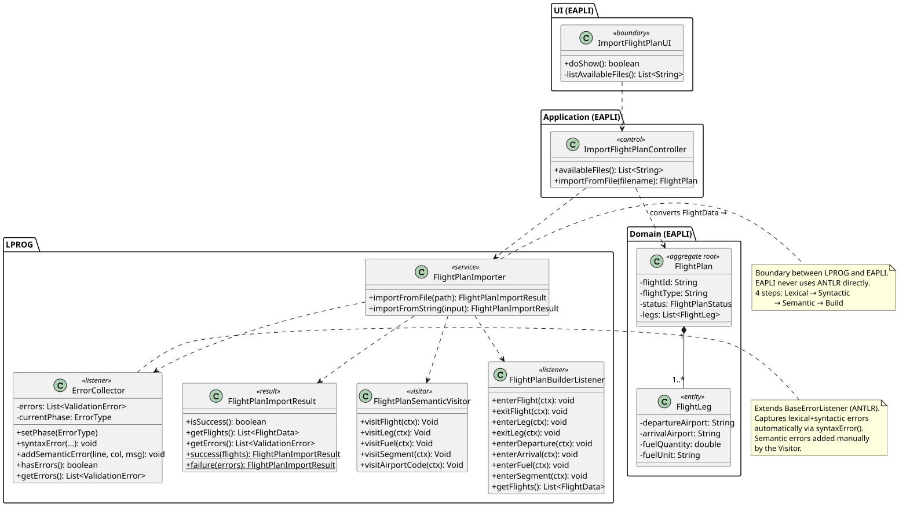
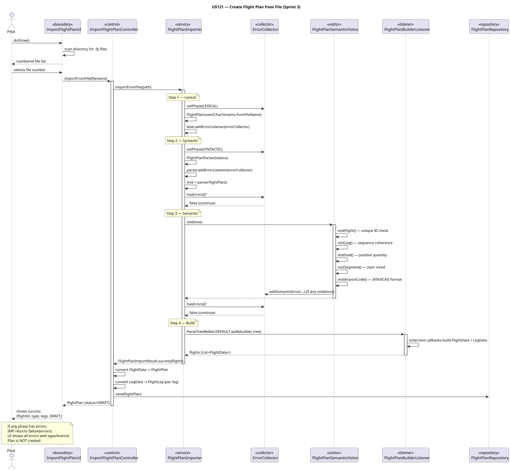

# US121 — Create a Flight Plan from a File

## 1. Context

This User Story is being developed in Sprint 3 as an evolution of **US081** (Sprint 2). The core ANTLR-based pipeline was implemented in Sprint 2 and is fully functional. US121 extends it with:

- Validation now references **US120** (Sprint 3 evolution of US083) — the grammar and semantic rules may be updated.
- Tighter integration with the EAPLI domain model — the imported `FlightData` is now persisted as a `FlightPlan` aggregate via `FlightPlanRepository`.
- The Pilot selects from available `.fp` files instead of typing a path manually.

This US is part of the **LPROG** course unit. The ANTLR grammar (`FlightPlan.g4`) is owned by US120; this US consumes it.

### 1.1 List of Issues

Analysis: Verify that the Sprint 2 pipeline is complete and working; identify any new semantic rules added in US120; confirm the mapping from `FlightData` to `FlightPlan` domain objects.

Design: Confirm the 4-step pipeline is unchanged; update any semantic rules if US120 extended the grammar; ensure `FlightPlanImporter` persists results via the repository.

Implement: Integrate `FlightPlanImporter` with `FlightPlanRepository`; update UI to list `.fp` files by number.

Test: Regression tests on all Sprint 2 cases; new tests for persistence and any new semantic rules.

---

## 2. Requirements

**US121** As a Pilot, I want to create a valid flight plan from a file.

> There may be multiple file formats, and I want to validate the file format before using it.

**Acceptance Criteria:**

- US121.1 — The flight plan file must conform to the Flight DSL defined in US120.
- US121.2 — The file must be validated according to US120 (lexical, syntactic and semantic analysis).
- US121.3 — Invalid files must produce meaningful error messages, including error type, line and column.
- US121.4 — Only valid flight plans may be imported and used by the system.

**Dependencies/References:**

- Depends on **US120** — defines the Flight DSL grammar and semantic rules. US121 consumes it.
- Depends on **US080** — the domain model (`FlightPlan`, `FlightLeg`, `FlightPlanStatus`) is shared between manual and file-based creation.
- Evolves from **US081** (Sprint 2) — the ANTLR pipeline is reused; this US adds persistence and improved UI.
- Referenced in the specification, section 6.5.

---

## 3. Analysis

### 3.1 What Changed from Sprint 2 (US081)

| Aspect | Sprint 2 (US081) | Sprint 3 (US121) |
|---|---|---|
| Grammar reference | US083 | US120 |
| File selection | Type path manually | Select from numbered list |
| Persistence | Not persisted | Saved via `FlightPlanRepository` |
| Semantic rules | As defined in US083 | As defined in US120 (may be extended) |
| Status | N/A | `DRAFT` on creation |

### 3.2 Flight DSL Structure (from US120)

A `.fp` file is hierarchical and block-based:

```
flight <ID> {
    type: <regular | charter>

    leg {
        departure: <AIRPORT_CODE> <DATE> <TIME>
        arrival:   <AIRPORT_CODE> <TIME>
        fuel:      <QUANTITY> <UNIT>

        segment {
            from: (<lat>, <lon>)
            to:   (<lat>, <lon>)
            altitude_slots: [<alt1>, <alt2>, ...]
            width: <value> m
            wind:  <angle> deg <speed> m/s
        }
        // one or more segments
    }
    // one or more legs
}
```

Keywords are **case-insensitive**. Identifiers and literals are **case-sensitive**.

### 3.3 Validation Pipeline (unchanged from Sprint 2)

```
.fp file
    │
    ▼
Step 1: Lexical Analysis
  FlightPlanLexer — tokenises the input
  ErrorCollector captures LEXICAL errors
    │
    ▼
Step 2: Syntactic Analysis
  FlightPlanParser — builds the parse tree
  ErrorCollector captures SYNTACTIC errors
  → if errors: return failure
    │
    ▼
Step 3: Semantic Validation
  FlightPlanSemanticVisitor — checks business rules
  ErrorCollector captures SEMANTIC errors
  → if errors: return failure
    │
    ▼
Step 4: Domain Object Construction
  FlightPlanBuilderListener — builds FlightData + LegData
    │
    ▼
  FlightData converted to FlightPlan + FlightLeg
  Saved via FlightPlanRepository
  Status = DRAFT
```

### 3.4 Semantic Validation Rules (US120)

| Rule | Where enforced |
|---|---|
| Flight ID unique within file | `FlightPlanSemanticVisitor.visitFlight()` |
| Arrival airport of leg N = departure of leg N+1 | `FlightPlanSemanticVisitor.visitLeg()` |
| Arrival time of leg N precedes departure of leg N+1 | `FlightPlanSemanticVisitor.visitLeg()` |
| Fuel quantity > 0 | `FlightPlanSemanticVisitor.visitFuel()` |
| Segment start ≠ end coordinates | `FlightPlanSemanticVisitor.visitSegment()` |
| Airport code: IATA (3 letters) or ICAO (4 letters) | `FlightPlanSemanticVisitor.visitAirportCode()` |

> All semantic errors are collected before reporting — no fail-fast.

### 3.5 Domain Model


---

## 4. Design

### 4.1 Design Decisions

- **Pipeline unchanged**: the 4-step `FlightPlanImporter` pipeline from Sprint 2 is reused without modification. US121 only adds the persistence step after a successful import.
- **`FlightPlanImporter` as boundary**: the EAPLI layer never uses ANTLR classes directly. All ANTLR interaction is encapsulated in `FlightPlanImporter`.
- **`FlightData` → `FlightPlan` conversion**: done in `ImportFlightPlanController`, keeping the LPROG and EAPLI layers decoupled.
- **File listing**: the UI scans a configured directory for `.fp` files and presents them as a numbered list — the Pilot selects by number, not by typing a path.
- **Error display**: all errors (type, line, column, message) are shown to the Pilot if the file is invalid. The plan is not created.

### 4.2 ANTLR Component Overview

| Component | Role |
|---|---|
| `FlightPlan.g4` | Grammar — owned by US120 |
| `FlightPlanLexer` | Generated — tokenises input |
| `FlightPlanParser` | Generated — builds parse tree |
| `FlightPlanSemanticVisitor` | Custom Visitor — semantic validation |
| `FlightPlanBuilderListener` | Custom Listener — builds domain objects |
| `ErrorCollector` | Accumulates all errors from all phases |
| `FlightPlanImporter` | Orchestrates the 4-step pipeline |

### 4.3 Class Diagram (CD)



### 4.4 Sequence Diagram (SD)



### 4.5 Acceptance Tests

**Test 1:** Verifies that a valid file produces a flight plan with DRAFT status.

**Refers to Acceptance Criteria:** US121.1, US121.4

```java
@Test
void ensureValidFileProducesDraftFlightPlan() {
    // Arrange
    final FlightPlanImporter importer = new FlightPlanImporter();
    // Act
    final FlightPlanImportResult result =
            importer.importFromString(VALID_CHARTER_DSL);
    // Assert
    assertTrue(result.isSuccess());
    assertEquals(1, result.getFlights().size());
    assertEquals("charter", result.getFlights().get(0).type.toLowerCase());
}
```

**Test 2:** Verifies that negative fuel produces a semantic error with line/column info.

**Refers to Acceptance Criteria:** US121.2, US121.3

```java
@Test
void ensureNegativeFuelProducesSemanticErrorWithLocation() {
    // Arrange
    final FlightPlanImporter importer = new FlightPlanImporter();
    // Act
    final FlightPlanImportResult result =
            importer.importFromString(FLIGHT_WITH_NEGATIVE_FUEL);
    // Assert
    assertFalse(result.isSuccess());
    final ErrorCollector.ValidationError err = result.getErrors().get(0);
    assertEquals(ErrorCollector.ErrorType.SEMANTIC, err.getType());
    assertTrue(err.getLine() > 0);
    assertTrue(err.getMessage().contains("Fuel quantity"));
}
```

**Test 3:** Verifies that mismatched leg airports produce a semantic error.

**Refers to Acceptance Criteria:** US121.2, US121.3

```java
@Test
void ensureMismatchedLegSequenceProducesSemanticError() {
    // Arrange
    final FlightPlanImporter importer = new FlightPlanImporter();
    // Act
    final FlightPlanImportResult result =
            importer.importFromString(FLIGHT_WITH_INVALID_LEG_SEQUENCE);
    // Assert
    assertFalse(result.isSuccess());
    assertTrue(result.getErrors().stream()
            .anyMatch(e -> e.getMessage().contains("does not match arrival airport")));
}
```

**Test 4:** Verifies that multiple semantic errors are all reported in one execution.

**Refers to Acceptance Criteria:** US121.3

```java
@Test
void ensureAllSemanticErrorsCollectedInSingleExecution() {
    // Arrange
    final FlightPlanImporter importer = new FlightPlanImporter();
    // Act
    final FlightPlanImportResult result =
            importer.importFromString(FLIGHT_WITH_MULTIPLE_ERRORS);
    // Assert
    assertFalse(result.isSuccess());
    assertTrue(result.getErrors().size() > 1,
            "All errors must be collected, not just the first one");
}
```

**Test 5:** Verifies that a multi-leg flight with correct sequence is accepted.

**Refers to Acceptance Criteria:** US121.1, US121.4

```java
@Test
void ensureMultiLegFlightWithCorrectSequenceIsAccepted() {
    // Arrange
    final FlightPlanImporter importer = new FlightPlanImporter();
    // Act
    final FlightPlanImportResult result =
            importer.importFromString(VALID_MULTI_LEG_DSL);
    // Assert
    assertTrue(result.isSuccess());
    assertEquals(2, result.getFlights().get(0).legs.size());
}
```

**Test 6:** Verifies that a syntactic error stops processing before semantic validation.

**Refers to Acceptance Criteria:** US121.2, US121.3

```java
@Test
void ensureSyntacticErrorStopsBeforeSemanticValidation() {
    // Arrange
    final FlightPlanImporter importer = new FlightPlanImporter();
    // Act
    final FlightPlanImportResult result =
            importer.importFromString(FLIGHT_WITH_MISSING_ARRIVAL_BLOCK);
    // Assert
    assertFalse(result.isSuccess());
    assertTrue(result.getErrors().stream()
            .anyMatch(e -> e.getType() == ErrorCollector.ErrorType.SYNTACTIC));
    // No semantic errors expected — stopped at syntactic phase
    assertFalse(result.getErrors().stream()
            .anyMatch(e -> e.getType() == ErrorCollector.ErrorType.SEMANTIC));
}
```

---

## 5. Implementation

**`lprog/FlightPlan.g4`** — owned by US120; consumed here.

**`lprog/FlightPlanImporter.java`**
- `importFromFile(filePath)` — 4-step pipeline for production use.
- `importFromString(input)` — same pipeline on a string; used in unit tests without filesystem access.
- Returns `FlightPlanImportResult.success(flights)` or `FlightPlanImportResult.failure(errors)`.

**`lprog/FlightPlanSemanticVisitor.java`**
- Extends `FlightPlanBaseVisitor<Void>` (ANTLR generated).
- Overrides: `visitFlight`, `visitLeg`, `visitFuel`, `visitSegment`, `visitAirportCode`.
- Calls `errorCollector.addSemanticError()` for each rule violation.
- Uses `visitChildren(ctx)` to control tree traversal order.

**`lprog/FlightPlanBuilderListener.java`**
- Extends `FlightPlanBaseListener` (ANTLR generated).
- Uses `enter`/`exit` callbacks to build `FlightData` and `LegData` incrementally.
- `getFlights()` returns the list of `FlightData` after the walk is complete.

**`lprog/ErrorCollector.java`**
- Extends `BaseErrorListener` (ANTLR) — captures lexical and syntactic errors automatically via `syntaxError()`.
- `addSemanticError()` — called manually by the Visitor.
- `setPhase()` — switches between LEXICAL, SYNTACTIC, SEMANTIC so each error is tagged correctly.

**`controller/ImportFlightPlanController.java`** *(EAPLI)*
- Calls `FlightPlanImporter.importFromFile()`.
- On success: converts `FlightData` → `FlightPlan`, `LegData` → `FlightLeg`, saves to `FlightPlanRepository`.
- On failure: returns error list to UI.

**`ui/ImportFlightPlanUI.java`** *(EAPLI)*
- Scans configured directory for `.fp` files.
- Shows numbered list; pilot selects by number.
- On success: shows flight ID, type, number of legs, status (`DRAFT`).
- On failure: shows all errors with type/line/column/message.

---

## 6. Integration/Demonstration

**Valid file — accepted:**
```
Available flight plan files:
  1. charter_flight.fp
  2. multi_leg_flight.fp
Select file: 1

Importing 'charter_flight.fp'...

>> Flight plan imported successfully.
   Flight ID : TP003
   Type      : charter
   Legs      : 1
     Leg 1   : LIS → LPMA  (fuel: 8000 kg)
   Status    : DRAFT
```

**Invalid file — rejected (semantic errors):**
```
Select file: 2

Importing 'invalid_flight.fp'...

>> Flight plan file is invalid. The following errors were found:

   [SEMANTIC] Line 7, Col 19 — Fuel quantity must be strictly positive (got: -500.0)
   [SEMANTIC] Line 9, Col 8  — Segment start and end coordinates must be different

>> Flight plan was NOT created.
```

**Invalid file — rejected (leg sequence error):**
```
Select file: 3

Importing 'invalid_leg_sequence.fp'...

>> Flight plan file is invalid. The following errors were found:

   [SEMANTIC] Line 19, Col 8 — Departure airport of this leg ('FAO') does not
                                match arrival airport of previous leg ('LIS')

>> Flight plan was NOT created.
```

---

## 7. Observations

- US121 is an evolution of US081 — the ANTLR pipeline was fully implemented in Sprint 2 and is **not** reimplemented here. This US adds persistence and an improved file selection UI.
- The `FlightPlanImporter` is the boundary between the LPROG and EAPLI layers — the EAPLI layer never imports or uses ANTLR classes directly.
- All semantic errors are collected before reporting (no fail-fast), as required by section 3.4.5.
- The `importFromString()` method allows unit testing the full pipeline without reading from disk — important for keeping tests fast and independent of file system state.
- Keywords are **case-insensitive** in the DSL. Identifiers (flight IDs, airport codes) are **case-sensitive**.
