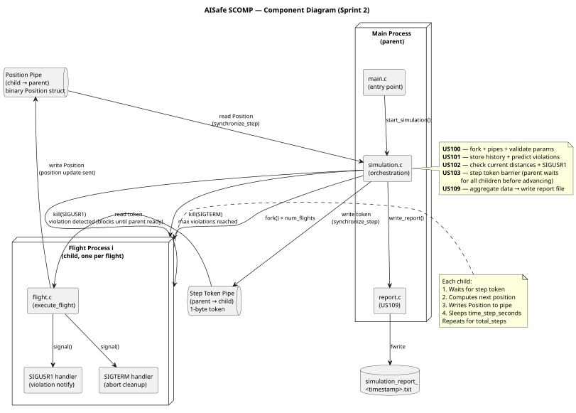

# SCOMP — Sprint 3: Flight Simulation

## How to Build and Run

```
# Compile
make

# Run the simulation (legacy mode — no flight plan file)
./simulation <num_flights> <total_steps> <time_step_sec> <safety_threshold_m> <max_violations>

# Example — 3 flights, 10 steps, 1 s per step, 50 km threshold, abort after 5 violations
./simulation 3 10 1 50000 5

# Example — force violations (flights close enough to trigger threshold)
./simulation 2 10 1 999999 5

# Run tests
make test        # US105 tests
make test107     # US107 tests
make test108     # US108 tests
make test109     # US109 tests
make test-all    # all tests at once
```

The simulation writes a timestamped report file (`simulation_report_YYYYMMDD_HHMMSS.txt`) to the working directory on completion.

---

## Component Diagram

The diagram below shows all processes, threads, shared memory segments, semaphores, signals and files involved in the simulation.



---

## Approach per User Story

### US105 — Initialise Hybrid Simulation Environment with Shared Memory
`start_simulation()` in `simulation.c` allocates a shared memory segment (`/aisafe_sim`) via `shm_open` + `ftruncate` + `mmap`. The segment holds the `SharedSimulationData` struct with per-flight positions, step counters, active flags, wind data and barrier state. Named semaphores are created for each flight (`/flight_i`, initialised to 0) and for the barrier (`/aisafe_nproc`, `/aisafe_barrier1`, `/aisafe_barrier2`). Flights are forked **before** threads are created so that `states[i].active` is populated when the SimulationController starts.

### US106 — Function-Specific Threads in the Parent Process
Four threads are created with `pthread_create`: `SimulationController`, `ViolationDetector`, `ReportGenerator` and `Environment`. Each operates independently on the shared memory. Thread synchronisation uses `pthread_mutex_t` and `pthread_cond_t`: `g_shm_mutex` protects shared memory writes, `g_report_mutex`/`g_report_cond` is the channel between ViolationDetector and ReportGenerator (US107), `g_done_mutex` protects the `g_sim_done` flag, and `g_vd_mutex`/`g_vd_cond` replaces `usleep` in the ViolationDetector with `pthread_cond_timedwait` (10 ms timeout).

### US107 — Notify Report Thread via Condition Variables
When the ViolationDetector detects a safety violation it calls `pthread_cond_signal(&g_report_cond)` while holding `g_report_mutex`. The ReportGenerator is blocked in `pthread_cond_wait` on the same condition variable and wakes immediately to log the event. When the simulation ends, the SimulationController calls `pthread_cond_broadcast` to unblock the ReportGenerator and trigger the final report write.

### US108 — Enforce Step-by-Step Simulation Synchronisation
A **two-phase turnstile barrier** (Little Book of Semaphores, §3.6) synchronises the N flight child processes at the end of each step. The three named semaphores (`/aisafe_nproc` as mutex, `/aisafe_barrier1` as Phase 1 gate, `/aisafe_barrier2` as Phase 2 gate) and the `nproc_at_barrier` counter in shared memory implement the pattern. The SimulationController does **not** participate in the barrier — it posts per-flight semaphores to start each step and polls `steps_completed[i]` with `sleep(1)` until all active flights finish. The fork-before-threads ordering ensures `states[i].active` is set before the SC starts iterating.

### US109 — Generate and Store Final Simulation Report
After all child processes exit and the simulation loop ends, the ReportGenerator thread calls `write_report()` in `report.c`. The file contains: generation timestamp, total flights, total violations, per-flight status (OK / VIOLATED / ABORTED), and full detail for each violation event (timestamp, both flight IDs, positions, velocity vectors computed from position history). A stdout summary is printed by `print_report_summary()`.

### US110 — Integrate Environmental Influences into Simulation
An `Environment` thread loads weather data from `CW_wind.csv` (falling back to `HP_wind.csv`) via `weather_load_csv()` in `weather.c`. At each step it reads `steps_completed[i]` from shared memory to determine the current simulation step, then calls `weather_lookup(lat, lon, alt_ft)` for each active flight's current position and writes the result into `shm->wind[flight_id]`. Each flight process reads `shm->wind[flight_id]` inside `advance_physics()` and applies the wind displacement to its latitude and longitude. Wind is per-flight — different flights in different geographic zones receive different wind vectors.

---

## What Was and Was Not Implemented

| US | Status | Notes |
|---|---|---|
| US105 | ✅ Implemented | `shm_open`, `mmap`, named semaphores, forks before threads |
| US106 | ✅ Implemented | 4 threads: SC, VD, RG, ENV; mutex + condition variables throughout |
| US107 | ✅ Implemented | `pthread_cond_signal` VD→RG on violation; `pthread_cond_broadcast` on sim done |
| US108 | ✅ Implemented | Two-phase turnstile barrier among N child processes; SC polls externally |
| US109 | ✅ Implemented | Timestamped report file with violations, positions, velocity vectors, PASS/FAIL |
| US110 | ✅ Implemented | Per-flight wind lookup each step from CSV; applied in `advance_physics()` |

**Known limitations:**

- The weather CSV (`CW_wind.csv`) covers altitudes up to 15 000 ft. Flights in cruise phase (~35 000 ft) operate above this ceiling and receive calm conditions. The lookup mechanism is correct and would work with higher-altitude data.
- The ENV thread and the SC are not barrier-synchronised with each other — wind data may be written slightly before or after the exact step boundary. This does not affect correctness since wind changes are gradual.
- `nproc_at_barrier` is reset naturally by Phase 2 of the barrier; no manual reset is needed between steps.
- The early-exit path in `execute_flight()` decrements `num_active_flights` inside `sem_nproc` and posts `sem_barrier1` (and `sem_barrier2` if it was the last active flight) to prevent deadlock when a flight terminates before completing the barrier.

---

## Group Contribution

| Student | Contribution (%) |
|---------|------------------|
| 1201020 | 20%              |
| 1230993 | 20%              |
| 1240654 | 20%              |
| 1240657 | 20%              |
| 1240676 | 20%              |